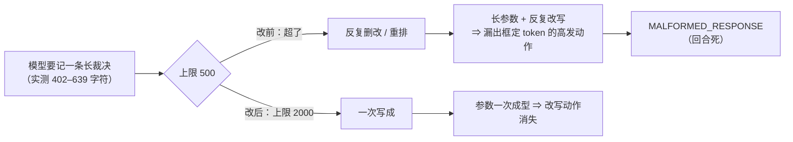

# 设计档 · `team_link_team_append` 的长文本压力（dsh-team-link 批 F）

> **状态**：**已实施**（2026-10-11 立项；用户原话「F 先做甲」；FR-4 由用户同日原话「保留，实施」拍板）。配对需求档 `docs/2026-10-11-append-longtext-requirements.md`。
> 章节口径＝全局 `~/.dsh/AGENTS.md` 第四节；**文字与图冲突时以文字为准并修图**。
> ★ 本档同样遵守批 E 立的纪律：**不逐字写出那个框定 token**（用码点描述）。
> ★ **实施状态（2026-10-11 落码，as-of）**：FR-1…FR-5 已按本档落码（`lib/index.js` / `host-half.test.mjs` / `README.md` / `CHANGELOG.md`）
> ＋ **20** 条新判据与 **7** 处改写（`host-half.test.mjs` 的「批 F」块，套件期望值 `1570 = 1550 + 20`，实测读数由宿主回填）；
> **FR-6（U6 真机复测）未做**（属父侧，需 ≥7 天 或 ≥20 次调用的观测窗口）。落码后的**实测落点**（符号为准，行号 as-of 本次落码）：
> `lib/index.js:4103`（`BLACKBOARD_LINE_LIMIT = 2000`）· `:153`（`TASKS_TAIL_DISPLAY_CHARS = 300`）· `:158`（`forDisplay`）·
> `:12877`（状态卡第 ⑥ 段）· `:13300`（客户端面板 `payload.tasksTail.lines`）· `__testing` 新增两键（`forDisplay` / `TASKS_TAIL_DISPLAY_CHARS`）。
> 证据账本见 [`docs/verification-log.md`](verification-log.md) 的「2026-10-11 批 F」一节。

---

## §0 给用户：三句话 + 一张图 + 一个「甲带来的必然后果」

### 0.1 三句话

1. **修什么**：把黑板单行的上限从 **500** 提到 **2000** 字符 —— 让模型**不必再为"塞不下"反复删改**。
2. **为什么值得修**：29 次流级失败里 **15 次（52%）** 出在这个工具上；而失败前的模型思考逐字是
   *"Need to trim the text to 500 characters or less."* —— **"删改"这个动作本身就是漏出框定 token 的高发动作**。
3. **建议怎么办**：**只改一个常量 + 把"描述面"和"判据面"跟着改准**（不改接口、不改账本形态）。
   取值 **2000**：失败样本实测长度 402–639 字符 ⇒ 2000 是观测最大值的 **约 3 倍余量**，同时仍然是"有界单行"。

### 0.2 一张图：改前为什么高危、改后压力去哪了



### 0.3 甲的一个**必然后果**：长行会撑大**两处**显示面（★ 已拍板：保留 FR-4）

黑板的 **tasks 行会被两处显示面渲染出来**（父侧 2026-10-11 实测）：

| # | 显示面 | 落点 | 现状 |
| --- | --- | --- | --- |
| ① | `team_link_status` 第 ⑥ 段（台账尾） | `lib/index.js:12826-12833` | 直接拼整行 ⇒ 上限提到 2000 后最长 4 倍于今天 |
| ② | **客户端团队面板的 payload** | `lib/index.js:13242-13257`（`payload.tasksTail.lines.push("    " + row)`） | **同样直拼** ⇒ 同一问题。★ 评审 🔵#10② 点名，**父侧已复核为真** |

**我的处理（FR-4，两处一起）**：**只对显示做截断**（超长行显示前 **300** 码点 + 省略标记），
**盘上内容与 `team_link_team_read` 的返回一字不动** —— 读面保真度不受影响。
**代价**：界面上看到的是摘要而非全文（要看全文用 `team_read`）。

★ **这一条超出需求档既定范围**（评审 🔵#7）：**已拍板 —— 用户 2026-10-11 原话「保留，实施」⇒ 保留 FR-4**（两处显示面都按码点截断）。

---

> ★ **行号 as-of（评审 🟡#2，抄批 E 先例）**：本档引用的 `lib/index.js` / `host-half.test.mjs` 行号以 **2026-10-11 工作树**
> （`be7d5f0` 之后的未提交态；批 E 已落码）为 as-of。**实施时按符号名定位**：
> `BLACKBOARD_LINE_LIMIT` · `TASKS_PROJECTION_SCAN` · `readStatusTasksTail` · `team_link_team_append` 的 `description` ·
> `payload.tasksTail` · 以及测试里的 `§9 U4` / `§9 U14` / `批 E · U1` 块。**行号只作线索，对不上以符号为准。**

---

## §1 背景

用户 2026-10-11 报告「每次用发团队消息时都有几率失败」。父侧取证（见批 E 设计档 §2）确认：
**15/29 次失败发生在 `team_link_team_append`**，且失败前的大脑活动逐字显示它在**为 500 字上限做文本手术**。
用户同日拍板「F 先做甲」。

## §2 问题

### 2.1 现象

- 该工具是**全队最常用的"记账"动作**，也是**最容易把会话搞死的那一个**（52% 的失败份额）。
- 失败样本的参数长度：**402 / 429 / 500 / 501 / 542 / 576 / 592 / 637 / 639** 字符（9 个可直接读长度的样本）。

### 2.2 根因（带证据）

| # | 证据 | 出处 |
| --- | --- | --- |
| ① | 上限是一个常量：`const BLACKBOARD_LINE_LIMIT = 500;` | `lib/index.js:3945` |
| ② | 失败前模型思考逐字：`Need to trim the text to 500 characters or less.` | 失败样本的 `assistant/attempt` 流 |
| ③ | 15 次失败全部带框定 token，JSON 断点固定在 `position 24` | 批 E 设计档 §2.2 |
| ④ | 模型的自然表达长度（402–639）**普遍贴着或超过上限** | 上表 |

⇒ **上限把"自然表达"变成了"反复删改"**，而删改正是高发动作。

## §3 目标

### 3.1 做完之后什么变了

1. 协调者记一条 **600–2000 字**的裁决：**一次写成**（US-F1）；
2. 读面**逐字不变**：`team_link_team_read` 的末 20 条格式、seq 单调、单行 = 一条（US-F2 / NF-4）；
3. 状态卡**不被长行撑大**（FR-4）；
4. 复测口径可算：同一套扫描脚本重跑，该工具的失败次数与基线（15）对照（US-F4）。

### 3.2 非目标

见需求档 §三 NF-1…NF-4。要点：**不做批 E 的消毒**（已单独立项）；**不修触发层**；**不拆多次调用**（备选丙被否决：调用次数 = 暴露次数）；**不改读取格式**。

## §4 决策与理由

### 4.1 选定：**甲 —— 上限 500 → 2000**

- **取值依据**：观测最大 639 ⇒ 2000 给出约 3 倍余量；同时仍在"单行人读得下去"的量级（一屏内）。
- **为什么不是更大**：上限的**存在意义**是"单行可读 + 有界"；无上限等于把 `line` 变成自由段落，读面与盘上形态都会失控。
- **为什么不是 1000**：观测里已有 637/639 两例贴着 500，若只翻一倍到 1000，**长裁决仍会贴顶**，删改动作只是概率下降而非消失。

### 4.2 选定：**描述面与判据面同批改准**（批 D 的教训）

- 模型可见描述里写着「单行 500 字符上限」（`lib/index.js:5968` 的 `description` 与参数说明）⇒ **不同批改就是"描述与实现不一致"**（AGENTS.md 引用文档卫生第 5 条）。
- 既有判据把 500 钉死（`host-half.test.mjs` 的 `§9 U14` 块与 `§9 U4` 块，**落码后实测共 7 条**：`:2471`·`:2473`·`:2502`·`:2574`·`:2578`·`:2796`·`:2804`）⇒ **改写而不是删除**，逐条留痕。
  ★ 分歧审计 D1（2026-10-11）更正：本行原只列 5 处，FR-3 原写「共 6 处」并**漏了 `§9 U14`** —— 实测是 7 条（账本 `:3601` 的 FR-3 署名列早已是 7 个行号，档与账本自相矛盾那处已随本次同步修正）。

### 4.3 被否决备选（记录在案）

| 备选 | 否决理由 |
| --- | --- |
| **乙（接受超长输入 + 插件自动折行）** | 动的是**账本契约**（"一条一行"的假设、末 20 条计数、`discipline` 的全量替换语义）⇒ 应单独立项。**触发条件见 §9** |
| **丙（把一次记账拆成多次短调用）** | **调用次数 = 暴露次数**：把 1 次长调用拆成 4 次短调用是把风险乘以 4，方向反了 |

## §5 方案（FR-x）

| FR | 交付单元 | 落点 | 验收 |
| --- | --- | --- | --- |
| **FR-1** | 常量 500 → **2000**（并改它的注释，写明取值依据；并注明**与另两个同名 500/2000 无关**，见 §6.1） | `lib/index.js:4066`（as-of 2026-10-11 工作树；**按符号 `BLACKBOARD_LINE_LIMIT` 定位**） | U1 / U2 |
| **FR-2** | **模型可见描述面同批改准**：`team_link_team_append` 的 `description`（`:6091`）、`line` 参数说明、`discipline` 的说明里所有「500」⇒「2000」 | `lib/index.js:6091` 起与该工具的 params | U3 |
| **FR-3** | **判据改写 ＋ 全库同改**（★ 评审 🟡#3 重写；★ 分歧审计 D1 更正计数）：① 把 `host-half.test.mjs` 里钉 500 的断言改成钉 **2000**（**保留原名与原意图**，见批 D §5.2 纪律），**落码后实测共 7 条**（原名锚仍逐字可 grep）：`§9 U14` 族 —— `:2471`（decisions 上限拒绝）· `:2473`（含「恰 500 收」）· `:2502`（discipline 逐行上限）· `:2796`/`:2804`（回执行期望串）；`§9 U4` 族 —— `:2574`/`:2578`（tasks 上限块，原名锚在 `:2570-2572`）；**＋ 批 E 的修复轮判据**（`host-half.test.mjs:11920-11939` 的「原文 ≤ 上限、[BARS] 消毒后越限」红相夹具 —— 它按 `beLineLimit` **现造**、自动改瞄 2000，已正确处置）；② **全库 grep `500` 并逐处判「改 / 不改」**（批 7 教训②：改约定必须检索**所有**出现点）。**明确不改的**：`TASKS_PROJECTION_SCAN = 500`（派生读数的**扫描窗口**，落码后 `lib/index.js:4115`）· `res.writeHead(500, …)`（HTTP 状态码，落码后 `:13531`）· `team_link_send` 正文的 2000/2001 边界（另一机制，含 `SEND_MESSAGE_HEAD_CHARS = 1500`）；③ 描述面里的「500」（`lib/index.js` 的 `description`、回执文案、`README.md` 的「≤ 500 码点」）同批改准；④ **新增**一条「曾经的失败样本长度（639 码点）现在必须被接受」 | 见左（含**必须改**与**必须不改**两张清单） | U2 / U3 / U4 |
| **FR-4** | **台账行的显示截断（★ 超出需求档范围，**已拍板：保留** —— 评审 🔵#7；用户 2026-10-11 原话「保留，实施」）**：**两处**显示面共用同一截断（按**码点**取前 300 + 省略标记）—— ① `team_link_status` 第 ⑥ 段 ② **客户端面板 payload**；**盘上与 `team_link_team_read` 一字不动** | `lib/index.js:12826-12833`（状态卡）· `:13242-13257`（面板 payload） | U5 |
| **FR-5** | **文档与变更史**：README / CHANGELOG / 验证账本 / 两份本批档 | 同名四档 | 文档纪律 |
| **FR-6** | **复测口径**：把批 E 取证目录里的 `tally-malformed.mjs` 重跑（**宿主 2026-10-11 已核实在仓内**，3968 字节），与该工具有关的失败次数与基线 15 对照，读数落账本 | `.investigations/token-sanitize-2026-10-11/scripts/tally-malformed.mjs` | U6（真机） |

## §6 机制伪代码（签名 + 前置 / 后置）

```js
/** §6.1 黑板单行的**码点**上限（FR-1）。
 *  前置：无。后置：> 0 的整数常量。
 *  取值依据（写在注释里，别只留数字）：失败样本实测 402–639 码点；2000 ≈ 观测最大值 ×3，
 *  同时仍是"单行可读"的量级。★ 改这个值必须同批改 §5 FR-2 的描述面与 FR-3 的判据面。 */
const BLACKBOARD_LINE_LIMIT = 2000;      // 曾为 500（2026-10-11 批 F·甲）
// ★ 评审 🔵#9：**与两个同名数值无关，改动时别混同** ——
//   · `team_link_send` 正文的 2000/2001 边界（发送正文的截断阈值，**本批不动**）；
//   · `TASKS_PROJECTION_SCAN = 500`（派生读数的**扫描窗口**，**本批不动**；宿主实测它在 `lib/index.js:4078`）。
//   本批只改**黑板单行的写入上限**这一个常量。

/** §6.2 台账行的**显示**截断（FR-4：状态卡第 ⑥ 段 与 客户端面板 payload **两处共用**）。
 *  前置：line 是盘上的原始行（可能很长）。后置：**只影响显示** ——
 *  盘上文件与 team_link_team_read 的返回一字不动（读面保真优先）。
 *  ★ 评审 🟡#5：按**码点**截断（`[...s]`），不用 UTF-16 码元（`s.length` / `s.slice`）——
 *    后者会把代理对切成两半，与本仓「astral 切点无半截代理项」的既有红线相抵
 *    （批 E 的 `repairSurrogates` 同源，见 `docs/verification-log.md` 的批 E 宿主回执节）。 */
const TASKS_TAIL_DISPLAY_CHARS = 300;                 // 单位：**码点**
function forDisplay(line) {
  const s = String(line);
  const points = [...s];
  return points.length <= TASKS_TAIL_DISPLAY_CHARS
    ? s
    : `${points.slice(0, TASKS_TAIL_DISPLAY_CHARS).join("")}…（已截断，全文见 team_link_team_read）`;
}
```

## §7 状态与 schema

| 面 | 改前 | 改后 |
| --- | --- | --- |
| 持久化字段 / 文件形态 | 单行 = 一条，`seq \| ISO \| author \| kind \| task \| 正文` | **零变更**（只是单行可以更长） |
| 常量 | `BLACKBOARD_LINE_LIMIT = 500` | = **2000**（as-of 落点 `lib/index.js:4103`） |
| 显示常量 | — | 新增 `TASKS_TAIL_DISPLAY_CHARS = 300`（**无持久化**；as-of 落点 `lib/index.js:153`，显示函数 `:158`） |
| 判据面 | — | `__testing` 新增两键：`forDisplay`（真函数本身）与 `TASKS_TAIL_DISPLAY_CHARS` —— **判据读真函数、不另抄一份实现**。★ 分歧审计 D4 更正：原写「判据不把省略标记或 300 抄进套件」，与实现字面冲突（`host-half.test.mjs` 的 `bfCap === 300` 确实钉了 300）—— 实情是**双锁**（先读出常量、再钉一次它的值），比「只读不钉」**更严**，措辞已按实情改准 |
| 读面 | `team_link_team_read` 返回原文 | **不变**（保真） |
| 状态卡 ⑥ **与** 客户端面板 payload | **两处**都显示原文 | **两处都按码点截断显示**（FR-4；盘上与 `team_link_team_read` 一字不动） |

## §8 防偏离（怎么被机械验证）

| # | 判据 | 红相构造 | 落点 |
| --- | --- | --- | --- |
| **U1** | **2000 收、2001 拒**（★ 评审 🟡#4：数字按**消毒后**的码点数判）：**干净**输入恰 2000 码点被接受（`已追加 decisions #N`）；2001 被拒且**什么都没写**（拒绝文案里的数字是 2000）。带毒输入沿用批 E 的顺序（**先消毒、再判长度**） | 常量改回 500 ⇒ 600 字样本被拒 ⇒ 红 | `host-half.test.mjs` |
| **U2** | **曾经的失败样本现在能过**：把取证里那条 **639 码点**的样本逐字喂进去 ⇒ 接受；且读回来**逐字相同**（含末尾） | 不改常量 ⇒ 红 | `host-half.test.mjs` |
| **U3** | **描述面与实现一致**：`team_link_team_append` 的 `description` 与 `line` 参数说明里**不含「500」**、含「2000」；`discipline` 说明同理 | 只改常量不改描述 ⇒ 红（文案比对） | `host-half.test.mjs` |
| **U4** | **判据改写留痕（可机械化的那半 —— 评审 🔵#6）**：**7 处**原 500 断言的**原名锚仍可 grep 到**（断言文本或紧邻注释里留着 `§9 U4` / `§9 U14` / 批 E · U1 ⑦ 等原名；锚标记另计），且交付报告逐条列「原名 ⇒ 新名 ⇒ 保留意图」。★ 交付评审 #1 更正：本行原写「6 处」，与 §4.2 / §5-FR-3 的 7 条不一致 —— 已同改 | 删掉任一段**独占的**原名锚注释、或改了名 ⇒ 红（grep 判据；`§9 U14` 两枚由**未改名的活断言**自持，见交付评审 #3） | `host-half.test.mjs` |
| **U5** | **显示截断只影响显示**：盘上那条 tasks 行 **逐字节**等于写入内容（未截断）；`team_read` 返回的也等于全文；只有**状态卡**里出现省略标记 | 在写入路径截断 ⇒ 盘上变短 ⇒ 红 | `host-half.test.mjs` |
| **U6** | **真机复测（可证伪；★ 评审 🟡#1 定的数值与窗口）**：按同口径重跑 `.investigations/token-sanitize-2026-10-11/scripts/tally-malformed.mjs`（**宿主已核实该脚本在仓内**，3968 字节）。**观测窗口**：自本批落码之日起 **≥7 天** 或 该工具累计 **≥20 次调用**（先到为准）。**判据**：窗口内该工具的 `MALFORMED_RESPONSE` **≤ 2 次**（基线 **15** 次，跨 4 工作区 11 会话累积），**且不得高于同期 `team_link_send` 的失败次数**（同阶）。读数落账本 | 未达目标 ⇒ 本方案收益被证伪（⇒ 走 §9 的乙） | 真机（父侧） |
| **U7** | **零污染对照**：把样本里超出旧上限的部分去掉（≤500）⇒ 输出与改前**逐字节相同** | 顺带改了别的行为 ⇒ 红 | `host-half.test.mjs` |

## §9 边界

| 面 | 行为 |
| --- | --- |
| **空集 / 畸形输入** | 空行、非字符串：沿用既有校验路径（本批不动） |
| **边界值（★ 评审 🟡#4）** | 恰 2000 **收**（含）；2001 拒。**长度按「消毒后」的码点数判** —— 沿用批 E 确立的顺序（先消毒、再判长度；占位符比原 token 长）；**干净输入下两读数等价**，带毒输入下按消毒后算（与描述面宣传的「原文 2000」在带毒时**有意分叉**：宁可拒一条，也不放过「落盘即超限」的行） |
| **并发** | 常量为只读值；append 的既有单写落点不变 |
| **重启 / 升级** | 无新依赖 |
| **失败方向** | 沿用既有：**拒绝时什么都不写**（fail-closed 于写入面） |
| **历史数据** | 盘上已有的行**不追溯**；> 500 的旧行本就不存在（旧上限拒过） |
| **★ 乙的触发条件** | 若 **U6 的复测**显示该工具失败次数**未降到与其它工具同阶** ⇒ 根因在「长参数本身」而非「卡上限」⇒ **按新证据重新立项**（不本批追加） |
