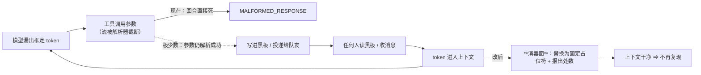

# 设计档 · 框定 token 消毒面（dsh-team-link 批 E）

> **状态**：待用户确认（2026-10-11 立项，用户原话「建议二立项」）。配对需求档 `docs/2026-10-11-token-sanitize-requirements.md`。
> 章节口径＝全局 `~/.dsh/AGENTS.md` 第四节；**文字与图冲突时以文字为准并修图**。
> ★ **本档全文不写出那个原串**：一律用码点描述。这不是排版洁癖 —— 逐字写它本身就会提高**写档这一动作**被判 `MALFORMED_RESPONSE` 的概率（父侧 2026-10-11 因此自伤**三次**；本档原写「两次」，评审 🟡#8 指出与 `AGENTS.md` §四 的口径不一致，已统一为三次）。
> ★ **实施状态（v1.1，2026-10-11 落码）**：FR-1…FR-7 已按本档落码（`lib/index.js`）＋ **37** 条判据（33 条交付面 ＋ 交付评审修复轮 4 条；`host-half.test.mjs` 的「批 E」块）。★ 评审 🟡#5（第 3 轮）更正：原写 **33** —— 修复轮新增了 4 条（上界复检两档 ＋ scrub 拒写两条），套件自报 `1550 = 1513 + 37`。
> §6.5 的 v1.1 改动是本批实施中发现的**硬约束**逼出来的（`host-half.test.mjs:7221` 的导入面白名单：**新增任何 import 都判红**）——
> 处数改为**由文本自带**（占位符带编号），于是**不新增 import、不加累加器、不需要执行上下文**；那条 `AsyncLocalStorage` 支路已整条撤掉。

---

## §0 给用户：三句话 + 一张图 + 两个待拍板项

### 0.1 三句话

1. **修什么**：让那个框定 token **不再经过本插件的任何出口/入口** —— 工具结果、跨会话投递正文、摘要与告警、状态卡、提示词段，以及黑板的落盘。
2. **为什么值得修**：它**碰到一次就留在对话里**，模型会接着复现 ⇒ **越撞越死**（实测连死 4 个回合）。而它**进黑板的唯一通路**就是本插件的工具 ⇒ 堵住这里，全队就不会被"再喂一次"。
3. **建议怎么办**：**一处实现**（一个消毒函数）＋**挂在既有收口点上**（工具结果走 `wellFormed*` 三个函数，覆盖全部 10 个工具）；**替换而不拒绝**，且**如实报出替换了几处**。

### 0.2 一张图：它现在怎么传播，改完怎么断



### 0.3 已拍板（用户 2026-10-11 原话：「E 按 b + [framing-token-removed]，F 先做甲」）

| # | 项 | **选定** | 理由（取证） | 代价（如实） |
| --- | --- | --- | --- | --- |
| **①** | 匹配范围 | **(b) 认整个包裹结构**：全角竖线（U+FF5C）×2 包夹 `[A-Za-z_]{0,20}`，并吞掉紧邻的前导 `<` `/` | 取证里除实测那一个词外**还抓到 1 处 `parameter`** ⇒ 这是 token **族**；只认一个词，下次换词就漏 | 会命中任何「两竖线夹词」的写法 —— 人写中文几乎不会这么写，但**理论上**比 (a) 激进 |
| **②** | 占位符文本 | **`[framing-token-removed]`** | 纯 ASCII、与原 token 无关（NF-5 禁止「长得像」的占位符）；一眼看懂发生了什么 | 黑板上会留下这一串 |

**未采纳项（记录在案）**：**(a) 只认单个词** —— 被取证里的 `parameter` 一例**否证**（换一个词就漏）。

---

## §1 背景

用户 2026-10-11 报告：`dsh://session/team-link-bac-1009-coordinator-40301798`「每次用发团队消息时都有几率失败」。
父侧取证后确认这是 **DeepSeek 框定 token 漏进工具参数**导致的流级故障，并**当场在父侧会话复现两次**（两次的前一步，工具输出里都逐字含有那个 token）。
本批只做**我们这一层**（传播面消毒）；触发层在流式解析器里，另出观测报告（NF-1）。

## §2 问题

### 2.1 现象与量级

跨 4 个工作区（bounded-agent-core / mal-analyze-cli / threat-intel / 本仓）共 **11 个会话、29 次** `MALFORMED_RESPONSE`（错误逐字：`DeepSeek Messages stream: tool input is invalid JSON`）。

| 失败时正在调的工具 | 次数 | 其中参数里带 token |
| --- | --- | --- |
| `team_link_team_append` | **15** | **15 / 15（100%）** |
| （回溯未抓到 attempt，未归因） | 7 | — |
| `validate_dsh_ui` | 5 | — |
| `team_link_send` | 1 | — |
| `eng_coder` | 1 | — |

### 2.2 字符级根因（逐字证据，非推测）

15 次 `team_link_team_append` 的失败参数，JSON 断在**同一位置**：
`Expected ':' after property name in JSON at position 24 (line 1 column 25)` —— 断点正是替入 token 之处。
坏串形态（码点表示）：`{ "decisions` `U+003C` `U+002F` `U+FF5C` `U+FF5C` `DSML` `U+FF5C` `U+FF5C` `: "` `★S8 第 1 步失败…`
—— 注意：**`file` 的值正常写成了 `decisions`，紧跟其后就冒出框定 token，再往后才是 `line` 的值**。
⇒ 模型是在**第一个属性边界处**漏出了框定 token，解析器据此判定"参数到此为止"，后续内容成了非法 JSON。

### 2.3 形态枚举（决定 §4 的匹配范围）

对 `assistant/attempt` 的原始流做码点统计（匹配式由码点拼出，见 §6）：

| 形态 | 次数 |
| --- | --- |
| 全角竖线×2 + `DSML` + 全角竖线×2 | 40 |
| 全角竖线×2（其后是标点，属**流切分**把同一 token 拆成多段） | 39 |
| 全角竖线×2 + `parameter` + 全角竖线×2 | 1 |

⇒ **这是 token 族，不是单个词**（`parameter` 一例说明包裹里的词会变）。

### 2.4 自传播（为什么"有几率"却越撞越死）

11 个有失败的会话，**11 个的上下文里都含该 token**（共 **69 条已入库的 `assistant/message`** ＋ 2 条 `tool/result`）。
⇒ 模型看得见自己上一轮的产物 ⇒ 复现 ⇒ 再死。实测：某会话 turn **51→54 连死 4 次**。
**本插件在这条回路里的角色**：黑板是"全队共享、反复被读"的载体 ⇒ **一旦 token 落进黑板，全队每次读都会被再喂一次**。

## §3 目标

### 3.1 做完之后什么变了

1. 黑板落盘文件里**不含** token（US-E1）；
2. 10 个工具的返回文本里**不含** token（US-E2）；
3. 跨会话投递的**正文**里不含（US-E3）；
4. 提示词面（角色段 / 资源行上下文）里不含（US-E4）；
5. 替换**不静默（v1.1 口径）**：**文本里看得见占位符**（多处时带 `i/N` 编号）—— **回执不另加读数行**，故也不存在「没替换时那句话」；没替换 ⇒ 输出逐字与改前相同（US-E5）。★ 评审 🔴#1 更正：原写「报出替换处数；没替换时不出现那句话」，是 v1.0 通道（回执报数）的残句
6. 实现**只有一处**，且**源码与文档里不出现原串**（US-E6 / NFR-4）。

### 3.2 非目标

见需求档 §三（NF-1…NF-5）。特别地：**不动** `team_link_team_append` 的长度上限（那是批 F）。

## §4 决策与理由

### 4.1 选定：**替换（不拒绝）＋ 如实报数**

- **为什么不是拒绝**：黑板是"谁声称了什么"的账本，一次拒绝会让调用方反复重试（而重试正是毒上加毒的动作）；投递面拒绝还会让消息丢失。
- **为什么不是静默替换**：需求档 US-E5 / 文档纪律要求"改了要说"。

### 4.2 选定：认**整个包裹结构**（不是单个词）

- 依据 §2.3：`parameter` 的存在证明这是**族**。匹配式＝全角竖线×2 ＋ `[A-Za-z_]{0,20}` ＋ 全角竖线×2，**并可吞掉紧邻的前导 `<` `/`**（实测坏串里它在 `<` `/` 之后）。
- **被否决备选**：只认 `DSML` ⇒ 换一个词就漏（一次取证就抓到了反例）；认所有全角竖线 ⇒ 会伤到正文里正当的 `｜`（表格/数学记号），过度。

### 4.3 选定：**一处实现 + 挂既有收口点**

- 工具结果已有三个收口：`wellFormed`（`lib/index.js:476`）、`wellFormedContent`（`:483`）、`wellFormedText`（`:7434`）⇒ 消毒挂在它们即可覆盖 **10 个工具**。
- 其余文本面逐个点名（§5 表），**不新造框架**。

### 4.4 选定：占位符 `[framing-token-removed]`

- 纯 ASCII、与原 token 无关（NF-5 禁止"长得像"的占位符）。**用户 2026-10-11 已拍板**（§0.3 ②）。

## §5 方案（FR-x）

| FR | 交付单元 | 落点 | 验收 |
| --- | --- | --- | --- |
| **FR-1** | **一个消毒函数** `stripFramingTokens(text) -> { text, removed }`：匹配式由**码点拼出**（源码里没有原串）；失败时**原样返回** | `lib/index.js` 新增，紧邻既有的 `wellFormed*` | U5 / U6 / U7 / U8 |
| **FR-2** | **工具结果收口**：`wellFormed` / `wellFormedContent` / `wellFormedText` 三处调用消毒；**处数由文本自身呈现**（v1.1：占位符带编号 `[framing-token-removed 1/N]`，见 §6.5 —— **不改回执、不加累加器、不新增 import**） | `lib/index.js:476` / `:483` / `:7434` | U2 / U5 |
| **FR-3** | **跨会话投递正文**：`team_link_send` 组装的 banner 与正文过消毒 | `lib/index.js` 的 send 组装点 | U3 |
| **FR-4** | **提示词与摘要面**：`renderRoleText`（`:3294`）· `renderResourceContext`（`:3347`）· `renderResourceLine`（`:3210`）· `tickMessage`（`:2642`）· `renderWatchdogDigest`（`:2726`）· `watchdogLines`（`:4393`）六个渲染函数出口过消毒 | 同上 | U4 |
| **FR-5** | **黑板落盘前消毒**：`team_link_team_append` 写入 decisions / tasks / discipline 之前过消毒 ⇒ **盘上永不出现** | `lib/index.js:5967` 起的 append 路径 | U1 |
| **FR-6** | **文档与变更史**（评审 🔵#7 修订：清单**六处**，与「六档」同数）：① README ② CHANGELOG ③ 本档 ④ 需求档 ⑤ 验证账本 ⑥ **`AGENTS.md` 新增一条纪律**（源码与文档里**不得逐字写出该 token**，构造它必须用码点） | 六处（同上） | NFR-4 / U8 |
| **FR-7** | **deep-link 快照出口**（评审 🟡#3 补入）：本插件把用户粘贴的 `dsh://session/<id>` 内容**注入收件人上下文**（`registerDeepLinks`，`lib/index.js:360` 起）⇒ 源会话被污染时快照会搬运 token。**纳入消毒面** | `registerDeepLinks` 的快照组装点 | U10 |

> ★ **行号 as-of（评审 🔵#9）**：本档引用的 `lib/index.js:NNN` 行号以 **commit `2c76002`**（2026-10-11）为 as-of。
> 实施前 `eng_coder` 应**按符号名定位**（`wellFormed` / `wellFormedContent` / `wellFormedText` / `renderRoleText` / `renderResourceContext` /
> `renderResourceLine` / `tickMessage` / `renderWatchdogDigest` / `watchdogLines` / `registerDeepLinks`），**行号只作线索**；
> 若行号与符号对不上，**以符号为准**并在交付报告里记一句。

## §6 机制伪代码（签名 + 前置 / 后置）

```js
// §6.1 ★ 纪律：原串绝不逐字出现 —— 用码点拼。
// ★ 评审 🟡#1 修订：**包裹结构本身即可命中**（前导 `<`/`</` 是**可选前缀**，不是必需）——
//   原写法 `</?…` 把 `<` 写成了必需，会漏掉「无前缀的裸包裹」（§2.3 形态表里那 40 例就是裸包裹）。
const FULLWIDTH_BAR = "\uFF5C";                    // 全角竖线（不是 ASCII 的 |）
const WRAP = FULLWIDTH_BAR + FULLWIDTH_BAR;        // 包裹结构的两侧
const FRAMING_RE = new RegExp(`(?:</?)?${WRAP}[A-Za-z_]{0,20}${WRAP}`, "gu");
const PLACEHOLDER = "[framing-token-removed]";

/** §6.2 消毒（终稿形状）。前置：text 可为任意值。后置：返回 { text, removed }。
 *  · removed = 0 ⇒ text **逐字节等于**入参（NFR-2 / U6 的前提）
 *  · **本函数不自包 try** —— 它只用 JS 原生正则与码点，结构上不会抛；try/catch 见 §6.2b
 *  落码处另有一层编号（`framingPlaceholderAt`），此处按 §6.5 v1.1 的口径展开。 */
function stripFramingTokens(text) {
  if (typeof text !== "string" || text === "") return { text, removed: 0 };
  const hits = [...text.matchAll(FRAMING_RE)].length;
  if (hits === 0) return { text, removed: 0 };                 // ★ 不经过 replace ⇒ 逐字节等于入参
  let index = 0;
  const out = text.replace(FRAMING_RE, () => {
    index += 1;
    return hits === 1 ? PLACEHOLDER : `${PLACEHOLDER.slice(0, -1)} ${index}/${hits}]`;
  });
  return { text: out, removed: hits };
}

/** §6.2b ★★ v1.1 落码修正（分歧审计 #8）：**fail-open 落在缝上，不在 `stripFramingTokens` 里**。
 *  · 原写法（§6.2 的**旧版**：try/catch 包在 `stripFramingTokens` 内部 —— 已由本次同步改掉）
 *    接不住 U7 的桩：U7 往注入缝 `stripImpl` 里塞的是一个**必抛**的函数，抛出点根本不在
 *    `stripFramingTokens` 里（那时它根本不是被调用的那个实现）⇒ 按旧版字面实现，U7 必红。
 *  · 落码形状：`stripFramingTokens` **不自包 try**（它只用 JS 原生正则与码点，结构上不会抛 ——
 *    §9「重启 / 升级」一行），try/catch 上移到**调用点唯一经过的那一层** `sanitizeFraming`；
 *    它同时把「实现抛错」与「实现返回畸形值（`undefined` / 非字符串 `text` / `removed<=0`）」
 *    折成同一档 fail-open：**原样返回、removed=0**。生产路径永远解析到 `stripFramingTokens`。 */
let stripImpl = stripFramingTokens;

function sanitizeFraming(text) {
  try {
    const result = stripImpl(text);
    return result !== null && typeof result === "object" && typeof result.text === "string" && result.removed > 0
      ? { text: result.text, removed: result.removed }
      : { text, removed: 0 };
  } catch {
    return { text, removed: 0 };                                 // fail-open（NFR-3 / U7）
  }
}

/** §6.3 工具结果收口（FR-2）：既有三个 wellFormed 家族各加一行。
 *  前置：value 是即将返回给模型的文本/内容。后置：返回值不含 token；有替换时文本里看得见编号占位符。
 *  ★ 调用的是 §6.2b 的 `sanitizeFraming`（**不是** `stripFramingTokens`）—— 收口点必须经由缝，
 *    否则 U7 的必抛桩与 §6.5 的注入缝对这三个出口都不生效。 */
function wellFormed(value) { … const s = sanitizeFraming(repairSurrogates(value)); return s.text; … }   // 语义与签名不变

/** §6.4 黑板落盘（FR-5）。前置：line 已过既有校验。后置：**写盘的那一份**已消毒。 */
const clean = sanitizeFraming(line);
await appendLine(file, clean.text);            // 注意：写干净的那份（处数由文本里的占位符自证，见 §6.5 v1.1；回执**不**额外加行）

/** §6.5 v1.1 ★ 替换处数的**通道**与**注入缝** —— 因**硬约束**改写（2026-10-11 实施中断后发现）。
 *  ★ 硬约束原文：`host-half.test.mjs:7221` 把 `lib/index.js` 的导入面钉成「**八个已审计模块**」的白名单
 *    （`sameJson(importList, HOST_IMPORTS) && importList.every(…)`）⇒ **任何新增 import 都判红**。
 *    （实证：半成品因加 `node:async_hooks` 而挂出 1 条红。）
 *  ⇒ **通道改成「写进文本本身」**：占位符**带编号** —— 命中 1 处仍是 `[framing-token-removed]`，
 *    多于 1 处则 `[framing-token-removed 1/N]`、`[… 2/N]`…
 *    ⇒ **不需要累加器、不需要执行上下文、不需要回执多写一行**；
 *      U5 的「无替换 ⇒ 回执逐字与改前相同」因此**结构性成立**，而不是靠判断。
 *  · 注入缝**保留**（零导入成本）：`let stripImpl = stripFramingTokens;` ＋ `__testing.setStripImpl(fn)`，
 *    供 U7 塞「必抛」的桩。**★ 缝由 `sanitizeFraming` 读**（§6.2b）—— 所以判据要观测缝，
 *    必须走**生产收口路径**（工具 `output.render` / 渲染函数），直调 `stripFramingTokens` 观测不到。
 *  · **删除** AsyncLocalStorage / 执行上下文累加器那条路（它需要新 import）。 */
function stripFramingTokens(text) {                                        // 终稿：不自包 try（见 §6.2b）
  if (typeof text !== "string" || text === "") return { text, removed: 0 };
  const hits = [...text.matchAll(FRAMING_RE)];
  if (hits.length === 0) return { text, removed: 0 };        // ★ removed=0 ⇒ text 逐字节等于入参
  let i = 0;
  const out = text.replace(FRAMING_RE, () => {
    i += 1;
    return hits.length === 1 ? PLACEHOLDER : `${PLACEHOLDER.slice(0, -1)} ${i}/${hits.length}]`;
  });
  return { text: out, removed: hits.length };
}
```

## §7 状态与 schema

| 面 | 改前 | 改后 |
| --- | --- | --- |
| 持久化字段 | — | **零变更**（NFR-1）；只影响写入的**字符内容** |
| 新增进程内状态 | — | **无**（纯函数） |
| 新增导出面 | — | 判据面（`__testing`，见 **`lib/index.js:13663` 起的 `__testing` 块**，行号 as-of 2026-10-11 工作树）：`tickMessage`(`:13682`) · `renderResourceLine`(`:13690`) · `renderRoleText`(`:13691`) · `renderResourceContext`(`:13692`) · `renderWatchdogDigest`(`:13708`) · `stripFramingTokens`(`:13885`) · **`watchdogLines`(`:13894`)** · **`FRAMING_PLACEHOLDER`(`:13904`)**；另有 §6.5 的**注入缝** `setStripImpl` 与只读事实源 `framingTokenPattern`（判据不自己抄一份匹配式）。★ 评审 🔵#6 更正：原格只写了 `stripFramingTokens` 一个 |

## §8 防偏离（怎么被机械验证）

| # | 判据 | 红相构造 | 落点 |
| --- | --- | --- | --- |
| **U1** | **黑板盘上零 token**：用具名夹具（码点拼出的 token）写一条 decisions ⇒ 读**磁盘文件**逐字断言不含；**处数由盘上 / 读回文本里的占位符编号自证 —— 写回执不另加读数行**。★ 评审第 2 轮 🔴#1 更正：原第二子句写「且读回执报出替换处数」，是被 v1.1 废弃的通道（且按字面不可满足：append 回执从不回显正文） | 去掉 FR-5 的消毒 ⇒ 盘上出现 ⇒ 红 | `host-half.test.mjs` |
| **U2** | **10 个工具全覆盖**：对 `team_link_recover / list_sessions / status / export / send / watch / roster / team_read / team_append / rotate` **逐个**注入带毒夹具（能让注入影响返回文本的那条路径），断言返回串不含匹配式 | 只挂其中一个 `wellFormed` ⇒ 至少一个工具红 | `host-half.test.mjs` |
| **U3** | **投递正文**：`team_link_send` 带毒正文 ⇒ 组装出的 banner 与 body 均不含 | 不挂 FR-3 ⇒ 红 | `host-half.test.mjs` |
| **U4** | **提示词面**：段渲染 / 资源行上下文 / tick / 摘要 / 状态卡看门狗段 六个函数各带毒输入 ⇒ 输出不含 | 不挂 FR-4 ⇒ 红 | `host-half.test.mjs` |
| **U5** | **不静默（v1.1 口径）**：有替换 ⇒ **文本里出现占位符**，且 **N>1 时带编号**（`… 1/N` / `… 2/N`）；**无替换 ⇒ 输出逐字节与改前相同**（结构性成立，见 §6.5） | 把编号写成固定串（每次都是 1/N）或无条件追加一句读数 ⇒ 红 | `host-half.test.mjs` |
| **U6** | **零污染对照**：夹具**不含** token 时，所有出口输出与改前**逐字节相同** | 消毒误伤普通文本 ⇒ 红 | `host-half.test.mjs`（改前快照对照） |
| **U7** | **fail-open**：令消毒内部抛错（桩）⇒ 工具**照常成功**、返回原文本 | rethrow ⇒ 工具失败 ⇒ 红 | `host-half.test.mjs` |
| **U8** | **静态零残留**（评审 🟡#4 修订：扫描面**放宽**到 FR-6 触及的**每一个**文件 ＋ 两个测试套件 ＋ 取证目录）：用码点拼出的匹配式扫 `lib/`、`host-half.test.mjs`、`client-half.test.mjs`、`docs/*.md`、**根 `README.md` / `CHANGELOG.md` / `AGENTS.md`**、`.investigations/**/*.{mjs,js,md}` ⇒ **0 命中** | 谁把原串写回源码/文档（哪怕是在写 FR-6 的文档时顺手写进去的）⇒ 红 | 交付报告须贴扫描命令与输出 |
| **U9** | **真机可证伪**：在真实会话里让一条含毒文本经 `team_link_team_append` 落盘 ⇒ 盘上无 token；再 `team_read` ⇒ **读回的那一行里看得见占位符**（处数由编号自证，**回执不另加读数行**，与 v1.1 口径一致）。★ 评审 🟡#6（第 3 轮）措辞更正：原写「回执报数」是 v1.0 残留 | 任一不成立 ⇒ 本方案证伪 | 真机（父侧） |
| **U10** | **deep-link 快照出口**（评审 🟡#3 补入，覆盖 FR-7）：令源会话内容含毒 ⇒ 粘贴 `dsh://session/<id>` 后注入的**快照文本**不含 token | 不挂 FR-7 ⇒ 红 | `host-half.test.mjs` |
| **U11** | **裸包裹也命中**（评审 🟡#1 补入）：夹具**必须**含一份**无 `<` 前缀**的裸包裹样本（§2.3 那 40 例的形态），断言被替换 —— 防止夹具全是从 §2.2 那一种形态克隆来的，把 `</?` 这类写法的缺陷**遮蔽掉** | 正则写成 `</?` ⇒ 裸包裹漏过 ⇒ 红 | `host-half.test.mjs` |

## §9 边界

| 面 | 行为 |
| --- | --- |
| **空集 / 非字符串** | `stripFramingTokens(undefined \| 数字 \| null)` ⇒ 原样返回、`removed=0`（不抛） |
| **畸形输入** | 只有半截包裹（如只有左侧两竖线）⇒ **不匹配**（宁少替不错替；下次取证若发现新形态，按 §2.3 的方法补规则） |
| **并发** | 纯函数、无共享状态 ⇒ 天然安全 |
| **重启 / 升级** | 宿主换代不影响：本函数只依赖 JS 原生正则与码点 |
| **失败方向** | **fail-open**（NFR-3）：消毒永远不能让工具调用失败 |
| **历史上已落盘的 token** | **不追溯**（NF-4）：只保证新写入与读出干净；旧账要清需另立一次人工动作 |
| **占位符本身** | 纯 ASCII、与原 token 无关 ⇒ 不会被解析器二次识别（NF-5） |
| **★ 入口面的范围（评审 🔵#6 ＋ 分歧审计 #13）** | **入口消毒只覆盖黑板**（FR-5）。其它**模型可写的持久化字段**理论上仍可能把 token 落到盘上 —— **本批不拦**，因为它们的**读回路**已被 FR-2 覆盖（读出来时会被消毒）⇒ **传播环仍然断**。⇒ **「盘上永不出现」这句话只是对黑板成立**，不得外推。<br>★ **这个枚举不是穷举**（原枚举只点了 roster 角色备注 / `recoveries` 的 note / 团队名三项 ⇒ 会被当穷举读）。**同类还有一处，本批同样不拦**：`team_link_rotate action=prepare` 且 **`successor:"auto"`** 时，由**调用方给出的正文**（`handoff`，五个硬节）经 {@link handoffDocumentPath} 写盘的**交接文档** `<workspace>/team/<name>/handoff-<role>-<YYYYMMDD-HHmmss>.md`（§11.9.6；写入路径 `lib/index.js` 的 `writeHandoffDocument`）—— 它同样是「模型可写、落盘、盘上留原串」的一处，同样**不在本批的入口消毒面内**，读回路同样被 FR-2 覆盖。⇒ 该口径一律读作「**本批覆盖的入口 = 黑板三文件（decisions / tasks / discipline）**」，其余入口按同一理由（读面消毒）**不在本批声张范围** |
| **★ 与 deep-link 的边界** | FR-7 覆盖的是「本插件注入他人内容」这一条出口；**宿主自己**把会话内容喂进上下文（如用户手动粘贴文本）不在本插件可及范围 ⇒ 归入给平台侧的观测报告（NF-1） |
