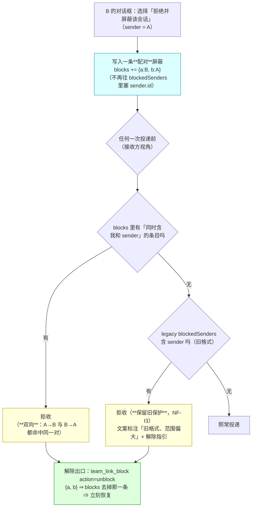

# 批 I · 屏蔽的作用域（block scope）—— 设计档

> **规格档**。需求档 [`docs/2026-10-12-block-scope-requirements.md`](2026-10-12-block-scope-requirements.md)。
> 行号一律 as-of **2026-10-12 工作树（commit `663a91f`）**，实施按**符号名**定位。
> ★ 本档全文不写出框定 token 的原串（批 E 立的仓规）；新测试标识符统一用 **`Bi` 中缀**（避免与既有顶格声明重名）。

---

## §0 三句话结论

1. **这是什么**：把屏蔽从「**部署级全局名单**」改成「**两个会话之间的一对**」（**双向**），并补上**解除出口**（工具动作 + 文案指引）。
2. **为什么**：屏蔽只按 `sender.id` 落盘（`:7800`），而策略是**一份部署级共享文件** ⇒ **别的会话也读到这一条**、按同一键判断（`:7682`）⇒ 一枚屏蔽 = **全局拉黑**；且**没有任何解除路径** ⇒ 误点之后只能手改文件 + 重启。
3. **代价**：新增一个 `blocks` 数组（三个 schema 点）＋ 一个工具面（`team_link_block`）＋ 两处文案；**旧数据零改写**（保留原保护）；零新 import。



---

## §1 背景

- 用户 2026-10-12 15:17 报的缺陷（需求档 §五 ①）：「**应该是只屏蔽确认的两个会话之间的消息，而不是全部屏蔽**」。
- 真机经过：`team-link-mal-analyze-1011-coordinator-2345e3ad` 往一个**已换届**的会话发消息 ⇒ 对方对话框点了【屏蔽】⇒ 该会话**所有**跨会话消息被拒。
- 父侧当日**一次性救回**（手改 `policy.json` 的 `blockedSenders` 置空 + 重启），过程与读数记在 [`docs/backlog.md`](backlog.md) 的 B-2 附节。

## §2 问题

### 2.1 现象

一枚屏蔽 ⇒ 被屏蔽者**对整个部署**发不出消息（不是只对那一对）；且**无法解除**。

### 2.2 根因（带 `file:line` 证据，不推测）

| # | 事实 | 出处 |
| --- | --- | --- |
| ① **写入只按一个键** | 对话框选「拒绝并屏蔽该会话」⇒ `policy.update({ blockedSenders: withSender(policy.get().blockedSenders, sender.id) })` —— **只有发送方，没有接收方** | `lib/index.js:7783`（选项）· `:7798`（分支）· `:7800`（写入） |
| ② **检查取整份名单** | 接收方视角：`if (initialView.blockedSenders.includes(sender.id))` ⇒ 拒收 | `:7682` · `:7691` |
| ③ **策略是部署级共享文件** | 本部署没有可用的 `settings.register()`，状态落 `~/.dsh/team-link/policy.json`；**每个会话读到同一份** | `AGENTS.md` §七 · 真机实测（父侧今日在该文件里看到那一条） |
| ④ ⇒ **合并结果** | ①＋②＋③ = **B 的屏蔽被 C 也当成自己的屏蔽** ⇒ 被屏蔽者**对所有会话都发不出去** | ①②③ 的推论（与用户症状逐字对上） |
| ⑤ **无解除出口** | 全库 `blockedSenders` 只有：`:1020` 默认值 · `:1150` schema · `:1200` 归一化 · `:2014/:2027/:2037/:2044/:2305` 迁移拷贝 · `:7682` 检查 · `:7800` 写入 —— **无 filter、无删除动作** | 逐行 grep |

## §3 目标与非目标

**目标**：屏蔽**只挡那一对**（双向）；**解得开**（工具动作）；**说得清**（文案）；**旧记录不静默放开**。

**非目标**（见需求档 §四，此处不重复）：不动双门批准 · 不改 roster · 不做批量解除 · 不碰黑板 · 不做「投递目标过期」（另立 B-3）· 不做「屏蔽角色/团队」。

## §4 决策与理由

| # | 决策 | 理由 | 被否决的备选与理由 |
| --- | --- | --- | --- |
| **D1** | 新增**独立的 `blocks` 数组**存配对，**不动** `pairs` | `pairs` 是**信任**（正向批准）；屏蔽是**负向** ⇒ 混在一起会让「信任的读面」多出一层过滤，且 `pairs` 的既有判据全要动 | **在 `pairs` 上加 `blocked: true` 标记**：污染信任数据面；`rotate` 的迁移/快照逻辑会连带搬它 |
| **D2** | 条目形状 **`{ a: <sessionA>, b: <sessionB>, since: <ISO> }`**，写入时**规范化顺序**（按 id 字典序） | 双向语义 ⇒ A↔B 与 B↔A 必须是**同一条**（否则会出现两条、解除只解掉一条） | **存两条单向条目**：解除要维护两条，容易出现「解了一半」 |
| **D3** | **旧格式零改写**：`blockedSenders` 原样保留，检查时**并集**（配对命中 **或** 旧名单命中 ⇒ 拒） | 需求 NF-I3「**不静默放开**」：旧记录无法换算成配对（没有接收方维度）⇒ 保留原保护最安全；**而解除出口本批就有了**，所以留着不危险 | **迁移时清空旧名单**：静默解除保护（安全向的坏方向），被用户明确否决（需求档 §五 ③） |
| **D4** | **解除出口 = 新工具 `team_link_block`**，`action`: `list`（看当前屏蔽）· `unblock`（解一对）· `clear-legacy`（清旧格式） | 插件既有的工具有 `roster`（团队）· `send`（投递）· `watch`（看门狗）· `rotate`/`recover`（换届）—— **没有一个能容纳「屏蔽」这个域**；硬塞进 `send` 会让投递工具的职责变模糊 | **塞进 `team_link_send` 的一个新参数**：投递与治理混在一处，读面也说不清；**塞进 `team_link_roster`**：屏蔽与团队无关 |
| **D5** | 拒绝文案**点名「谁挡的 + 怎么解」** | 需求 US-I3；今天的文案（`:7691` / `:7804`）只说「已屏蔽」，不说出口 | **只说「已屏蔽」**：卡住的人只能猜（今天就是这么卡住的） |
| **D6** | 解除动作**不弹确认框**（写了就生效） | 解除是**恢复通信**（安全向的「放开」），且**可逆**（再屏蔽一次即可）；与批 H 的删除（不可逆）性质不同 | **弹确认框**：多一步无收益的摩擦 |

## §5 方案（FR-x 交付单元）

| FR | 交付单元 | 落点（符号名） | 验收 |
| --- | --- | --- | --- |
| **FR-I1** | 状态加 `blocks` 数组（默认值 / schema / 归一化三点齐） | `DEFAULT_POLICY` · policy schema · `normalizePolicy`（与 `blockedSenders` 同款三处） | U1 |
| **FR-I2** | 写入改配对：对话框那个分支写 `blocks`（**不再**往 `blockedSenders` 塞） | 投递路径里的「拒绝并屏蔽该会话」分支（现 `:7798`/`:7800`） | U2 / U3 |
| **FR-I3** | 检查改配对：**双向**——`blocks` 里存在「同时含我和 sender」的条目 ⇒ 拒；**并集**旧名单（NF-I3） | 投递路径的收件检查（现 `:7682`/`:7691`） | U4 / U5 |
| **FR-I4** | 新工具 `team_link_block`：`action: list / unblock / clear-legacy`（`list` 标出哪些是**旧格式**） | 新工具定义（与 `team_link_watch` 同级的注册点） | U6 / U7 |
| **FR-I5** | 两处拒绝文案点名**谁挡的 + 怎么解**（含旧格式时说明「范围偏大」） | 现 `:7691` / `:7804` 两条文案 ＋ 新工具的回读面 | U8 |
| **FR-I6** | 文档同批改准：工具面（新工具的 description）· `README.md`（能力清单）· `CHANGELOG.md` · **`docs/verification-log.md`** · 本批两档 · [`docs/backlog.md`](backlog.md) 的 **B-2 标 ✅** ＋ 确认 **B-3**（投递目标过期）**已在册**（父侧 2026-10-12 立项时已写入，实施只需核它在册、**不重立**） | 同名各档 | U9 |

## §6 机制伪代码（前置 / 后置条件）

```js
/** 规范化一对（D2）：小 id 在前 ⇒ A↔B 与 B↔A 是同一条。 */
function blockPair(a, b) {
  return a <= b ? { a, b } : { a: b, b: a };
}

/** FR-I3 判定：接收方视角。前置：senderId 非空；selfId = 本会话 id。
 *  后置：true ⇒ 拒收。命中条件（并集，NF-I3）：
 *    ① `blocks` 里存在 {a,b} 同时含 selfId 与 senderId（**双向**，D2 保证只存一条）；
 *    ② 旧格式 `blockedSenders` 含 senderId（**保留原保护**，D3）。
 *  ★ 只读，不写。 */
function isBlocked(policyView, selfId, senderId) {
  const paired = policyView.blocks.some((p) => (p.a === selfId && p.b === senderId) || (p.a === senderId && p.b === selfId));
  const legacy = policyView.blockedSenders.includes(senderId);
  return { blocked: paired || legacy, legacyHit: !paired && legacy };
}

/** FR-I2 写入：配对化。前置：对话框已选「拒绝并屏蔽该会话」；senderId 非空。
 *  后置：`blocks` 恰多一条规范化条目（**幂等**：已存在则不重复追加）；`blockedSenders` **一个字节不动**。 */
async function blockSender(policy, selfId, senderId) {
  const target = blockPair(selfId, senderId);
  const current = policy.get().blocks;
  if (current.some((p) => p.a === target.a && p.b === target.b)) return; // 幂等
  await policy.update({ blocks: [...current, { ...target, since: new Date().toISOString() }] });
}

/** FR-I4 解除。前置：调用方给出 a / b（或自报「我和目标」）；两者都非空。
 *  后置：`blocks` 去掉那一条（**只去一条**，别的对与旧名单都不动）；
 *        若这一对**不在** `blocks` 里 ⇒ 如实拒绝并列出当前全部屏蔽（不是静默成功）。 */
async function unblockPair(policy, a, b) { /* 规范化后 filter，再 policy.update */ }
```

## §7 状态与 schema

| 面 | 改前 | 改后 | 谁写 | 谁读 |
| --- | --- | --- | --- | --- |
| `policy.blocks`（**新**） | 不存在 | `[]` ⇒ `[{ a, b, since }]`（规范化、**去重**） | 屏蔽写（FR-I2）· 解除写（FR-I4） | 投递检查（FR-I3）· `team_link_block action=list` |
| `policy.blockedSenders`（旧格式） | 写入只按 sender（全局） | **原样保留、不再新增**；检查时**并集**参与判定（NF-I3） | 仅 `clear-legacy` 可清 | 投递检查（并集）· `action=list`（标注「旧格式」） |
| `pairs` / `trustedSenders` / `rememberTargets` / `teams` / `watchdogs` | — | **一个字节不动** | — | — |
| 工具面 | 5 个工具 | **6 个**（`+ team_link_block`） | — | 模型可见 description（同批改准） |
| import 面 | 8 条 | **8 条**（零新增） | — | 硬闸门 |

## §8 防偏离（怎么被机械验证）

| # | 判据 | 红相构造 | 落点 |
| --- | --- | --- | --- |
| **U1** | **三点齐**：`blocks` 在默认值 / schema / 归一化三处都存在（缺一 ⇒ 读不出或写不进） | 只加默认值不加 schema ⇒ 写入被拒 ⇒ 红 | `host-half.test.mjs` |
| **U2** | **写入配对化**：走一次「拒绝并屏蔽该会话」⇒ `blocks` 恰多一条 `{a: 接收方, b: 发送方}`（规范化），且 **`blockedSenders` 一字未变** | 仍往 `blockedSenders` 塞 ⇒ 红 | 同上 |
| **U3** | **幂等**：同一次屏蔽做两遍 ⇒ `blocks` 仍只一条 | 无幂等 ⇒ 两条 ⇒ 红 | 同上 |
| **U4** | **只挡那一对**（US-I1 的核心）：A↔B 屏蔽后，**B 拒 A**、**A 拒 B**（双向），而 **C→B 与 B→C 全部照常** | 返回全局判断 ⇒ C 也拒 ⇒ 红 | 同上 |
| **U5** | **旧格式仍挡**（NF-I3）：夹具在 `blockedSenders` 里放一条 ⇒ 该发送方**仍被拒**，且文案**标注旧格式 + 给解除指引** | 迁移时清空 ⇒ 旧保护失效 ⇒ 红 | 同上 |
| **U6** | **解除真的解开**（US-I2）：`action=unblock` 后 ① 那一对**双向都恢复**；② **别的对与旧名单不受影响**；③ 再屏蔽一次又能挡上 | 只删一半 / 误删别的 ⇒ 红 | 同上 |
| **U7** | **解除的负相**：解一对**不存在**的 ⇒ **拒绝 + 零写入**，拒绝文案**列出当前全部屏蔽** | 静默成功 ⇒ 红 | 同上 |
| **U8** | **文案说清出口**（US-I3）：两条拒绝文案都点名**谁挡的**（或「旧格式」）＋ **怎么解**（工具名 + 动作） | 只说「已屏蔽」⇒ 红 | 同上 |
| **U9** | **文档同步**（FR-I6）：新工具 description 在册；README 能力清单含 `team_link_block`；`docs/backlog.md` 的 **B-2 标 ✅** 且 **B-3 已立** | 漏一处 ⇒ grep 红 | 同上 |
| **U10** | **不回归**：`pairs` / 双门批准 / `roster` / `watch` / `rotate` / `recover` 的既有判据全绿；双向批准路径**逐字未动** | 顺手动了批准 ⇒ 红 | 同上 |

**夹具纪律**：一律用既有投递夹具的工厂（`teamEnv` / `setup`），**不依赖墙钟**；每条红相判据同批给**负相自证**。

## §9 边界

| 面 | 行为 |
| --- | --- |
| **空集 / 畸形输入** | `a`/`b` 为空或非字符串 ⇒ 参数校验拒；两者**相同**（自己屏蔽自己）⇒ 拒绝并说明 |
| **幂等** | 重复屏蔽同一对 ⇒ 不重复追加（U3）；重复解除 ⇒ 第二次走「不在册」的拒绝分支（U7） |
| **并发** | 两处同时写 ⇒ `policy.update` 后写胜；第二笔基于**写前重读**后的新鲜数组（沿用批 H 的纪律） |
| **重启 / 升级** | 无新依赖、无新 import；`blocks` 缺字段的旧文件 ⇒ 归一化补 `[]`（与 `blockedSenders` 同款），**不需要** schema bump |
| **失败方向** | **fail-closed**：判定读不到状态 ⇒ **按拒收**（安全向）；解除写失败 ⇒ 如实报错、**原屏蔽仍在**（绝不出现「报成功但没解开」） |
| **旧格式的归宿** | 一直保留到使用者显式 `clear-legacy`（**不自动清**）；`action=list` 把它与配对**分开展示** |
| **不碰** | 黑板文件·`pairs`·信任三数组·团队·看门狗 |

## §10 实施注意

1. **配对规范化必须在一处做**（`blockPair`）—— 写入与解除**共用**，否则 A↔B / B↔A 会各写一条（U3 钉住）。
2. **检查是「接收方视角」**（沿用 `:7682` 的既有语义）：`selfId` 用该处**已有的**本会话 id 读取路径，**不要**新引一套身份来源。
3. **旧名单只读不写**（除 `clear-legacy`）—— D3 的「不静默放开」全靠这条。
4. **文案里的出口必须可执行**（工具名 + 动作 + 参数示例），不是「请联系管理员」式的空话。
5. **`docs/backlog.md` 收口**：B-2 标 ✅ 并指向本批入库点；**同批新增 B-3**（「投递目标过期」——往已换届的旧会话投递，是**路由**的账）。
