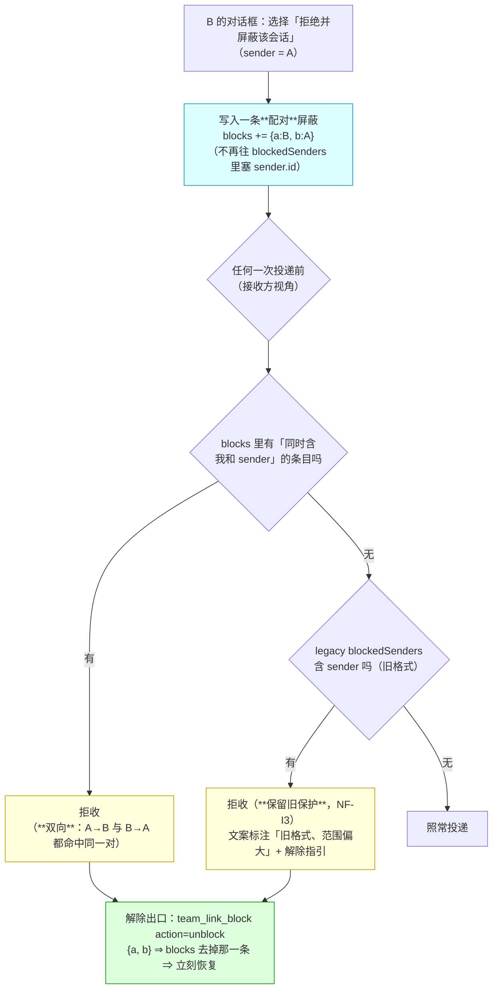

# 批 I · 屏蔽的作用域（block scope）—— 设计档

> **规格档**。需求档 [`docs/2026-10-12-block-scope-requirements.md`](2026-10-12-block-scope-requirements.md)。
> 行号一律 as-of **2026-10-12 工作树（commit `663a91f`）**，实施按**符号名**定位。
> ★ 本档全文不写出框定 token 的原串（批 E 立的仓规）；新测试标识符统一用 **`Bi` 中缀**（避免与既有顶格声明重名）。
> **实施状态（2026-10-12，批 I 落码）**：**已实施** —— 落点 `lib/index.js` 的 `DEFAULT_POLICY.blocks` · `PolicyConfig.blocks` · `normalizePolicy` 的 `blockList` · `policyIsAtDefaults` · `adoptMemoryWindow` 的整份写入补丁 · `blockPair` / `blockEntryBetween` / `isBlocked` / `blockSender` / `unblockPair` / `clearLegacy` · `blockListLines` / `blockedDeliveryText` / `blockDecisionText` · 投递路径的两处改写（收件检查与「拒绝并屏蔽」分支）· 新工具 `team_link_block`（＋ `__testing` 的五个判据面导出）；判据 **27 条**在 `host-half.test.mjs` 的「批 I」块（标识符 `Bi` 中缀，U1–U19 逐条落地；★ 2026-10-12 用户追加项 **D3** 补第 27 条 **U20**「`by ∉ {a,b}` 的条目归一化丢弃」）；**宿主实测回执已回填**（`node host-half.test.mjs` ⇒ `ALL PASS / assertion total: 1646 (failed: 0)`、`node client-half.test.mjs` ⇒ `310 (failed: 0)`，原文见 [`docs/verification-log.md`](verification-log.md) 的「2026-10-12 · 批 I＋D3 **宿主回执**（收口）＋ 四处口径回填」一节）。★ **FR-I6 的 ★ 硬锁清单不全（实施勘误，2026-10-12）**：除该行点名的两处（`:5604` 的 `=== 10` 与 README 架构图行）外，**另有六处同类同改锁**（键集/计数：`U29 schema` · `U9 对照 (pendingCreates)` · `U19 schema` 的 `U19_POLICY_KEYS` 与声明面计数 · `U1 文件后端` · `U11 schema` · `U17 键集与 README 同批`）必须与新键 `blocks` 同批改准 —— 漏任一处套件当场红；**再一处同类锁**：`批 E · U2 ①` 的 `BE_TOOLS` 工具全覆盖清单与它的两组计数（`10 → 11`）—— 它**不改不会红**，但不改就等于留了一句「全部 10 个工具都过消毒收口点」的**覆盖面假声明**（第 11 个工具在册却不在覆盖面内）。逐条见 [`docs/verification-log.md`](verification-log.md) 的「2026-10-12 · 批 I」§四。★ **§6 的一处实施细化**：`isBlocked` 除 `{ blocked, legacyHit }` 外还回传命中的 `entry`（**仅供 FR-I5 的文案**报出「谁挡的」与解除参数；**判定语义一字不变**）。

---

## §0 三句话结论

1. **这是什么**：把屏蔽从「**部署级全局名单**」改成「**两个会话之间的一对**」（**双向**），并补上**解除出口**（工具动作 + 文案指引）。
2. **为什么**：屏蔽只按 `sender.id` 落盘（`:7800`），而策略是**一份部署级共享文件** ⇒ **别的会话也读到这一条**、按同一键判断（`:7682`）⇒ 一枚屏蔽 = **全局拉黑**；且**没有任何解除路径** ⇒ 误点之后只能手改文件 + 重启。
3. **代价**：新增一个 `blocks` 数组（三个 schema 点）＋ 一个工具面（`team_link_block`）＋ 两处文案；**旧数据零改写**（保留原保护）；零新 import。



---

## §1 背景

- 用户 2026-10-12 15:17 报的缺陷（需求档 §五 ①）：「**应该是只屏蔽确认的两个会话之间的消息，而不是全部屏蔽**」。
- 真机经过：`team-link-mal-analyze-1011-coordinator-2345e3ad` 往一个**已换届**的会话发消息 ⇒ 对方对话框点了【屏蔽】⇒ 该会话**所有**跨会话消息被拒。
- 父侧当日**一次性救回**（手改 `policy.json` 的 `blockedSenders` 置空 + 重启），过程与读数记在 [`docs/backlog.md`](backlog.md) 的 B-2 附节。

## §2 问题

### 2.1 现象

一枚屏蔽 ⇒ 被屏蔽者**对整个部署**发不出消息（不是只对那一对）；且**无法解除**。

### 2.2 根因（★ 评审第 2 轮 🔵#7：本表与需求档 §五 的证据表**近乎逐行重复** ⇒ 此处**收敛为指针**，只留设计侧需要的一句）

**根因一句话**：屏蔽只按 `sender.id` 一个键落盘，而策略是**一份部署级共享文件** ⇒ 别的会话读到同一条、按同一个键判断 ⇒ **一枚屏蔽 = 全场拉黑**；且**全库没有解除路径**。

**逐条证据（写入点 / 检查点 / 共享性 / 无出口）一律见需求档**：[`docs/2026-10-12-block-scope-requirements.md`](2026-10-12-block-scope-requirements.md) 的 **§五 ①–⑤**（各带 `lib/index.js` 行号与 as-of 括注，父侧逐行 grep 得出）。
**设计侧新增的证据只有一条**（不在需求档）：**§8 U9 用到的既有硬锁** `host-half.test.mjs:5604` ★ 评审第 3 轮 🔵 更正：本行的归属**原写成 U17 是错的** —— 该锁管的是**工具计数**（⇒ 对应 **U9 文档同步**），U17 是 `^import` 计数扫描，两者不同。该锁把「README 架构图里的工具数」与**测试内硬写的 `registeredTools.length === 10`** 绑死（见 §5 FR-I6）⇒ **新增第 11 个工具时，README 的计数行与这个常量必须同批改准**（漏任一处 ⇒ 套件当场变红）。

## §3 目标与非目标

**目标**：屏蔽**只挡那一对**（双向）；**解得开**（工具动作）；**说得清**（文案）；**旧记录不静默放开**。

**非目标**（见需求档 §四，此处不重复）：不动双门批准 · 不改 roster · 不做批量解除 · 不碰黑板 · 不做「投递目标过期」（另立 B-3）· 不做「屏蔽角色/团队」。

## §4 决策与理由

| # | 决策 | 理由 | 被否决的备选与理由 |
| --- | --- | --- | --- |
| **D1** | 新增**独立的 `blocks` 数组**存配对，**不动** `pairs` | `pairs` 是**信任**（正向批准）；屏蔽是**负向** ⇒ 混在一起会让「信任的读面」多出一层过滤，且 `pairs` 的既有判据全要动 | **在 `pairs` 上加 `blocked: true` 标记**：污染信任数据面；`rotate` 的迁移/快照逻辑会连带搬它 |
| **D2** | 条目形状 **`{ a: <sessionA>, b: <sessionB>, by: <点屏蔽的那一方>, since: <ISO> }`**，写入时**规范化顺序**（按 id 字典序） | 双向语义 ⇒ A↔B 与 B↔A 必须是**同一条**（否则会出现两条、解除只解除一条）；**`by` 是 D7 的连带要求** —— 「只有发起屏蔽的那一方能解」必须知道**谁发起的**，否则无从判定 | **存两条单向条目**：解除要维护两条，容易出现「解了一半」；**不留 `by`**：D7 无法实现（分不清谁是发起方） |
| **D3** | **旧格式零改写**：`blockedSenders` 原样保留，检查时**并集**（配对命中 **或** 旧名单命中 ⇒ 拒） | 需求 NF-I3「**不静默放开**」：旧记录无法换算成配对（没有接收方维度）⇒ 保留原保护最安全；**而解除出口本批就有了**，所以留着不危险 | **迁移时清空旧名单**：静默解除保护（安全向的坏方向），被用户明确否决（需求档 §五 ③） |
| **D4** | **解除出口 = 新工具 `team_link_block`**，`action`: `list`（看当前屏蔽）· `unblock`（解一对）· `clear-legacy sender=<id>`（**按发送方逐条清**旧格式） | 插件既有的工具有 `roster`（团队）· `send`（投递）· `watch`（看门狗）· `rotate`/`recover`（换届）—— **没有一个能容纳「屏蔽」这个域**；硬塞进 `send` 会让投递工具的职责变模糊。★ **`clear-legacy` 按发送方逐条清**（用户 A1 裁定）：批量清会**一次放开全部旧保护** ⇒ 与需求档非目标 3「不做批量解除」正面冲突，且按 D6 零摩擦生效 ⇒ 与批 H「不可逆动作要人类确认」的方向相反 | **塞进 `team_link_send` 的一个新参数**：投递与治理混在一处，读面也说不清；**塞进 `team_link_roster`**：屏蔽与团队无关；**批量 `clear-legacy`（无 sender 参数）**：见左（用户 A1 否决） |
| **D5** | 拒绝文案**点名「谁挡的 + 怎么解」** | 需求 US-I3；今天的文案（`:7691` / `:7804`）只说「已屏蔽」，不说出口 | **只说「已屏蔽」**：卡住的人只能猜（今天就是这么卡住的） |
| **D6** | 解除动作**不弹确认框**（写了就生效） | 解除是**恢复通信**（安全向的「放开」），且**可逆**（再屏蔽一次即可）；与批 H 的删除（不可逆）性质不同。★ A1 裁定后本条的适用面收窄成「**一次只解一条**」（`unblock` 解一对、`clear-legacy sender=<id>` 解一条旧记录），所以零摩擦是安全的 | **弹确认框**：多一步无收益的摩擦（批量清那种才需要，而它已被 A1 否掉） |
| **D7** | **`unblock` 只有「发起屏蔽的那一方」能解**（判定：`self === entry.by`）；第三方（既非 a 也非 b）**一律拒绝** | 用户 A2 裁定（甲）：否则**被屏蔽方自己就能解掉** ⇒ 屏蔽对被屏蔽方**毫无约束力**，成了摆设。与「屏蔽写入也只发生在当事接收方」对称 | **双方都能解**（被屏蔽方可自救）：今天那次的困境正是「被挡的人无法自救」—— 但代价是屏蔽退化成**建议性**的 ⇒ 用户明确选甲（不采纳）|
| **D8** | **`clear-legacy sender=<id>` 的权限：被那条旧记录挡住的发送方本人不得清自己的条目；其余任何会话可清** | ★ 设计评审第 2 轮 🔴#1：旧格式条目**没有 `by`**（缺陷期产物，无作者）⇒ D7 那套「只认 `by`」在它身上**无法适用**（会使该动作永久不可用）；但若放开成「谁都能清」，则**被挡方可自清** ⇒ 撞上 D7 的整段理由。用户 2026-10-12 21:17 裁定（甲′）：**旧条目是缺陷遗留物 ⇒ 清它是修 bug，不需要 D7 那么严；但「受益方不能自己动手」这条底线保住** | **沿用 D7 的严格口径**（只认 `by`）：旧条目无 `by` ⇒ 动作永久不可用，与用户 A1 裁定正面冲突；**「谁都能清」（含被挡方）**：被挡方自清自己的条目 ⇒ 与 D7 的理由直接对撞，用户否决 |

## §5 方案（FR-x 交付单元）

| FR | 交付单元 | 落点（符号名） | 验收 |
| --- | --- | --- | --- |
| **FR-I1** | 状态加 `blocks` 数组（默认值 / schema / 归一化三点齐；★ **单条畸形条目**的处置也在归一化里定死，见 §9；★ **`by ∈ {a,b}` 校验**见 U20） | `DEFAULT_POLICY` · policy schema · `normalizePolicy`（与 `blockedSenders` 同款三处） | U1 / U16 / U20 |
| **FR-I2** | 写入改配对：对话框那个分支写 `blocks`（**不再**往 `blockedSenders` 塞），且**必须记 `by`**（点屏蔽的那一方，即当事接收方） | 投递路径里的「拒绝并屏蔽该会话」分支（现 `:7798`/`:7800`） | U2 / U3 / U13 / U19 |
| **FR-I3** | 检查改配对：**双向**——`blocks` 里存在「同时含我和 sender」的条目 ⇒ 拒；**并集**旧名单（NF-I3） | 投递路径的收件检查（现 `:7682`/`:7691`） | U4 / U5 |
| **FR-I4** | 新工具 `team_link_block`：`action: list`（看当前屏蔽，**配对与旧格式分组呈现**）· `unblock`（解一对，**只有 `by` 那一方能解**，D7）· `clear-legacy sender=<id>`（**按发送方逐条清**旧格式，A1；**权限见 D8**：被该条目挡住的发送方本人清 ⇒ **拒 + 零写入**，其余会话可清） | 新工具定义（与 `team_link_watch` 同级的注册点） | U6 / U7 / U11 / U12 / U14 / U15 / U18 / U19 |
| **FR-I5** | 两处拒绝文案点名**谁挡的 + 怎么解**（含旧格式时说明「范围偏大」） | 现 `:7691` / `:7804` 两条文案 ＋ 新工具的回读面 | U8 |
| **FR-I6** | 文档同批改准（★ 评审第 2 轮 🔵#8 逐点点名）：工具面（新工具的 description）· `README.md`（能力清单 **＋ 架构图那行「N 个工具 + 2 条 / 命令」的计数与名字列表**）· `CHANGELOG.md` · **`docs/verification-log.md`** · 本批两档 · [`docs/backlog.md`](backlog.md) 的 **B-2 标 ✅** ＋ 确认 **B-3**（投递目标过期）**已在册**（父侧立项时已写入，实施只需核它在册、**不重立**）。★ **必须同批改准的既有硬锁（父侧 2026-10-12 实测）**：① `host-half.test.mjs:5604` 的 **`§11.9 文档面=实现面（工具计数同改锁）`** —— 它断言 **`README` 架构图里的工具数 == 实际注册数**，**新增工具而不同改 README ⇒ 立刻变红**；★ **同一条断言里还硬写着 `diagEnv.registeredTools.length === 10`**（评审第 3 轮复核原文确认）⇒ **该常量必须同批改成 `11`**（漏它 ⇒ 套件红）；② 同档 `:5713` / `:5958` 的两处「工具面仍注册」清单是**子集**（各 8 个名字）⇒ **不受影响**，无需改 | 前述各档 ＋ `host-half.test.mjs:5604` 的**锁与其中的 `=== 10` 常量** ＋ `README` 架构图行 | U9 / U17 |

> ★ **FR-I6 的实施勘误（2026-10-12 落码时补记）**：上面那一格只点名了两处硬锁（`:5604` 的
> `=== 10` 常量与 README 架构图行）。实施时发现**同类的键集/计数锁另有六处**必须同批改准 ——
> 逐一点名（共六处）：`U29 schema` 的键集 · `U9 对照 (pendingCreates)` 的折叠键集 ·
> `U19 schema` 的 `U19_POLICY_KEYS` 与「声明面 = N 项」计数 · `U1 文件后端` 的文件 schema 键集 ·
> `U11 schema` 的 base 键集 · `U17 键集与 README 同批`（含它对 README 的 `/九个键|九项/` 正则）。
> 六处形态与 `:5604` 完全相同（同一份清单两处写、只改一处即红），漏改任一处套件当场红；
> **第七处**是 `批 E · U2 ①` 的 `BE_TOOLS` 工具全覆盖清单（清单 ＋ 标签里两个计数 ＋ 长度断言，
> `10 → 11`）：它**不改不会红**，但不改就是一句「全部 10 个工具都过消毒收口点」的**覆盖面假声明**。
> 逐条留证见 [`docs/verification-log.md`](verification-log.md) 的「2026-10-12 · 批 I」§四。
> 另：那一格对同档 `:5713` / `:5958` 的判断（「工具面仍注册」清单是**子集**、不受影响）**经复核仍成立** ——
> 两处都是 `.every(name => tool(name) !== undefined)` 形制、各 4–8 个名字，本批**未改**它们。

## §6 机制伪代码（前置 / 后置条件）

```js
/** 规范化一对（D2）：小 id 在前 ⇒ A↔B 与 B↔A 是同一条。 */
function blockPair(a, b) {
  return a <= b ? { a, b } : { a: b, b: a };
}

/** FR-I3 判定：接收方视角。前置：senderId 非空；selfId = 本会话 id。
 *  后置：true ⇒ 拒收。命中条件（并集，NF-I3）：
 *    ① `blocks` 里存在 {a,b} 同时含 selfId 与 senderId（**双向**，D2 保证只存一条）；
 *    ② 旧格式 `blockedSenders` 含 senderId（**保留原保护**，D3）。
 *  ★ 只读，不写。 */
function isBlocked(policyView, selfId, senderId) {
  const paired = policyView.blocks.some((p) => (p.a === selfId && p.b === senderId) || (p.a === senderId && p.b === selfId));
  const legacy = policyView.blockedSenders.includes(senderId);
  return { blocked: paired || legacy, legacyHit: !paired && legacy };
}

/** FR-I2 写入：配对化。前置：对话框已选「拒绝并屏蔽该会话」；senderId 非空；`selfId` = 点屏蔽的那一方（当事接收方）。
 *  后置：`blocks` 恰多一条规范化条目 `{ a, b, by: selfId, since }`（**幂等**：已存在则不重复追加）；
 *        **`by` 必填**（D2/D7：没有它就没法判定谁能解）；`blockedSenders` **一个字节不动**。 */
async function blockSender(policy, selfId, senderId) {
  const target = blockPair(selfId, senderId);
  const current = policy.get().blocks;
  if (current.some((p) => p.a === target.a && p.b === target.b)) return; // 幂等
  await policy.update({ blocks: [...current, { ...target, by: selfId, since: new Date().toISOString() }] });
}

/** FR-I4 解除（D7 ← 用户 A2 裁定）。前置：`selfId` = 调用方会话 id（**必填**，★ 评审第 2 轮 🔵#4：
 *  此前签名缺它，注释却要求校验 caller）；`a` / `b` 为**这一对的两个会话 id**（工具参数形态**定为这一种** ——
 *  不再保留「或自报『我和目标』」的第二形态）。
 *  权限：**只有 `entry.by` 那一方能解** —— 被屏蔽的一方、以及第三方（既非 a 也非 b）**一律拒绝 + 零写入**。
 *  后置：`blocks` 去掉那一条（**只去一条**，别的对与旧名单都不动）；
 *        若这一对**不在** `blocks` 里、或 `selfId !== entry.by` ⇒ 如实拒绝并列出当前全部屏蔽（不是静默成功）。 */
async function unblockPair(policy, selfId, a, b) { /* 规范化 → 找条目 → 校验 selfId === entry.by → filter → policy.update */ }

/** FR-I4 清旧格式（A1 ← 用户裁定：**按发送方逐条清**，不做批量；D8 ← 用户甲′裁定：**被该条目挡住的
 *  发送方本人不得清自己的条目**，其余任何会话可清）。
 *  前置：`selfId` = 调用方会话 id；`sender` 非空且是字符串。
 *  后置：① `selfId === sender` ⇒ **拒绝 + 零写入**（受益方不能自己动手，保住 D7 的底线）；
 *        ② `blockedSenders` 里那一条消失、**其余条目与其它所有键逐字节不动**；
 *        ③ 旧名单里**没有**这个 sender ⇒ 如实拒绝 + 零写入，并列出当前旧名单（U12）。 */
async function clearLegacy(policy, selfId, sender) { /* 校验 selfId !== sender → filter 掉那一条 → policy.update({ blockedSenders }) */ }
```

## §7 状态与 schema

| 面 | 改前 | 改后 | 谁写 | 谁读 |
| --- | --- | --- | --- | --- |
| `policy.blocks`（**新**） | 不存在 | `[]` ⇒ `[{ a, b, by, since }]`（规范化、**去重**；`by` = 点屏蔽的那一方，D2/D7） | 屏蔽写（FR-I2）· 解除写（FR-I4） | 投递检查（FR-I3）· `team_link_block action=list` |
| `policy.blockedSenders`（旧格式） | 写入只按 sender（全局） | **原样保留、不再新增**；检查时**并集**参与判定（NF-I3） | 仅 `clear-legacy sender=<id>` 可清（A1：**逐条**，不批量） | 投递检查（并集）· `action=list`（标注「旧格式」） |
| `pairs` / `trustedSenders` / `rememberTargets` / `teams` / `watchdogs` | — | **一个字节不动** | — | — |
| 工具面 | **10 个**（★ 评审 🟡#4 实测更正：`grep 'name:\s*"team_link_[a-z_]+"'` 在 `lib/index.js` 里恰 10 个，此前本行误写「5 个」） | **11 个**（`+ team_link_block`） | — | 模型可见 description（同批改准） |
| import 面 | 8 条 | **8 条**（零新增） | — | ★ 评审第 2 轮 🟡#2：本行此前只写「硬闸门」而**没有可 grep 的断言名**（违 `AGENTS.md` §一.1）⇒ 由本批新增的 **U17**（静态扫 `^import` 计数 = 8）承接；既有的八模块白名单即本仓既有闸门 |

## §8 防偏离（怎么被机械验证）

| # | 判据 | 红相构造 | 落点 |
| --- | --- | --- | --- |
| **U1** | **三点齐**：`blocks` 在默认值 / schema / 归一化三处都存在（缺一 ⇒ 读不出或写不进） | 只加默认值不加 schema ⇒ 写入被拒 ⇒ 红 | `host-half.test.mjs` |
| **U2** | **写入配对化**：走一次「拒绝并屏蔽该会话」⇒ `blocks` 恰多一条 **`blockPair(接收方, 发送方)` 形状的规范化条目**（★ 评审 🔵#8 措辞更正：**不断言 `a`/`b` 与收发方的对应顺序** —— 字典序规范化会把两键互换），且 **`blockedSenders` 一字未变** | 仍往 `blockedSenders` 塞 ⇒ 红 | 同上 |
| **U3** | **幂等**：同一次屏蔽做两遍 ⇒ `blocks` 仍只一条 | 无幂等 ⇒ 两条 ⇒ 红 | 同上 |
| **U4** | **只挡那一对**（US-I1 的核心）：A↔B 屏蔽后，**B 拒 A**、**A 拒 B**（双向），而 **C→B 与 B→C 全部照常** | ★ 分歧审计（批 I）**按实测更正**：本栏原写「返回全局判断 ⇒ C 也拒 ⇒ 红」，但**改前的真实现**（按 `sender.id` 一个键判）下 **C→B 恰恰是「已投递」（不被挡）** ⇒ 那句红相**指错了子句**。**真正咬住旧实现的是另两句**：**B→A**（旧实现下被拒、文案里**没有**「已屏蔽」，而配对语义下应命中同一对）与 **B→C**。⇒ 红相措辞改为：**「把判定换成『任一条目挡住所有人』（家族甲）或换成『按 `sender.id` 判』（家族乙＝改前的真实现），本条都必红」** —— 审计对**两个家族**都做过变异实证（家族甲 ⇒ U4 转红；家族乙 ⇒ U4 转红，该轮 14 红）⇒ **本条判别力成立**，只是原红相描述只覆盖了家族甲 | 同上 |
| **U5** | **旧格式仍挡**（NF-I3）：夹具在 `blockedSenders` 里放一条 ⇒ 该发送方**仍被拒**，且文案**标注旧格式 + 给解除指引** | 迁移时清空 ⇒ 旧保护失效 ⇒ 红 | 同上 |
| **U6** | **解除真的解开**（US-I2）：`action=unblock` 后 ① 那一对**双向都恢复**；② **别的对与旧名单不受影响**；③ 再屏蔽一次又能挡上 | 只删一半 / 误删别的 ⇒ 红 | 同上 |
| **U7** | **解除的负相**：解一对**不存在**的 ⇒ **拒绝 + 零写入**，拒绝文案**列出当前全部屏蔽** | 静默成功 ⇒ 红 | 同上 |
| **U8** | **文案说清出口**（US-I3）：两条拒绝文案都点名**谁挡的**（或「旧格式」）＋ **怎么解**（工具名 + 动作） | 只说「已屏蔽」⇒ 红 | 同上 |
| **U9** | **文档同步**（FR-I6）：新工具 description 在册；README 能力清单含 `team_link_block`；`docs/backlog.md` 的 **B-2 标 ✅** 且 **B-3 已立** | 漏一处 ⇒ grep 红 | 同上 |
| **U10** | **不回归**：`pairs` / 双门批准 / `roster` / `watch` / `rotate` / `recover` 的既有判据全绿；双向批准路径**逐字未动** | 顺手动了批准 ⇒ 红 | 同上 |
| **U11** | **`clear-legacy sender=<id>` 真的只清那一条**（★ 补自设计评审 🔴#1 —— FR-I4 声明的这个状态变更动作此前**零判据**）：① 指定发送方的那条旧记录消失；② **`blocks` / `pairs` / `trustedSenders` / `rememberTargets` / `teams` / `watchdogs` 逐字节不变**；③ 其余旧记录**原样在** | 顺手清空整张旧名单 / 误动别的键 ⇒ 红 | 同上 |
| **U12** | **`clear-legacy` 的负相 + 文案**：旧名单里**没有**那个发送方 ⇒ **如实拒绝 + 零写入**（不是静默成功）；拒绝文案**列出当前旧名单** | 静默成功 ⇒ 红 | 同上 |
| **U13** | **写入必须记 `by`**（D2/D7 的连带要求）：那一条 `blocks` 的 `by` **等于当事接收方**（点屏蔽的那一方），不是发送方、不是空 | 不写 `by` / 写成发送方 ⇒ 红（后续 U14 也会跟着红） | 同上 |
| **U14** | **`unblock` 的权限模型**（★ 用户 A2 裁定 · 设计评审 🟡#3 的缺口）：① **`by` 那一方**能解 ⇒ 双向恢复；② **被屏蔽的一方**解 ⇒ **拒绝 + 零写入**（文案说明「只有发起屏蔽的一方可以解除」）；③ **第三方**（既非 a 也非 b）解 ⇒ **拒绝 + 零写入** | 任何会话都能解 ⇒ ①②③ 全红 | 同上 |
| **U15** | **`action=list` 分组呈现**（★ 设计评审 🔵#6）：输出把**配对屏蔽**与**旧格式**分成两组（旧格式组**标注**「范围偏大（旧格式）」＋解除指引） | 两类混排 / 旧格式不标注 ⇒ 红 | 同上 |
| **U16** | **单条畸形条目的归一化**（★ 设计评审 🔵#7）：`blocks` 里塞一条缺 `a`/`b`/`by` 的 ⇒ **丢弃那一条、其余原样保留**（不因一条坏的丢掉整张表、也不把它带进判定）；另：**整个 `blocks` 缺席** ⇒ 补 `[]` | 一条坏的导致整表清空 / 带进判定 ⇒ 红 | 同上 |
| **U17** | **import 面仍 8 条**（★ 设计评审第 2 轮 🟡#2 · 承接 NF-I5）：静态扫 `lib/index.js` 的 `^import` 计数 **恰 8**（新增依赖 ⇒ 红；八模块白名单是硬闸门） | 顺手新增一个 import ⇒ 红 | 同上 |
| **U18** | **`clear-legacy` 的权限三态**（★ 设计评审第 2 轮 🔴#1 · D8 ← 用户甲′裁定）：① **被该条目挡住的发送方本人**（`selfId === sender`）清 ⇒ **拒绝 + 零写入**；② **另一个会话**清 ⇒ 成功、只清那一条；③ 旧名单里没有该 sender ⇒ 拒绝 + 零写入（与 U12 同一支） | 本人能自清 / 别的人清不了 ⇒ 红 | 同上 |
| **U19** | **落点不变量**（★ 设计评审第 3 轮 🟡#2 · 承接 **NF-I6**）：本批三个写路径（`blockSender` / `unblockPair` / `clearLegacy`）**每次动作恰一笔 `policy.update`**、补丁**只含那一个键**（`blocks` 或 `blockedSenders`），且**没有任何直接文件写**；另：`team_link_roster action=get` / `team_link_status` 的**首行落点三态**判据（既有 `U9 迁移可核:` 那三条断言）在本批后**仍全绿** | 双写 / 绕开 `policy.update` 直接写文件 / 首行落点变了 ⇒ 红 | 同上 |
| **U20** | **`by ∉ {a,b}` 的条目被归一化丢弃**（★ 用户 2026-10-12 22:2x 裁定（甲）· 分歧审计 D3：手工改出的 `{a, b, by:<第三人>}` 此前会被收下，且按 D7 **谁都解不开** ⇒ 落 §9 的人工出口，方向虽 fail-closed、但那是个**本可在入口就挡住**的畸形）：`blockList` 归一化时加一句 `if (entry.by !== pair.a && entry.by !== pair.b) continue;` ⇒ 该条**丢弃、其余保留**（与 U16 同族：**丢弃那一条、不丢整表、不带进判定**） | 收下 `by` 不在 a/b 之内的条目 ⇒ 红（该条会变成「无人能解」的死条目） | 同上 |

**夹具纪律**：一律用既有投递夹具的工厂（`teamEnv` / `setup`），**不依赖墙钟**；每条红相判据同批给**负相自证**。

## §9 边界

| 面 | 行为 |
| --- | --- |
| **空集 / 畸形输入** | `a`/`b` 为空或非字符串 ⇒ 参数校验拒；两者**相同**（自己屏蔽自己）⇒ 拒绝并说明；★ **`by ∉ {a,b}`**（手工改出来的第三人）⇒ **归一化时丢弃该条**（U20 · 用户甲裁定）：它若被收下就是一条**谁都解不开的死条目**（D7 只认 `by`）—— 在入口挡住它，比让它落到 §9 的人工出口更干净 |
| **幂等** | 重复屏蔽同一对 ⇒ 不重复追加（U3）；重复解除 ⇒ 第二次走「不在册」的拒绝分支（U7） |
| **并发** | 两处同时写 ⇒ `policy.update` 后写胜；第二笔基于**写前重读**后的新鲜数组（沿用批 H 的纪律） |
| **重启 / 升级** | 无新依赖、无新 import；`blocks` 缺字段的旧文件 ⇒ 归一化补 `[]`（与 `blockedSenders` 同款），**不需要** schema bump。★ 评审 🔵#7 补：**单条畸形**（缺 `a`/`b`/`by`）⇒ 归一化时**丢弃那一条、其余原样保留**（U16）—— 不因一条坏的丢掉整张表；**降级路径**（新版写出的文件被**旧版**插件读）⇒ 旧版不认识 `blocks` 键，按其既有归一化**忽略未知键**（配对屏蔽在旧版下**不生效**，但**不会**被旧版写坏：旧版只写它认识的键的补丁）—— 这是**可接受**的降级（旧版退回本批之前的行为） |
| **失败方向** | **fail-closed**：判定读不到状态 ⇒ **按拒收**（安全向）；解除写失败 ⇒ 如实报错、**原屏蔽仍在**（绝不出现「报成功但没解开」） |
| **旧格式的归宿** | 一直保留到使用者**显式** `clear-legacy sender=<id>`（**不自动清、不批量清**）；`action=list` 把它与配对**分开展示** |
| **身份 / 权限** | **两条不同的口径，别混**：① **配对屏蔽解除**只认 `entry.by`（D7）—— 被屏蔽方与第三方**一律拒绝 + 零写入**；② **旧格式清条**按 D8 —— **被该条目挡住的发送方本人**清自己的 ⇒ **拒绝 + 零写入**，**其余任何会话可清**（旧条目无 `by`，D7 那套在它身上不适用）。两处文案各自说清「只有谁能做」 |
| **`by` 那一方消亡时**（★ 评审第 2 轮 🟡#3） | 该配对**无人能解** —— 如实拒绝 + **指向人工出口**（改 `policy.json` 对应条目 + 重启，即 `AGENTS.md` §七 的既有路径）。**这是 fail-closed 方向的可接受限制**（宁可不放，不可乱放）—— 本批**不动换届/退役**（需求档 §四 非目标 2），故不做「随换届迁移 `by`」 |
| **`since` 与「互蔽」**（★ 评审第 2 轮 🔵#5） | `since` 只作**留痕**，不参与任何判定（故无专属判据；`list` 面展示它，值取首次写入的时刻）；**互蔽**（A 屏蔽 B 后 B 又屏蔽 A）⇒ `blockSender` 的**幂等早退**命中 ⇒ **只留最早那条**、第二个发起方的 `by` **被吞掉** ⇒ 这是**已知行为**（判定只看条目在场、不看 `by`，故对「谁都不能解」这一点无影响；`by` 仍是**最早那个发起方**） |
| **不碰** | 黑板文件·`pairs`·信任三数组·团队·看门狗 |

## §10 实施注意

> ★ 评审第 2 轮 🔵#6：本档与需求档里的 **「A1 裁定」「A2 裁定」「甲′裁定」标签**，定义点**只有一个** —— 需求档 [`docs/2026-10-12-block-scope-requirements.md`](2026-10-12-block-scope-requirements.md) 的 **§五 用户已确认的五点**（④=A1「旧格式按发送方逐条清、不批量」· ⑤=A2「解除只允许发起屏蔽方」），**甲′** 是本档 **D8** 的口径、其用户裁定同样记在该档 §五 **⑥**。

1. **配对规范化必须在一处做**（`blockPair`）—— 写入与解除**共用**，否则 A↔B / B↔A 会各写一条（U3 钉住）。
2. **检查是「接收方视角」**（沿用 `:7682` 的既有语义）：`selfId` 用该处**已有的**本会话 id 读取路径，**不要**新引一套身份来源。★ 评审第 2 轮 🔵#4：`unblockPair` / `clearLegacy` 的**签名都必须带 `selfId`**（§6），工具参数形态**只保留一种**（显式 `a`/`b` 或 `sender`），删掉「或自报『我和目标』」的第二形态。
3. **旧名单只读不写**（除 `clear-legacy sender=<id>`）—— D3 的「不静默放开」全靠这条。
4. **文案里的出口必须可执行**（工具名 + 动作 + 参数示例），不是「请联系管理员」式的空话；**旧格式那条还要标注「范围偏大」**（NF-I3）。
5. **`docs/backlog.md` 收口**：B-2 标 ✅ 并指向本批入库点；**核 B-3 已在册（不重立）** —— B-3（「投递目标过期」，往已换届的旧会话投递，是**路由**的账）已由父侧在 2026-10-12 立项时写入 [`docs/backlog.md`](backlog.md):12，与 FR-I6 同口径（★ 设计评审 🟡#5：本行原写「同批新增 B-3」，会与 FR-I6 冲突并造出重复条目）。
