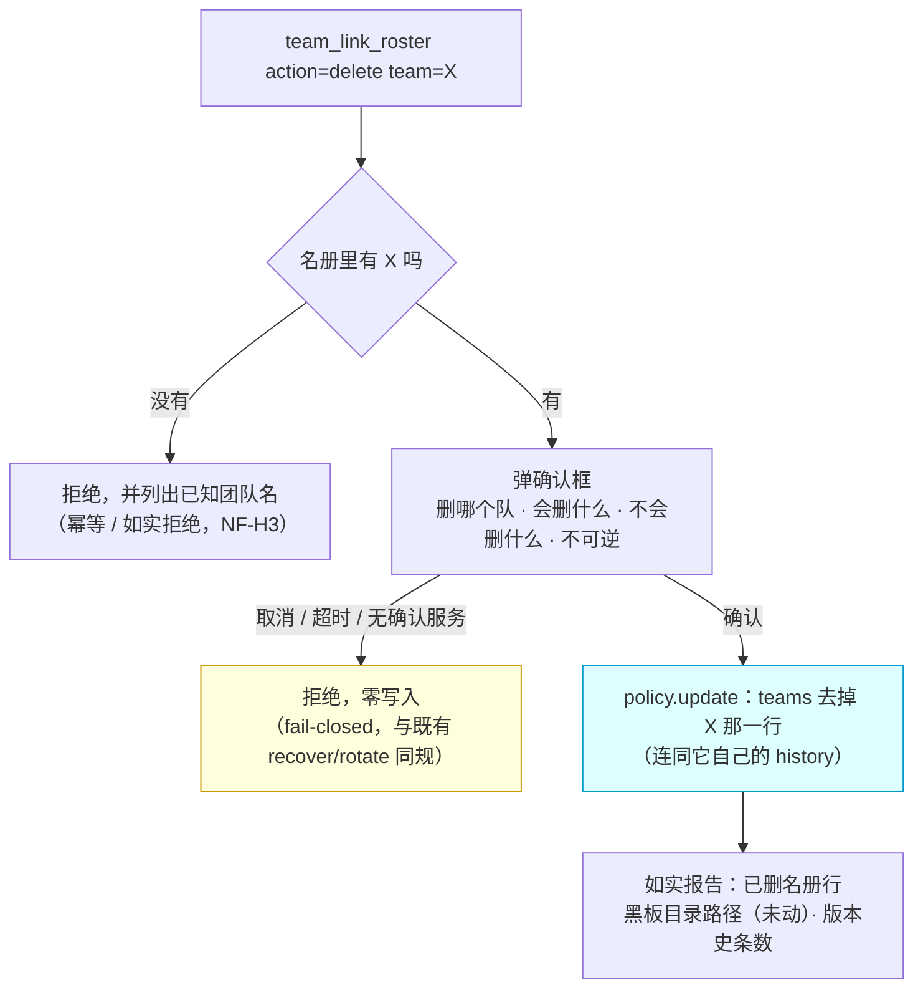

# 批 H · 删团队（`team_link_roster action=delete`）—— 设计档

> **规格档**。需求档 [`docs/2026-10-12-team-delete-requirements.md`](2026-10-12-team-delete-requirements.md)。
> 行号一律 as-of **2026-10-12 工作树（commit `2329a0a`）**，实施按**符号名**定位。
> ★ 本档全文不写出框定 token 的原串（批 E 立的仓规）；实施时新测试标识符用 **`Dh` 中缀**（避免与既有顶格声明重名）。
> **实施状态（2026-10-12，批 H 落码）**：**已实施** —— 落点 `lib/index.js` 的 `deleteTeam` / `askDeleteConfirm` / `blackboardDirPresence` / `blackboardUntouchedLine` ＋ roster 工具的 `if (action === "delete")` 分支；判据 **21 条**在 `host-half.test.mjs` 的「批 H」块（落码时 **19 条**：U1–U11 ＋ NF-H5；**2026-10-12 分歧修复轮追加 2 条**：`U12①②`（§6 伪代码那条「写前重读」的 TOCTOU 夹具 —— 此前块内没有任何一条在对话框打开期间改名册，如实登记见本段末））。入库点与读数口径见 [`docs/verification-log.md`](verification-log.md) 的「2026-10-12 · 批 H」一节与其 §七（分歧修复轮）与 [`CHANGELOG.md`](../CHANGELOG.md) 的同名条目（**宿主回执待回填**）。★ **§6 末尾有一处实施勘误**（伪代码里版本史条数的写法），实施按 FR-H3/FR-H4 的意图改正并配了红相判据。★ **同一轮另修三处判据 / 文档面**（实现零改动）：U3 的 ④ 恒假格（夹具把同一 legacy 标记种进**保留队**，与断言自相矛盾 ⇒ 工厂形参加 `legacy` 参数、默认值不动）· U3 逐字节比对**纳入 `blockedSenders`**（连通 `receiveMode` / `pendingCreates` / `sections`，且种成非空避免空真）· §八 U 表的行号与 `README.md` §十 的计数漂移。

---

## §0 三句话结论

1. **这是什么**：给 `team_link_roster` 加第五个动作 `delete` —— 把团队**从名册里真正删掉**（含它自己的版本史）。
2. **为什么**：今天只有 `retire`（停用），名册行永远留着；而**已退役**的队没有现任协调者 ⇒ 连 `retire` 的发起权都没有 ⇒ **谁都清不掉**。
3. **代价**：新增一个动作枚举值 + 一个确认对话框走查；**不碰黑板文件、不碰信任、不新增 import**。



---

## §1 背景

- 用户 2026-10-12 原话：「**没有删团队这个，可以考虑后续功能加上删的功能**」（来源：[`docs/backlog.md`](backlog.md) 的 B-1）。
- **触发场景是真机上的两例**：`u9-verify-1012` 与 `u9b-verify-1012` —— 批 E 的 U9 取证建的临时队，用毕已 `retire`（`current` 置空），
  但**名册行仍在**，于是它们永远出现在团队列表里。
- `AGENTS.md` §七 记录：本部署的**状态事实源是 `policy.json`**，设置 UI 直改 `teams` 键**不会生效** ⇒ 「手工删」这条路不通。

## §2 问题

### 2.1 现象

名册里存在**没有任何办法清掉**的行：`retire` 把它变成 vacant，而 vacant 之后：
- `set-role` / `retire` 都要求「现任协调者」发起 ⇒ **没有现任 ⇒ 谁也动不了**（`lib/index.js` 的 writer gate 分支）；
- 团队列表（`roster action=get` / `team_link_status` ① 段）**照旧列出它**。

### 2.2 根因（带证据）

| # | 事实 | 出处 |
| --- | --- | --- |
| ① | `retire` 的动作是「把 `current` 置空 + 版本史记 `until`」，**不删行** | `lib/index.js` 的 retire 分支（`team_link_roster` 的 `action === "retire"` 一档） |
| ② | roster 工具的写权限由 **writer gate** 把关：`policy.writer === "coordinator"` 时**只有该队现任协调者可写**；现任空缺 ⇒ **会话路径一律拒绝** | 同工具描述里的 writer 段 · `policy.writer` 的判定分支 |
| ③ | ⇒ **vacant 的队构成一个死区**：没有任何工具动作能改它 | ①② 的推论（真机两例即此） |
| ④ | 设置 UI 直改 `teams` 键**不生效** | `AGENTS.md` §七 |

## §3 目标与非目标

**目标**：名册里的**任意**一行（含 vacant 的），能被**一次显式确认**之后删掉；删完如实报告删了什么、没删什么。

**非目标**（本批明确不做）：
1. **不删黑板文件**（已拍板）—— `<workspace>/team/<队名>/` 下的任何文件不读不写不删；
2. **不改信任数据** —— `pairs` / `trustedSenders` / `rememberTargets` **一个字不动**（纪律：那些是**会话与会话之间**的信任，删一个团队不该顺手改别人的信任；要清请先走 `retire` 的可选清理）；
3. **不做归档**、**不做批量删**、**不改 `retire` 的既有语义**、**不动 `policy.writer` 的判定逻辑**。

## §4 决策与理由

| # | 决策 | 理由 | 被否决的备选与理由 |
| --- | --- | --- | --- |
| **D1** | 加**动作枚举值** `delete`（不新建工具） | 本插件已有的模式就是 `team_link_roster action=…`（`get` / `upsert-team` / `set-role` / `retire` / `set-mode`）；加一个值比加一个工具面小得多，且模型可见面只有一处要改（既有枚举的 description） | **新建 `team_link_team_delete` 工具**：工具面 +1，描述/权限/判据全要另起一套，收益为零 |
| **D2** | **删除动作豁免 writer gate**，改由**人类确认框**把关 | 需求 US-H2 的核心场景就是 **vacant 的队**（没有现任协调者）—— 若沿用 writer gate，这个功能**对它的目标场景完全不可用** | **沿用 writer gate**：vacant 的队永远删不掉 ⇒ 功能等于没做（真机两例即此） |
| **D3** | **fail-closed**：没有确认服务（`userQuestions` 不可用）/ 用户取消 / 超时 ⇒ **零写入** | 与既有 `askRecoveryConfirm`（recover）和 rotate 的确认同规：不可逆动作必须有人类的印子 | **无人值守变体**（超时后自动删）：不可逆动作没有这个余地 |
| **D4** | 删的是 `teams` 里那一行**连同它自己的 `history`** | 「删」若留 history，名册里仍留着痕迹 ⇒ 与 US-H1「清掉」矛盾；而版本史是这个团队自己的属性 | **留墓碑（`deleted: true` 标记）**：名册里仍留着行、仍要读面配合过滤，复杂且不达目的 |
| **D5** | **不动信任数据** | 见非目标 2；信任是会话间的，不属于团队名册 | **顺手清理指向该队的信任**：会静默改掉**其它会话**的信任状态，而用户这次要的只是「清脚手架」 |
| **D6** | 拒绝时**列出已知团队名** | 与 `team_link_status` 的既有风格一致（列出有效值），且防「转录错队名后以为删成功」 | 只回一句「团队不存在」：使用者无法自查 |

## §5 方案（FR-x 交付单元）

| FR | 交付单元 | 落点（符号名） | 验收 |
| --- | --- | --- | --- |
| **FR-H1** | `team_link_roster` 的动作枚举加 `delete`（`enum` + description 一句） | roster 工具的 `action` 参数定义 · 工具 description | U1 |
| **FR-H2** | 删除分支本体：**先校验存在性**（不存在 ⇒ 拒绝 + 列已知团队名）⇒ **弹确认框** ⇒ `policy.update({ teams: 去掉那一行 })` ⇒ 如实报告 | 工具 execute 的分派处（与 `retire` 分支并列） | U2 / U3 / U4 |
| **FR-H3** | 确认框内容（**逐项写清**）：队名 · 「删的是名册行（含版本史 N 条）」· 「**不会**删磁盘上的黑板目录」· 「不可逆」 | 新增一个 `askDeleteConfirm`（形制照 `askRecoveryConfirm`） | U5 |
| **FR-H4** | 报告面：删成功后如实报出 ① 名册行已删（含版本史条数）② **黑板目录路径（原样未动）** ③ 若目录不存在也如实说 | 同分支的返回文本 | U6 |
| **FR-H5** | 文档同批改准（★ 评审 🔵#7 逐档点名）：**工具 description**（模型可见面，枚举串加 `delete`）· `README.md`（roster 动作清单）· `CHANGELOG.md`（本批条目）· **`docs/verification-log.md`**（证据账本，只追加本批小节）· 本批**两份档自身**（需求 / 设计）· `docs/backlog.md` 的 **B-1 标 ✅** 并指向入库点 | 前述各档 | U7（文档纪律） |

## §6 机制伪代码（前置 / 后置条件）

```js
/** FR-H2 删除分支。前置：调用方已过「工具可用」与「参数形状」两道校验；`team` 已 trim 且非空。
 *  后置：返回 { ok: true, … } ⇒ 名册里已无该队、且**只**发生了一笔 policy.update；
 *        返回 { ok: false, reason } ⇒ **一个字节都没写**（拒绝路径一律零写入）。 */
async function deleteTeam(ctx, agent, policy, teamName, signal) {
  const teams0 = policy.get().teams;
  const row = teams0.find((t) => t.name === teamName);
  if (row === undefined) {
    // NF-H3：如实拒绝 + 列已知团队名（不是静默成功）
    return { ok: false, reason: `团队「${teamName}」不在名册里。已知团队：${teams0.map((t) => t.name).join("、") || "（无）"}` };
  }
  // ★ 实施勘误（见本档 §6 末尾）：版本史挂在**角色行**上（团队行没有 `history` 字段），
  //   所以条数是各角色 `history` 之和 —— 字面写 `row.history?.length ?? 0` 会恒报 0。
  const historyCount = row.roles.reduce((total, entry) => total + entry.history.length, 0);
  // FR-H3：人类确认（fail-closed —— 无服务 / 取消 / 超时都拒绝）
  const confirmed = await askDeleteConfirm(ctx, agent, {
    header: `删除团队 ${teamName}`,
    question: `确定把团队「${teamName}」从名册里删掉吗？`,
    detail: [
      `会删：名册里这一行（含它自己的版本史 ${historyCount} 条）`,
      `不会删：磁盘上的黑板目录（<workspace>/team/${teamName}/ 原样保留）`,
      `不会改：pairs / trustedSenders / rememberTargets（信任数据一个字不动）`,
      `不可逆：删掉之后团队成员、版本史都从名册里消失`,
    ].join("\n"),
  }, signal);
  if (!confirmed) return { ok: false, reason: "未确认（或确认服务不可用）—— 按不可逆动作的规矩，本次没有写入任何东西。" };
  // ★ 评审 🟡#2：**写前重读**。确认窗口是分钟级，期间别的会话可能做过 `set-role` / `upsert-team` /
  //   删了另一个队 —— 若拿 `teams0` 这份**陈旧快照**过滤回写，那些改动会被**静默回退**。
  const fresh = policy.get().teams;
  if (!fresh.some((t) => t.name === teamName)) {
    return { ok: false, reason: `团队「${teamName}」在确认期间已被删除（幂等：本次零写入）。` };
  }
  await policy.update({ teams: fresh.filter((t) => t.name !== teamName) });
  return { ok: true, historyCount };
}
```

★ **§6 实施勘误（2026-10-12，落码时发现并改正；**原写法逐字保留在本注里**）**：上面这段伪代码的两处
`row.history?.length ?? 0` **是笔误**（逐字原文即本句里这两个写法）—— `row` 是**团队行**，而团队行**没有** `history` 字段
（版本史挂在**角色行**上；`normalizeTeams` 也不产出团队级 `history`）⇒ 字面照抄会**恒报 0 条**，
与本档自己的 FR-H3「含版本史 N 条」/ FR-H4① 直接矛盾。落码按**意图**改正为
`row.roles.reduce((n, e) => n + e.history.length, 0)`（D4：删行即全删它**每个角色**的历史），
并配一条**红相判据**钉住它（`host-half.test.mjs` 的 `批 H · U3 版本史条数如实`：字面实现 ⇒ 恒 0 ⇒ 红）。
另：落码另加了一处实现细节（本档未写、与既有名册写入点同形）：成功分支调 `sections?.sync()`
（`set-role` / `retire` / `upsert-team` 都调），使被删团队的角色段随之释放。

**确认helper 的形制**（照 `askRecoveryConfirm` 的既有范式，**只列签名与前置**）：

```js
/** 前置：ctx 可 `get("userQuestions")`（不可用 ⇒ 返回 `{ confirmed: false }`，**不抛**）。
 *  后置：返回 true 仅当用户在对话框里选了「确认删除」那一项；取消 / 超时 / 无服务一律 false。 */
async function askDeleteConfirm(ctx, agent, request, signal) { … }
```

★ **落码的返回形状（与 `askRecoveryConfirm` 逐字同形，实施时如实记一笔）**：上面那行「返回 true / false」
在实现里是 **`{ confirmed: boolean, reason: string }`** —— 即上句的「true / false」读作 `confirmed` 字段；
多出来的 `reason` 让**三态各自可读**（无确认服务 / 用户取消 / 超时 各自点名），工具拒绝文案据此如实转述，
U5 的三条判据也据此断言。**没有任何一态会因这个形状而放松**：只有 `confirmed === true` 才继续往下走。

## §7 状态与 schema

| 面 | 改前 | 改后 | 谁写 | 谁读 |
| --- | --- | --- | --- | --- |
| `policy.teams` | `retire` 只置空 `current`，行保留 | `delete` **移除整行**（含其 `history`） | `delete` 分支（单笔 `policy.update`） | `roster action=get` · `team_link_status` ① 段 · `ensureTeamAutoWatchdogs`（批 G） |
| `policy.watchdogs` | — | **不动**（指向该队的 auto 注册会因「团队不在名册」而在下次巡逻被名册门拒绝 ⇒ 到期自清，**这是既有语义**，本批不额外处理） | — | 批 G 的续期门（`autoWatchdogRosterGate`） |
| `pairs` / `trustedSenders` / `rememberTargets` | — | **不动**（非目标 2） | — | — |
| 黑板文件 `<workspace>/team/<队名>/**` | — | **不读不写不删** | — | — |
| 工具面 | `action` 五值 | **六值**（`+ delete`） | — | 模型可见 description（同批改准） |
| import 面 | 8 条 | **8 条**（零新增） | — | 硬闸门 |

## §8 防偏离（怎么被机械验证）

| # | 判据 | 红相构造 | 落点 |
| --- | --- | --- | --- |
| **U1** | **动作在枚举里**：`action: "delete"` 被接受（不再报「未知动作」），且工具 description 里出现 `delete` | 只改 execute 不改 enum ⇒ 参数校验先拒 ⇒ 红 | `host-half.test.mjs` |
| **U2** | **删除生效**：已确认 + 团队在册 ⇒ 名册里**无该行**（`roster action=get` 与 `policy.get().teams` 两处都读不到），且**只**发生一笔 `policy.update` | 去掉 `policy.update` ⇒ 行仍在 ⇒ 红 | 同上 |
| **U3** | **不误伤**（NF-H1）：删除前后的 `policy` **逐字段比对** —— `watchdogs` / `pairs` / `trustedSenders` / `rememberTargets` / **其它团队**一个字节不变；被删队的行**连同 history** 一起消失 | 误删别的字段 ⇒ 红 | 同上 |
| **U4** | **幂等 / 如实拒绝**（NF-H3）：删一个**不在册**的名字 ⇒ 拒绝**且零写入**，拒绝文案里**列出已知团队名** | 静默成功 ⇒ 红 | 同上 |
| **U5** | **确认门**（D3，fail-closed）：① 无 `userQuestions` ⇒ 拒绝 + 零写入；② 用户取消 ⇒ 拒绝 + 零写入；③ 超时 ⇒ 拒绝 + 零写入 | 去掉确认 ⇒ 无服务时也删 ⇒ 红 | 同上 |
| **U6** | **不碰黑板**（NF-H2）：先用夹具在 `<workspace>/team/<队名>/` 放一个文件 ⇒ 删除后该目录**逐字节不变**（含文件 mtime/内容），且报告文本里**出现该目录路径** | 顺手删目录 ⇒ 红 | 同上 |
| **U7** | **文档同步**（FR-H5）：工具 description 的枚举串含 `delete`；README 的 roster 动作清单含它；`docs/backlog.md` 的 B-1 标 ✅ | 漏一处 ⇒ grep 判据红 | 同上 |
| **U8** | **不回归**：`retire` / `set-role` / `upsert-team` / `set-mode` 的既有判据全绿；roster 工具的 writer gate 对**其它**动作**逐字未动**（只有 `delete` 豁免） | 顺手放宽 gate ⇒ 红 | 同上 |
| **U9** | **US-H2 被钉死**（★ 评审 🟡#3：这是本批存在的**全部理由**，不钉住则没了豁免也能绿）：夹具 **`policy.writer === "coordinator"`** ＋ 调用方**不是**该队的现任协调者（或该队**已 vacant**）⇒ `delete` **仍然成功** | **不豁免 gate** ⇒ 该夹具下被拒绝 ⇒ 红 | 同上 |
| **U10** | **写盘抛错 ⇒ 行仍在、如实报错**（★ 评审 🔵#4 · §9 失败方向）：`policy.update` 抛错 ⇒ 名册行**仍在**、返回文本**如实说失败**（不报成功） | 吞掉异常 ⇒ 报「已删」而名册没变 ⇒ 红 | 同上 |
| **U11** | **黑板目录不存在也如实说**（★ 评审 🔵#4 · FR-H4③）：夹具里**不**创建 `<workspace>/team/<队名>/` ⇒ 报告文本里**点明该目录不存在**（不编造路径、不假装报了个存在的目录），且**不**因缺目录而失败 | 目录不存在时静默省略这一句 / 或因此报错 ⇒ 红 | 同上 |

**夹具纪律**：一律用既有 roster 夹具的工厂（`setup(...)` + `settingsSeed`），**不依赖墙钟**；每条红相判据同批给**负相自证**。

## §9 边界

| 面 | 行为 |
| --- | --- |
| **空集 / 畸形输入** | `team` 为空 / 不是字符串 ⇒ 沿用既有参数校验（本批不动）；**不在册** ⇒ 按 §6 拒绝并列出已知名 |
| **team 名大小写 / 前后空格** | 沿用既有工具的 trim 与精确匹配（不新增模糊匹配） |
| **并发** | ① 两处同时删 ⇒ `policy.update` 后写胜；第二笔读到的是「不在册」⇒ 走拒绝分支（**幂等**，不重复删）；② ★ 评审 🟡#2：**删 vs 其它名册变更**（确认窗口内别的会话做了 `set-role` / `upsert-team` / 删了另一个队）⇒ §6 的伪代码**写前重读**、以**新鲜** `teams` 过滤，绝不回写陈旧快照（★ **这条防线的范围**（2026-10-12 补，是**界定范围**、不是改口）：它盖的是**同一个宿主进程内**的并发写 —— 另一个会话的工具调用、设置 UI，二者都走**同一个 store 读面**、每次 `get` 现读 ⇒ **看得见**；而**另一个 OS 进程**、或**手工改 `policy.json`** ⇒ 本插件**看不见**（设置服务是进程内状态、每个 store 只读一次文件）⇒ **不在这条防线内**，那种改法按 `AGENTS.md` §七 要重启才生效） |
| **落点不可写 / 损坏档** | ★ 评审 🔵#6：**沿用 store 层既有语义**，本批**不新增分支** —— `settings` 在场 ⇒ 写 settings；文件后端损坏（读不出/非法 JSON）时按 `AGENTS.md` §七「**不覆盖**、落内存、如实报因」，报告面沿用**落点行的既有五态**措辞（即：内存态删除成功但**如实标未落盘**，不冒充已持久化） |
| **重启 / 升级** | 无新依赖、无新 import、无 schema 变更（只是少一行数据） |
| **失败方向** | **fail-closed**：确认不可得 / 写入抛错 ⇒ 行仍在、如实报错；**绝不**出现「报成功但没删」 |
| **不删文件** | 无论确认与否，黑板目录**不读不写** |

## §10 实施注意

1. **writer gate 的豁免范围要窄**：只对 `delete` 放行，**不得**顺手放宽其它动作（U8 钉住）。
2. **确认框的文案**要**逐项**写清（§6 的 detail 四行）：会删什么 / 不会删什么 / 不可逆 —— 使用者据此决策。
3. **报告面要报出黑板目录路径**（未动的那一份）—— 这是「不删文件」这个决定的**可核出口**。
4. **`docs/backlog.md` 的 B-1 收口**：做完后把该行标 ✅ 并指向本批入库点（文档卫生：状态行与事实同步）。
