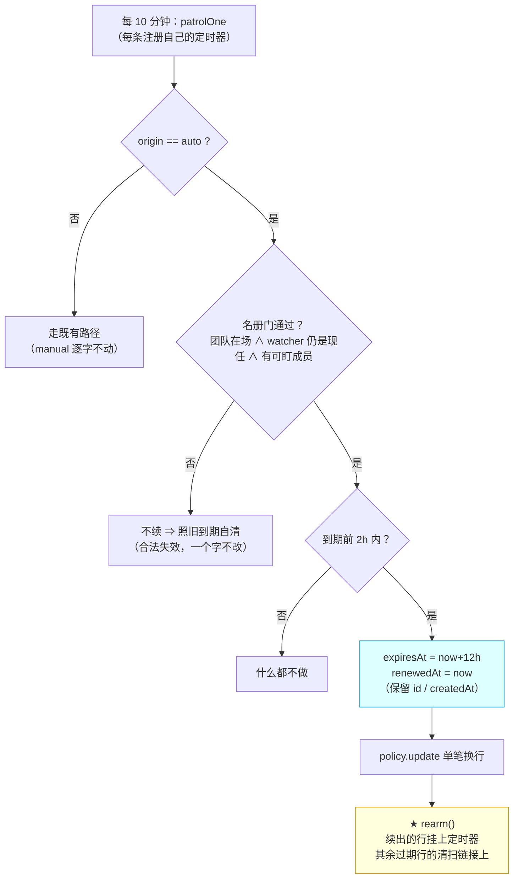
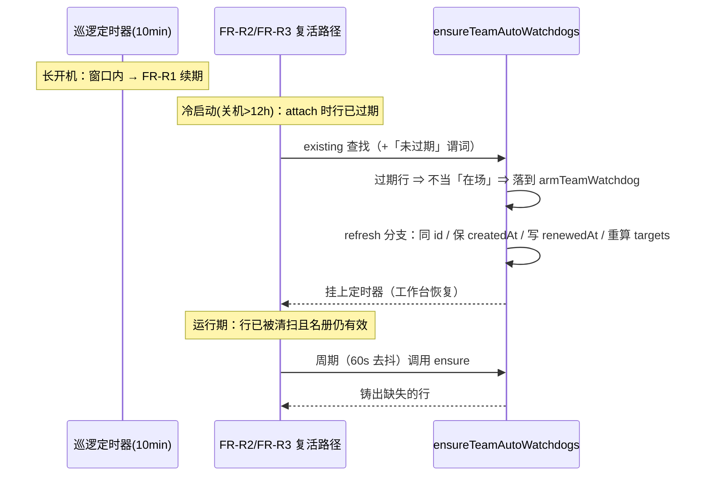

# 批 G · 自动工作台注册的续期 —— 设计档

> **规格档**。需求档 [`docs/2026-10-12-watchdog-renewal-requirements.md`](2026-10-12-watchdog-renewal-requirements.md)；
> 会诊纪要 [`docs/consult-minutes/2026-10-12-consult-43-minutes.md`](consult-minutes/2026-10-12-consult-43-minutes.md)（§2/§3 是本档决策的来源）。
> 行号一律 as-of **2026-10-12 工作树（commit `f641a6a`）**，实施按**符号名**定位。
> ★ 本档全文不写出框定 token 的原串（批 E 立的仓规）。

---

## §0 三句话结论

1. **这是什么**：给「工作台摘要」的自动注册接上**续期** —— 它今天有 12 小时 TTL 却没有续期路径，连续开机满 12 小时就静默熄灭（你原始投诉的复现路径）。
2. **怎么修**：把 `planAutoWatchdog` 里**已经写好、也已经被文案承诺过**的 refresh 语义，接到**进程里唯一还活着的周期路径**（每条注册的 10 分钟巡逻定时器）上；并补两个同源洞（冷启动 >12h、睡过窗口）。
3. **代价**：新增 1 个常量、1 个持久化字段、3 条写路径（全是复用既有落点）；**不新增 import、不建新定时器**；`ensure` 的 `continue` **不翻转**（乙已否决），它只按 FR-R2 增加**一个谓词**，refresh 分支只按 🔴#1 的裁定统一字段形状。





---

## §1 背景

- **2026-10-12 00:16**：用户重启 DSH 后，宿主验「批 D 的自愈补挂」时读到 —— 13 条 `来源 auto` 的注册全部 `present`（attach 后置链于 `00:14:02` 跑过），但**到期时刻集中在建队时刻 + 12 小时**；其中 10 条约 10 分钟后到期。
- 本文档要回答的问题是：**到期之后怎么办？** 今天答不上来 —— 没有任何东西会续它。
- 用户同日 00:27 裁定：「**甲**（在巡逻定时器里续期），但是先会诊决策，然后走工程模式修/实施」，并声明「我睡觉了」⇒ 本批由父侧按会诊结论贯彻。

## §2 问题

### 2.1 现象

工作台摘要（`origin === "auto"` 的那条看门狗注册）在**连续开机满 12 小时**后静默失效；恢复它只能靠 **重启 DSH** 或**手动 `team_link_watch action=arm-team`**。
而 `arm-team` 要求调用方是**该队现任协调者**（`lib/index.js:13156` 一侧的门）⇒ 用户无法从任意会话一键救活**所有**团队。

### 2.2 根因（带证据，逐行核对）

| # | 事实 | 出处 |
| --- | --- | --- |
| ① | 自动注册的 TTL 是 12 小时 | `lib/index.js:278` `WATCHDOG_DEFAULT_TTL_HOURS = 12` |
| ② | 续期代码**存在，但永远跑不到**：`planAutoWatchdog` 命中旧条目时返回带新 `expiresAt` 的条目；而调用方 `ensureTeamAutoWatchdogs` 发现条目存在就 `continue`，根本不调 `armTeamWatchdog` | `:2573-2575`（返回）vs `:2614-2617`（`continue`） |
| ③ | 没有任何周期任务碰续期：`ensureTeamAutoWatchdogs` 只有两个调用点，都是「挂载时刻」事件 | `:13670`（attach 后置链）· `:13156`（`arm-team`） |
| ④ | 每条注册有自己的巡逻定时器（auto 的巡检间隔 10 分钟）——**这是进程里唯一周期性触碰活注册的机制** | `:2936-2943`（`schedule`）· `:292`（`WATCHDOG_AUTO_INTERVAL_MINUTES = 10`） |
| ⑤ | auto 行**唯一**的 GC 就是 TTL 到期：`removeWatchdog` 的调用点只有到期门一处；`set-role` / `retire` / rotation 落定都**不**清 watchdogs；`clear` 又拒清 auto | `:3086-3089`（到期门）· `:5772` / `:5808`（只调 `sections.sync()`）· `:13091-13094`（拒清） |
| ⑥ | `rearm()` 对过期行**不挂定时器**，只给最新那条过期行挂清扫专用表；清扫靠 `removeWatchdog` 末尾的 `rearm()` 接棒 | `:3181-3196` · `:2957-2963` |
| ⑦ | ★ **第二个洞**：`ensureTeamAutoWatchdogs` 的 `existing` 查找**不查 `expiresAt`** ⇒ 冷启动（关机 >12h）后过期行被当「在场」报 `present` 然后 `continue`，随后被清扫链逐条收掉 ⇒ 工作台**当场死透**（比 12h 慢死更快） | `:2612-2617` |

### 2.3 影响面

- **用户可感知**：工作台摘要（谁在跑 / 谁空闲 / 谁需处置）停止投递 —— 这正是用户最初的投诉。
- **文案与实现已经不一致**：`clear` 的拒绝文案写「它**随团队存在**，只能靠 TTL 到期或团队解散消失」（`:13094`），摘要脚注写「不需要你维护」（`:2875-2877`）—— 而实情是「12 小时就死、要人为 arm-team 维持」。
  ⇒ 本批是**修实现去对齐既有承诺**，不是改语义。

## §3 目标与非目标

**目标**：`origin === "auto"` 的注册，在其**名册依据仍然成立**期间，**不需要重启、不需要人操作**就保持有效。

**非目标**（本批明确不做）：
1. 不改 TTL 常量（丙案已否决）；
2. 不改 `arm-team` 的**入口语义**（它仍是显式入口、仍幂等）；但 **FR-R2 让 ensure 的「存在」不再包含已过期行** ⇒ 经 ensure 的 `arm-team` 会**重建**过期行 —— 这是本批的**有意行为**（★ 评审第 3 轮 🟡#13 的措辞更正：原写「不改 `arm-team` 的既有语义」，与 FR-R2 对 ensure 谓词的改动相抵）；
3. 不给 `manual` 注册续期（人工 TTL 是用户的意志）；
4. 不给 `agent-team` 档的团队设门（与现状同级；设门会让 ensure 与续期两条路径语义分叉）；
5. 不做「注册熄灭时的主动告警」（US-G2 的完整形态）；
6. 不动看门狗的其它参数（静默阈值、巡检间隔、投递条件）。

## §4 决策与理由

| # | 决策 | 理由 | 被否决的备选与理由 |
| --- | --- | --- | --- |
| **D1** | 续期挂在**巡逻定时器**里（甲） | 它是长开机下**唯一**活着的周期驱动（证据 ④） | **乙**（翻转 ensure 的 `continue`）：只覆盖重启/手动两个时刻，用户场景一次都不跑；**丙**（TTL→24h）：只把死线后挪；**摘要投递时顺带滑动**：安静团队 12h 一条都不发 ⇒ 恰好放过最需要兜底的场景 |
| **D2** | 续期必须带**名册门**（团队在场 ∧ `watcher === 现任协调者` ∧ 非空 targets） | 到期现在**身兼两职**：用户可感知的租约 + 换人/删队的隐形 GC（证据 ⑤）⇒ 续期必须把两职拆开 | **裸甲**（见 auto 就续）：会把「团队已删 / 协调者已换 / 已退役」续成永生僵尸 |
| **D3** | **不设**观察者活性门 | 工作台摘要是**团队资产**，不是那个会话窗口的属性；死观察者的输出本来已被 `patrolOne` 的活性门压住 ⇒ 续期零噪音零成本，协调者会话重开（**不重启**）时摘要自动恢复 | **设活性门**（kimi-k3 的多数少数派意见）：会重新引入「协调者窗口关着、机器长开 ⇒ 摘要静默熄灭」——正是原始投诉的另一半 |
| **D4** | 窗口 **2 小时** | auto 巡检 10 分钟 ⇒ 2h = **12 次**续期机会，容忍休眠/抖动；**写频不受影响**（续期后窗口顺延到 +10h） | **窗口 0 / 到期即续**（deepseek-v4-pro）：推理上更优雅（消除相位赛跑），但**前提不成立** —— 它依赖「过期行仍有巡逻定时器」，而 `rearm()` 不给过期行挂表（证据 ⑥）；**30 分钟**（kimi-k3）：余量偏紧 |
| **D5** | 续期写盘后**补一次 `rearm()`** | 证据 ⑥：续期让某条行不再走删除 ⇒ 同队「该合法死掉」的过期行**永远没人碰**，清扫链断 | 「续期不碰定时器」（kimi-k3）：单条视角成立，漏了同队其它过期行那一面 |
| **D6** | 同时修**冷启动洞**（FR-R2）与**运行期复活**（FR-R3） | 证据 ⑦ 是与 R1 同源但**独立存在**的洞；FR-R3 还顺带关掉「换届后新协调者的行要等重启才建」 | 「只做 R1 + R2」：机器睡过 2h 窗口 + 到期点时，行已被清扫，今天没有任何东西会重建它 |
| **D7** | 续期**保留原 `createdAt`**，只加 `renewedAt` | 续期是**租约顺延**，不是重建 | 沿用 `planAutoWatchdog` 的 `:2574`（它会重写 `createdAt`）：语义错位 |
| **D8** | 留痕落**行字段** + 读面渲染，不走 logger | 本部署 `ctx.logger?.warn` 是空操作（FR-17 的存在理由就是这个） | 只写 logger：等于没留痕 |

## §5 方案（FR-x 交付单元）

| FR | 交付单元 | 落点（as-of 工作树） | 验收 |
| --- | --- | --- | --- |
| **FR-R1** | **续期**：`patrolOne` 内、**到期门之前**、窗口内、名册门通过 ⇒ 走 `planAutoWatchdog` 的 refresh 分支（保留 `id` / `createdAt`，**`targets` 按名册重算**，写 `expiresAt = now + WATCHDOG_DEFAULT_TTL_HOURS` 与 `renewedAt = now`）⇒ 单笔 `policy.update` ⇒ **`rearm()`**。判定用**本条目**、返回即止（**不做**外层预扫）。**名册门与 ensure 的谓词抽成同一个共享 helper**（评审 🟡#6：复制版会单边漂移） | `patrolOne`（`:3085` 起）· 到期门 `:3086-3089` 之前 | U1 / U2 / U3 / U4 / U9 |
| **FR-R2** | **乙′**：`ensureTeamAutoWatchdogs` 的 `existing` 查找加「未过期」谓词 ⇒ 过期行落到 `armTeamWatchdog` ⇒ 命中 refresh 分支（同 id 原地刷新 + 挂表）。★ **该分支同批改成与 FR-R1 同一字段形状**（评审第 2 轮 🔴#1）：`planAutoWatchdog` 的 refresh 分支（`:2573-2575`）今天会把 `createdAt` 重写成 now、且不写 `renewedAt`——而 §7 又声称 R2 是这两者的写者 ⇒ **同一机制两种说法**。裁定：**保留原 `createdAt`、写 `renewedAt`**（与 R1 逐字同形，重算 `targets`）。★ **评审第 3 轮 🟡#12 更正**：本行原写「该分支今天是死代码、改动零风险」——**不准确**。它今天**有活调用方**：`armTeamWatchdog` 消费它（`lib/index.js:2716-2718` 的 `planned.created ? … : current.map(…)`），而 `/team_session` 建队路径（`:9959`）调 `armTeamWatchdog` 时**没有 `existing` 守卫** ⇒ **同一个队 + 同一个协调者会话重建时会命中 refresh 分支**。⇒ 这次字段形状改动**也会改变那条路径**（§7 与 U5 已按此扩展） | `:2612-2613` + `:2573-2575` + `/team_session` 路径 `:9959` | U5 / U9 |
| **FR-R3** | **运行期复活**：在 `patrol` 的**循环体末尾**去抖地（60s，**进程级**时间戳，仿 `runRotationSweep` `:3150`；**不 await 在 tick 的关键路径上**，失败只留 warn）周期调用现有 `ensureTeamAutoWatchdogs` —— 除 FR-R2 那一个谓词外，其语义**逐字不变**。★ **去抖时钟必须可注入**（与 `patrol({ now })` 用**同一注入缝**）—— 否则判据只能靠墙钟真等 60s（评审第 2 轮 🔵#9） | `patrol`（`:3127` 一侧）循环尾 | U6 / U11 |
| **FR-R4** | **留痕可核**：`renewedAt` 落行字段 + **归一化白名单同批加键** + 状态卡/`watch list` 渲染「上次续期 …」 | 归一化 `watchdogList`（`:1228-1251`）· 渲染 `watchdogLines`（`:4551` 一侧） | U7 |
| **FR-R5** | **文档同批改准**：`markWatcherDead` 的注释口径（`:2995-2998`：「保留至 TTL」→「保留至**名册有效期内**；名册失效时由 TTL 收尸」）· 摘要脚注（`:2875-2877`）与 `clear` 文案（`:13094`）若与新行为不符则同改 · **四档逐一点名**（★ 评审第 2 轮 🟡#7）：`README.md`（看门狗 TTL 一节）· `CHANGELOG.md`（本批条目）· `docs/verification-log.md`（只追加本批小节）· **本批两份档自身**（需求/设计）—— 另按 D1「建档者随建随登」把**两份新档与 consult minutes 登记进文档地图**（★ 评审 🔵#11） | 前述注释行 · 四档 | **grep 可核**：注释新口径在场、**四档各自的条目串在场**（评审 🟡#4：原格错挂到 U8） |

## §6 机制伪代码（前置 / 后置条件）

```js
/** FR-R1 续期判定。前置：① **调用方（`patrolOne`）必须先过 `entry.origin === WATCHDOG_ORIGIN_AUTO` 门** ——
 *  manual 行根本不进本函数（评审 🔵#9：这道门原先只出现在 §0 图与 U8 反相里，规范节不自足）；
 *  ② `entry` 是本轮巡逻的**目标条目**（不是全表快照里的旧对象）；③ `now` 是注入时钟。
 *  后置：返回 true ⇒ 该条目的 expiresAt/targets/renewedAt 已落盘且定时器已重排（调用方应立即 return）；
 *        返回 false ⇒ 一个字节都没写（调用方继续走既有路径）。 */
async function renewAutoRowIfStillValid(entry, now) {
  // 门（名册真值 —— 与 ensure 会为它重铸的谓词同源）
  const team = policy.get().teams.find((t) => t.name === entry.team);
  if (team === undefined) return false;                                    // 团队已删
  if (roleOf(team, COORDINATOR_ROLE)?.current !== entry.watcherSession) return false; // 已换人 / 已退役
  const members = /* 与 ensure `:2618-2619` 同源的目标集 */;
  const planned = planAutoWatchdog(policy.get().watchdogs, { watcherSession: entry.watcherSession, team: entry.team, targets: members, now });
  if (planned.error !== undefined) return false;                           // 队缩到无可盯成员 ⇒ 让它死
  if (planned.created === true) return false;                              // ★ 评审第 2 轮 🔵#8：并发清理窗口内**不当“复活者”**（只 refresh 不 resurrect；map-by-id 写入本就写不到，这里显式化）
  // ★ 窗口：到期前 2h 内才写（写频 ≈ 每条每 10h 一次，不是每 10min 一次）
  if (now > entry.expiresAt || entry.expiresAt - now > WATCHDOG_RENEW_WINDOW_MS) return false;
  const next = { ...planned.entry, createdAt: entry.createdAt, renewedAt: now }; // 保留 id / createdAt（D7）
  try {
    await policy.update({ watchdogs: policy.get().watchdogs.map((w) => w.id === entry.id ? next : w) });
  } catch { return false; }                                                // fail-open：下个 tick 重试
  rearm();                                                                 // ★ D5：挂表 + 接回清扫链
  return true;
}
```

**插入位置（硬约束）**：`patrolOne` 内、到期门 `now > entry.expiresAt → removeWatchdog`（`:3086-3089`）**之前**；
对**本条目**判定，续成即 `return`（不回落到删除门）。

> ★ **评审第 2 轮 🟡#6**：上面**内联**的门谓词，就是 FR-R1 要求的**共享 helper 的函数体**（此处展开以便审阅）。
> **落码时它必须是一个函数**，被 `ensureTeamAutoWatchdogs` 与巡逻**共同**调用 —— 复制成两份会单边漂移，
> 那正是本批要修的「两条路径语义分叉」的形状。

## §7 状态与 schema

| 面 | 改前 | 改后 | 谁写 | 谁读 |
| --- | --- | --- | --- | --- |
| `policy.watchdogs[].expiresAt` | 建队/attach 时写一次，此后只减不增 | 巡逻在窗口内**顺延**到 `now + 12h` | 巡逻（FR-R1）· ensure（FR-R2） | 到期门 · `status` §③ · `watch list` |
| `policy.watchdogs[].targets` | 建队/attach 时写一次，此后**冻结** | **续期时按名册重导出**（成员中途入队从此会被盯上——评审 🔴#1/#2 的裁定落点） | 巡逻（FR-R1）· ensure（FR-R2） | 巡逻投递 · `status` §③ |
| `policy.watchdogs[].renewedAt` | **不存在** | **新增（加性字段，缺省 undefined）** | 同上 | `watchdogLines`（`:4551`）⇒ 状态卡 §③ 与 `watch list` |
| `policy.watchdogs[].createdAt` | 建队时写 | **续期不改**（D7） | — | 读面 |
| 归一化白名单 | 固定键集（`:1228-1251`） | **加 `renewedAt`**（不加就被静默丢掉） | — | — |
| 落点 / 写路径 | `policy.update` 单写 | **不变**（不新增写路径、不双写） | — | — |
| 常量 | — | 新增 `WATCHDOG_RENEW_WINDOW_MS = 2 * 3600000` | — | FR-R1 |

**`renewedAt` 的零迁移性**：加性字段，缺省即 undefined，旧数据无需迁移（与 `origin` 的引入同例 `:284-288`）。

## §8 防偏离（怎么被机械验证）

| # | 判据 | 红相构造 | 落点 |
| --- | --- | --- | --- |
| **U1** | **续期生效 ＋ 逐字段保真**（★ 评审第 2 轮 🟡#4）：名册有效 + 窗口内 ⇒ `expiresAt` 顺延到 `now+12h`、`renewedAt=now`、**`id` / `createdAt` / `silentMinutes` / `intervalMinutes` 逐字段不变**、`targets` 按名册重导出、`watchdogs` **数组长度不变**（不产生重复条目）、定时器**在位**、行**未被删除**。**另含活性档**（★ 评审第 2 轮 🟡#3：把 D3 的 2:1 裁定钉成判据）：**watcher 会话不 live / undefined ＋ 名册有效 ＋ 窗口内 ⇒ 照样续** | 撤掉续期分支 ⇒ 不动（或到期被删）⇒ 红；**设了活性门 ⇒ 活性档红** | `host-half.test.mjs` |
| **U2** | **四态负向**（不续，照旧到期被清）：团队不在名册 · watcher 非现任 · 协调者空缺 · 零可盯成员 | 去掉任一门 ⇒ 该态被续 ⇒ 红 | 同上 |
| **U3** | **写频**：窗口内连巡逻两次 ⇒ 第二次**零** `policy.update`（防 churn 回潮） | 把窗口判定写错（如无条件续）⇒ 第二次也写 ⇒ 红 | 同上 |
| **U4** | **清扫链不卡死**：混合「有效但过期」与「该合法死掉」的过期行 ⇒ 续有效的、删无效的，链**走到空** | 去掉续期后的 `rearm()` ⇒ 链断、行滞留 ⇒ 红 | 同上 |
| **U5** | **FR-R2 冷启动（字段形状须与 R1 同形 —— ★ 评审第 2 轮 🔴#1；含第三轮 🟡#12 那条活调用方路径）**：① attach 时行**已过期**且名册仍有效 ⇒ 同 `id` 原地刷新并**挂上定时器**（不是被当成 `present` 后清扫掉），且 **`createdAt` 保留原值、`renewedAt` 已写、`targets` 按名册重导出**；② **同一队 + 同一协调者会话再次 `/team_session` 建队**（走 `:9959` 那条**无 existing 守卫**的路径）⇒ 命中 refresh 分支时字段形状**同样**是「保 `createdAt` / 写 `renewedAt`」 | 去掉「未过期」谓词 ⇒ 报 present 后被清 ⇒ 红；refresh 分支仍重写 `createdAt` 或不写 `renewedAt` ⇒ 红（①② 两条各自红） | 同上 |
| **U6** | **FR-R3 复活**：名册有效但行**已被清扫** ⇒ 去抖窗口后的周期 ensure 重铸一条 | 撤掉周期 ensure ⇒ 永不重建 ⇒ 红 | 同上 |
| **U7** | **留痕可核**：`renewedAt` 出现在 `watch list` 与状态卡看门狗段的渲染文本里；且**归一化后仍在**（不丢字段） | 不把键加进归一化白名单 ⇒ 渲染里看不到 ⇒ 红 | 同上 |
| **U8** | **不回归**：manual 行到期**逐字节旧行为**；既有「过期行不挂定时器」断言（`:3181-3193` 一族）对**无效/手工**语义仍成立 | 误伤 manual ⇒ 红 | 同上 |
| **U9** | **`targets` 按名册重导出**（★ 评审 🔴#2：会诊采纳的行为**不能没有判据**）：名册有效 + 窗口内 + **成员漂移**夹具 ⇒ 续期后 `targets` **含新成员** | 续期保留旧 `targets` ⇒ 红（这正是今天的隐性缺口） | 同上 |
| **U10** | **名册有效但已过期 ⇒ 删而不复活**（★ 评审 🔴#3：需求档 NF-G1 明文要求；缺它则**被否决的 D4 备选可静默回潮**）：`now > expiresAt` 的行走 `removeWatchdog`，**不**原地续 | 把窗口守卫放宽成含过期行（＝被否决的「窗口 0」）⇒ 红 | 同上 |
| **U11** | **换届后新协调者的行**（★ 评审 🔵#10：D6 声称的收益要钉住）：旧协调者的行随名册门失效而死；**新**协调者在无行状态下由 FR-R3 的周期 ensure 铸出 | 撤掉周期 ensure ⇒ 新协调者永远没有行 ⇒ 红 | 同上 |
| **U12** | **fail-open 的失败路径**（★ 评审第 2 轮 🟡#2：错误路径也要有判据）：`policy.update` 抛错 ⇒ 巡逻**不抛**、条目**保留旧 `expiresAt`**、下个 tick 仍会重试（退化到今天的行为，**不引入新死法**） | 去掉 try/catch ⇒ 巡逻崩 ⇒ 红 | 同上 |
| — | **NF-G2（零新 import）**（评审 🔵#7 的指针） | 由**既有硬闸门**机械覆盖：八模块白名单（`host-half.test.mjs` 的 `HOST_IMPORTS`） | 既有 |
| — | **NF-G4（单写落点）**（评审 🔵#7 的指针） | 由 **U4 的混合夹具 + `policy.update` 的 map 构造**天然覆盖（盘上 diff 只动目标条目） | 既有 |

**夹具纪律**：一律用注入时钟（`patrol({ now })` 既有缝隙 `:3124-3126`）驱动，**不依赖墙钟**；每条红相判据同批给**负相自证**（证明夹具真的推得动）。

## §9 边界

| 面 | 行为 |
| --- | --- |
| **空集 / 畸形输入** | 名册里没有该团队 / `roleOf` 拿不到协调者 / `targets` 为空 ⇒ **不续**（照旧到期自清），不抛错 |
| **并发** | 同一条目的自有定时器与一次全量巡逻重叠 ⇒ 两次 `policy.update` 后写胜，无害；续期写丢了下个 tick 重试（窗口 12 次机会） |
| **重启 / 升级** | 无新依赖、无新 import；`renewedAt` 加性 ⇒ 旧数据免迁移 |
| **失败方向** | **fail-open**：`policy.update` 抛错 ⇒ 保留旧 `expiresAt`、巡逻不崩、退化到**今天的行为**（到期自清）——**新代码不引入新死法** |
| **不复活** | `now > expiresAt` 且名册无效 ⇒ 照旧删除（**不复活**）；名册有效时由 FR-R2/FR-R3 走「重建」而不是「复活」 |

## §10 实施注意（既有断言与语义迁移）

1. **既有断言迁移（★ 评审 🟡#5：已知清单，不留到实施期现场勘察）** —— 会诊纪要 §3 已点名两族，实施时按新语义**改写不是删除**（留**原名锚**，批 F 立的纪律）：
   - **`:2083` 一族**（「观察者死了注册保留到 TTL」）：D3 判定**不设活性门** ⇒ 该族在「名册仍有效」的夹具上期望**必变**（行会被续，而不是等到期死）；迁移时把「活性死亡 ⇒ 保留至 TTL」重挂到**名册失效**语义上，并在注释里留原名锚。
   - **`:3181-3193` 一族**（评审裁定 #9「过期行不挂定时器」）：对**无效/手工**行逐字成立、**保持不变**；但若其中混了 auto 行，需按新语义拆成「无效 ⇒ 不挂 / 有效且在窗口内 ⇒ 会被续」两条。
   - 两族都要给「修复前必红 / 修复后全绿」两次实测读数（`AGENTS.md` §三）。
2. **`markWatcherDead` 的注释口径**（`:2995-2998`）：「keeping the registration until its TTL」⇒ 改为「保留至**名册有效期内**；名册失效时由 TTL 收尸」（D3 的代价，如实入档）。
3. **不做外层预扫**：续期只作用于**本轮巡逻的那一条**（快照陷阱，见 §4 D1 的否决项）。
4. **测试标识符**用 `Rg` 中缀（如 `rgRenewEnv`），避免与既有顶格声明重名（批 E 的教训）。
