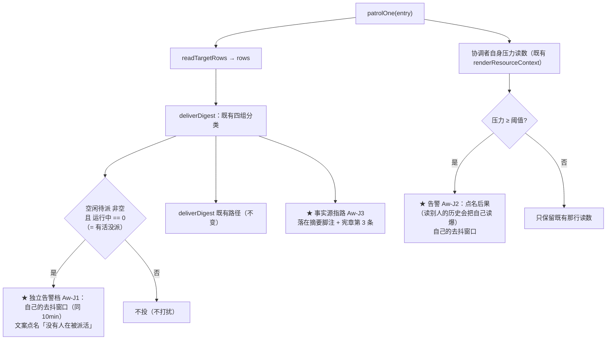

# 批 J · 协调者的派工信号加固 —— 设计档

> **规格档**。需求档 [`docs/2026-10-13-coordinator-signal-requirements.md`](2026-10-13-coordinator-signal-requirements.md)。
> 行号一律 as-of **2026-10-13 工作树（commit `f24f167`）**，实施按**符号名**定位。
> ★ 本档全文不写出框定 token 的原串（批 E 立的仓规）；新测试标识符统一用 **`Cj` 中缀**。

---

## 0. 结论与图

**三句话**：① 既有「空闲待派」只是摘要里的一行散文、还被「有可行动内容才投」的门关着 ⇒ 把「**队员全闲、没人被派活**」提成**独立告警档**（有自己的去抖）；② 给协调者加**自身上下文压力告警**（过阈值才说），把「读别人的历史」这件事的**后果**点名；③ 宪章与摘要脚注里**写明事实源**（看队员在干什么 ⇒ 读黑板 `tasks`，不要读它的会话历史）。



---

## 1. 背景

需求档 §2.1 的真机读数：`bac-1009` 的三个队员**全部空闲**，协调者却在自己做记账与文档，并**自认**三次越界。
而宪章（`lib/index.js:3793`）**早就**逐字写着「不实施 / 实施一律派给团队成员 / 成员空闲=待派工」。
⇒ 本批的目标不是补规则，而是**让既有规则更难被忽略**，并**给出一条不必读对方历史的查活路**。

---

## 2. 问题（根因，带 file:line）

| 根因 | 代码事实 |
| --- | --- |
| **①「有活没派」信号太软且被关** | 摘要把空闲队员渲染为一行散文（`renderWatchdogDigest`，`lib/index.js:3148`）；投递受 `watchdogDigestActionable`（`:3116`）＋ 10 分钟去抖 + 指纹去重（`deliverDigest`，`:3343-3346`）三道门 |
| **② 没有压力告警，也没有「别读别人历史」** | 资源行只给一个百分比（`renderResourceContext`，`:3781`）；全仓检索「读别人的历史 / 会话历史」在宪章与脚注里**零命中** |
| **③ 事实源指路不明** | 宪章第 3 条（`:3798`）只说「开工先看状态」，**没写**要看队员在干什么该读哪里 |

---

## 3. 目标

**做完之后**：协调者每收到一次工作台信息，**同时**得到三件它今天要自己猜的事 ——
「有没有活没人被派」·「我自己的窗口还剩多少」·「想看队员在干什么该读哪里」。

**非目标**：需求档 §五（逐条：不拦截、不替它派工、不动失联三态、不改阈值语义、不做零代码诊断页）。

---

## 4. 决策与理由

| # | 决策 | 理由 | 被否决的备选 |
| --- | --- | --- | --- |
| **D1** | **「有活没派」提成独立告警档**，触发条件 = **空闲待派非空 ∧ 运行中为空** | 这个组合正是「**没人被派活**」的精确形态，而它今天与「刚转空闲」等同档处理。条件用**两个既有分组**算，不新增读数。★ **评审 🔵#5 要求点破的近似**：US-J1 字面上的「**协调者自己在干活**」**对插件不可观测**（那一步走宿主子代理工具，需求档非目标 1 已承认）⇒ 本档以**可测组合**近似（空闲非空 ∧ 无人在跑）。它会**包含**「团队确实没活干」这一超集 ⇒ 误报由**去抖 + 限量 + 文案**兜住（文案**陈述事实**「没有成员在被派活」，**不指控**）。 | ① 把空闲待派直接放进 `TICKABLE_VERDICTS`（会把它与「失联」混为一谈 —— 需求档非目标 3 禁止）· ② 每轮都投（会刷屏）· ③ 试图观测「协调者在干活」（做不到） |
| **D2** | 新档**有自己的去抖窗口**（沿用 `WATCHDOG_DIGEST_DEBOUNCE_MS`，`lib/index.js:294`），**不与既有摘要共用指纹** | 既有指纹是「四组 id 序列」（`watchdogDigestSignature`，`:3121`）—— 新档要与它分开，否则其中之一的变化会抑制另一个。 | 复用既有指纹（互相抑制） |
| **D3** | **只警告、不自动派活** | 插件的既有红线：机械动作要么有门、要么只读。自动派活要替协调者做决策，超出本批。 | 自动派工（越权 + 无法回滚） |
| **D4** | **压力告警的阈值取常量并具名**（建议 **60%**），文案**点名后果** | 「60%」是**保守值**：真机读数里协调者到 40.1% 时已在读别人历史。阈值具名 ⇒ 判据可钉、将来可调。 | 不警告（现状）· 按「低于阈值才正常」的表述（违反既有「只给读数+结论」纪律） |
| **D5** | **事实源指路写两处**：宪章第 3 条（`:3798`）＋ 摘要脚注（`renderWatchdogDigest` 的 footers 段，`:3151-3158`） | 宪章是**会话期恒定**的段（压缩后可能淡出），脚注**每次摘要都到** ⇒ 两处覆盖两种时机。 | 只改一处（覆盖不全） |
| **D6** | **不动 `renderResourceContext` 的既有那行**，告警**另起一行** | 那行是**资源读数**的唯一出口（有既有判据钉着）；把告警塞进去会改变既有判据的字节。 | 改写既有行（牵动既有判据） |

---

## 5. 方案（FR-J1…FR-J4）

| FR | 内容 | 落点（符号名 · 行号 as-of） |
| --- | --- | --- |
| **FR-J1** | **新增告警档「有活没派」**：`idleAwait` 非空 ∧ `running` 为空 ⇒ 投一条独立消息；文案点名「**没有人在被派活**」并列出空闲队员；受 D2 的去抖 | `lib/index.js` 的新函数（与 `deliverDigest` 同闭包）· 触发点在 `patrolOne`（`:3476` 邻近） |
| **FR-J2** | **协调者自身上下文压力告警**：压力 ≥ 具名阈值 ⇒ 投一条点名后果的消息（「**再读别人的会话历史会把你自己的窗口读满**」），受自己的去抖 | 读侧复用既有 `renderResourceContext` 的投影路径（`:3760-3785`）· 投递在 `patrolOne` 的 watcher 分支（`:3451-3476`） |
| **FR-J3** | **事实源指路**：宪章第 3 条改写为「…；要看某位成员在干什么 ⇒ **读那个团队的黑板 `tasks.md`**（`team_link_team_read`），**不要读它的会话历史**」；摘要脚注同批加一句 | `renderCharterLines`（`:3793-3803`）· `renderWatchdogDigest` 的 footers（`:3151-3158`） |
| **FR-J4** | **同批改准**：工具 description / README 里凡描述「摘要包含什么」的地方，与新档同批改准（文档卫生 5） | `team_link_watch` 的 description（`:13681`）· `README.md` 摘要段 |

**改动的文件面**：`lib/index.js` · `host-half.test.mjs`（新判据块）· 本批两份档 · `CHANGELOG.md` · `README.md`。

---

## 6. 机制伪代码（前置 / 后置）

```js
/**
 * 前置：rows 是本轮巡逻读到的目标行（{target, signal, previous}）；now 是注入时钟。
 * 后置：恰在满足条件且不在去抖窗口内时投递一次；否则零投递（纯读，无副作用）。
 * 不抛：调用方已有 try/catch（与 deliverDigest 同姿态）。
 */
function deliverIdleAlert(entry, watcher, rows, now) {
    const groups = classifyWatchdogTargets(rows);          // 既有函数（:3104），不复制
    if (groups.idleAwait.length === 0) return;             // 没有空闲成员 ⇒ 不打扰
    if (groups.running.length > 0) return;                 // 还有人在跑 ⇒ 不算「有活没派」
    const signature = groups.idleAwait.map(r => r.target).join(",");
    const last = idleAlerted.get(entry.id);
    // ★ 评审 🔴#1 的裁决：窗口内不重复；窗口外**复投**（让信号不沉没），但每段限量。
    if (last && last.signature === signature) {
        if (now - last.at < WATCHDOG_DIGEST_DEBOUNCE_MS) return;   // 窗口内 ⇒ 零投递
        if (last.count >= IDLE_ALERT_MAX_PER_EPISODE) return;      // 本段已投满 ⇒ 等状态变化
    }
    const count = last && last.signature === signature ? last.count + 1 : 1;   // 签名一变 ⇒ 重置为 1
    watcher.followup(relayUserMessage(renderIdleAlert(entry, groups, now), entry.watcherSession));
    idleAlerted.set(entry.id, { at: now, signature, count });
}

/** 压力告警：读 watcher **自身**的投影（★ 只发给现任协调者，评审 🟡#2）；同一档不重复。 */
function deliverPressureAlert(entry, watcher, now) {
    if (!isIncumbentCoordinator(policy.get(), entry.team, entry.watcherSession)) return;  // ★ 角色门
    const reading = renderResourceContext(ctx, ctx.agents.get(entry.watcherSession), () => {});  // ★ 真名（:3894）
    if (reading.percent === undefined || reading.percent < LIAISON_PRESSURE_WARN_PERCENT) return;
    const bucket = bucketOf(reading.percent);              // ★ = Math.floor(p / 10)（每 10% 一档，评审 🟡#3）
    const last = pressureAlerted.get(entry.id);
    if (last && now - last.at < WATCHDOG_DIGEST_DEBOUNCE_MS) return;
    if (last && last.bucket === bucket) return;            // 同一档不重复
    watcher.followup(relayUserMessage(renderPressureAlert(reading, now), entry.watcherSession));
    pressureAlerted.set(entry.id, { at: now, bucket });
}
```

**新增符号**：`LIAISON_PRESSURE_WARN_PERCENT`（具名常量，建议 60）· **`IDLE_ALERT_MAX_PER_EPISODE`**（具名常量 = **3**）· **`bucketOf(percent) = Math.floor(percent / 10)`**（档粒度**写死**）· `deliverIdleAlert` / `deliverPressureAlert` · `renderIdleAlert` / `renderPressureAlert` · 两个去抖 Map（`idleAlerted` / `pressureAlerted`，与既有 `digested` 同姿态）。
**既有符号（经回读确认的真名）**：`classifyWatchdogTargets`（`:3104`）· `renderResourceContext`（`:3894`，**不是** `readSessionResources` —— 那个名字不存在，评审 🟡#3 验出父侧写错）· `isIncumbentCoordinator`（`:4720` 邻近的既有判定）· `WATCHDOG_DIGEST_DEBOUNCE_MS`（`:294`）。
**前置**：`entry.watcherSession` 是一个活代理（`patrolOne` 的 watcher 门已过）。
**后置**：两条消息**都过既有消毒出口**（`wellFormed` / `noticeField`）；内存态 Map 有界（按 `entry.id`，注销即失）。

---

## 7. 状态与 schema

**零持久化变更**：本批**不新增/删除任何 `policy.json` 字段**，两个去抖 Map 是**进程内**状态（重启即失，与既有 `digested` / `ticked` 同姿态 —— 它们本来就不落盘）。

| 项 | 变更 |
| --- | --- |
| `policy.json` | **一字不改** |
| 进程内新增 | `idleAlerted` / `pressureAlerted`（Map，键 = `entry.id`）· 一个具名阈值常量 |
| 谁写谁读 | 不变（摘要类投递是 `watcher.followup`，与既有完全同路） |
| import 面 | **8 条不变**（不新增任何名字 —— 连解构列表都不动） |

---

## 8. 防偏离（判据与红相构造）

**判据统一在 `host-half.test.mjs` 新增「批 J」块，标识符 `Cj` 中缀。**

| # | 判据 | 红相（怎么让它红） |
| --- | --- | --- |
| **U1** | **「有活没派」触发条件**：空闲待派非空 ∧ 运行中为空 ⇒ **恰投一条**；两个反相各自不投（① 有人在跑 ② 没有空闲成员） | 把条件写成「只要空闲待派非空就投」⇒ 反相①红；把条件写成永不投 ⇒ 正向红 |
| **U2** | **自己的去抖与限量（★ 评审 🔴#1 后的口径）**：同一签名 10 分钟内连投两次巡逻 ⇒ **第二次零投递**；窗口外 ⇒ **复投**（信号不沉没）；**同一签名投满 `IDLE_ALERT_MAX_PER_EPISODE`(=3) 次后**，窗口外也不再投，直到**签名变化**（成员集合变了）才重置计数 | 去掉窗口 ⇒ 本条红；把「窗口外复投」整段删掉（回到永不复投）⇒ 本条红；去掉限量 ⇒ 无限复投 ⇒ 本条红 |
| **U3** | **与既有摘要互不抑制**：同一轮里「摘要」与「有活没派」**各投一条**（互不吃掉对方） | 复用既有指纹 ⇒ 其中一条被抑制 ⇒ 本条红 |
| **U4** | **压力告警**：★ **只发给现任协调者**（非协调者的 watcher ⇒ **零投递**，评审 🟡#2 的角色门）；现任协调者压力 ≥ 阈值 ⇒ 投；< 阈值 ⇒ 不投；**同一档（每 10%）不重复** | 去掉阈值判断 ⇒ 反相红；去掉档位判断 ⇒ 重复投 ⇒ 本条红；**去掉角色门** ⇒ worker 也收到 ⇒ 本条红 |
| **U5** | **事实源指路在场**：宪章文本**含**「黑板」与「tasks」与「不要读…会话历史」三段必经字样；摘要脚注同批含指路句 | 去掉任一处 ⇒ 本条红 |
| **U6** | **反走私**：把注册参数（团队名 / 目标 id）替换成含换行与控制字符的载荷 ⇒ 投出的消息里**不含**那些字节（过 `noticeField`） | 绕过消毒出口 ⇒ 本条红 |
| **U7** | **不回归**：`TICKABLE_VERDICTS` 仍**恰三态**；摘要四组语义与行数预算与改前逐字一致 | 顺手把空闲待派塞进三态集合 ⇒ 本条红 |
| **U8** | **零新依赖 / 零 schema**：顶层 `import` 仍 8 条；`policy.json` 键集仍十键 | 新增 import 或字段 ⇒ 本条红 |
| **U9** | **FR-J4 的文档面同批改准（★ 评审 🔵#6 要求给 FR-J4 一条判据）**：`team_link_watch` 的 description **与** `README.md` 的摘要段**都含**新事实源指路句（宪章那句的同义表述）；两处**逐字一致** | 任一处漏改 ⇒ 本条红 |

**两次实测读数（实施方必须给）**：修复前（把两条新告警的调用点去掉）⇒ **U1/U3/U4 红**；接上 ⇒ 全绿。

---

## 9. 边界

| 情形 | 行为 |
| --- | --- |
| **协调者自己不 live** | `patrolOne` 的既有 watcher 门先挡（`:3451-3455`）⇒ 两条告警都**不投**（不可能投给一个不存在的代理） |
| **★ 协调者没有任何在册 watch（评审 🟡#4 补）** | **两条告警都不存在** —— 巡逻是**唯一的驱动源**（`patrol()` 只遍历 `policy.get().watchdogs`，`:3488`）；没有注册就没有巡逻。**这是本批的已知前提**：可接受，因为被派活的一方（协调者）**必然**有一条全队工作台的自动注册（`/team_session` 建队时自动挂，`origin=auto`；老团队由 attach 的按队补挂兜底）⇒ **实践上恒成立**；本行明确写出，避免读者以为「任何会话都能收到这两条告警」。 |
| **团队只有协调者没有成员** | `idleAwait` 为空 ⇒ U1 反相 ⇒ 不投（本来也无人可派） |
| **成员全部在跑** | `running` 非空 ⇒ 不投（这正是「有人在干活」，不该打扰） |
| **读不到压力投影** | `renderResourceContext` 的既有「不可读」支（`:3769`）⇒ 压力告警**走「读不到就不说」**（绝不编造一个百分比） |
| **去抖 Map 无界增长** | 按 `entry.id`，注销/换届即失；条数上界 = 注册数（既有的同类 Map 同规矩）；`idleAlerted` 每条只存 `{at, signature, count}`（定长） |
| **失败方向** | **fail-open**：告警投不出去只留一行 warn（与 `deliverDigest` 的 catch 同姿态，`:3353-3356`），绝不让巡逻崩 |
| **重启** | 去抖窗口与**限量计数**清零 ⇒ 重启后**可能**立刻再投一次同类告警（**可接受**：重启本身就是状态剧变，且既有的 `digested` 同行为） |

---

## 10. 第二轮设计评审的折入（9 条 · 2026-10-13；阈值由**用户裁定 = 50**）

> 第二轮评审（`advisor-dsh-13`）**PASS**（0 🔴 / 6 🟡 / 3 🔵）。下列 9 条为采纳项；**与本档前文冲突时以本节为准**。

| # | 级别 | 折入内容 | 落点 |
| --- | --- | --- | --- |
| 1 | 🟡 | **阈值 = 50**（★ **用户 2026-10-13 裁定**，取代 D4 原写的 60）；D4 理由改写为诚实版：50 覆盖动机场景（那次事故 40.1% 时 Aw-J2 会响），同时保留反噪余量；它是**具名常量**（`LIAISON_PRESSURE_WARN_PERCENT = 50`），将来一行可调 | §4 D4 · §6 常量 |
| 2 | 🟡 | **U7 口径消歧**：摘要的**四组正文逐字不变**；**脚注是另一段**（FR-J3 往那里加一句指路），新句**仍在既有行数预算内** | §8 U7 |
| 3 | 🟡 | **Aw-J1 也加协调者门**：与 Aw-J2 同一把 `isIncumbentCoordinator`（US-J1 收件人本就是协调者） | §6 `deliverIdleAlert` 首行 · §8 U1 补「非协调者 ⇒ 零投递」 |
| 4 | 🟡 | **条件转假时重置该段计数**：`running` 非空 ⇒ **删掉**该 `entry.id` 的 `idleAlerted` 条目 ⇒ 下次满足条件是**新的一段** | §6 `deliverIdleAlert` · §9 |
| 5 | 🟡 | **设计输入出处**：本批**无会诊** —— 输入 = 用户 2026-10-12/13 的直接指令 + 父侧对 `bac-1009` 黑板的自证读数 | §1 |
| 6 | 🟡 | **既有字节锁须同批改准**：FR-J3 改**宪章第 3 条**与**摘要脚注**；若仓内有按字节钉死的判据 ⇒ 同批更新，并在报告点名（没有也要说明「已核：无锁」） | §5 · 报告 |
| 7 | 🔵 | **压力档位取「上升沿」**：仅**档位变大**时才再告警（跨档振荡不重复打扰）；§9 记明 | §6 `deliverPressureAlert` · §9 |
| 8 | 🔵 | **三处 `renderResourceContext` 锚点逐处标注**（调用点 / 投影区 / **定义** `lib/index.js:3894`） | §2 §5 §6 |
| 9 | 🔵 | **实施首步：确认压力读数的返回形状**（对象 vs 渲染串）再写 `.percent`，结论写进报告 | 实施首步 |

**判据总数（本批）**：**Cj U1 … U9 ＝ 9 条**。⇒ 实施必须**同批改准**所有计数声明。
★ **实施分批（因通道 30 分钟墙钟，2026-10-13 父侧拆单）**：**J-1 = FR-J1 + U1/U2/U3** · **J-2 = FR-J2 + U4** · **J-3 = FR-J3/J4 + U5/U7/U8/U9 + 全量计数与文档同步**。每单只做自己那一份；**文档最后写、且只写实测到的读数**（上一单就是先写好「已实施 / 9 条 / 红相 1683」然后被掐 ⇒ 那批谎已被父侧回滚，作为反面先例记此）。
