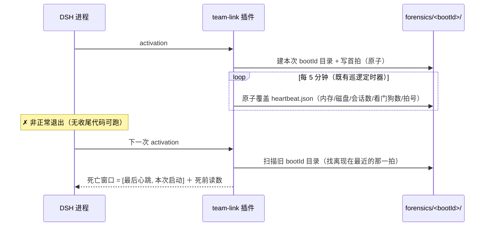

# 批 K · 崩溃现场留证（心跳） —— 设计档

> **规格档**。需求档 [`docs/2026-10-13-crash-forensics-requirements.md`](2026-10-13-crash-forensics-requirements.md)。
> 行号一律 as-of **2026-10-13 工作树（commit `f24f167`）**，实施按**符号名**定位。
> ★ 本档全文不写出框定 token 的原串（批 E 立的仓规）；新测试标识符统一用 **`Fk` 中缀**。

---

## 0. 结论与图

**三句话**：① 崩溃是**非正常退出**，进程没机会在死时写任何东西 ⇒ 唯一可行形态是「**活着时持续写**」；② 心跳写成**每次启动一个目录**（`<DSH_HOME>/team-link/forensics/<bootId>/heartbeat.json`），**原子写**、**定长小 JSON**、**按启动次数保留 10 份**；③ 下次启动**读上一次的目录**，就能算出「死亡窗口」并显示死前那一刻的内存/磁盘/会话数。



---

## 1. 背景

需求档 §2：崩溃史 **40 条**（自 2026-09-29），最近两次死亡窗口 `12:58:36Z → 01:37:59Z` 与 `00:18:52Z → 01:37:59Z`。
DSH 自带 `~/.dsh/death-forensics/` 已有半个仪表（`crash.log` / `heartbeat.log` / `state.json`），
但**心跳只有三格**（`ts` / `boot` / `pid`）⇒ **死前那一刻的机器状态无据可查**。

---

## 2. 问题（根因，带 file:line 证据）

| 根因 | 证据 |
| --- | --- |
| **① 死时没机会写** | 崩溃类型是 `non-graceful-end`（`~/.dsh/death-forensics/crash.log` 尾部 40 条逐条如此）⇒ 收尾代码**不会执行** |
| **② 宿主那半个仪表只记时间** | `heartbeat.log` 每行**只有三键**（实测：`{"ts":…,"boot":…,"pid":…}`）；`state.json` 只有 `bootId` / `pid` / `startedAt` / `lastEnd` |
| **③ 本插件零参与** | 全仓检索 `death-forensics` **零命中** ⇒ 插件目前**不写任何**崩溃相关的东西 |
| **④ 插件读不到宿主作业服务** | 模块级 `inject` 恰 4 项（`lib/index.js:100`：`sessionReferenceResolver` / `tools` / `sessionQuery` / `agents`）—— **没有 `jobs`** ⇒ 「在飞作业数」本批**不做**（需求档 §五 5） |

---

## 3. 目标

**做完之后**：任一次非正常退出之后，**下一次启动**就能读到「死前那一刻」的四类读数（内存 / 磁盘 / 活会话数 / 看门狗数）与**死亡窗口时长**。

**非目标**：需求档 §五（不归因 · 不碰宿主地盘 · 不做外部收集器 · 不记会话内容 · 不读作业服务）。

---

## 4. 决策与理由

| # | 决策 | 理由 | 被否决的备选 |
| --- | --- | --- | --- |
| **D1** | **心跳写在自己的目录**：`<DSH_HOME>/team-link/forensics/<bootId>/heartbeat.json` | 宿主目录 `death-forensics/` 是**宿主的地盘**（且我们读不懂它的内部结构）；写在插件自己的根目录旁边 ⇒ 与 `policy.json` 同级、权限与生命周期一致 | ① 写宿主 `death-forensics/`（越界，且宿主可能清理）· ② 写系统临时目录（会被清） |
| **D2** | **每次启动一个目录**，而不是覆盖同一个文件 | 文件系统**自带历史**：崩溃后那个目录还在 ⇒ 不需要任何额外逻辑就能拿到上一拍的现场。 | ① 单文件覆盖（历史丢失）· ② 追加日志（会无限增长，还要解析） |
| **D3** | **心跳内容 = 定长小 JSON**（≤ 1 KB） | 定长 ⇒ 写入快、原子覆盖永不撕裂；小 ⇒ 磁盘可忽略。 | 记录大对象（慢、且可能写一半） |
| **D4** | **写频 = 既有巡逻定时器（10 分钟）**，首拍在 activation | **零新增定时器**（复用既有 patrol）—— 与既有「一个后台定时器干两件事」的姿态一致（`:3496-3499`）。⇒ 死亡窗口的**精度上界 = 10 分钟**，如实登记。 | 新增 1 分钟定时器（多一个后台负载） |
| **D5** | **保留上限 = 最近 10 次启动**，超出按最旧清理 | 有界（NF-K3）；10 次 ≈ 覆盖最近几次崩溃，够用。 | 不清理（无界）· 保留 1 次（看不到模式） |
| **D6** | **不做外部收集器 / 不发 HTTP** | `node:http` 不在 8 条白名单里；外部进程是更重的一步（需求档 §五 3）。**等本批跑出几组现场再谈**。 | 起独立进程 / 发 HTTP |
| **D7** | **读面 = 让既有 `team_link_status` 支持 `action=forensics`**（只读），**不加新工具** | 插件有**工具数同改锁**（`host-half.test.mjs:5604` 断言「README 计数 == 实际注册数」）；加第 12 个工具要动多处计数。而「看崩溃现场」天然属于状态卡这一家。 | 新增 `team_link_forensics` 工具（要改工具计数与多处文档） |

---

## 5. 方案（FR-K1…FR-K4）

| FR | 内容 | 落点（符号名 · 行号 as-of） |
| --- | --- | --- |
| **FR-K1** | **开一次启动的现场目录**：activation 时算 `bootId`（`<ISO>-<pid>` 形态，与宿主同形）、建 `forensics/<bootId>/`、写首拍 | 新函数（模块级）· 调用点：attach 后置链（与既有 `runPatrolEnsure` 同链，`:14443` 邻近） |
| **FR-K2** | **周期心跳**：每次巡逻写一拍（原子覆盖 `heartbeat.json`）；内容见 §7 | `patrol()`（`:3485-3503`）循环体末尾，与 `runPatrolEnsure`（`:3495`）并列 |
| **FR-K3** | **启动时算死亡窗口**：扫描 `forensics/*/`，取**非本次**目录里 `lastBeatAt` 最大的那份 ⇒ 与本次 `startedAt` 一起渲染 | 同上新模块；读数缓存在进程内（activation 一次） |
| **FR-K4** | **读面**：`team_link_status` 新增可选参数 `action=forensics` ⇒ 输出「本次启动 + 上一次的死亡窗口 + 死前读数 + 保留份数」；**不带该参数时输出逐字不变** | `team_link_status` 的 handler（`:13408` 注册 · 渲染在 `:13485` 邻近） |

**改动的文件面**：`lib/index.js`（一个新模块区 + 巡逻挂钩 + 状态卡一个新动作）· `host-half.test.mjs`（新判据块）· 本批两份档 · `CHANGELOG.md` · `README.md`（状态卡动作表）。

★ **字段面的诚实边界（必须写进实施任务）**：`在飞作业数` **本批不做** ——
插件读不到宿主的作业服务（`:100` 的 4 项 inject 里没有 `jobs`）。读数里**不得**出现这一格，
也不得用「猜测的 0」冒充（需求档 §五 5）。

---

## 6. 机制伪代码（前置 / 后置）

```js
/** 前置：ctx / policy 可用；DSH_HOME 由既有 policyPath 的根推导（不新 import）。 */
function forensicsDirOf(bootId) { return path.join(forensicsRoot, bootId); }

/**
 * 后置：目录存在；heartbeat.json 是一次完整原子写；失败只 warn，绝不抛。
 * 不抛：否 —— 内部 catch 全吞（它是观测，不是功能；NF-K4）。
 */
async function writeHeartbeat(now) {
    const doc = {
        schema: 1, bootId, pid: process.pid,
        startedAt, lastBeatAt: new Date(now).toISOString(), seq: ++beatSeq,
        uptimeSeconds: Math.round(process.uptime()),
        memory: memoryReading(),          // process.memoryUsage()：rss / heapUsed / heapTotal
        disk: diskReading(),              // statfs(fsRoot)：free bytes（读不到 ⇒ null，不编造）
        sessions: { live: liveAgentCount(), roster: rosterSessionCount() },
        watchdogs: watchdogRowCount(),
        // ★ 在飞作业数：本批不做（读不到宿主作业服务）
    };
    try { await writePolicyFileAtomic-ish(dir + "/heartbeat.json", JSON.stringify(doc)); }
    catch (e) { warnOnce("heartbeat write failed: " + describeError(e)); }
}

/**
 * 启动时：找上一次的现场（不含本次）。
 * 后置：返回 { lastBeatAt, bootId, readings } 或 null（没有旧目录 ⇒ 首次运行，如实说「无」）。
 * 不抛。
 */
function readPreviousForensics() { /* 扫描 forensics/*/heartbeat.json，取 lastBeatAt 最大且 bootId !== 本次 */ }

/** 保留上限：按目录 mtime 排序，删掉最旧的第 11 份起。失败只 warn。 */
async function pruneForensics(keep = 10) { /* 纯读目录 + unlink；越界不删 */ }
```

**新增符号**：`bootId` / `forensicsRoot` / `writeHeartbeat` / `readPreviousForensics` / `pruneForensics` / `renderForensicsReport` · 具名常量 `FORENSICS_KEEP_BOOTS = 10`。
**前置（对 `writeHeartbeat`）**：`forensicsRoot` 已建（activation 那一步）。
**后置（对 `pruneForensics`）**：目录数 ≤ keep；**永不删本次**。

---

## 7. 状态与 schema

**新增磁盘状态**（在插件自己的根目录下，与 `policy.json` 同级）：

```
<DSH_HOME>/team-link/forensics/
  └── <bootId>/                      ← 每次启动一个目录（D2）
        └── heartbeat.json           ← 定长小 JSON，原子覆盖（D3）
```

| 字段 | 类型 | 含义 |
| --- | --- | --- |
| `schema` | `1` | 本文件的形状版本（**独立于** `POLICY_FILE_SCHEMA`，两者不相干） |
| `bootId` / `pid` / `startedAt` | string / number / string | 本次启动的身份（与宿主 `state.json` 同形，便于对时间线） |
| `lastBeatAt` / `seq` | string / number | 最后一拍的时刻与序号（**死亡窗口的计算依据**） |
| `uptimeSeconds` | number | 进程已运行秒数 |
| `memory.rss` / `heapUsed` / `heapTotal` | number（字节） | `process.memoryUsage()` 的读数（**不引入依赖**） |
| `disk.free` / `total` | number \| null | `statfs` 的读数；**读不到就是 `null`，不许编造** |
| `sessions.live` / `sessions.roster` | number | 活代理数（`ctx.agents.list()`）· 名册行数（`policy.get().teams`） |
| `watchdogs` | number | `policy.get().watchdogs.length` |
| **`jobs`** | **—— 不做 ——** | 读不到宿主作业服务（§5 的诚实边界） |

**谁写谁读**：插件写；`team_link_status action=forensics` 读（只读，不写任何东西）。
**`policy.json` 一字不改**；**import 条数不变（8）**（`statfs` 若采用，只在既有 `node:fs/promises` 解构里加名字 —— 与批 L 的 `unlink` 同一手法；两批若同批实施须在报告里点名）。

---

## 8. 防偏离（判据与红相构造）

**判据统一在 `host-half.test.mjs` 新增「批 K」块，标识符 `Fk` 中缀。**

| # | 判据 | 红相（怎么让它红） |
| --- | --- | --- |
| **U1** | **首拍在场**：activation 之后，`forensics/<本次 bootId>/heartbeat.json` 存在且 `JSON.parse` 通过、`bootId`/`pid` 与本次一致 | 去掉建目录/首拍 ⇒ 本条红 |
| **U2** | **周期心跳更新**：注入时钟跑两次巡逻 ⇒ `seq` **递增**、`lastBeatAt` 更新；**同日不新增目录**（仍是同一个 bootId 目录） | 每次都新建目录 ⇒ 本条红；不更新 ⇒ 本条红 |
| **U3** | **原子性**：心跳文件**任何时刻**都能被解析（写入前后读一次都 OK）；**不留** `.tmp-*` 残留文件 | 改成非原子写 ⇒ 本条红 |
| **U4** | **死亡窗口计算**：预置一份「上一次」目录（`lastBeatAt` 早于本次 `startedAt`）⇒ 报告里的窗口 = `[lastBeatAt, 本次 startedAt]`；**没有旧目录** ⇒ 如实说「无（首次运行）」 | 不去读旧目录 ⇒ 本条红；没有旧目录时编造一个窗口 ⇒ 本条红 |
| **U5** | **保留上限**：预置 12 份旧目录 ⇒ 触发清理后**恰剩 10 份**、且**删掉的是最旧的**、**本次目录永不在被删之列** | 不清理 ⇒ 本条红；删掉本次 ⇒ 本条红 |
| **U6** | **只读合同不破**：`team_link_status action=forensics` 调用前后，`settings` 与磁盘**逐字节不变**（除心跳自身的周期更新，测试里冻结时钟规避） | 让该动作顺手写点东西 ⇒ 本条红 |
| **U7** | **输出面**：不带 `action` 时状态卡输出**逐字不变**（与改前同字节）；带 `action=forensics` 时**含**窗口与四类读数；**不含**「在飞作业」这一格（诚实边界） | 改动了既有输出 ⇒ 本条红；出现 jobs 那一格 ⇒ 本条红 |
| **U8** | **失败方向**：让 `writeHeartbeat` 的目标不可写 ⇒ 巡逻**不抛**、只留一行 warn、其余投递照常 | 让异常冒泡 ⇒ 本条红 |
| **U9** | **零新依赖 / 零 schema**：顶层 `import` 仍 8 条；`policy.json` 键集仍十键 | 新增 import 行或字段 ⇒ 本条红 |

**两次实测读数（实施方必须给）**：修复前（把周期心跳那一句去掉）⇒ **U2 红**；接上 ⇒ 全绿。清理判据的**双向**读数：不清理 ⇒ U5 红；清理但删错（含本次）⇒ U5 红。

---

## 9. 边界

| 情形 | 行为 |
| --- | --- |
| **首次运行（没有任何旧目录）** | 如实说「无（首次运行）」——**不编造**窗口 |
| **目录不可写 / 磁盘满** | 只 warn；**主功能零影响**（NF-K4） |
| **`statfs` 不可用（平台差异）** | `disk` 写 `null` 并如实标注，**不编造数字** |
| **进程正常退出** | 最后一次心跳仍在 ⇒ 窗口 = [最后心跳, 下次启动]（这与崩溃**同形**）⇒ 判据必须**结合宿主 `crash.log` 的 `non-graceful-end`** 才能区分「崩」与「正常退出后关机」——**本批把这句写进输出**，不单独下「崩溃」结论 |
| **同时多次启动** | 每个 pid 一个目录（bootId 含 pid）⇒ 互不覆盖 |
| **清理越界** | `pruneForensics` **永不删本次**，且只删匹配 `forensics/<bootId>/` 形态的目录（不做通配删除） |
| **失败方向** | **fail-open**（观测失败绝不影响功能）；**取证本身 fail-closed**（读不到就写 `null` / 说「无」，绝不编造） |
| **重启** | 这是本批的**设计前提**：每次启动都是新目录 |
