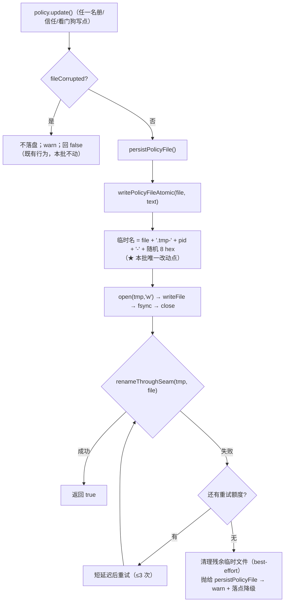

# 批 L · 名册文件的并发写保护 —— 设计档

> **实施状态（2026-10-13，批 L 落码）**：**已实施** —— 落点 `lib/index.js`：**`renameThroughSeam`**（FR-L2 的唯一改名出口，体内只一句 `await rename(tmp, file)`，默认实现另有 `renameThroughSeamDefault` 供还原）· **`writePolicyFileAtomic`**（FR-L1 唯一临时名 = 目标路径 ＋ `.tmp-` ＋ pid ＋ `-` ＋ 8 位 hex；FR-L2 三次尝试 / 间隔 25ms / 末次不再多等 / 耗尽后 best-effort `rm` 清残留 ＋ **保留原始 errno** 抛出）· `sleep` / `errorCodeOf` / `renameFailureMessage`（FR-L3 的三要素留痕文本）· store 侧新增 `renameWarned` 门与 `warnRenameFailureOnce` 出口（成功分支同批复位）· `__testing` 新增 **`setRenameThroughSeam`** / **`renameThroughSeamIsDefault`**（可注入接缝 ＋ 还原自证）· `renderPolicyFileDocument` 的 JSDoc 按事实更正（「八个键」→ **十键**，并指权威读数 `host-half.test.mjs` 的 `U19_POLICY_KEYS`）。判据 **8 条**（`Aw1`–`Aw8`）在 `host-half.test.mjs` 的「批 L」块（标识符 `Aw` 中缀；期望值取自源码逐条计数 `grep -c '^check("批 L ·'` = **8**），另**同批改写 2 处既有判据**（`U2 原子写` 的遗留临时文件改 `.tmp-*` 形态且第二条断言只认「别人的那一份残留」· `🟡#1` 夹具的「回写在飞」守卫改按 `.tmp-` 前缀扫目录 —— 语义均一字未动，只跟新名字口径走）。★ **import 面一个字符未动**：随机后缀用既有的 `createHash`、残留清理用既有的 `rm`（批 K 已加进 `node:fs/promises` 那一行的解构列表）⇒ §7 点名的「确需 `unlink` 时只加在既有解构行里」这条退路**最终没有用到**（顶层 `import` 仍 8 条、说明符逐字不变）。★ **一处实施口径（如实登记）**：`writePolicyFileAtomic` 是模块级函数、**没有 ctx**，而 FR-L3 的留痕必须走 `ctx.logger` ⇒ 它多了一个**可选第三参** `warn`（留痕出口）；「一段一行」的门因此落在 **store**（`renameWarned`，与 `fileWriteWarned` 各自独立）而不是 §6 伪代码暗示的模块级 `warnOncePerWindow`（模块级的门会让进程内**后一个** store 的失败静默）。批 K 的心跳仍按**两参**调用（它有自己的单行 warn，那条路径一字未动）。★ **两次实测读数（修复前必红 / 修复后全绿）由宿主执行** —— 本轮交付方**没有 shell**（未执行任何命令），红相配方（就地变异 → 跑 → **逐字节还原** ＋ `sha256` 自证）逐条写在该块头注里，宿主回执待回填。

> **规格档**。需求档 [`docs/2026-10-13-policy-atomic-write-requirements.md`](2026-10-13-policy-atomic-write-requirements.md)。
> 行号一律 as-of **2026-10-13 工作树（commit `f24f167`）**，实施按**符号名**定位。
> ★ 本档全文不写出框定 token 的原串（批 E 立的仓规）；新测试标识符统一用 **`Aw` 中缀**。

---

## 0. 结论与图（给用户与实施者先看）

**三句话**：① 事故根因是**所有写入者共用一个固定名的临时文件**（`<file>.tmp`），两个进程同时写就互相截断、交错；② 修法是**让每次写的临时文件名唯一**（进程号 + 随机后缀），并在 `rename` 上补**有界重试**；③ 判据要能**真红**，且**交付后必须全绿**：`Aw1` 正向要求「唯一名」、`Aw2` 反向要求「源码里**不含**固定名字面量」—— 两条**在修复后的实现上同时为绿**，而把实现回退成固定名会让**两条一起变红**（互为冗余锁，任一条失效都说明另一条失去了区分力）。



---

## 1. 背景

2026-10-13 上午，两名协调者（`team-link-bac-1009-coordinator-e3d1aa13`、`team-link-mal-analyze-1011-coordinator-c768c616`）同时报「团队名册丢了」。父侧取证：`~/.dsh/team-link/policy.json` **不可解析**，但**完整部分含全部 10 个团队**（含两队各 5 个角色）、68 组配对、12 个看门狗注册 ⇒ **数据没丢，是文件读不出来**。原始坏文件已留存为 `policy.json.corrupt-2026-10-13T02-36-07-303Z`。

---

## 2. 问题（根因，带 file:line）

**根因唯一**：`lib/index.js:1895-1906` 的 `writePolicyFileAtomic` 把临时文件名**写死**：

```js
const tmp = `${file}.tmp`;      // :1897  ← 全部写入者共用同一个临时文件
const handle = await open(tmp, "w");  // :1898  ← "w" 截断：后者清零前者正在写的文件
await rename(tmp, file);        // :1905  ← 无重试
```

**现场签名（实测，**单位写明**）**：坏文件 **841,978 字节 = 834,388 字符**，其中**完整可解析部分 841,905 字节 = 834,315 字符**，尾部垃圾 **73 字节 = 73 字符**。
**撕裂签名以字符计**：`834,388 − 834,315 = 73` ⇒ 「甲写完的 **834,315** 个字符」之上，**乙从字符偏移 834,315 起写了 73 个字符**。
⇒ 同一 inode 上两个写者交错。**（★ 本行的单位更正是设计评审 🟡#7 的处置：原文把字节与字符混用，详见需求档 §2.1 的口径更正段。）**

**唯一写路径的核对**（需求档 §2.3 已列）：`policy.json` **只有** `writePolicyFileAtomic` 一条写路径；`writeFileSync` / `createWriteStream` **零命中**；`appendFile` 只写黑板。⇒ 排除其他嫌疑人。

**放大因素**：文件已涨到 **814 KB**（10 团队 + 68 配对 + 12 看门狗）⇒ 写得越久，两进程时间窗重叠概率越大。

---

## 3. 目标

**做完之后**：多进程同时写名册时，文件**要么是甲的完整版、要么是乙的完整版**（`rename` 的原子性保证），**永远不会出现两者交错的字节**。

**非目标**（需求档 §五，逐条对应）：
1. **不做自动修复**（读到损坏档仍走「不覆盖 + 人工处置」，`POLICY_REASON_CORRUPT` 一字不改）。
2. **不改落点语义**（settings 在场走 settings、不在场走文件；不双写）。
3. **不引入跨进程文件锁**（无新依赖）。
4. **不改各写点的调用语义**（谁写、写什么、什么时候写，全不动）。
5. **不碰黑板的 `appendFile` 路径**。

---

## 4. 决策与理由

| # | 决策 | 理由 | 被否决的备选 |
| --- | --- | --- | --- |
| **D1** | **临时文件名唯一化**：`${file}.tmp-${process.pid}-${8 位随机 hex}` | 唯一名 ⇒ 两个写入者**不可能**碰同一 inode ⇒ 撕裂的物理前提消失。这是**最小改动**（一个常量表达式）。 | ① 文件锁（新依赖、跨平台行为不一）· ② 全局串行队列（进程内队列挡不住跨进程，而本次正是跨进程）· ③ 改用数据库（范围爆炸） |
| **D2** | **`rename` 补有界重试（≤3 次，短延迟）** | Windows 上目标被另一进程占用时 `rename` 会抛 `EPERM`/`EBUSY`；现有调用方**无重试** ⇒ 一次偶发失败就是「这段状态没落盘」。重试把它变成「大概率成功」。 | ① 不重试（保留现状 —— 偶发丢写）· ② 无限重试（可能挂住热路径） |
| **D3** | **失败仍走既有 warn + 落点降级**（不新增错误类型） | 既有 `persistPolicyFile` 的 catch（`:1944-1952`）已把失败如实反映成「⚠ 仅进程内存」；新增错误类型只会让落点行分叉。 | 新增专用原因码 |
| **D4** | **随机后缀用既有 `createHash`**（`node:crypto`） | **零新依赖**（NF-L1）；不用 `Date.now()` 单变量（同毫秒并发会撞名）。★ **证据（评审 🟡#6 要求，已回读）**：`host-half.test.mjs:7253` 的 `HOST_IMPORTS` 逐字含 **`node:crypto`** —— 原文只断言「已在白名单内」而无证据，现补上。 | `randomUUID()`（也在 `node:crypto` 内，但会把 UUID 的连字符带进文件名；hex 更省事） |
| **D5** | **残余临时文件 best-effort 清理**（重试耗尽后 `unlink`） | 失败路径不清会把 `.tmp-*` 越积越多；但清理**本身失败不许掩盖**原始错误。 | 不清理（积累垃圾文件） |
| **D6** | **不做「启动时扫描残留临时文件」** | 唯一名之后前缀可辨（`.tmp-`），扫一遍很便宜 —— 但它**不解决本次的故障**（本次是撕裂内容、不是残留文件），且引入新写面。**留作后续候选**，本批不做。 | 本批顺手加清扫 |

---

## 5. 方案（FR-L1…FR-L3）

| FR | 内容 | 落点（符号名 · 行号 as-of） |
| --- | --- | --- |
| **FR-L1** | **唯一临时名**：写入前算出 `${file}.tmp-${pid}-${token}`；`token` = `createHash("sha256").update(`${process.pid}:${Date.now()}:${Math.random()}`).digest("hex").slice(0, 8)` | `writePolicyFileAtomic`（`lib/index.js:1895`） |
| **FR-L2** | **有界重试 + 可注入接缝**：`rename` 失败 ⇒ 最多重试 3 次（含首次），每次间隔 25ms；仍失败 ⇒ 清理临时文件（D5）并**抛给调用方**（既有 catch 接管）。★ **评审 🟡#5 的处置（用户裁定「按建议」）**：`rename` 是**顶层导入**、同进程单测注不进去 ⇒ 本批**新增一层薄接缝** `renameThroughSeam(tmp, file)`（模块级函数，体内只有一句 `await rename(tmp, file)`），所有改名**只经它**；测试替换这一层即可注入 `EPERM`/`EBUSY`。**零新依赖**（`rename` 本就已导入）。 | `writePolicyFileAtomic`（`lib/index.js:1895`）＋ 新模块级 `renameThroughSeam` |
| **FR-L3** | **留痕**：重试发生时**不静默** —— 首次退避时 `ctx.logger?.warn?.(…)` 一行，内容 = **落点文件路径 + 错误码（errno）+ 写入者函数名**（★ US-L3 的裁定口径，取代原写的 `file:line`），只报一次/段（沿用既有「一段一行」范式）；重试耗尽后由既有 `persistPolicyFile` catch 再报**落点降级**那行（两行**各自受自己的「一段一行」门**，见 §8 Aw5） | 同上 + `persistPolicyFile`（`:1925`）的既有 catch |

**改动的文件面**：`lib/index.js`（一个函数 + 一个新 helper + **一处既有注释改准**）· `host-half.test.mjs`（新判据块）· 本批两份档 + `CHANGELOG.md` + `README.md`（工具面未变，只改实现说明）。

★ **顺带的文档卫生更正（同批做，属文档卫生第 5 条「描述面与实现一致」）**：`lib/index.js:1909-1911` 的 `renderPolicyFileDocument` JSDoc 逐字写着「**八个键**每次写全」，而 `DEFAULT_POLICY` 今天是**十键**（`blocks` 与 `pendingCreates` 都是后来加的）。本批把它改成**按事实的说法**（不写死数字，或写「十键」并指名权威读数位置）。⇒ 这条**不影响行为**，但会误导下一个读它的人。

---

### 5.1 用户故事 → 判据映射（评审 🟡#3 的处置：US-L2 **不重复造判据，只做指针**）

| US | 由谁承接 |
| --- | --- |
| **US-L1**（并发写不坏文件） | **Aw1 / Aw2**（唯一名与反向锁）· **Aw3**（重复写 + `Promise.all` 并发 + 读回十键） |
| **US-L2**（损坏档读面如实） | **既有判据，本批不新增**：`host-half.test.mjs` 的「代码评审修复轮」块 **U11 损坏档守卫**四条（`:8997` 不覆盖 / `:9000` 落点报第 5 个原因 / `:9003` 每次写留痕 / `:9007` 状态不受影响）——它们**已经**钉住 US-L2 要的一切；本批的边界（§9「损坏档」行）保证**不改动**这条路径 |
| **US-L3**（失败点名到写入者） | **Aw4③ / Aw5⑤**（warn 恰一行/段）＋ **FR-L3 的文案口径**（路径 + errno + 写入者函数名，★ 用户 2026-10-13 裁定） |

---

## 6. 机制伪代码（前置 / 后置）

```js
/**
 * 前置：file 是绝对路径；text 是完整文档字节；调用方已确保不在损坏档分支。
 * 后置：目标文件内容**恰为** text（或抛错且目标文件保持调用前的完整版本）。
 *       成功路径不留下任何 .tmp-* 文件；失败路径 best-effort 清理。
 * 不抛：否 —— 失败抛给调用方（persistPolicyFile 的既有 catch 接管）。
 */
async function writePolicyFileAtomic(file, text) {
    await mkdir(path.dirname(file), { recursive: true });
    const token = createHash("sha256")
        .update(`${process.pid}:${Date.now()}:${Math.random()}`)
        .digest("hex").slice(0, 8);
    const tmp = `${file}.tmp-${process.pid}-${token}`;   // ★ FR-L1：唯一
    const handle = await open(tmp, "w");
    try { await handle.writeFile(text, "utf8"); await handle.sync(); }
    finally { await handle.close(); }
    let last = null;
    for (let attempt = 1; attempt <= 3; attempt++) {      // ★ FR-L2：有界重试
        try { await renameThroughSeam(tmp, file); return; }   // ★ 唯一改名出口（可注入）
        catch (error) {
            last = error;
            if (attempt === 1) warnOncePerWindow(file, error);  // ★ FR-L3：路径 + errno + 写入者名
            if (attempt < 3) await sleep(25);                    // ★ 末次不再白等（评审 🔵#12①）
        }
    }
    try { await unlink(tmp); } catch { /* best-effort；不掩盖 last */ }   // ★ D5
    throw last;
}

/** 唯一改名出口 —— 测试替换这一层即可注入 rename 失败（FR-L2 · 评审 🟡#5）。 */
async function renameThroughSeam(tmp, file) {
    await rename(tmp, file);
}
```

**新增符号**：`sleep`（`new Promise(r => setTimeout(r, ms))`）· **`renameThroughSeam`**（FR-L2 的唯一改名出口，可注入）· `warnOncePerWindow`（复用既有「一段一行」布尔门，与 `fileWriteWarned` 同范式）· `unlink` 需从既有 `node:fs/promises` **补充到 import 列表**（★ 见 §7：这不增加**条数**，只在既有那一行的解构里加一个名字 —— 实测既有那条是 `import { appendFile, mkdir, open, readFile, readdir, rename, writeFile } from "node:fs/promises"`）。
**前置（对 `sleep`）**：ms 为正有限数。**后置**：至少等待 ms。**不抛**。
**前置（对 `renameThroughSeam`）**：`tmp` 存在且内容已落盘（fsync 已过）。**后置**：成功 ⇒ 目标文件内容为 `tmp` 的内容、`tmp` 消失；失败 ⇒ 抛原始错误（**不重试、不吞**，重试归调用方）。

---

## 7. 状态与 schema

**零 schema 变更**：本批不新增/删除任何状态字段（`policy.json` 的 `schema` 常量 `POLICY_FILE_SCHEMA`（`:1689`）保持 1）。

| 项 | 变更 |
| --- | --- |
| `policy.json` 形状 | **一字不改** |
| 磁盘上新增的文件 | **仅**瞬态 `.tmp-<pid>-<token>`（成功即被 `rename` 消费；失败路径清理） |
| 谁写谁读 | 不变：`persistPolicyFile` 写、`loadPolicyFile` 读 |
| import 面 | **一个字符未动**（落码实测）：条数不变（8 条）、说明符逐字不变、**解构名也没加** —— 残留清理用的是**既有的 `rm`**（批 K 已加进 `node:fs/promises` 那一行），随机后缀用的是**既有的 `createHash`**；本行原先预告的「解构列表加一个 `unlink`」**未发生**（那条退路没有用到）。⇒ **NF-L1 的两个既有锁（`批 H · NF-H5` / `批 I · U17`）判的是「条数与说明符」**，两个读数都保持原值；此处点名是为了不让读者以为 import 面动过 |

---

## 8. 防偏离（判据与红相构造）

**判据统一在 `host-half.test.mjs` 新增「批 L」块，标识符 `Aw` 中缀，**行标签与标识符一一对齐（`Aw1`…`Aw8`）**（评审 🔵#11：原用 `U1…U7` 会与批 I 的 U1–U20 撞号）。**

| # | 判据 | 红相（怎么让它红） |
| --- | --- | --- |
| **Aw1** | **唯一临时名（正向）**：实取 `writePolicyFileAtomic` 的源码文本，断言它同时含 `process.pid` 与一次哈希调用，且**不含** `` `${file}.tmp` `` 这一字面量 | 把实现回退成固定的 `` `${file}.tmp` `` ⇒ **本条红** |
| **Aw2** | **固定名不在场（反向锁，★ 评审 🔴#1 的处置）**：断言源码文本**不含** `` `${file}.tmp` `` —— **与 Aw1 第三子句互为冗余锁**；修复后**本条为绿**，把实现回退成固定名 ⇒ **本条红** | 修复后**本条必须绿**；若它红，说明实现没改对（**原设计把极性写成了「修复后必红」，与全绿门禁冲突 —— 已改**） |
| **Aw3** | **重复写不撕裂（行为面）**：① **连续两次** `policy.update` ⇒ 文件内容**恰等于**第二次的序列化；② **`Promise.all` 双写者并发**（贴住事故场景）⇒ 文件**仍是其中一份完整文档**、可解析、**且**目录里**没有**残留 `.tmp-*`；③ **★ 评审 🟡#2 的处置**：写完用**读回路径**（`loadPolicyFile` 或等价的新进程读回）确认**十键齐全且不判损坏** —— 等价于「下一个进程读到完整名册」 | 把两次写改成交替覆盖**同一**临时文件（模拟旧实现）⇒ ② 混入另一份的尾巴 ⇒ 本条红；读回缺键 ⇒ ③ 红 |
| **Aw4** | **rename 失败有重试**（经 `renameThroughSeam` 注入）：前两次抛、第 3 次成功 ⇒ ① 文件**最终内容正确** ② 失败计数 = 2 ③ **恰一行** warn（一段内不重复） | 去掉重试 ⇒ 内容停在旧版 ⇒ 本条红 |
| **Aw5** | **重试耗尽后的失败方向**：注入 `rename` 恒抛 ⇒ ① `persistPolicyFile` 回 `false` ② 落点行仍可核（`⚠ …`）③ **没有残留** `.tmp-*`（best-effort 清理生效）④ 抛出的错误**保留原始 errno** ⑤ **★ 评审 🔵#10 的处置**：warn **恰一行/段**（重试内那一行与既有落点降级那行**各自受自己的门**，同段内不重复） | 去掉清理 ⇒ ③ 红；把错误吞成 `undefined` ⇒ ④ 红；同段内重复告警 ⇒ ⑤ 红 |
| **Aw6** | **零 schema / 零形状变更**：写出的文档键集与既有的**十键**（权威读数：`host-half.test.mjs:7312` 的 `U19_POLICY_KEYS` = `blockedSenders` / `blocks` / `pairs` / `pendingCreates` / `receiveMode` / `rememberTargets` / `sections` / `teams` / `trustedSenders` / `watchdogs`）逐字一致；`POLICY_FILE_SCHEMA`（`:1689`）仍为 1 | 顺手加字段 ⇒ 键集断言红 |
| **Aw7** | **零新依赖（条数锁）**：顶层 `^import` 仍**恰 8 条**，八个说明符逐字是白名单那一份。★ **落码口径**：§7 点名的「确需 `unlink` 时只加在既有那一行的解构列表里」这条**退路最终没有用到** —— 残留清理走的是**既有的 `rm`**（批 K 已加进那一行），随机后缀走**既有的 `createHash`** ⇒ `import` 面一个字符未动 | 新增第二条 `import` 行 ⇒ 本条红 |
| **Aw8** | **负向锁（NF-L2 不退化；★ §10 第 6 条新增）**：`writePolicyFileAtomic` 体内**必须经 `renameThroughSeam`**，且**不含**直接改名（`await rename(…)`）与**直接写目标文件**（`open(file` / `writeFile(file`）的调用形态；另钉住接缝体内**恰一句** `await rename(tmp, file);` | 绕过接缝直接改名 / 直接覆盖目标 ⇒ 本条红；接缝体内长出第二句 ⇒ 本条红 |

**两次实测读数（实施方必须给，★ 极性已按评审 🔴#1 改正）**：**修复前** ⇒ **Aw1 红 / Aw2 红**；**修复后** ⇒ **Aw1 绿 / Aw2 绿**，且 Aw3–Aw8 全绿。
（⇒ 交付态**全部为绿** —— 这正是原设计写错的地方：它写成「修复后 Aw2 红」，那会让套件永久带一条红断言。★ **本行原把修复前的 Aw2 写成「绿」，与 Aw2 行的「回退成固定名 ⇒ 本条红」自相矛盾；已按后者更正** —— 回退之后源码里**确实**又有那个固定名字面量，Aw2 与前两条一起红。★ 两次读数**由宿主执行**：本轮交付方无 shell（未执行任何命令），红相配方见 `host-half.test.mjs` 的「批 L」块头注。）

---

## 9. 边界

| 情形 | 行为 |
| --- | --- |
| **同一进程内并发两次写** | 两次各得唯一临时名 ⇒ 各自完整；`rename` 后者胜 ⇒ 最终是后者的完整版（不撕裂） |
| **跨进程并发写**（本次事故场景） | 同上 —— **本批要消除的正是这一格** |
| **目标文件被占用（Windows）** | `rename` 偶发失败 ⇒ 重试 ≤3 次；仍失败 ⇒ 如实报错 + 落点降级（不静默） |
| **磁盘满 / 只读** | `open` 或 `writeFile` 抛 ⇒ 走既有 catch ⇒ `⚠ 仅进程内存`（本批不新增分支） |
| **崩溃在 write 与 rename 之间** | 留下的**唯一名** `.tmp-*` **不会被读**（读只认 `policy.json`）⇒ 状态是上一次完整版本（安全） |
| **损坏档** | **本批一字不改**：`fileCorrupted` ⇒ `persistPolicyFile` 直接回 `false`（`:1930-1933`），不覆盖、不自动修复 |
| **失败方向** | **fail-closed 于状态**（不假装写成功）、**fail-open 于可用性**（内存态继续服务，落点行降级）—— 与既有语义一致 |
| **重启** | 修好的文件在**下一个进程**被读到（每进程只读一次是既有事实）⇒ 落地判据取 **Aw3③ 的「等价新进程读回」**（单测里不真重启进程；强度口径以 Aw3③ 为准，本行不再要求「真重启」） |

---

## 10. 第二轮设计评审的折入（8 条 · 2026-10-13，用户裁定「按建议」）

> 第二轮评审（`advisor-dsh-5`）**PASS**（0 🔴 / 3 🟡 / 6 🔵）。下列 8 条为采纳项；**第 9 条判 Not an issue**（机会性 JSDoc 更正已在 §5 明示理由）。实施**按本节**，与本档前文冲突时**以本节为准**。

| # | 级别 | 折入内容 | 落点 |
| --- | --- | --- | --- |
| 1 | 🟡 | **Aw4/Aw5 补「内容子句」**：warn 文本**必须同时含** ① 目标**文件路径** ② **错误码（errno）** ③ **写入者函数名** —— 三者缺一即红（US-L3 的用户裁定口径从「只判几行」升到「判写了什么」） | §8 Aw4 / Aw5 的谓词 |
| 2 | 🟡 | **数值口径更正**：本档原写文件「涨到 **814 KB**」**是错的**；权威读数 = **841,978 字节 = 834,388 字符**（其中完整可解析部分 **841,905 字节 = 834,315 字符**，尾部垃圾 **73 字节/字符**）—— 见需求档 §2.1 的**单位写明**表 | §2 的「放大因素」句 |
| 3 | 🟡 | **「重启」判据的强度对齐**：§9 该行改为「**等价新进程读回（Aw3③）**」（单测不真重启进程） | §9 末行（本档已就地改） |
| 4 | 🟡 | **实施第一步＝回读两个既有锁的断言文本**（`批 H · NF-H5`、`批 I · U17`）：确认它们判的是**条数与说明符**（而非解构名逐字）；**若判解构名 ⇒ 把锁的修订列入改动面**并在交付报告点名 | 实施首步 · 报告 |
| 5 | 🔵 | **Aw2 取不同作用域**：原与 Aw1 第三子句**同谓词**（冗余不产生区分力）⇒ Aw2 改为**全文件扫描**（`lib/index.js` 全文不含固定名字面量），Aw1 仍限函数体 | §8 Aw2 |
| 6 | 🔵 | **新增 Aw8 负向锁**（锁 NF-L2 不退化）：`writePolicyFileAtomic` 体内**必须经 `renameThroughSeam`**，且**不含**直接写目标文件的调用形态 | §8 新增 Aw8 |
| 7 | 🔵 | §0 图注「本批**唯一**改动点」→「本批唯一**命名**改动点」（FR-L2/L3 同为行为改动，原文与图失配） | §0 图 |
| 8 | 🔵 | ① 设计档 §2 **只留差值签名 + 指针**（四个数字不在两档重复书写）；② 需求档 **NF-L1 的枚举去掉本批用不到的 `os`** | §2 · 需求档 NF-L1 |

**判据总数（本批）**：**Aw1 … Aw8 ＝ 8 条**（原 7 条 ＋ 新增 Aw8）。⇒ 实施必须**同批改准**所有计数声明（README 徽标/稳定性行/当前读数行、`CHANGELOG`、本档与需求档头注、以及套件里任何硬编码总条数）。
