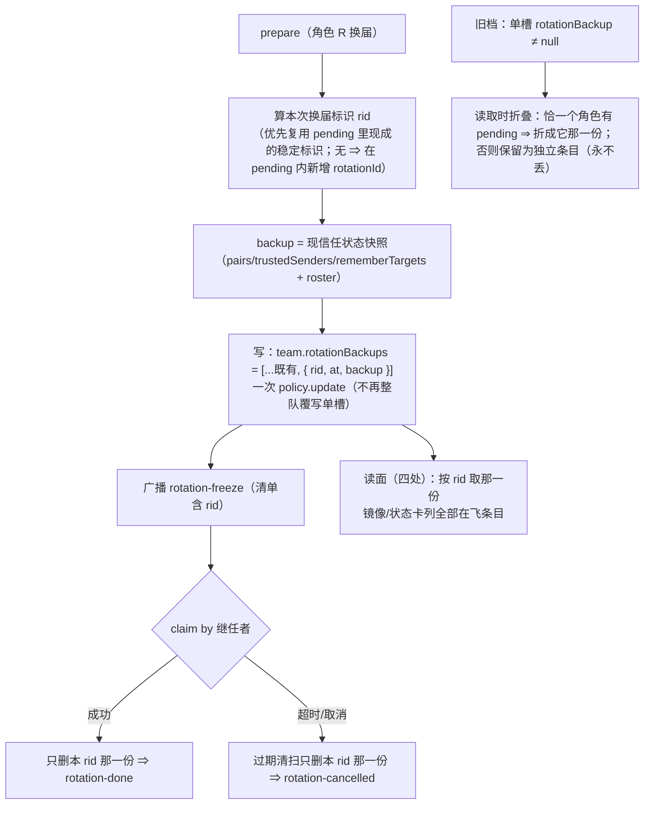

# 批 Q · 换届的「撤销依据」按换届各存一份 —— 设计档

> **★ 接续须知（2026-10-15 凌晨，父侧写）**：本档**已两轮评审判 PASS**（`advisor-dsh-20` / `advisor-dsh-22`：逐条验证 7 条折入全部为已修，无未解决 🔴，评审原文 `[APPROVE:7032d28f]` + `VERDICT: PASS`）；**但平台的签发闸门两次都拒发令牌** —— 理由是「评审表格中仍存在未解决的阻塞行（严重度单元格为 🔴）」，而它指的是**那行「🔴：状态=Fixed」的等级列**（启发式误判；批 P 的同格式第二轮曾正常签发）。叠加**第一次复审 FAIL 已撤销本会话既有签发** ⇒ **本会话实施被硬卡**（`eng_coder` 回执：「no design token issued in this session（从未签发）」）。
> **⇒ 接续方式**：**开一个新会话**（**不需要重启 DSH**），在新会话里对**本档 + 配对需求档**跑一次 `advisor(type='design')`（新会话 ⇒ 评审计数重置、按第 1 轮做完整评审、PASS 即签发令牌），然后按设计档 §5 的 FR-Q1…FR-Q5 实施。**设计本身无需改动**。
>
> **★ 2026-10-18 状态更新（本会话实测）**：已按要求在新会话重跑评审（`advisor-dsh-69339a915bb747bf`）⇒ `VERDICT: PASS`（无 🔴；🟡 ×2 / 🔵 ×4），**令牌已签发**（有效至 2026-10-25）。用户当轮裁定「批准，改档开跑」；§5 FR-Q1、§6、§7、§8 Qr8 与需求档 US-Q1 已按该裁定的 1–5 条小改落档（只把含糊变可核，**不改被审机制**）。

> **★ 2026-10-18 实施完成（批 Q）**：FR-Q1…FR-Q5 全部落地，判据 **`Qr1`–`Qr11`** 落在 `host-half.test.mjs` 的「批 Q」块（11 条，刻意放在 Rr8 **之后** ⇒ Rr8 的判定面一个字符未动）。**两次实测**：修复前 **`1738 (failed: 17)`**（旧 `lib/` × 新判据，2026-10-18 复现实测；构成见 §8 末段）⇒ 修复后 **`ALL PASS / assertion total: 1738 (failed: 0)`**；`node client-half.test.mjs` ⇒ **`310 (failed: 0)`**。
>
> **落点对照（批 R 拆分之后按符号名定位；行号 as-of 已作废）**：形状与归一化 = `lib/policy-store.js`（`normalizeRotationBackup` 旁的 **`normalizeRotationBackups`** · `normalizeTeams` · `normalizePending` 的 `rotationId` 白名单）；读视图与写回 = `lib/rotation.js`（**`pendingRotationRid`** / **`rotationEntriesOf`** / **`rotationEntryOf`** / **`appendRotationBackup`** / **`removeRotationBackup`** / **`clearRotation`**，以及 `prepare` / `claim` / `replayClaim` / `sweep` 四处调用点）；镜面 = `lib/roster-write.js`（`renderRosterMirror` ＋ 团队行创建时显式 `rotationBackups: []`）与 `lib/team-registration.js`（`roster get` 详情）；结转-2 = `lib/team-session-creation.js`（`applyInheritedApprovalPolicy` 的 `agent.session` 守卫）。★ **`lib/index.js` 的实施期状态**：批 Q 实施时**未改**（`TeamConfig` **不加** `rotationBackups` 声明：`schemastery` 保留未声明键）；**2026-10-18 分歧修复轮**按审计改了入口档里 **4 处描述/兜底文案**（单槽措辞 → 按换届各存一份，+145 B），故 `Rr1`/`Rr7` 读数已重取（**254,802 → 254,947**，合规档 §六 同批改准）；**声明面仍零新增**。
>
> **rid 来源（FR-Q1 的单一权威自报点）**：pending 的现成形状是 `{session, token, team, role, expiresAt, createdAt, note?, migratedPairs?}` —— **没有**换届作用域的稳定标识（`token` 是秘密、任何读面只给掩码；`session` 是**继任者**，同一会话可被指定为两个角色的继任者 ⇒ 用它当键会让第二个 prepare 覆盖第一个；`createdAt` 既不唯一也不与哪一路 pending 绑定）。按 D2 第二支：**在 `pending` 内新增行内字段 `rotationId`**（顶层键不变），prepare 铸 `rot-<base36 时间>-<uuid8>`；升级前的 pending 没有这个键 ⇒ 走确定性推导 **`legacy:<角色名>`**（折叠侧与 claim 侧同一条推导）。

> **规格档**。需求档 [`docs/2026-10-14-rotation-backup-per-rotation-requirements.md`](2026-10-14-rotation-backup-per-rotation-requirements.md)。
> 行号一律 as-of **2026-10-14 工作树（commit `826b0ec`）**，实施按**符号名**定位。
> **设计输入**：会诊 **#66** 父侧裁定层 §3-①（[`docs/consult-minutes/2026-10-14-consult-66-minutes.md`](consult-minutes/2026-10-14-consult-66-minutes.md)）；用户 2026-10-14 裁定「起批 0」「可以」。
> ★ 本档不写出框定 token 原串（批 E 仓规）；新测试标识符统一用 **`Qr`** 中缀。

---

## 0. 结论与图

**三句话**：① 病根是**快照的容器是「每个团队一个槽」**，而 prepare **整队覆写**它（`lib/index.js:13207`）⇒ 第二次 prepare 抹掉第一次；② 修法是**给每一次换届各存一份**（团队行内部**新增**一个集合字段，键 = 该次换届的标识），**旧槽读取时无损折叠**、**顶层键一个不加**；③ 四处读面（镜像 / 状态卡 / claim 找前任 / reappoint 找旧任）全部改成「**按本次 pending 取那一份**」，并在 claim 成功或过期取消时**只删那一份**。



---

## 1. 背景

会诊 #66 四席**独立**指出：真正的卡点不是 `role` 必填，而是**`rotationBackup` 是团队级单槽**（`lib/index.js:1180`，prepare 整队覆写 `:13207`）⇒ **并行/连续 prepare 互不覆盖的前提根本不成立**。父侧裁定（纪要 §3-①）：**「按换届编号各存一份」**（否决了「搬进 `roles[].pending`」的更大改动、也否决了「批共享一份」的语义混淆）。

---

## 2. 问题（根因，带 file:line）

**逐字取证见需求档 §二**（本档不复写整表，只留指针）。三条要点：写面 `:13207` 整队覆写 · 形状 `:1180`/`:1505` · 读面四处 `:6565-6566` / `:7254` / `:13277` / `:13540`。
★ **as-of 对账（评审 🔵#5）**：会诊纪要里同一处写作 `:12777-12784` —— 那是**更早快照**的行号，指同一段代码；本档统一按 `826b0ec` 的行号，**实施一律按符号名定位**（行号只作 as-of 括注）。
★ **它今天已经在发生**：任何「先后换两个角色」的团队，前一次的快照此刻已不在盘上。

---

## 3. 目标 / 非目标

**目标**：**每一次换届各存一份撤销依据**，四次读面按本次换届取对，claim/取消只删自己那一份，**旧档无损折叠**，**顶层键零新增**。
**非目标**：需求档 §五 六条（不做整队换届 · 不改 claim 语义 · 不改令牌 · 不改快照内容 · 不动黑板 · 不重写历史档）。

---

## 4. 决策与理由

| # | 决策 | 理由 | 被否决的备选 |
| --- | --- | --- | --- |
| **D1** | **新增团队行内字段 `rotationBackups`**（**数组形**：`[{ rid, at, backup }, …]`），**旧字段 `rotationBackup` 保留为只读迁移源** | 数组能自带 `at` 与顺序（map 形做不到），且**两个形状都是对象**⇒ 若**同名换类型**，归一化分不清「旧单槽 vs 新集合」，迁移与判据都会含糊。★ 与纪要 §3-① 里「折叠进 **map**」的措辞有**无害偏差**（同一语义、不同 JSON 容器）—— 以本档为准 | ① **同名换类型**（形状歧义，见左）· ② 搬进 `roles[].pending`（会诊 [2] 主张）—— 动 pending 契约会牵连 claim / 清扫 / 幂等三处判据，**改面大得多** · ③ 批共享一份（会诊 [3] 主张）—— 单跑两个角色仍会互相覆盖，只是把洞变小 |
| **D2** | **换届标识 `rid`**：**优先复用 pending 里现成的稳定标识**；确无可用标识 ⇒ **在 `pending` 内**新增 `rotationId`（**团队行内部字段**，不动顶层键） | 实施首步**必须回读** pending 的现成形状再定（本档未验该形状 ⇒ 标 **unverified**）；不凭空造新状态 | 用数组下标 / 用 `at` 时间戳当键（并发同毫秒可撞、且与「哪一路 pending」无绑定关系） |
| **D3** | **迁移：读取时折叠** —— 旧单槽 ≠ `null` 时：若**恰有一个**角色持有 pending ⇒ 折成**它**那一份；否则**保留为独立条目**（永不丢） | NF-Q3 无损；且不要求人工改档 | 启动时**主动重写**旧值（会引入新的写面与失败面；违反「不重写历史档」） |
| **D4** | **四处读面改成「按本次 pending 取」**：claim 按令牌绑定的 `(team, role)` 取其 pending → 取该 `rid` 那一份；reappoint 同理；**镜像与状态卡列全部在飞条目**（不再只显示一份） | US-Q4 的「不许张冠李戴」；也让读面第一次能看见**多个**在飞换届 | 读面继续只显示「最近一份」（用户看不到并发的其它换届） |
| **D5** | **收尾只删自己那一份**：claim 成功 / 过期取消 ⇒ 按 `rid` 删条目（**不清空整个集合**） | 与现有「清除 pending」同处收尾，语义对称 | 收尾清空集合（会把**别人在飞**的那份也删掉——正是本批要消灭的错） |
| **D6** | **零顶层键**：改动只落团队行内部；**实施首步回读任何枚举团队字段的既有锁**（如 schema 形状类判据），有则**同批改准** | NF-Q1；本仓有「同一份清单两处写」的既有锁文化 | 顺手加顶层键（会直接撞 `U19_POLICY_KEYS`） |
| **D7** | **结转两条同时做**：① 补 `Pi7④`（审批写面**抛错**分支的判据）② `applyInheritedApprovalPolicy` 加 **`session` 在场守卫**（具名拒绝） | 都是批 P 交付评审的 🔵、改动极小、同轮走完更省 | 单独再开一轮（本通道今天已多次失败，轮次成本高） |

---

## 5. 方案（FR-Q1…FR-Q5）

| FR | 内容 | 落点（符号名 · 行号 as-of） |
| --- | --- | --- |
| **FR-Q1** | **形状与迁移**：团队行新增集合字段；`normalizeRotationBackup` 扩为**能读两形状**（旧单槽 ⇒ 折成单元素集合）并按 D3 折叠；**实施首步必须先回读 `pending` 的现成形状**，选定的 `rid` 来源字段名**写进交付回执**（单一权威自报点；评审 🟡#1） | `lib/policy-store.js` 的 **`normalizeRotationBackups`（新增）** / `normalizeTeams` / `normalizePending`（`rotationId` 白名单）；**`normalizeRotationBackup` 原样保留**（旧槽归一化） |
| **FR-Q2** | **写面**：prepare 改为「**追加**本次条目」（`rid` + `at` + 快照），一次 `policy.update`；**不再整队覆写单槽** | `lib/rotation.js` 的 **`appendRotationBackup`**（经 `prepare`；一次 `policy.update`） |
| **FR-Q3** | **读面**：按 `rid` 取（claim 经 `rotationEntryOf` · reappoint 随 prepare/claim **同一路径**、落在 `lib/rotation.js` —— `lib/handover.js` **不读** rotation-backup，旧指针是拆分前行号残留）；**名册镜像**（`lib/roster-write.js`）与 **`roster get` 详情**（`lib/team-registration.js`）**列全部条目**。★ 2026-10-18 更正：原写「状态卡 `:7254`」是**行号错位**（as-of `826b0ec` 的 `:7254` 实为 `roster get`）；状态卡第 ② 段本批**仍只列 pending**（不新增段，避免动大读面）—— 需求档 US-Q3 同批改准 | `lib/rotation.js` / `lib/roster-write.js` / `lib/team-registration.js` |
| **FR-Q4** | **收尾**：claim 成功 / 过期取消 ⇒ **按 `rid` 删条目**；与既有「清除 pending」同批同一笔写 | `lib/rotation.js` 的 **`removeRotationBackup` / `clearRotation`**（经 claim / replay / sweep） |
| **FR-Q5** | **结转两条**（D7）：`Pi7④` 判据 ＋ `session` 守卫 | `lib/team-session-creation.js` 的 `applyInheritedApprovalPolicy`（`session` 守卫）· `host-half.test.mjs` 桩与判据 |

**改动的文件面（2026-10-18 按实测更正 —— 批 R 拆分之后代码已不在 `lib/index.js`）**：`lib/policy-store.js`（`normalizeRotationBackups` / `normalizePending` 的 `rotationId` 白名单 / `normalizeTeams`）· `lib/rotation.js`（`pendingRotationRid` / `rotationEntriesOf` / `rotationEntryOf` / `appendRotationBackup` / `removeRotationBackup` / `clearRotation` ＋ prepare/claim/replay/sweep 四处调用点）· `lib/roster-write.js`（镜像列全部在飞 ＋ 建队显式 `rotationBackups: []`）· `lib/team-registration.js`（`roster get` 详情）· `lib/team-session-creation.js`（`session` 守卫）· `host-half.test.mjs` · `README.md` / `CHANGELOG.md` / 本批两份档（计数与状态行）。★ **`lib/index.js`**：批 Q 实施时未改；**2026-10-18 修复轮**只改了 4 处描述/兜底文案（+145 B，`Rr1`/`Rr7` 已重取为 **254,947**）；声明面零新增。表内行号仍是 as-of `826b0ec`（拆分前），实施一律按符号名定位。

---

## 6. 机制伪代码（前置 / 后置）

```js
/**
 * 前置：team 是名册里的那一行；roleName 的 pending 已构造好（含 D2 的 rid）。
 * 后置：entries 恰多一条 { rid, at, backup }；**其它条目逐字节未动**（这就是「不覆盖别人」）。
 *       一次 policy.update 落盘（沿用既有单写点）；★**同一次写里把旧槽吸收掉**（§7 写回规则）。
 */
function appendRotationBackup(team, rid, backup, now) {
    const entries = rotationEntriesOf(team)          // 读两形状：旧单槽 ⇒ 折叠成一条（推导见下）
        .filter((e) => e.rid !== rid);               // 幂等：同 rid 重放 ⇒ 覆盖自己那条，不产生第二条
    entries.push({ rid, at: now, backup });
    return { ...team, rotationBackups: entries, rotationBackup: null };   // ★ 吸收旧槽
}

/**
 * 旧槽 ⇒ 折叠条目的 **rid 推导**（评审 🔴#1 (a)：**升级前就存在的 pending 里没有 D2 的 rotationId**，
 * 所以必须有一条**不依赖 prepare** 的确定性推导，否则 claim 找不到它 ⇒ 恰好在这批要保护的窗口里返回 null）：
 *   ① 该团队**恰有一个**角色持有 pending ⇒ rid = `legacy:<角色名>`（纯函数、确定性；claim 侧对**同一条** pending
 *      做**同一条推导** ⇒ 两边必然对上）；
 *   ② pending 有 0 个或多个 ⇒ 折叠成独立条目 rid = `legacy:<rotationBackup.at 的 ISO>`；**旧槽缺 `at` 时取 `legacy:at-unknown`**（确定性、团队内唯一；评审 🔵#3 —— 不留 `legacy:undefined`），**永不丢、也不猜归属**
 *      （读面照实列出；claim 侧找不到对应 rid ⇒ 走 §9 的具名拒绝分支，**绝不回退到「团队第一条/最近一条」**）。
 * 后置：折叠**只发生在读取视图里**；写回吸收（上）之后旧槽不再是事实源 ⇒ **被吃掉的那份不会「长回来」**。
 */
function rotationEntriesOf(team) { /* 新形状直接返回；旧单槽 ⇒ 按上面①②推导折叠 */ }

/**
 * 前置：team 行可读；rid 来自**本次** pending（绝不用「团队第一条」）。
 * 后置：返回那一份 entry 或 null（读不到 ⇒ null，**不编造、不借用别人的**）。
 */
function rotationEntryOf(team, rid) { /* 按 rid 精确取；找不到 ⇒ null */ }
```

**前置（读面四处）**：调用方**必须先拿到本次 pending 的 `rid`**（claim 从令牌绑定的 `(team, role)` 推；reappoint 从本次 prepare 的 pending 推）。
**后置（收尾）**：`entries.filter(e => e.rid !== rid)` —— **只删自己**。

---

## 7. 状态与 schema

| 项 | 变更 |
| --- | --- |
| `policy.json` **顶层键** | **零变更**（仍**十一键**；`U19_POLICY_KEYS` 原样绿。★ 2026-10-18 更正：原文写「十键」是旧数，`antiDrift` 加入后权威读数为 11） |
| **团队行** | **新增 `rotationBackups`（数组形）**：每条 `{ rid, at, backup }`；**旧字段 `rotationBackup` 保留为只读迁移源**。★ **两条写回规则（评审 🔴#1 (c)）**：① 折叠**只在读取视图里发生**（不主动重写历史档）；② **该团队的下一次换届类写入**（prepare / claim 成功 / 过期取消 / 清扫，即 `appendRotationBackup` / `removeRotationBackup` / `clearRotation` 三条路径）**在同一次写里把旧槽吸收掉**（**统一置 `null`**；评审 🔵#4：只此一种吸收形态，`absorbedAt` 不采用）⇒ **吃掉的那份不会在下一次读时「长回来」**。★ 2026-10-18 口径收窄（分歧审计 #7）：**非换届类团队写**（`upsert-team` / 新建 / `set-role` / `retire`）**不吸收**——它们只在读取视图里折叠（旧槽原样留存、可读、不丢），因为「主动重写历史档」与 §7① / 需求档 §五-6 相抵触；下一次换届类写才会把它实体化进数组并置 `null` |
| `pending` | **仅在无现成稳定标识时**才新增行内 `rotationId`（D2；实施首步回读后定） |
| 磁盘上新增文件 | 无 |
| import 面 | 8 条不变 |
| 谁写谁读 | 写：prepare / 收尾（claim 成功、过期取消）；读：镜面 / 状态卡 / claim / reappoint —— 与改前**同一组**，只换取值方式 |

---

## 8. 防偏离（判据与红相构造）

**判据统一在 `host-half.test.mjs` 新增「批 Q」块，标识符 `Qr` 中缀。**

| # | 判据 | 红相（怎么让它红） |
| --- | --- | --- |
| **Qr1** | **两次 prepare 互不覆盖**：同队两个角色**先后** prepare ⇒ 集合里**恰两条**、**各自快照逐字段可辨**（用不同值种，防同值恒真）。★ 评审 🔵#7：**去掉原写的「或并发」** —— 宿主半边是单进程、`policy.update` 是既有单写点，**顺序两个角色已经证明这个修复**；并发不在本批断言面内 | 保持单槽 ⇒ 第一条被整队覆写 ⇒ **本条红**（这正是本批的存在理由） |
| **Qr2** | **旧档无损折叠**：预置旧格式单槽 ≠ null ⇒ 读面**看得见它**、且字段**一个不少**（`pairs`/`trustedSenders`/`rememberTargets`/`roster` 逐字段比对） | 丢弃旧槽 / 只搬一半字段 ⇒ **本条红** |
| **Qr3** | **claim 取对那份**：两个角色各有一份在飞 ⇒ 用 A 的令牌 claim ⇒ 用的是 **A 的**快照（B 的原样在）；`previous` 解析也取 A 的 | 取「团队第一条」或「最近一条」⇒ 张冠李戴 ⇒ **本条红** |
| **Qr4** | **读面列全部**：**名册镜像**与 **`roster get` 详情**各列**全部条目的摘要**（两条 ⇒ 两行）；★ 2026-10-18 更正：**状态卡本批不动**（第 ② 段仍只列 pending，见 §5 FR-Q3 ★ 更正） | 只显示一份 ⇒ 本条红 |
| **Qr5** | **收尾只删自己**：A claim 成功后 ⇒ A 那一条没了、**B 那条原样在**；过期取消同理 | 清空整个集合 ⇒ 本条红 |
| **Qr6** | **零顶层键 / 零新依赖**：`policy.json` 顶层仍**十一键**（复用 `U19_POLICY_KEYS` 真读数；★ 2026-10-18 更正：原文「十键」是旧数）；顶层 `^import` 仍 8 条 | 加顶层键或 import ⇒ 本条红 |
| **Qr7** | **不回归**：既有 `rotate` / `reappoint` / claim / 过期清扫判据全绿（尤其令牌三段绑定与 provisional 回退） | 顺手改了 claim 语义 ⇒ 既有多条判据红 |
| **Qr8** | **结转-1（`Pi7④`）**：桩 `refuseSet: true` ⇒ ① `creates` 恰 1 ② 审批写面被调恰 1 次 ③ 回执含**审批档落地失败**那句（**期望子串以实施首步回读的逐字文案钉死**，评审 🟡#2；回执须附该行原文，**不得先写断言后测**）且**不含**「已在创建返回之后调用」 | 去掉那条如实报 ⇒ 本条红 |
| **Qr9** | **结转-2（`session` 守卫）**：handle 形状缺 `agent.session` ⇒ **不调写面**、返回**具名**「写面入参形状断层」行 | 拿 `undefined` 去调写面 ⇒ 本条红 |
| **Qr10 ★（评审 🔴#1 折入：升级窗口端到端 —— 这是本批最危险那一刻）** | **升级前的在飞换届全链路**：夹具 = 旧格式单槽 ≠ null ＋ **恰一个升级前就存在的 pending**（**其内没有** D2 的 `rotationId`）⇒ ① claim / reappoint **真的取到**那份折叠备份（`previous` 与撤销依据在场、字段逐项完整）② 用的是 `legacy:<角色名>` 那条**确定性推导**（两边推导一致）③ claim / 取消**之后**，那份**不会在下一次读时重新长出来**（写回吸收生效） | ① 折叠条目与 claim 推导的 rid 对不上 ⇒ 返回 null ⇒ 本条红（**这正是评审指出的洞**）② 去掉写回吸收 ⇒ 被吃掉的那份复活 ⇒ 本条红 |
| **Qr11 ★（评审 🟡#4 折入：失败方向要有判据）** | **该 pending 对应的那一份不存在** ⇒ **具名拒绝**、**绝不回退到「团队第一条/最近一条」**（同时独立锁死 Qr3 的红相） | 回退到任意其它条目 ⇒ 本条红 |

**两次实测读数（2026-10-18 实测；方法 = `git archive HEAD lib` 取旧代码 ＋ 当前新判据/新文档，在 `%TEMP%` 副本里实跑，副本不落仓）**：**修复前** ⇒ **`1738 (failed: 17)` / `17 FAILURE(S)` / `nodeExit=1`** —— 构成 = `Qr1 / Qr2 / Qr3 / Qr4 / Qr5 / Qr7 / Qr9 / Qr10 / Qr11`（**9** 条）＋ 既有断言连带红 **8** 条（`M4 prepare` / `U20` / `U27` / `Y1` / `U9 (c)` / `U10 (c)` / `B/U12` / `Rr8`）。★ 与本节原先的**预测**（Qr1/Qr3/Qr5/Qr9 红、Qr2 绿）**不一致**：实测 **Qr2 也红**（旧码没有 `rotationBackups` 形状 ⇒ 折叠断言红），覆盖缺口类实际是 **`Qr6` / `Qr8`**（修复前绿）—— **以实测为准**。**修复后** ⇒ `ALL PASS / assertion total: 1738 (failed: 0)`；`node client-half.test.mjs` ⇒ `310 (failed: 0)`。逐字证据见 [`docs/verification-log.md`](verification-log.md) 的 2026-10-18 节。

---

## 9. 边界

| 情形 | 行为 |
| --- | --- |
| **旧档（只有单槽）** | 读取时按 D3 折叠（恰一 pending ⇒ 折给它；否则**保留为独立条目**）；**不丢、不猜**。★ 折叠条目的 `rid` **确定性推导**（`legacy:<角色名>` / `legacy:<at>`）与**写回吸收 ⇒ 不复活**规则见 §6／§7 —— **`Qr10` 咬这条全链路**（升级前就存在的 pending 也要能取到） |
| **同一 `rid` 重复 prepare（重放）** | 幂等：覆盖自己那一条（**不产生第二条**） |
| **两个角色先后 prepare** | 各自 `rid` ⇒ 各写各的；`policy.update` 是既有单写点（**本批不新增并发面**，也不对并发做断言 —— 见 Qr1 的评审 🔵#7 口径） |
| **`pending` 形状里没有稳定标识** | 走 D2 的第二支：在 `pending` 内加 `rotationId`（**行内**字段，顶层键不变）——由**实施首步的回读结论**决定 |
| **claim 成功 / 过期取消** | **只删本 `rid` 那一份**；其它在飞条目逐字节不动 |
| **崩溃在「写集合」与「广播 freeze」之间** | 与改前同形：pending 在、快照在 ⇒ 过期清扫按既有语义收拾（**不新增死法**） |
| **失败方向** | **fail-closed 于信任**（快照缺失 ⇒ 不迁移、如实报）；**fail-open 于可用性**（读不到那一份 ⇒ 该次 claim 照既有语义拒绝/降级，不编造） |
| **重启** | 形状落在 `policy.json` 团队行内 ⇒ 重启后按既有「每进程只读一次」语义生效；**新行为在下一次 DSH 重启后生效**（用户 2026-10-14 未要求重启） |
