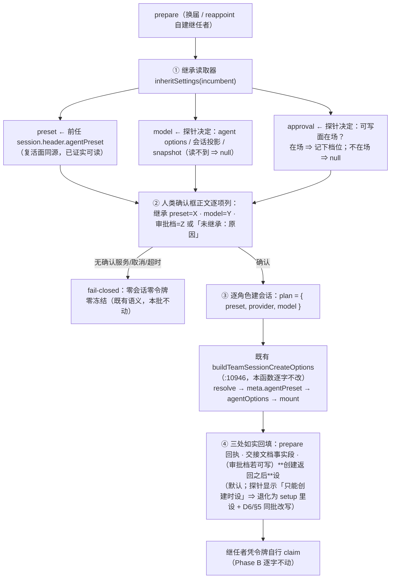

# 批 P · 换届继任者的设置继承 —— 设计档

> **规格档**。需求档 [`docs/2026-10-14-rotation-inheritance-requirements.md`](2026-10-14-rotation-inheritance-requirements.md)。
> 行号一律 as-of **2026-10-14 工作树（commit `7a7b984`）**，实施按**符号名**定位。
> **实施状态（2026-10-14，批 P 落码）**：**已实施** —— 落点 `lib/index.js`：**`readInheritableSettings`**（FR-P1，四项 / 读不到 `null` / **绝不抛**）＋ 两处调用点接线（FR-P2，`autoHandover` 与 `appointSelfBuiltSuccessor`，**只有 preset/provider/model 进 plan**）＋ **三处逐项如实可见**（FR-P3：确认框正文 / prepare 回执 / 交接文档事实段）＋ **审批档继承**（FR-P4，**创建返回之后设**，共用函数 `buildTeamSessionCreateOptions` 逐字未改）。判据 **`Pi1`–`Pi9`（14 条 `check()`）**在 `host-half.test.mjs` 的「批 P」块。★ **三个宿主探针全通过**（翻宿主 `app.asar`，只读检索）：模型对可读 · 审批档可写且是「创建返回后设」· 已死前任可读预设 ⇒ **三项都不必降级**。**宿主机读**：`node host-half.test.mjs` ⇒ `ALL PASS / 1697 (failed: 0)` · `node client-half.test.mjs` ⇒ `310 (failed: 0)`；构成 `1697 = 1646 + 20 + 8 + 9 + 14`。★ 实施拆两小单；第二单以 `error` 终止（路由 `deepseek-flash`），**代码与判据已落盘并经父侧实测全绿**，文档收口由父侧补齐。
>
> **设计输入**：会诊 #66（4/5 有效）→ [`docs/consult-minutes/2026-10-14-consult-66-minutes.md`](consult-minutes/2026-10-14-consult-66-minutes.md) §2–§5；用户 2026-10-14 裁定「都按你建议」。
> ★ 本档全文不写出框定 token 的原串（批 E 立仓规）；新测试标识符统一用 **`Pi` 中缀**。

---

## 0. 结论与图

**三句话**：① 根因不是「没有继承能力」，而是**换届那两条路把三个变量写死成 `undefined`**（`:8134` / `:13981`），而复活面**早就在读**前任自己存下的预设（`:11100`）——所以修法是「让创建面读复活面已经在读的东西」，**零新增状态**；② 本批**只改「创建时传什么」**（加一个继承读取器 + 改两个调用点），`/team_session` 与复活两条路**逐字不动**；③ 读不到的项**绝不阻断创建**，但必须在**三处**如实可见（确认框正文 / prepare 回执 / 交接文档事实段）。



---

## 1. 背景

用户 2026-10-13 原话（逐字）：「**目前团队换届很麻烦**……而且**换了之后新会话还得重新设置权限和模型，不能自动继承老的会话的**」。

会诊 #66 四席**独立**确认三件事（详见纪要 §1/§2）：这是真缺口、修法很小（让创建面读复活面已在读的字段）、且**审批档能不能继承取决于宿主可写面**（未验，需探针）。

---

## 2. 问题（根因，带 file:line）

**逐字取证见需求档 §2.2**（本档不复写整表，只留指针 —— 文档卫生第 2 条）。三条要点：

1. **创建面支持继承**：`buildTeamSessionCreateOptions`（`lib/index.js:10946`）吃 `plan.preset` / `plan.provider` / `plan.model`；预设走 `resolve → acquireScope → mount`（`:10975-11014`），`meta.agentPreset` 在 `:11002-11004`，模型对落 `agentOptions`（`:10957`）。
2. **换届两条路从来没给过这些东西**：`autoHandover`（`:8134`）与 reappoint 自建支路（`:13981`）**逐字**传 `{ preset: undefined, provider: undefined, model: undefined }`。
3. **复活面读的是别的东西**：`agent.session.header.agentPreset`（`:11100-11102`）—— 同一插件、两条路、口径相反。

---

## 3. 目标 / 非目标

**目标**：换届与 reappoint 自建的继任者**自动带上**前任的 ① 预设 ② 模型（③ 审批档**按探针结果**）；**没带上的每一项都必须说清原因**。

**非目标**：需求档 §五 七条逐条适用（不迁移历史 · 不改 claim · 不动信任数据 · 不改 `/team_session` 取值来源 · 不强制审批档继承 · 不碰黑板 · 不修批 0 的单槽缺陷）。

---

## 4. 决策与理由

| # | 决策 | 理由 | 被否决的备选 |
| --- | --- | --- | --- |
| **D1** | **预设**：读**前任会话自己存的那一份**（`agent.session.header.agentPreset`，与复活面 `:11100` **同一个字段**） | **该字段已被复活路径在真机验证可读**（本仓既有实现与判据都在用它）⇒ 零风险面 | 在 `TeamConfig` 里存「每角色上次 preset 镜像」—— **双事实源必漂移**，且违反「状态单写一处」 |
| **D2** | **读不到 ⇒ 回退宿主缺省 + 具名如实行，不阻断创建** | 换届场景**前任已被冻结**；若因「继承失败」拒绝创建，整次换届会卡死在**没人能修的墙前**（会诊 [5] R-②b 的论证）。⇒ 如实报 > 假装，**可用 > 完美** | 「继承来的 preset 解析失败 ⇒ fail-closed 拒绝创建」（**会诊 [2] glm-5.3 主张**；★ 出处经设计评审 🟡#5 更正：原写 [3] 是记错 —— 会诊 [3] deepseek 恰恰主张「绝不因此拒绝创建」）—— 它保护的是「不出现顶着旧名字跑别的工作面的继任者」，但代价是换届死锁；本批用**三处可见的如实报**替代拒绝 |
| **D3** | **优先级：前任存量 > 调用方显式给 > 宿主缺省** | 换届场景没有「调用方显式给」这一档（prepare 不加 preset/model 参数 —— 参数膨胀，且**模型转录 preset id 正是本仓反复要防的事**）；该顺序为将来留门且当下行为确定 | 调用方显式 > 前任（会让「谁发起」隐式决定新会话设置，更难审计） |
| **D4** | **审批档：先探针、后定**。宿主**可写面在场** ⇒ 继承并把该项**写进确认框正文**；不在场 ⇒ **如实报一行未继承** | 用户原话逐字含「还得重新设置**权限**」；但**静默把高权限档复制给新会话是安全回退**（会诊 [5] 的顾虑）⇒ 用**披露**化解：**看得见就不算静默** | ① 一律不继承（会诊 [5] 主张）—— 用户的抱怨没被解决；② 一律继承且不披露 —— 静默延续高风险配置，不可接受 |
| **D5** | **零新增政策状态**：不落 `policy.json` 字段；继承结果写进 **prepare 回执** + **交接文档事实段**（+ 确认框正文） | prepare 与 create 在**同一调用链内** ⇒ 无需落盘中间态；`policy.json` 键集仍**十键**（既有判据 `U19_POLICY_KEYS` 原样绿） | 落 `pending.inherit` 快照（会诊 [4] 主张）—— 引入会过期、会与 header 漂移的中间态 |
| **D6** | **改动面**：新增一个**继承读取器** + 改**两个调用点**；`buildTeamSessionCreateOptions` / 复活路径 / `/team_session` 建队路径**逐字不改**（★ 评审 🔴#2 的口径补全：**审批档默认在创建返回之后设**，不进 plan、不动该函数；**仅当探针 2 显示该宿主只能创建时设时**才退化为「加进 plan + setup 里设」，**届时 D6 与 §5 文件面同批改写并明文豁免那一行**） | 病根在「传什么」，不在「怎么建」；把改动压在调用点 ⇒ 既有判据（尤其 U19 与复活面那一组）零牵连 | 改造 `buildTeamSessionCreateOptions` 内部回退源（会波及 `/team_session` 路径，回归面变大） |

---

## 5. 方案（FR-P1…FR-P4）

| FR | 内容 | 落点（符号名 · 行号 as-of） |
| --- | --- | --- |
| **FR-P1** | **继承读取器** `readInheritableSettings(ctx, incumbentSessionId)` → `{ preset, provider, model, approvalPolicy }`（读不到的项为 `null`，**绝不编造**） | 新模块级函数；读面分别见**实施首步的两个探针**（§6 前置） |
| **FR-P2** | **两个调用点接上**：`autoHandover`（`:8134`）与 reappoint 自建支路（`:13981`）的 `plan` 改为由 FR-P1 的结果填充（读不到的项仍传 `undefined`） | 同上两处 |
| **FR-P3** | **三处如实可见**：① **确认框正文**逐项列「继承 preset=X · model=Y · 审批档=Z 或 未继承：<原因>」；② **prepare 回执**同项一行；③ **交接文档事实段**同项一行 | 确认框：`rotate` / `reappoint` 的确认构造点（as-of：`team_link_rotate` 的 `askRotationConfirm` 调用点 · `reappoint` 的对话框构造点）· 回执与文档：`writeHandoffDocument` 的调用方（as-of：`prepare` 收尾与 `reappoint` 交付处）★ 评审 🔵#8：两处落点补 as-of 符号锚，实施按符号定位 |
| **FR-P4** | **审批档继承（条件性）**：① **默认 = 创建返回之后设**（在两个调用点、`agents.create` 返回之后调宿主写面）⇒ **`buildTeamSessionCreateOptions` 逐字不改**（与 D6 一致、回归面最小）；② **仅当探针 2 显示该宿主只能「创建时设」时**才退化为「把 `approvalPolicy` 加进 `plan` + 在 `setup` 里设」——**届时 D6 与 §5 文件面必须同批改写**（明文豁免那一行）。不在场/不可写 ⇒ 只走 FR-P3 的「未继承」如实报 | 默认落点：`autoHandover`（`:8134` 附近）与 reappoint 自建支路（`:13981` 附近）的**返回之后**；退化落点：`buildTeamSessionCreateOptions` 的 `setup`（`:11010-11014` 邻近）＋ **D6/§5 同批改写**。⚠ 见 §6 探针 2 |

**改动的文件面**：`lib/index.js`（读取器 + 两调用点 + 确认框/回执/文档三处文案）· `host-half.test.mjs`（新判据块）· `README.md` / `CHANGELOG.md` / 本批两份档。

---

## 6. 机制伪代码（前置 / 后置）

### 6.1 实施首步：两个宿主探针（**先探后写**，结论必须进报告）

```
探针 1（模型对可读性）：对「非调用方」的会话，能否读到它上次用的 provider/model？
  候选面：a) ctx.agents.get(id)?.options?.{provider,model}
          b) ctx.get("sessionProjections").stateOf(session,"modelSelection")（如存在）
          c) snapshot / request header 历史里的 selection
  ⇒ 任一可读到「一对非空字符串」即算通过；全不可读 ⇒ 本项降级为「如实报未继承（原因：宿主无可读面）」

探针 2（审批档可写性）：`permissionPresets.set(session, preset)` 或等价写面，对**插件自建会话**是否可达？
  ⇒ 可达 ⇒ 做 FR-P4；不可达 ⇒ 本项降级为「如实报未继承」，并在档里登记为宿主面缺口

探针 3（评审 🟡#4 折入：**不靠活代理**的会话级读面）：
  「前任代理已不在场」时，`header.agentPreset` 还能不能读到？（`ctx.agents.get(id)` 对已死代理返回空 ⇒ 需另找面：
   会话持久化/查询面，或复活路径实际用的那条存取面）
  ⇒ 能 ⇒ §9 的「已死前任仍可继承预设」成立，Pi9 取「仍继承」分支；
  ⇒ 不能 ⇒ **§9 该句必须改准**为「已死前任 ⇒ 如实报未继承」，Pi9 取「如实报」分支（两条都不许静默）
```

### 6.2 读取器与接线

```js
/**
 * 前置：incumbentSessionId 是该角色**当前现任**的会话 id；调用方已在 roster 里确认过它的存在。
 * 后置：返回一个四项对象；**读不到的项一律 null**（绝不退回调用方、也绝不编造）；
 *       本函数**不抛**（内部逐项 try/catch ⇒ null），因为「继承失败」永远不许阻断创建（NF-P3）。
 */
function readInheritableSettings(ctx, incumbentSessionId) {
    const session = ctx.agents.get(incumbentSessionId)?.session;   // ⚠ 代理不在场 ⇒ 按探针 3 走会话级读面（Pi9）
    return {
        preset: stringOrNull(session?.header?.agentPreset),      // D1：与复活面同源
        provider: probeModelPair(ctx, incumbentSessionId).provider, // D2/探针 1：读不到 ⇒ null
        model: probeModelPair(ctx, incumbentSessionId).model,       //   （评审 🔵#7：拆成两个显式键）
        approvalPolicy: probeApprovalPolicy(ctx, incumbentSessionId), // D4/探针 2
    };
}

/**
 * 两个调用点的接线（逐字：只把 undefined 换成读数，其它参数不动）。
 * ★ 审批档**不进 plan**（D6：创建函数逐字不改）—— 它由调用方在 `agents.create` **返回之后**设置
 *   （FR-P4 默认支路）；仅当探针 2 显示「只能创建时设」时才把它加进 plan 并在 setup 里设（届时改 D6）。
 */
const inherited = readInheritableSettings(ctx, incumbent.sessionId);
const plan = { preset: inherited.preset ?? undefined,
               provider: inherited.provider ?? undefined,
               model: inherited.model ?? undefined, team };
const created = await createRootAgent(ctx, rootCtx, plan, entry, cwd);
if (inherited.approvalPolicy !== null) await setApprovalPreset(ctx, created, inherited.approvalPolicy); // FR-P4 ①
```

**前置（对 FR-P3 的三处回填）**：`inherited` 与最终生效值都可读（读不到就是一个 `null` + 一条原因串）。
**后置**：确认框正文 / prepare 回执 / handoff 事实段**各自**含**恰好一行**继承行；**没有任何路径**在采集失败时静默。

---

## 7. 状态与 schema

**零变更**：

| 项 | 变更 |
| --- | --- |
| `policy.json` | **一字不改**（仍**十键**；继承是派生读数不落盘 —— D5） |
| `TeamConfig` | **零新增字段** |
| 磁盘上新增的文件 | **无** |
| import 面 | **8 条不变**（读取器只用既有符号：`ctx.agents` / `ctx.get`） |
| 读面新增 | 确认框正文 / prepare 回执 / handoff 事实段**各一行**（都是既有出口，不加新工具） |

---

## 8. 防偏离（判据与红相构造）

**判据统一在 `host-half.test.mjs` 新增「批 P」块，标识符 `Pi` 中缀。**

| # | 判据 | 红相（怎么让它红） |
| --- | --- | --- |
| **Pi1** | **预设继承**：前任 header 存非缺省 preset ⇒ 继任者 create 的 `meta.agentPreset` **等于**前任值 | 把读取源改回字面量 `preset: undefined` ⇒ 继任者落宿主缺省 ⇒ **本条红** |
| **Pi2** | **模型继承**（探针 1 通过时）：前任可读模型对 ⇒ 继任者 `agentOptions` 里是**同一对**。★ **双分支红相（评审 🟡#6 折入）**：① 探针通过分支的红相 = 把读取源改回 `undefined` ⇒ 红；② **降级分支的红相 = 去掉那行「未继承（原因）」如实报 ⇒ 红**（与 Pi3 联动） | 见左列两条红相 |
| **Pi3** | **三处如实可见**：确认框正文 / prepare 回执 / handoff 事实段**各含**继承行（且三项齐全：preset/model/审批档，未继承的写明原因） | 去掉任一处 ⇒ **本条红** |
| **Pi4** | **不阻断**：前任 preset 不可解析（`resolve` 抛）⇒ **创建仍成功**、`agents.create` **被调用一次**、回执含「未继承 + 原因 + 出路」 | 改成 fail-closed 拒绝创建 ⇒ **本条红** |
| **Pi5** | **零新增状态 / 零新依赖**：`policy.json` 键集仍十键（复用 `U19_POLICY_KEYS` 真读数）；顶层 `^import` 仍 8 条 | 加字段或加 import ⇒ **本条红** |
| **Pi6** | **不回归**：`/team_session` 建队路径与**复活路径**的既有判据全绿（尤其复活面读 `header.agentPreset` 那一组逐字不变） | 顺手改了 `buildTeamSessionCreateOptions` 内部回退源 ⇒ 既有多条判据红 |
| **Pi7 ★（评审 🔴#1 折入：**判据不能只查「印了字」**）** | **审批档真的设进去了**（探针 2 通过时）：① 新会话的审批档**等于**前任值（或 `permissionPresets.set` **恰被调用一次**且第二参为前任值）；② **降级分支**（探针 2 不通过）：只投「未继承（原因）」如实行，**零设置调用** | ① 把那次设置调用改成 **no-op** ⇒ **本条红**（★ 这正是原设计的洞：只打印一行「审批档=Z」而没真设，**Pi3 照样绿**）；② 降级分支仍去调用设置 ⇒ 本条红 |
| **Pi8 ★（评审 🔵#9 折入）** | **「前任从没存过 preset」路径**：`header.agentPreset` 为 `undefined`/空串 ⇒ 继任者落**宿主缺省**、且回执含具名「未继承（原因：前任无存量）」行（与 Pi4 的「解析抛」是**两条不同**路径） | 把该路径写成静默落缺省 ⇒ 本条红 |
| **Pi9 ★（评审 🟡#4 折入）** | **已死前任**：代理不在场时，按**探针 3** 的结论落 —— 有会话级读面 ⇒ 预设**仍继承**（`header` 在盘上）；无 ⇒ **如实报未继承**（**绝不静默变 null**） | 让「代理不在场」直接静默成 `null` 而无如实行 ⇒ 本条红 |

**两次实测读数（实施方必须给）**：**修复前** ⇒ **Pi1/Pi2 红**（继任者落宿主缺省）；**修复后** ⇒ 全绿。

---

## 9. 边界

| 情形 | 行为 |
| --- | --- |
| **前任会话已死（代理不在场）** | ★ **按探针 3 的结论落，两个分支都不许静默**（评审 🟡#4）：有会话级读面 ⇒ 预设**仍能继承**（`header` 在盘上）；无 ⇒ **如实报「未继承（原因：宿主无会话级读面）」**；模型大概率读不到 ⇒ 该项 `null` + 如实报 |
| **前任没有存过 preset** | `preset = null` ⇒ 走宿主缺省 + 具名如实行（**不编造**） |
| **继承来的 preset 已被删除/改名** | `resolve` 抛 ⇒ **回退宿主缺省 + 具名如实行**（D2；**不阻断创建**），文案点名那个 id 与出路 |
| **探针 1/2 都失败** | 本批退化为「**只继承预设**」+ 三处如实报两项「未继承（原因：宿主无可读面）」—— 需求档 US-P1 仍满足 |
| **无确认服务 / 取消 / 超时** | **fail-closed 零写入**（既有语义，本批不动）—— 继承清单**随之不落地**（因为会话根本没建） |
| **并发两次 prepare** | 各自读各自的前任 ⇒ 无共享状态可冲突（本批**不碰** `rotationBackup` 单槽，那是批 0） |
| **失败方向** | **fail-open 于可用性**（继承失败不阻断创建）、**fail-closed 于声明**（读不到必须说，绝不假装） |
| **重启** | 本批不在插件内持有长期状态 ⇒ 重启前后行为一致；**新行为在下一次 DSH 重启后生效**（用户 2026-10-14 明确：**不重启**，故按 `link:` 部署的常规纪律等其自行重启） |
