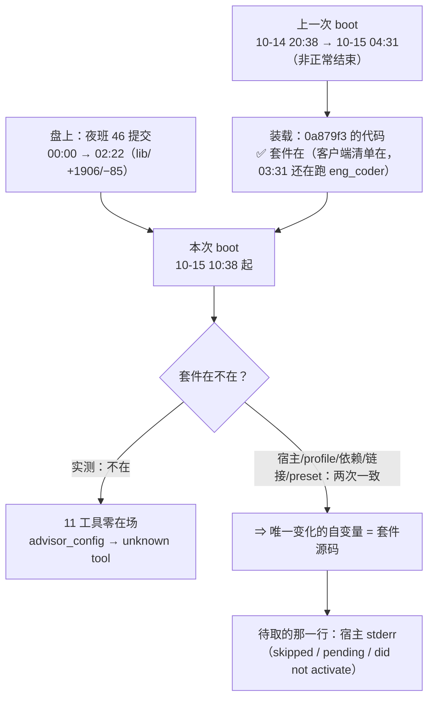

# 工程模式通道失效 · 诊断报告（2026-10-15）

> **性质**：**内部过程档**（不进 README 的门面）。只读诊断 + 一次实测探针，**零代码改动、零配置改动、零重启**。
> **谁写的**：会话 `session-b5ee8976-8ac9-496c-bb95-353bceb5588a`（用户 2026-10-15 15:14 起，cwd = 本仓）。
> **触发**：用户要求「按 `docs/2026-10-14-rotation-backup-per-rotation-design.md` 实施批 Q，走工程模式」；
> 按该设计档「接续须知」，本会话第一步应当是跑一次 `advisor(type='design')` 签发设计令牌 —— **这一步做不了**。
> **行号/时间**：一律 as-of **2026-10-15 15:40（本地 Asia/Shanghai）**。

---

## 0. 三句话结论

1. **现象**：**thincoder 套件（`@dsh-external/dsh-thincoder-suite`）在本次 DSH 启动里没挂上**（★ 措辞已被 **§0.1** 更正为「**挂上了、之后掉了**」——现象不变，机制更正）—— 它的 11 个工具
   （`advisor` / `eng` / `eng_coder` / `escalate` / `consult_*` / `contractWatch` / `goal_*` / `anti_drift_config`）
   **一个都不在工具目录里**；调用 `advisor_config` 直接被宿主拒绝：`Error: unknown tool "advisor_config"`。
   ⇒ **不是批 Q 一个批的问题：工程模式的整条「评审 → 令牌 → 实施 → 交付评审」链对所有会话都断了。**
2. **最重要的差分**：两次启动之间，**宿主、profile、依赖、链接、禁用行、preset 全都没变**，唯一变的是
   **套件自己的源码** —— 上一次已知良好装载是 `0a879f3`（10-12 11:31），本次装载的是 `0d74b9b`（10-15 02:22），
   两者相差 **10 个文件、+1906 / −85 行**（含全新的 `lib/anti-drift.mjs` 932 行、`lib/index.mjs` +474 行）。
   ⇒ **「夜班那 1900 行新代码的第一次真机装载」就是头号嫌疑**（**是差分指向，不是已坐实的根因**，见 §4 口径）。
3. **建议**：先做 §6 的**判别实验①**（一次重启 + 把宿主 stderr 落文件）—— 那一行会直接点名原因（`pending (waiting for
   service: X)` 还是 `skipped` 还是 `did not activate`），**零风险、可复现**；**重启时机由你定**（本报告没有重启）。
   在那一行拿到之前，**批 Q 的实施方案可以定，但不要开工**（开工可能撞上你要重启的窗口）。

---

## 0.1 ★ 关键修正（2026-10-15 16:05，**本报告的自我更正**）

**被更正的是本报告 §2/E3 与 §4 的核心框架**：「**本次 boot 从未挂载**」**不成立**；新读数是「**本次 boot 挂上了，之后掉了**」。

| 项 | 内容 |
| --- | --- |
| **新读数** | 桌面壳渲染进程的代码缓存里，**本次 boot 的 10:38:47**（启动后 36 秒）写下的那份**客户端插件清单**含 `@dsh-external/dsh-thincoder-suite/client.js`。命令：对 `%APPDATA%\@deepseek-ai\dsh-desktop\Code Cache\js\*` 逐档读文本、按 `dsh-team-link/client.js` 定位清单文件、再看是否含套件条目。 |
| **清单口径（为什么它能证明"在场"）** | ① **负控**：profile 里被 patch `disabled: true` 的 `bridge-browser` / `whale-girl` **不在**清单里，而其余 bundle 全在 ⇒ 清单**不是**静态 bundle 清单，含"是否生效"信息。② **顺序不符**：清单顺序 ≠ `package.json` 的 bundles 顺序（套件在清单里紧跟 `@zseven-w/dsh-openpencil`，在 manifest 里却在 `dsh-git-status` 之后） ⇒ 它是**活动条目**的产物。★ **保留**：这仍是**推断**（"活动条目"与"manifest 减 disabled、按依赖序"两种口径都能解释上述两条），不是宿主注册表的直接读数。 |
| **时间线（63 份清单文件全量）** | 09-27 起**每一份**清单都含套件；**最新一份是 10-15 10:38:47**（本次 boot 的首次加载），此后渲染进程**再未重取**（GUI 未刷新）⇒ 只有"**10:38:47 时在**"这一个时点读数，没有"掉之后"的对照清单。 |
| **窗口** | ⇒ 套件**掉线窗口 = (10:38:47, 15:24]**（15:24 是本会话探针 `advisor_config → unknown tool` 的时刻）；本会话建于 **15:14:19**，其工具目录里已无套件。 |
| **对本报告其余部分的连带影响** | §4 那条差分（"**新代码首次装载就失败**"）**被削弱**：新代码**装载成功了**、并至少存活到 10:38:47 ⇒ "1900 行让装载失败"不再能解释现象。更可能的是**挂上之后在运行期被摘掉**（跨会话对家 `session-4aed6938` 提的"周期性重载"假说与此相容，见 §4.4）。 |
| **未被这次修正推翻的** | §3 排除清单（宿主/profile/依赖/链接/BOM/preset/禁用行）· §3.1 跨插件对照（只有套件家族挂）· §6①（拿宿主 stderr 仍是首选，**但现在它必须是"整个会话期"的捕获，不只是启动那几秒**）。 |

---

## 1. 背景：这件事从哪来

批 Q 的设计档已**两轮评审判 PASS**（`advisor-dsh-20` / `advisor-dsh-22`，评审原文带 `[APPROVE:7032d28f]` + `VERDICT: PASS`），
但平台的**签发闸门两次拒发令牌**（把「🔴：状态=Fixed」那一行的严重度单元格当成未解决阻塞行）。设计档给出的接续方式是：

> 开一个新会话（不需要重启 DSH），在新会话里对本档 + 配对需求档跑一次 `advisor(type='design')`
> （新会话 ⇒ 评审计数重置、按第 1 轮做完整评审、PASS 即签发令牌），然后按 §5 的 FR-Q1…FR-Q5 实施。

用户 2026-10-15 15:14 开了这个新会话并下达「实施批 Q，走工程模式」——**第一步就撞上了本报告的对象**。

---

## 2. 现象与取证（每条读数附命令与原文）

### E1 · 工具面：套件 11 个工具全不在场（**决定性读数**）

| 项 | 值 |
| --- | --- |
| 探针 | 工具调用 `advisor_config` 传 `{"action":"get"}`（该工具的只读分支，正常应在毫秒级返回配置） |
| 原文回执 | `Error: unknown tool "advisor_config"` |
| 对照 | 同一批注册的 `contractWatch` / `goal_criteria` / `goal_verify` / `anti_drift_config` / `eng` / `eng_coder` / `escalate` / `consult_start` / `consult_stop` / `advisor` —— 本会话工具目录里**同样一个都没有** |

套件注册的 11 个工具名（事实源 `lib/index.mjs`，`grep -n 'name: "'`）：

```
968  name: "thincoder:discipline"     1031  name: "advisor_config"    1193  name: "consult_start"
974  name: "thincoder:main"           1075  name: "eng"               1276  name: "consult_stop"
987  name: "advisor"                  1093  name: "eng_coder"         1309  name: "contractWatch"
                                      1151  name: "escalate"          1408  name: "goal_criteria"
                                                                    1457  name: "goal_verify"
                                                                    1496  name: "anti_drift_config"
```

### E2 · 「是不是 preset 不对？」——已排除

- 本会话会话头：`{"agentPreset":"standard"}`（读法：解 `~/.dsh/sessions/.../session.v4.jsonl.zstd` 首帧）。
- 反证：**上一个成功跑过 `eng_coder` 的会话**（`session-e652f116-…`，`.thincoder` 账上 `engineering=true`、
  `lastSeen` = 2026-10-15 03:31:18 本地）会话头**同样是** `{"agentPreset":"standard"}`。
- 套件自己的 preset 说明也写死了这条：`preset/thincoder-eng/agent.cordis.yml` 原文
  「The thincoder mechanism itself comes from the GLOBALLY installed `@dsh-external/dsh-thincoder-suite` plugin
  (advisor / eng / eng_coder / escalate / consult are **host-plane tools**)」⇒ preset 只管「开工即工程模式」，不管工具在不在。

### E3 · 上一次启动里它是活的（对照组）

| 读数 | 命令/落点 | 原文 |
| --- | --- | --- |
| 上一次 boot | `death_forensics_report` | `当前 boot: 2026-10-15T02:38:11Z-5704` → 本地 **10:38:11**；上次运行 `2026-10-14T12:38:27Z-40260`（本地 10-14 **20:38**）→ 心跳止于 `2026-10-14T20:31:24.999Z`（本地 10-15 **04:31**），**非正常结束** |
| 上次 boot 的客户端清单含套件 | `logs/crash-2026-10-14T20-31-31-303Z-host.log` 第 551 行 | `…,@zseven-w/dsh-openpencil/client.js,**@dsh-external/dsh-thincoder-suite/client.js**,dsh-rewind-plugin/client.js,…` |
| 上次 boot 里它真在干活 | `~/.dsh/.thincoder/jobs/` | `eng-dsh-38.txt` 写于 **2026/10/15 3:31:27**；`jobs/index.jsonl` 末行 `{"jobId":"eng-dsh-38","kind":"eng-dsh","at":1792006287024,…}` |
| 本次 boot 里它静默 | `~/.dsh/.thincoder/session-state.json` | 最后写入 **2026/10/15 3:31:18**（= 上一次 boot）；本会话 id **不在这 47 条里**；`jobs/` 目录 mtime 同为 3:31:27 ⇒ 本次 boot（10:38 起）**零写入**。★ **口径**：这一行只证明「**零工具使用**」，**不能**推出「从未挂载」（它挂在 10:38:47 的读数是 §0.1 / A18） |

### E4 · 宿主换代不成立

| 读数 | 原文 |
| --- | --- |
| 桌面壳版本 | `D:\DSH-Desktop-Official\DeepSeek Harness.exe` → `0.2.0-rc.2`，mtime **2026-09-29T18:34:26** |
| 运行时包版本（asar 内索引） | `@deepseek-ai/dsh` = `0.2.0-rc.2` · `@deepseek-ai/dsh-app-boot` = `0.2.0-rc.2` |
| `app.asar` mtime | **2026-09-29T18:34:26**（上一次 boot 与本次 boot 用的是**同一个二进制**） |
| 套件声明的 peer | `@deepseek-ai/dsh: ^0.2.0-rc.1` ⇒ 对 `0.2.0-rc.2`（含 prerelease 口径）**应当满足** |

---

## 3. 排除清单（读什么 ⇒ 结论）

| # | 假设 | 读法 | 结论 |
| --- | --- | --- | --- |
| 1 | 套件源码有语法错 / 装载失败 | `node --check` 全 26 个 `lib/*.mjs` + `client.js`；`import('./lib/index.mjs')` | **全部 OK**（26/26 语法通过；`import` 返回 `LOAD OK`，导出 15 个符号含 `apply`/`inject`） |
| 2 | 另一仓有未提交的半成品 | `git -C D:\workspace\dsh-plugins\dsh-thincoder-suite status --porcelain` | **干净**；HEAD = `0d74b9b`（10-15 02:22） |
| 3 | profile 里被禁用 / 被覆盖 | `grep -n 'disabled\|- id: ' profiles/desktop/cordis.patch.yml` | **无 thincoder 相关行**（禁用的只有 `bridge-browser` 与 `whale-girl`） |
| 4 | bundle 解析不到（装载器硬检查） | `undo_doctor`（只读） | `✅ bundle @dsh-external/dsh-thincoder-suite: resolved from the DSH installation (…\profiles\desktop\node_modules\@dsh-external\dsh-thincoder-suite) — host-managed, not profile-local` |
| 5 | `link:` 断了 | `Get-Item … \@dsh-external\dsh-thincoder-suite` | `SymbolicLink` → `D:\workspace\dsh-plugins\dsh-thincoder-suite`（在） |
| 6 | 配置文件被写出 BOM（本仓 §六 那条坑） | 读前 3 字节 | 套件 `package.json` `7B 0A 20` · `cordis.patch.yml` `23 20 64` · profile 两份同查 —— **BOM 全 False** |
| 7 | 缺依赖（`node_modules` 不在） | `grep '^import … from'` 全 `lib/**` | 只有 `node:*` 内建 + 相对路径；**仓库无 `node_modules` 也不需要**（我实测 `import` 成功即为证） |
| 8 | `inject` 的服务在本次 boot 缺席（⇒ 条目永久 `pending`） | 套件 `lib/index.mjs:72` `export const inject = ["tools","llm","subagents","systemPrompt","webServer"]`；逐条对本次会话取证 | **五条都在场**：`tools`/`systemPrompt` 由本会话可见的插件工具与静态段证明；`llm` 由本会话自身在跑证明；`subagents` 由本会话的 `subagent` / `spawn_teammate` 工具证明；`webServer` 由 GUI 在 19387 上服务证明 ⇒ **未坐实此路** |
| 9 | 我在一个子会话里（工具目录被裁） | 会话头 | 头里**没有** `parentSession`，`delegationDepth` 为根会话 ⇒ 不是子会话 |

---

### 3.1 跨插件对照（2026-10-15 15:55，套件仓会话 `session-4aed6938` 请求的判别取证）

目的：分清「**只有套件挂不上**」与「**宿主/装配层整体异常**」。口径 = **只看到底是返回结果还是 `unknown tool`**。

| # | 探针 | 家族 | 实际回执（原文要点） | 判定 |
| --- | --- | --- | --- | --- |
| 1 | `team_link_list_sessions` | 本仓 dsh-team-link | 「当前工作区：…dsh-team-link（当前会话：session-b5ee8976-…）共 85 个其他会话…」+ 逐行清单 | **返回结果** |
| 2 | `modlens_read_image`（传不存在的路径） | @liustack/modlens | `Error: modlens failed (exit 1): Error: Input image not found: C:\__dsh-probe-no-such-image__.png` | **返回结果**（插件级错误） |
| 3 | `undo_list` | dsh-undo-savepoint | `Snapshots (newest first): 20261015-153935-2644 … 20261015-103828-e546 baseline [auto] plugin-mounted` | **返回结果** |
| 4 | `list_agents`（**替换** spawn_teammate/subagent：同一宿主 subagents 注册表的控制面工具，零副作用） | 宿主 subagents 面 | `[{"target":"lead","role":"lead","status":"running","model":"deepseek-flash","diagnostics":[]}]` | **返回结果** |
| 5 | `openpencil_selection` | @zseven-w/dsh-openpencil | `Error: No active OpenPencil editor. Render with editable=true and open "Edit in sidebar" first.` | **返回结果**（插件级错误） |

**判定**：**五个家族全部正常派发，只有套件那 11 个是 `unknown tool`** ⇒ 落在「**只有套件挂不上**」这一支，
**不是**宿主编译运行时整体异常 ⇒ 修法指向套件自己的装载，而非宿主侧。

**两条附注**（判别相关，不做过度解读）：

- **工具目录是「会话建立时点」的快照**：套件仓会话的目录里**列着**那 11 个（其会话建于丢失之前），
  本会话（建于 **15:14**，丢失之后）**一个都没有**；而两边**调用都失败**。
  ⇒ 「我目录里有」**不能**证明它此刻还在注册表里（与 §3 第 8 行同向）。
- **一条可用的时间线来源**：`undo_list` 显示本次 boot 后 **17 秒**（本地 10:38:28）有一条
  `baseline [auto] plugin-mounted`，此后是密集的 `patch-change` / `plugin-change` 自动快照
  （03:38 / 03:40 / 03:43 / 04:38 / 04:43 / 05:38 / 05:43 / 06:39 / 06:44 / 07:00 / 07:04 / 07:14 / 07:39 本地）。
  ★ **口径**：这些是「配置/补丁文件被写过」的痕迹，**不是**「条目被卸载」的判据 —— 只可当比对窗口，**不可当证据**。

---

## 4. 最强线索：两次 boot 之间**唯一变化的自变量**是套件源码

> ★ **本节已被 §0.1 削弱，读它请连同 §0.1 一起读**：差分能解释「**装载失败**」，但 10:38:47 的读数表明
> **装载是成功的**（清单含套件）⇒ 本节降级为「**一个未能解释现象的差分**」，不再是主假设。
> 保留它的理由是：它仍是两次 boot 之间唯一变化的自变量，可作为「运行期被摘」的一个**候选触发面**（而非装载面）。

### 4.1 差分读数

| 项 | 值 |
| --- | --- |
| 上一次**已知良好装载**的修订 | `0a879f3`（2026-10-12 11:31）—— 命令：`git rev-list -1 --before="2026-10-14T20:38:00" HEAD` |
| 本次装载的修订 | `0d74b9b`（2026-10-15 02:22） |
| 两次之间 `lib/` 的差 | `git diff --stat 0a879f3..HEAD -- lib/` ⇒ **10 files changed, 1906 insertions(+), 85 deletions(-)** |

```
 lib/abort-provenance.mjs  |    4 +      lib/consult.mjs           |   89 ++++-
 lib/advisor.mjs           |  130 ++--   lib/contract-baseline.mjs |   66 +++-
 lib/anti-drift.mjs        |  932 ++++++  lib/escalate.mjs          |   21 +-
 lib/client.js             |   76 +--    lib/index.mjs             |  474 +++++++++++++--
 lib/codex-adapter.mjs     |   31 +-    lib/codex-app-server.mjs  |  168 +++++++++
```

### 4.2 与之互证的第三方证据（套件自己的夜班报告）

`D:\workspace\dsh-plugins\dsh-thincoder-suite\docs\2026-10-15-night-shift-report.md`：

- §0.a 末行原文：「你只需挑一条：① 清理残名（建议先做）② 做 FR-7 ③ 做 N-3/N-5/N-6 **④ 重启**（我按 V1–V13 验收，
  只需你动手 V6/V11）⑤ 停。」⇒ **夜班本身就把「重启」列为待办，并预期重启只带来一条假红**。
- §0.c 原文：「★ 重启后第一眼：`contractWatch` 会报 `ps7` **红** —— 那是**旧模块**，不是缺陷… **重启后这条红会自己消失**」
  ⇒ 夜班预期的是**插件照常在、只是常量陈旧**；**实况是插件整个不在**。
- §0.a 的「装配 | **OK** —— 11 工具 / 10 监听器」读数，来自**桩环境**（该仓测试自带 fixture），**不是真机读数**。

⇒ 这正是本仓 `AGENTS.md` §四 记过两次的同一类断层：「**测试桩不得只镜像自家实现的调用面** —— 桩只提供插件正在调的方法，
就把「宿主已改名 / 宿主面缺失」这层断层永久挡在套件外面」（2026-09-29 的 `standingKeyFor → acquireScope` 就是同一物种）。

**套件作者本人的对照读数（2026-10-15 15:54 跨会话送达，原文口径）**：他把 `lib/index.mjs` 用 `import()` 真身加载后，
用一个**服务全缺席**的桩 ctx 跑 `apply` ⇒ **11 工具 / 10 监听器、不抛错**；再逐级补齐服务
（`agent` / `llm` / `subagents` / `webServer`）到三级 ⇒ **依然不抛错**。
⇒ 该读数把嫌疑面从「`apply` 抛错」**收窄**到「**`apply` 从未被调用**」（pending / skipped）。
★ **但别读满**：桩补服务 ≠ 宿主给真服务 —— 若宿主**在场但形状变了**（同一物种的老坑），抛错仍可能发生；
所以这条是**收窄**，不是**排除**。

### 4.3 口径（别把它读成已坐实的根因）

- **已坐实**：① 工具全不在场；② 上一次 boot 它在场；③ 宿主/profile/依赖/链接/preset 两次 boot 无变化；④ 源码语法与模块装载本身没问题。
- **未坐实**：**那 1900 行里的哪一处**让真机装载失败（也**不能排除**「与那 1900 行无关的宿主侧偶发」——只是差分强烈指向前者）。
- **缺的那一件证据**：宿主的**启动 stderr 那一行**（`reportSkippedBundles()` 的 skipped 行 / `1 entry did not activate` /
  `pending (waiting for service: X)`）。桌面壳把 stderr 丢给了父进程，**本机没有本次 boot 的 host 日志**
  （`%APPDATA%\@deepseek-ai\dsh-desktop\logs\` 里最新一份是 **04:31** 那次崩溃的）⇒ 只能靠下一次启动去接。



---

### 4.4 对家的反驳与新增读数（跨会话 `session-4aed6938`，2026-10-15 16:01 送达）

**他的论证**：「改过代码」与「坏掉」**不相关** —— ① 本次 boot（10:38）装载的套件代码 `0d74b9b` **在 boot 时就已在盘**，
且 boot 之后套件**零提交、工作树 CLEAN**；② **team-link 是活的反例**：它 HEAD `7978871`（**15:51:38**，boot 之后还改过代码）
**照样正常派发**；③ boot 时的 profile manifest 与现在**逐字节一致**（用 undo 的 `baseline plugin-mounted` 快照比对）。

**本方评估**：③ 与我 §3 一致，采纳；② **反驳的是「凡刚改过代码的插件都会坏」**——这一条我从未主张；
它**不能反驳**「新代码**装载失败**」，而 §0.1 的新读数**已经把后者驳掉了** ⇒ **两条合起来的结论是**：
「新代码」**既不是装载失败的原因、也不是充分条件**；它最多是「运行期被摘」的一个**候选触发面**。

**他新增的三条读数**（可抄用）：

| # | 读数 | 意义 |
| --- | --- | --- |
| a | `0a879f3` 与 HEAD 的 `inject` 数组与 `apply` 导出**逐字相同**（`["tools","llm","subagents","systemPrompt","webServer"]`） | **加载期契约未变** ⇒ 「宿主找不到服务」不是新引入的 |
| b | 声明的工具数 **10 → 13**（新增 `goal_criteria` / `goal_verify` / `anti_drift_config`），桩内**全部注册成功、无重名冲突** | 排除「注册重名把 apply 打挂」 |
| c | `apply` 在**服务全缺席**的桩里不抛错（逐级补 `agent`/`llm`/`subagents`/`webServer` 到三级仍不抛） | 见 §4.2 末条（收窄面，不排除） |

**他的假说（值得优先验）**：**DSH 的插件集在周期性重载** —— `undo_list` 里 `plugin-change` ↔ `patch-change`
**成对心跳**（UTC 03:38 / 04:38 / 05:38 / 06:39 / 07:39 ≈ 每小时）⇒ 套件**可能是在某次重载里被摘掉的**，而不是 boot 起就没挂。

★ **本方补的一条支持性读数**：profile 的 `cordis.patch.yml`（`dsh.profile.patchReload = "live"`）**mtime = 15:14**
—— 正好落在掉线窗口 `(10:38:47, 15:24]` 内，且与我建会话是同一分钟。
⇒ **"窗口内确实发生过 patch 写入"是实测**；但「**那一次写入是否真触发了重载、以及重载是否就是摘除动作**」**未验证**。

⇒ **对 §6 的连带修改**：§6③（检出 `0a879f3` 二分）**预期收益低**（它测的是"新代码让装载失败"，而装载是成功的）；
§6①（拿 stderr）**仍是首选，但捕获必须覆盖"整个会话期"**（重载发生在运行中，那一行会出现在**运行中**的 stderr，而不是启动那几秒）。

---

## 5. 影响面

| 面 | 影响 |
| --- | --- |
| **全部会话的工程模式** | `advisor`（设计/交付评审）· `eng` / `eng_coder`（实施）· `escalate`（飞刀）· `consult_start` / `consult_stop`（会诊）· `contractWatch`（契约巡检）· `goal_criteria` / `goal_verify` · `anti_drift_config` —— **全不可用** |
| **批 Q（本次要做的）** | 卡在第一步：拿不到设计令牌 ⇒ 按流程**不能**开 `eng_coder` 实施；用户已裁定本会话**只出诊断、不动代码** |
| **本仓 `dsh-team-link`** | **工具面不受影响**：`team_link_*` 工具全在场（与套件的挂载状态无关，本仓 peer 区间不含 `@deepseek-ai/dsh`，不走套件那条 inject 面）。★ **但工作树此刻不干净 —— 且不是我改的**：15:36:56 起有两处**外来改动**（`lib/index.js` +51/−19、`docs/2026-10-13-policy-atomic-write-design.md` +4/−1，内容是「批 L 交付评审 🔵#1/🔵#3」的原子写收尾）⇒ **另一会话在本仓干活，不是本报告所为**（见 §7 的重启前置清点）；**15:56 复读**：那两处已由其提交 `7978871`（15:51:38）收进库，工作树重新干净（只剩本文件）。本报告自身**只新增本文件**，零代码/配置改动。
| **thincoder 套件仓** | 其夜班报告把「重启验收（V1–V13）」「`contractWatch` 十锁」列为待办；**本次重启的实况与该预期不符** ⇒ 该仓的 N 系列待办需要追加一条 |

---

## 6. 判别实验（交给用户定；按成本排序）

| # | 实验 | 怎么做 | 能判什么 | 代价 / 风险 |
| --- | --- | --- | --- | --- |
| **①（推荐）** | **接住宿主那一行（★ 捕获窗口要覆盖整个会话期）** | **换启动方式**：从终端起 `D:\DSH-Desktop-Official\DeepSeek Harness.exe`（或包一层重定向）把 stderr 落文件，**让它一直跑**，去干别的事，再回来看文件 | **一句话定性**：`pending (waiting for service: X)` ⇒ 某个服务没来；`skipped` ⇒ 兼容性闸门；`did not activate` ⇒ `apply` 抛错（并可拿到栈）。★ 因为掉线发生在**运行期**（见 §0.1/§4.4），**只看启动那几秒会漏掉它** | 一次重启（**时机你定**）。★ **重启前必须先清点在飞作业**（本仓规矩 §八）：**另有一会话正在本仓干活**（15:36–15:51 那两处改动即其手笔）⇒ 重启会掐掉它。**本会话自身零在飞作业。** |
| ② | **GUI 侧对照** | 重启后看 GUI 是否弹「entry did not activate」类启动告警；跑一次 `contractWatch` 看 `ps7` 是红是绿 | 与①互证；顺带核夜班那条「假红会消失」的预期 | 零额外成本（与①同一次重启） |
| ③ | **二分定位（★ 预期收益已下调）** | 把套件仓 checkout 到 `0a879f3` 再重启一次 | 只在「**新代码让装载失败**」成立时才有信息量；§0.1 的读数表明**装载是成功的** ⇒ **大概率白烧一次重启**（跨会话对家同判） | 动另一仓工作树 + 又一次重启 ⇒ **建议先不做** |
| ④ | **套件侧自检** | 在套件仓跑 `npm test`（`node --test`，其自述 631/631） | 若它自己红了 ⇒ 夜班「全绿」是陈旧读数 | 只读，但会在系统临时目录落文件；**我未擅自跑**，你说跑我再跑 |

---

## 7. 建议（每条带代价）

| 事项 | 建议 | 代价 / 不做的后果 |
| --- | --- | --- |
| **工程模式恢复** | **先做 §6①**（一次重启 + stderr 落文件），拿到那一行再定修法 | 不做 ⇒ 只能停留在「差分指向」，修哪儿全靠猜 |
| **批 Q** | **方案可以先定、代码先不动**（你已裁定「只出诊断」）—— 等①的结论；若套件短期修不好，再考虑「我直接实施 + 另一模型独立交付评审」的替代路（那是**流程偏离**，届时我会在 `docs/verification-log.md` 如实登记） | 现在就开工 ⇒ 可能与重启窗口相撞（重启会掐掉在飞作业） |
| **这套教训入仓规** | 建议在本仓 `AGENTS.md` §四 的「宿主换代必复核」那一族里**追加一条**：「**插件换代（不只是宿主换代）之后，第一次真机装载必须单独取证**——套件/插件的自测是桩读数，桩绿不等于真机在」 | 不入 ⇒ 同一物种（桩绿 / 真机不在）会在两边仓继续复发 |
| **重启** | **由你决定时机**（本仓 §三 的规矩：代理不自作主张）；本报告**没有重启、没有改配置、没有改代码** | —— |

---

## 8. 边界与未验证项（本报告不做什么）

- **不做**：不改任何代码 / 配置；不重启；不动套件仓；不动 `docs/verification-log.md`（要追加读数你说一声，我再落）。
- **非目标**：不在本报告里裁定「套件该由谁修、怎么修」——那是套件仓的事；本报告只把现场读数与差分交出来。
- **未验证（如实标注）**：
  1. 宿主 stderr 那一行（**缺的就是它**）；
  2. 那 1900 行里具体哪一处让真机装载失败（无栈则不可知）；
  3. 「`inject` 五服务全在场」是我的**递进取证**（会话面反推），**不是**宿主服务注册表的直接读数；
  4. 套件自测当前是否仍 631/631（未跑，见 §6④）。
- **不排除**：与那 1900 行无关的宿主侧偶发（差分强烈指向新代码，但**没有**直接证据排除偶发）。

---

## 附录 · 读数清单（可逐条复核）

| # | 读什么 | 命令 / 落点 | 原文要点 |
| --- | --- | --- | --- |
| A1 | 工具探针 | 会话内调 `advisor_config` | `Error: unknown tool "advisor_config"` |
| A2 | 本会话会话头 | 解 `~/.dsh/sessions/--D-workspace-dsh-plugins-dsh-team-link--/session-b5ee8976-…/session.v4.jsonl.zstd` 首帧 | `"agentPreset":"standard"` |
| A3 | 上一成功会话的会话头 | 同上，`…/--D-workspace-mal-analyze-cli--/session-e652f116-…/` | `"agentPreset":"standard"` |
| A4 | 当前 boot / 上次 boot | `death_forensics_report` | `2026-10-15T02:38:11Z-5704` ／ 上次 `2026-10-14T12:38:27Z-40260`，非正常结束 |
| A5 | 上次 boot 的客户端清单 | `…\logs\crash-2026-10-14T20-31-31-303Z-host.log:551` | 含 `@dsh-external/dsh-thincoder-suite/client.js` |
| A6 | 套件状态文件 | `~/.dsh/.thincoder/session-state.json`（47 条）· `jobs/` | mtime 均 **2026/10/15 3:31**；无本会话 id |
| A7 | 宿主版本 | `app.asar` 内索引 · exe 版本资源 | `@deepseek-ai/dsh` / `dsh-app-boot` = **0.2.0-rc.2**；asar mtime **09-29** |
| A8 | 套件源码体检 | `node --check`（26 档） · `import('./lib/index.mjs')` | 全 OK；`LOAD OK`，导出含 `apply` / `inject` |
| A9 | 套件仓状态 | `git status --porcelain` · `git log -3` | 干净；HEAD `0d74b9b`（10-15 02:22） |
| A10 | 差分 | `git diff --stat 0a879f3..HEAD -- lib/` | 10 files, **+1906 / −85** |
| A11 | profile 禁用行 | `grep -n 'disabled\|- id: ' profiles/desktop/cordis.patch.yml` | 无 thincoder 行 |
| A12 | bundle 解析 | `undo_doctor`（只读） | `✅ bundle @dsh-external/dsh-thincoder-suite: resolved …` |
| A13 | 链接 | `Get-Item …\node_modules\@dsh-external\dsh-thincoder-suite` | `SymbolicLink` → `D:\workspace\dsh-plugins\dsh-thincoder-suite` |
| A14 | BOM | 读前 3 字节（套件 3 份 + profile 2 份） | 全 `BOM=False` |
| A15 | 夜班自述 | 套件仓 `docs/2026-10-15-night-shift-report.md` §0.a / §0.c | 「④ 重启（我按 V1–V13 验收）」·「重启后 ps7 红会自己消失」 |
| A16 | 本仓工作树（**外来改动**） | `git status --porcelain=v1` · `git diff --stat` | 开工时（15:16）**空**；15:36:56 起出现 ` M docs/2026-10-13-policy-atomic-write-design.md` + ` M lib/index.js`（+36/−19，内容 =「批 L 交付评审 🔵#1/🔵#3」**原子写收尾**）⇒ **另一会话在本仓写**，与本次诊断无关、**不是本报告所为**；**15:56 复读**：已由 `7978871`（15:51:38）提交进库，工作树重新干净 |
| A17 | 本仓套件计数（**已复核**） | `node host-half.test.mjs`（本会话后台实跑，2026-10-15 16:00 前后） | **`ALL PASS` · `assertion total: 1697 (failed: 0)`** ⇒ 开工时引用的 **1697/0 正确**；`7978871` 提交自述的「1674/0」**与实测不符**（差 23，**未追问**，登记备查） |
| A18 | **本 boot 是否挂过套件（关键修正读数）** | `%APPDATA%\@deepseek-ai\dsh-desktop\Code Cache\js\*` 逐档读文本，按 `dsh-team-link/client.js` 找清单、按 `dsh-thincoder-suite/client.js` 判在场 | **10:38:47**（本次 boot 后 36 秒）那份清单**含**套件；09-27 起 63 份清单**全部含**；**最新一份止于 10:38:47** ⇒ 「boot 起就没挂上」**不成立**，掉线窗口 = **(10:38:47, 15:24]**（见 §0.1） |
| A19 | 跨会话对家（套件仓） | `session-4aed6938` 两条入站消息（15:54 / 16:01） | ① 其目录**列着**那 11 个工具但**调用失败**（与本报告判别一致）；② 其反驳与三条新读数见 §4.4 |
