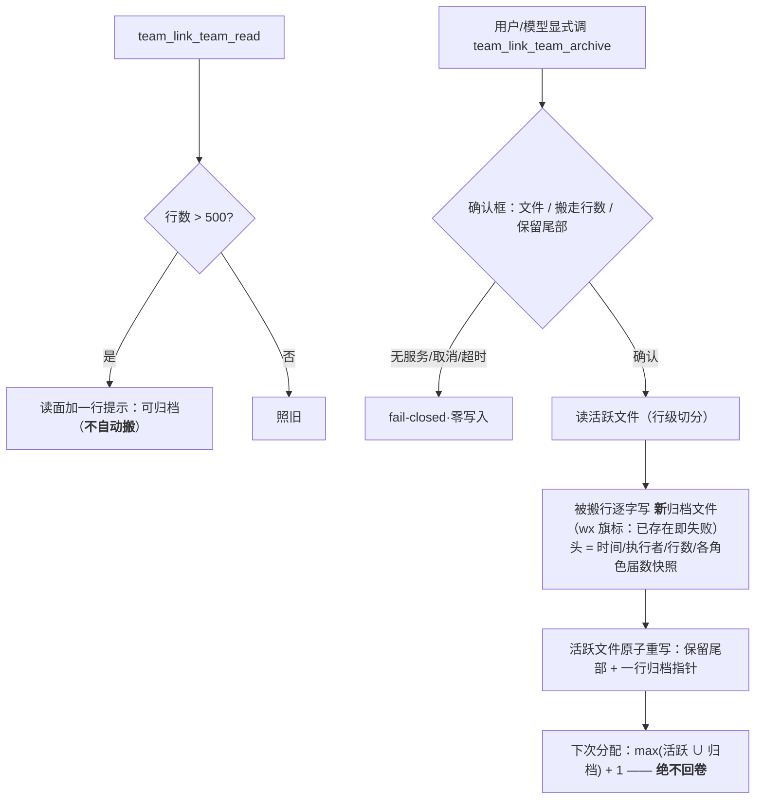

# 批 T · 黑板归档 / 回收 —— 设计档

> **规格档**。需求档 [`docs/2026-10-18-blackboard-archive-requirements.md`](2026-10-18-blackboard-archive-requirements.md)。
> **设计输入**：会诊 #66 §3-③/⑤ 裁定（行数触发 + 尾段留存 + 世代只做归档头；只搬不删；归档文件只写一次；任务号不回卷）。
> 行号 as-of **2026-10-18 工作树**；实施按符号名定位。★ 新测试标识符用 **`Tr`** 中缀。

---

## 0. 结论与图

**三句话**：① 黑板的 `decisions.seq` 与任务号 `t-<n>` **都是从文件里扫出来的** ⇒ 天真截断会让序号回卷、旧号被复用；② 修法 = **显式归档动词**把旧行**搬**进「只写一次」的归档文件，活跃文件保留尾部 ＋ 一行指针，**序号分配改为「活跃 ∪ 归档」的最大值 + 1**；③ 阈值 **500 只提示**，任何搬运都必须由人/模型显式触发并过一道确认框。



---

## 1. 背景

`bac-1009` 这类长期团队的 `tasks.md` / `decisions.md` **只增不减**；用户已裁定**不删团队、不删黑板**。会诊 #66 四席独立命中同一命门：**计数器从文件扫出来**（`lib/ledger.js` 的 `lastSeq` 与任务号分配「扫整个文件」）⇒ 截断 = 序号复位 = claim 指向歧义历史。

## 2. 问题（根因，带符号名）

| 面 | 事实 | 证据 |
| --- | --- | --- |
| 序号 | `lastSeq(text)` 只看**当前文件** | `lib/ledger.js:143` |
| 任务号 | 分配扫**整个文件**取最大 `t-<n>` | `lib/ledger.js:247` 一带（`taskRefs` 扫描） |
| 写面 | 黑板追加走 `appendFile`（无归档概念） | `lib/team-tools.js:46/66` 一带 |
| 读面 | 读末 N 条 + 派生读数；无「行数提示」 | `team_link_team_read` 的实现 |

## 3. 目标 / 非目标

**目标**：显式归档 → 旧行**搬进只写一次的归档文件**、活跃文件保留尾部 ＋ 指针、**序号永不复用**、世代只进归档头。
**非目标**：需求档 §五 六条（不自动 · 不删团队/黑板 · 不改既有序号分配点（只把取值面扩到归档）· 不加 generation 字段 · 不动换届 · 不做跨队批量）。

## 4. 决策与理由

| # | 决策 | 理由 | 被否决的备选 |
| --- | --- | --- | --- |
| **D1** | **新工具 `team_link_team_archive`**（不塞进 `team_link_team_append` 的 `file` 枚举） | 语义不同：append 是**追加一行**、archive 是**重写整个文件 + 新建归档**；确认框与失败面也不同 | `file=archive`（把两种破坏面混进一个动词） |
| **D2** | **搬而不失**：被搬行**逐字**进归档文件；活跃文件保留**尾部 `keepTail`（默认 200）行** ＋ **一行归档指针** | 需求 US-T2 的二选一里选「搬而留指针」；活跃文件回到可读尺寸，历史仍可追溯 | 纯复制（源文件继续增长，不解痛）· 全搬（活跃文件只剩指针，读面失去近期上下文） |
| **D3** | **归档文件只写一次**：文件名 `<file>-<ISO>-g<世代>.md`，创建用 `flag: "wx"`（已存在即失败） | 需求 NF-T3；「只写一次」= 文件生成后**不再追加/覆盖**，下一次归档开新文件 | 覆盖写（不可审计）· 追加到同一个归档（一次坏写污染整份） |
| **D4** | **世代只进归档头**：时间 / 执行者会话 / 被搬行数 / 行范围 / **各角色届数快照**（从既有 `history` 现算）；**不落 policy** | 会诊 §3-⑤：`generation` 字段**不加**；世代是审计维度不是状态 | 新增顶层 `generation`（状态双写、与 roster 届数打架） |
| **D5** | **序号分配改为「活跃 ∪ 归档」最大值 + 1**：`decisions.seq` 与任务号 `t-<n>` 同规 | 需求 NF-T4 的命门；只扩**取值面**，不改分配时机与格式 | 归档时把最大号写进活跃文件头（多一处状态、可被手改） |
| **D6** | **阈值 500 只提示**：读面在 `decisions.md` 或 `tasks.md` 行数 > 500 时加一行提示；**零写盘** | 需求 NF-T1；用户裁定「只提示不自动」 | 到阈值自动归档（用户明确否决） |

---

## 5. 方案（FR-T1…FR-T5）

| FR | 内容 | 落点 |
| --- | --- | --- |
| **FR-T1** | **阈值提示**：`team_link_team_read` 的输出里，行数超 500 的文件加一行「可显式归档（只提示，不自动）」 | `lib/team-tools.js` 的 read 面 |
| **FR-T2** | **归档动词**：`team_link_team_archive`（参数：`team`、`file`（`decisions`/`tasks`）、`keepTail` 可选默认 200）；**一道确认框**（文件 / 将搬行数 / 保留行数）；取消/超时/无服务 ⇒ 零写入 | 新工具注册（`lib/index.js`）＋ `lib/team-tools.js` |
| **FR-T3** | **归档文件**：`<workspace>/team/<name>/archive/<file>-<ISO>-g<世代>.md`（`wx` 创建）；头 = 时间/执行者/行数/范围/届数快照；正文 = 被搬行**逐字** | `lib/team-tools.js` |
| **FR-T4** | **序号不回卷**：`lastSeq` 与任务号分配改为扫「活跃文件 ∪ `archive/` 下同族归档」取最大 | `lib/ledger.js` 的 `lastSeq` / 任务号分配 |
| **FR-T5** | **对账**：归档返回「搬走 N 行、保留 M 行、活跃文件现 K 行；N + M' = 原行数」的可核读数；二次归档**新开文件**不覆盖 | `lib/team-tools.js` |

---

## 6. 机制伪代码（前置 / 后置）

```js
/**
 * 前置：team 在册；file ∈ {decisions, tasks}；archive/ 可建；确认框已确认（否则零写入）。
 * 后置：新归档文件**恰存在一份**（wx 语义）；活跃文件 = 头部（若有）+ 指针行 + 尾部 keepTail 行；
 *   **被搬行逐字出现在归档文件里**（逐行比对通过）；**不丢任何行**；
 *   下一次 seq / 任务号 > max(活跃 ∪ 归档) 的历史最大值。
 */
async function archiveBlackboard({ team, file, keepTail = 200, caller, now, confirmed }) {
    if (!confirmed) return { error: "未确认：归档会重写活跃文件（零写入）" };
    const paths = blackboardPaths(team);                 // 既有：<workspace>/team/<name>/...
    const text = await readFile(paths[file], "utf8");
    const rows = splitRows(text);                        // ★ 行级切分口径见 §7（实施首步回读文件头形态）
    if (rows.body.length <= keepTail) return { error: "无需归档：行数未超过保留尾部" };
    const moved = rows.body.slice(0, rows.body.length - keepTail);
    const tail = rows.body.slice(rows.body.length - keepTail);
    const archivePath = join(paths.dir, "archive", `${file}-${isoStamp(now)}-g${generationOf(team)}.md`);
    await mkdir(dirname(archivePath), { recursive: true });
    await writeFile(archivePath, archiveDocument(team, file, moved, now, caller), { flag: "wx" }); // 只写一次
    await writeFileAtomic(paths[file], rebuildActive(rows.header, tail, archivePath, moved.length));  // 原子重写
    return { lines: reconcileLines({ moved: moved.length, tail: tail.length, archivePath }) };
}
```

**前置（分配面）**：`lastSeq` / 任务号分配在**同一进程内**读活跃文件与 `archive/`（目录缺省视为空）；归档与分配**不同时**发生（单进程、单写点）。
**后置（分配面）**：`t-<n>` 的 `n` 严格大于历史最大值；归档后新任务号**不回卷**。

## 7. 状态与 schema

| 项 | 变更 |
| --- | --- |
| `policy.json` | **零变更**（仍十一键；**不加**世代字段） |
| 磁盘 | **新增** `<workspace>/team/<name>/archive/*.md`（只写一次）；活跃文件被原子重写 |
| 归档头 | `# 归档头`：时间 / 执行者 / 文件 / 搬走行数 / 行范围 / 各角色届数快照 |
| 谁写谁读 | 写：`team_link_team_archive`（唯一）；读：`team_link_team_read`（活跃文件）＋ 分配面（活跃 ∪ 归档） |

★ **未验（实施首步回读）**：活跃文件的头形态（是否有标题行/注释行）、行级切分是否可简单按 `\n`（`decisions` / `tasks` 的单行上限 2000 码点、正文不可含换行；`discipline` 是整文件替换，**不在归档面**）。

## 8. 防偏离（判据与红相）

= 需求档 §四 `Tr1`–`Tr8`（每条带红相）。实施方必须给**修复前 / 修复后**两次实测；`Tr7`（既有 append/read/block 族不回归）属回归锁，修复前绿、如实标负相。

## 9. 边界

| 情形 | 行为 |
| --- | --- |
| 空文件 / 行数 ≤ keepTail | 具名拒绝「无需归档」，零写入 |
| 恰好 500 / 501 行（阈值边界） | 提示只在 > 500 出现；归档按 `keepTail` 计算，与阈值无关 |
| `archive/` 不存在 | 建目录（`recursive`）；建不出 ⇒ 报错、零写入 |
| 归档文件名已存在（同秒同世代） | `wx` 失败 ⇒ 报错、零写入（**绝不覆盖**） |
| 并发 append 与归档 | 单进程写点串行；归档用**读-改-写**，与 append 竞争时后写者胜 —— 实施首步评估是否需要文件锁；若需要，复用批 L 的唯一临时名接缝 |
| 活跃文件损坏（非 UTF-8 / 无有效行） | 如实报错、**不写归档、不改活跃文件** |
| 重启 | 归档文件与活跃文件都在磁盘；分配面重启后照常（每次现算） |
| 失败方向 | **fail-closed**：确认框、文件名冲突、读失败任一 ⇒ 零写入 |
