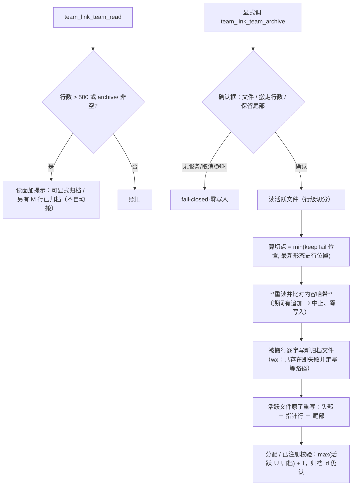

# 批 T · 黑板归档 / 回收 —— 设计档

> **规格档**。需求档 [`docs/2026-10-18-blackboard-archive-requirements.md`](2026-10-18-blackboard-archive-requirements.md)。
> **设计输入**：会诊 #66 审定层 §2/§3（行数触发 + 尾段留存 + 世代只做归档头；只搬不删；归档文件只写一次；任务号不回卷；**形态史行钉住**；**已注册校验面**）。
> 行号 as-of **2026-10-18 工作树**；实施按符号名定位。★ 新测试标识符用 **`Tr`** 中缀。
>
> **状态：已实施（批 T · 2026-10-19）**。判据 `Tr1`–`Tr13` 落在 `host-half.test.mjs` 的「批 T」块；本地复跑 **`1771 = 1758 + 13`，`failed: 0`，退出码 0**（修复前基线 `1758 (failed: 0)`）。实施首步回读的五项读数见本档 §2 与 §7 末的「实施期裁定」；
> `lib/index.js` **零改动**（仍 261,720 B），第 12 个工具注册在 `lib/team-ledger-tools.js`。

---

## 0. 结论与图

**三句话**：① 黑板的 `decisions.seq` 与任务号 `t-<n>` **都是从文件里扫出来的**（且「已注册」校验也扫同一份）⇒ 天真截断会让序号回卷、旧号被复用、归档 id 的 claim 被误拒；② 修法 = **显式归档动词**把旧行**搬**进「只写一次」的归档文件，活跃文件保留尾部 ＋ 一行指针，**分配面与已注册校验都改成「活跃 ∪ 归档」**，**切点还要钉住最新形态史行**；③ 阈值 **500 只提示**，任何搬运都必须显式触发并过一道确认框。



---

## 1. 背景

`bac-1009` 这类长期团队的 `tasks.md` / `decisions.md` **只增不减**；用户已裁定**不删团队、不删黑板**。会诊 #66 四席独立命中同一命门：**计数器从文件扫出来**（`lib/ledger.js` 的 `lastSeq` 与任务号分配「扫整个文件」）⇒ 截断 = 序号复位 = claim 指向歧义历史；并且**「已注册」校验**与**形态史行**也是文件内的耦合点（会诊 §2 采纳的「彩蛋级耦合」两条）。

## 2. 问题（根因，带符号名）

| 面 | 事实 | 证据 |
| --- | --- | --- |
| 序号 | `lastSeq(text)` 只看**当前文件** | `lib/ledger.js:143` |
| 任务号 | 分配扫**整个文件**取最大 `t-<n>` | `lib/ledger.js:247` 一带（`taskRefs` 扫描） |
| 已注册校验 | claim/append 的「这个号登记过吗」也只扫当前文件 | **实施首步回读确认**：判据本体 = `lib/ledger.js` 的 `registeredTaskIds()`（扫全文取 `ids` / `max` / `unsafe`）；**调用点**在 `lib/index.js` 的 append 工具里（`kind=plan` 取 `max + 1`、其余 kind 用 `ids.has(task)` 拒绝未登记号）—— 所以本批只改**判据本体的取值面**，入口零改动 |
| 形态史行 | `set-mode` 的幂等检查读 `decisions.md` 找既有形态史行 | 会诊 #66 §2（`:866`）· `lib/team-registration.js` 的 set-mode 分支 |
| 写面 | 黑板追加走 `appendFile`（无归档概念） | `lib/team-tools.js:46/66` 一带 |
| 交接扫描 | 交接文档按 `handoff-<role>-` 前缀扫 `team/<name>/` | `lib/handover.js`（扫描谓词） |

## 3. 目标 / 非目标

**目标**：显式归档 → 旧行**搬进只写一次的归档文件**、活跃文件保留尾部 ＋ 指针、**序号与已注册面永不复用/误拒**、世代只进归档头、**最新形态史行钉住**。
**非目标**：需求档 §五 六条。

## 4. 决策与理由

| # | 决策 | 理由 | 被否决的备选 |
| --- | --- | --- | --- |
| **D1** | **新工具 `team_link_team_archive`**（不塞进 `team_link_team_append` 的 `file` 枚举） | 语义不同：append 是**追加一行**、archive 是**重写整个文件 + 新建归档**；确认框与失败面也不同 | `file=archive`（把两种破坏面混进一个动词） |
| **D2** | **搬而不失 + 形态史行钉住**：被搬行逐字进归档；活跃文件保留**尾部 `keepTail`（默认 200）行** ＋ **一行指针**；★ **切点 = min(位置切点, 最新形态史行的位置)**（即最新形态史行**永不搬走**） | 需求 US-T2/US-T5；会诊 #66 §2 的「彩蛋耦合①」：set-mode 幂等检查读 `decisions.md` 找形态史行，切走它会让幂等检查失灵、产生重复行 | 纯位置切（bac-1009 的形态史行常在 200 行之外）· 全搬（活跃文件只剩指针，读面失去近期上下文） |
| **D3** | **归档文件只写一次**：文件名 `archive/<file>-g<世代>-L<起>-L<止>.md`（**确定性区间** = 被搬行在该文件 **body 内**的 1-based 行号 `1..cut`，见 D8；时间戳只写在**归档头**里），创建用 `flag: "wx"` | 需求 NF-T3；「只写一次」= 文件生成后不再追加/覆盖，下一次归档开新文件；★ 文件名不含墙钟是 D8 幂等的前提 | 覆盖写（不可审计）· 追加到同一个归档 · 用墙钟命名（重跑换名，评审 N2） |
| **D4** | **世代只进归档头**：时间 / 执行者会话 / 被搬行数 / 行范围 / **各角色届数快照**；**不落 policy** | 会诊 §3-⑤：`generation` 字段**不加**；世代是审计维度不是状态 | 新增顶层 `generation`（状态双写） |
| **D5** | **序号与已注册面都取「活跃 ∪ 归档」**：`decisions.seq` / 任务号**分配**取并集最大 + 1；**「已注册」校验**改为「并集里有这个号，或 `id ≤ 并集最大`」 | 需求 NF-T4 ＋ 会诊 #66 采纳项「归档后旧 id 仍须被认」；只扩**取值面**，不改时机与格式 | 把最大号写进活跃文件头（多一处状态、可被手改）· ★ **本决策显式取代**会诊纪要里 kimi 提的「锚行」机制（`docs/consult-minutes/2026-10-14-consult-66-minutes.md:892`）—— 不变量（不回卷、旧 id 仍认）逐字保留，实现从「写锚行」改为「扫并集」，此替代在此**如实声明** |
| **D6** | **阈值 500 只提示**；且 `archive/` 非空时读面**始终**给归档索引一行（与阈值无关） | 需求 NF-T1 ＋ 设计评审 🟡#6：刚归档的文件约 201 行，低于阈值，若只在超阈值时提示，读者永远看不到「还有更早的历史」 | 到阈值自动归档（用户明确否决）· 只在超阈值提示（归档后即失明） |
| **D7**（设计评审 🟡#4 ＋ N1 折入） | **读-改-写必须带核对，且核对在归档写之前**：算好切点后**重读活跃文件**并比对**被搬前缀**（`rows[0..cut)` 逐行相等）；不一致 ⇒ **中止、零写入**（此时还没写任何东西）。归档写之后、活跃重写之前**再读一次**：前缀仍相等 ⇒ 用**新读数**的尾部（自然包含期间 append 的行）完成重写；前缀变了（极罕见）⇒ 中止并**如实报「已在 archive/ 留下一份孤儿归档」**（行同时存在于两处，不丢数据；重跑按确定性文件名识别它） | 否则「后写者胜」会静默丢掉归档窗口内追加的一行，直接违背 US-T5 的可审计承诺 | 只做一次核对且在归档写之后（会产生孤儿却声称零写入 —— 评审 N1 否决）· 用批 L 的唯一临时名接缝（只保证写不撕裂，不解决丢更新） |
| **D8**（设计评审 🟡#5 ＋ N2 折入） | **两笔写的崩溃语义 ＋ 确定性文件名**：归档文件名**不取墙钟**，而取 `archive/<file>-g<世代>-L<起始行>-<截止行>.md`（被搬行在活跃文件里的 **1-based 物理行号区间**；活跃文件未变 ⇒ 重跑算出的名字**必然相同**）；先写归档（`wx`）、再原子重写活跃文件；**重跑幂等** —— 同名文件已存在且**正文（被搬行）逐行相等** ⇒ 跳过归档写、直接完成活跃文件重写（**原归档头与字节一律不改**）；正文不等 ⇒ 报错零写入 | 需求 US-T5「崩溃后重跑幂等、不重复」；用墙钟命名时重跑必然换名 ⇒ 永远命中不了上一轮（评审 N2）；用行号区间是可从「活跃文件内容」确定性重算的键 | 墙钟 / `now` 命名（重跑换名 ⇒ 幂等不可达）· 先改活跃再写归档（崩溃即丢行） |

---

## 5. 方案（FR-T1…FR-T5）

| FR | 内容 | 落点 |
| --- | --- | --- |
| **FR-T1** | **读面提示**：行数 > 500 ⇒ 加「可显式归档」提示；`archive/` 非空 ⇒ **始终**加「另有 M 行已归档至 archive/（最近 <ts>）」 | `lib/team-tools.js` 的 read 面 |
| **FR-T2** | **归档动词**：`team_link_team_archive`（`team` / `file` ∈ {decisions,tasks} / `keepTail` 默认 200）；**一道确认框**（文件 / 将搬行数 / 保留行数）；取消/超时/无服务 ⇒ 零写入；**切点钉住最新形态史行**（D2） | 新工具注册（`lib/index.js`）＋ `lib/team-tools.js` |
| **FR-T3** | **归档文件**：`team/<name>/archive/<file>-g<世代>-L<起>-L<止>.md`（`wx`；**确定性命名**）；头 = 时间/执行者/行数/范围/届数快照；正文 = 被搬行**逐字**；**世代定义**（`generationOf`）：§7 给出 | `lib/team-tools.js` |
| **FR-T4** | **分配与注册面**：`lastSeq` / 任务号分配 / **已注册校验**都改为「活跃 ∪ `archive/` 同族」；归档 id 仍认、伪造高号仍拒 | `lib/ledger.js`（`lastSeq` / 任务号分配 / 注册校验点） |
| **FR-T5** | **对账与幂等**：返回「搬走 N 行、保留 M 行、活跃文件现 K 行」；归档写入与活文件重写之间**崩溃后重跑幂等**（D8）；二次归档**新开文件** | `lib/team-tools.js` |

---

## 6. 机制伪代码（前置 / 后置）

```js
/**
 * 前置：team 在册；file ∈ {decisions, tasks}；确认框已确认；活跃文件此刻可读。
 * 后置（成功）：新归档文件**恰存在一份**（wx）；活跃文件 = 头部（若有）+ 指针行 + 尾部（含**最新形态史行**）；
 *   被搬行**逐字**在归档里；不丢任何行；下次分配与已注册校验 > 并集历史最大值。
 * 后置（失败/中止）：**活跃文件字节不变**；归档写之前中止 ⇒ 盘上零写入；归档写之后中止（前缀被改，极罕见）⇒ 留下**孤儿归档**，行同时存在两处、不丢，重跑按确定性文件名识别。
 */
async function archiveBlackboard({ team, file, keepTail = 200, caller, now, confirmed }) {
    if (!confirmed) return { error: "未确认：归档会重写活跃文件（零写入）" };
    const paths = blackboardPaths(team);                 // 既有：<workspace>/team/<name>/...
    const first = await readFile(paths[file], "utf8");
    const rows = splitRows(first);                        // 行级切分（实施首步回读文件头形态）
    const pin = indexOfLatestModeHistoryRow(rows.body);    // ★ D2：最新形态史行位置（无则 -1）
    const positional = Math.max(0, rows.body.length - keepTail);
    const cut = pin >= 0 ? Math.min(positional, pin) : positional;   // 形态史行永不搬走
    if (cut <= 0) return { error: "无需归档：行数未超过保留尾部（或切点被形态史行钉住）" };
    const moved = rows.body.slice(0, cut);
    // D7：**归档写之前**先核对「被搬前缀」没变（期间有人改旧行 ⇒ 中止、零写入）
    const secondPre = await readFile(paths[file], "utf8");
    if (!samePrefix(secondPre, first, cut)) return { error: "归档前重读：被搬行已被改动 ⇒ 中止（零写入），请重跑" };
    // D8：**确定性文件名**（行号区间，不取墙钟）⇒ 崩溃后重跑算出同一个名字
    const archivePath = join(paths.dir, "archive", `${file}-g${generationOf(team)}-L${1}-L${cut}.md`);
    const archiveDoc = archiveDocument(team, file, moved, now, caller);
    await mkdir(dirname(archivePath), { recursive: true });
    const existing = await readIfExists(archivePath);
    if (existing !== null) {
        // 幂等：正文（被搬行）逐行相等 ⇒ 跳过归档写、原文件字节不改；不等 ⇒ 中止
        if (!archiveBodyEquals(existing, moved)) return { error: "同名归档已存在但正文不同 ⇒ 中止（零写入，人工处置）" };
    } else {
        await writeFile(archivePath, archiveDoc, { flag: "wx" });   // 只写一次
    }
    // D7 第二读：前缀仍相等 ⇒ 用**新读数**的尾部（含期间 append 的行）完成重写；前缀变了 ⇒ 中止并如实报孤儿归档
    const second = await readFile(paths[file], "utf8");
    if (!samePrefix(second, first, cut)) return { error: "归档后重读：被搬前缀已变 ⇒ 中止；已在 archive/ 留下孤儿归档（行同时存在于两处，不丢数据；重跑会按同名识别）" };
    const freshTail = splitRows(second).body.slice(cut);   // ★ 追加的行自然并入尾部，不丢
    await writeFileAtomic(paths[file], rebuildActive(rows.header, freshTail, archivePath, moved.length));
    return { lines: reconcileLines({ moved: moved.length, tail: freshTail.length, archivePath, pinned: pin >= 0 }) };
}
```

**前置（分配/注册面）**：`lastSeq` / 任务号分配 / 已注册校验在同一进程内读活跃文件与 `archive/`（目录缺省视为空）。
**后置（分配/注册面）**：新号 > 并集最大；归档 id 仍被认；伪造高号仍被拒。

## 7. 状态与 schema

| 项 | 变更 |
| --- | --- |
| `policy.json` | **零变更**（仍十一键；**不加**世代字段） |
| 磁盘 | **新增** `<workspace>/team/<name>/archive/*.md`（只写一次）；活跃文件被原子重写 |
| 归档头 | 时间 / 执行者 / 文件 / 搬走行数 / 行范围 / 各角色届数快照 / 是否因形态史行缩短切点 |
| **`generationOf(team)` 定义**（设计评审 🔵#7） | 取该团队**所有角色 `history` 条数的最大值**（0 ⇒ `g0`）；只用于文件名与归档头，**不落 policy** |
| **归档路径不变式**（设计评审 🔵#8） | 归档一律落在 `team/<name>/archive/` **子目录**，文件名 `<file>-g<n>-L<a>-L<b>.md` **不得**匹配交接文档扫描谓词 `handoff-<role>-`（负向断言进 Tr6） |
| 谁写谁读 | 写：`team_link_team_archive`（唯一）；读：`team_link_team_read`（活跃 ＋ 归档索引行）＋ 分配/注册校验面（活跃 ∪ 归档） |

### 实施期裁定（批 T · 2026-10-19；首步回读 ＋ 一处必要接缝，逐条如实）

| # | 设计档假设 | 实施首步回读的**真实符号与落点** | 处置 |
| --- | --- | --- | --- |
| 1 | `lastSeq` 在 `lib/ledger.js` | ✅ `lib/ledger.js:143` `lastSeq(text)`（`lastDecisionSeq` 是它的具名别名）；**调用点**在 `lib/index.js`（decisions 追加 / tasks 追加各一处） | 只改判据本体：扫「活跃 ∪ 归档」 |
| 2 | 任务号分配在 `lib/ledger.js` | ⚠️ **分配逻辑在入口**：`lib/index.js` 的 append 工具里 `registered.max + 1`（`kind=plan`），判据本体是 `lib/ledger.js` 的 `registeredTaskIds()` | 只改 `registeredTaskIds()` 的取值面（`max` / `ids` / `unsafe` 一起取并集），入口零改动 |
| 3 | 「已注册」校验点在 `lib/ledger.js` | ⚠️ **调用点在入口**：`ids.has(task)` 的拒绝分支在 `lib/index.js` 的 append 工具里 | 同上：只扩 `registeredTaskIds().ids` 的取值面 |
| 4 | 形态史行由 `set-mode` 读取 | ✅ `lib/team-tools.js` 的 `modeHistoryBody()`（写）＋ `decisionsHasModeHistory()` / `backfillModeHistoryRow()`（读，只读活跃文件）；入口的 set-mode 分支消费 | 新增 `MODE_HISTORY_PREFIX`：写与「钉」共用同一个前缀（`modeHistoryBody` 输出逐字节不变） |
| 5 | 交接文档按 `handoff-<role>-` 扫 `team/<name>/` | ✅ `lib/rotation.js` 的 `listHandoffDocuments()`：**非递归**扫黑板目录本层 ＋ 前缀 `handoff-<role>-` ＋ `.md` | 归档落 `archive/` **子目录**、文件名 `<file>-g<n>-L<a>-L<b>.md` ⇒ 两关都撞不上（Tr6 负向断言） |

**活跃文件的头形态**：`decisions.md` / `tasks.md` **没有**标题行或注释行（只有台账行），归档重写后才在**头部**出现归档指针行（`> 归档指针：…`）；行级切分按 `\r?\n` 切、逐行**逐字**保留（末尾换行不产生额外一行）。`discipline` 是整文件替换，**不在归档面**。

**★ 一处必要的取值面接缝（如实声明，不是设计遗漏）**：第 2/3 项的**调用点在 `lib/index.js`**，而本批红线是「入口一个字节都不改」（它已顶到 256 KiB 上限），调用点只拿到**正文**、拿不到路径 ⇒ 无法在调用点算「归档并集」。落地方式：由**唯一读入口** `readBlackboardFile()` 在读到两本台账之一时，把「同目录 `archive/` 同族」的正文按**文件路径**登记进一张小表（`lib/ledger.js` 的 `archiveScopes`），`lastSeq` / `registeredTaskIds` 在扫描时按「**正文逐字相等**」取回并一并扫描。失败方向写在代码注释里：登记缺失 / 正文不等 / 归档读不出 ⇒ **只扫活跃档**（= 本批之前的行为），绝不猜别的队。

**★ 设计 D5 第二支的收窄（唯一一处与字面不符，如实登记）**：D5 原文是「并集里有这个号，**或** `id ≤ 并集最大`」。实施取**只有前一支**（并集里有这个号）—— 因为扫的是**真实归档行**（每条已登记 id 的那一行逐字都在归档里），Tr10/Tr11 因此都成立；而第二支会额外放行「从没在任何地方登记过、但数字比并集最大小」的号（把 `ids` 展开成 1..max 的集合还有内存风险：手写的 `t-999999999` 就是一个 10 亿项集合）。本批**不放宽**任何拒绝面 —— 这是**更严**的取值，不是降级。

## 8. 防偏离（判据与红相）

= 需求档 §四 `Tr1`–`Tr13`（每条带红相）。实施方必须给**修复前 / 修复后**两次实测；`Tr7`（既有 append/read/set-mode/block 族不回归）属回归锁，修复前绿、如实标负相；`Tr9`/`Tr10`/`Tr11`/`Tr12`/`Tr13` 由设计评审折入。★ **NF-T7 的收口义务**：README（徽标/稳定性行/当前读数行）· `CHANGELOG` · 本批两份档的**计数与状态行**必须在同一交付里改准（设计评审 🟡#3 点名）。

## 9. 边界

| 情形 | 行为 |
| --- | --- |
| 空文件 / 行数 ≤ keepTail | 具名拒绝「无需归档」，零写入 |
| 最新形态史行落在切点之前 | **切点回退到它之前**（该行留在活跃文件），回执如实报「因形态史行缩短切点」 |
| 恰好 500 / 501 行（阈值边界） | 提示只在 > 500 出现；归档按 `keepTail` 计算，与阈值无关 |
| `archive/` 不存在 | 建目录（`recursive`）；建不出 ⇒ 报错、零写入 |
| 归档文件名已存在（确定性行号区间同名） | **正文逐行相等** ⇒ 幂等跳过归档写、继续活跃重写（原归档头与字节不改）；不一致 ⇒ 报错、零写入（人工处置） |
| **归档与 append 并发**（D7） | ① 归档写**之前**比对被搬前缀：变了 ⇒ 中止、零写入；② 归档写**之后**再读：前缀仍相等 ⇒ 用新读数的尾部（**期间的 append 行自然并入，不丢**）；前缀变了 ⇒ 中止并如实报孤儿归档（行在两处、不丢） |
| **崩溃在归档写之后、活跃重写之前**（D8） | 重跑（**新的 `now`** 也算）算出的**文件名相同**（确定性行号区间）⇒ 正文相等 ⇒ 跳过归档写、完成活跃重写；**原归档文件字节不变**；不重复搬 |
| 活跃文件损坏（非 UTF-8 / 无有效行） | 如实报错、**不写归档、不改活跃文件** |
| 重启 | 归档文件与活跃文件都在磁盘；分配/注册面每次现算 |
| 失败方向 | **fail-closed**：确认框、内容核对、文件名冲突、读失败任一 ⇒ 零写入 |
