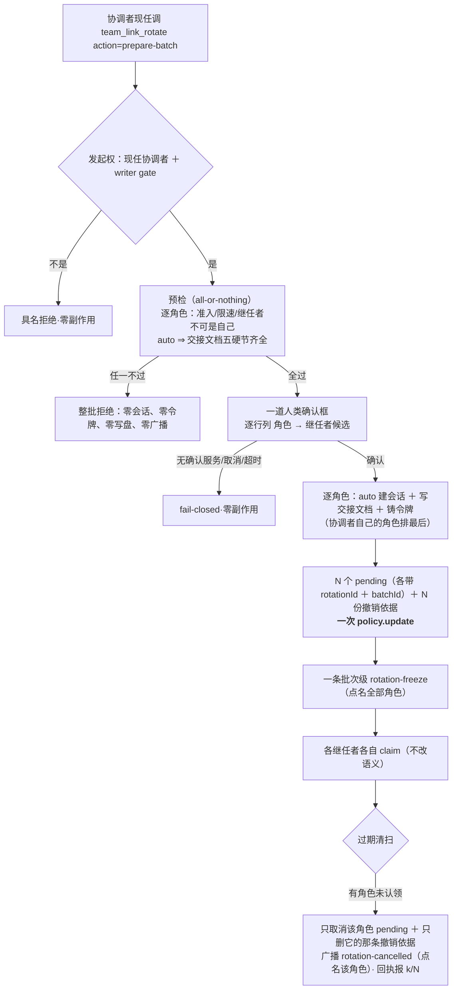

# 批 S · 整队换届（批量准备 ＋ 各自认领）—— 设计档

> **规格档**。需求档 [`docs/2026-10-18-team-rotation-requirements.md`](2026-10-18-team-rotation-requirements.md)。
> **设计输入**：会诊 #66 裁定层 §3（`docs/consult-minutes/2026-10-14-consult-66-minutes.md`）；交接档 A-3 口径；用户 2026-10-18 授权（自主立项、重大设计经会诊）。
> **前置**：批 Q（`rotationBackups` 按 rid 各存一份，判据 `Qr1`–`Qr11`）已落地。
> 行号一律 as-of **2026-10-18 工作树（批 Q 交付后）**；实施按**符号名**定位。★ 本档不写出框定 token 原串（批 E 仓规）；新测试标识符用 **`Sr`** 中缀。

---

## 0. 结论与图

**三句话**：① 病根是 prepare **只能由该角色现任发起**（`prepareAdmission` → `rotateGate`），5 人队要 5 个调用方会话各跑一次；② 修法是**在既有 `team_link_rotate` 上加一个批量动词**：现任协调者一条命令 → 预检 → **一道确认框** → 建 N 个 pending ＋ N 份撤销依据**一次写盘** → **一条**批次级 freeze；③ **认领一个不省**：每个继任者仍凭自己的令牌 `claim`，批量只到 Phase A。



---

## 1. 背景

会诊 #66 四席**独立**指认：`team_link_rotate action=prepare` 的 `role` 必填、且 `prepareAdmission` 只承认**该角色现任**发起（`lib/rotation.js:435-455` 的 `rotateGate(team, entry, caller)`）⇒ 协调者**无权代 worker 发起**；5 人队今天要 5 个不同调用方会话各跑一次。这是「麻烦」的本体，不是使用姿势问题。
批 Q 已把撤销依据从「团队级单槽」改成「按换届各存一份」 ⇒ **存储前置**成立；本批才有意义。

## 2. 问题（根因，带符号名）

| 面 | 事实 | 证据 |
| --- | --- | --- |
| 发起权 | 逐角色现任才可发起 | `lib/rotation.js` `prepareAdmission` → `rotateGate`（`:403` / `:435-455`） |
| 入口 | `role` 必填、单角色 | `lib/index.js` 的 `team_link_rotate` 参数面 |
| 写面 | 每次 prepare **一次** `policy.update`（`:987`） | 批量要 N 个 pending **一次**写 |
| 广播 | 每次 prepare 一条 `rotation-freeze`（`:992`） | 批量 5 条 freeze = 通知风暴 |

## 3. 目标 / 非目标

**目标**：现任协调者**一条命令 ＋ 一道确认框**完成整队 Phase A；**一次**写盘、**一条** freeze；逐角色如实报；Phase B 逐字复用既有 claim。
**非目标**：需求档 §五 七条（不做 agent-team Lead 更换 · 不做「一把换完」· 不做混合批次 · 不改交接格式/claim/令牌类型 · 不动黑板 · 不新增顶层键/工具 · 不自动归档）。

## 4. 决策与理由

| # | 决策 | 理由 | 被否决的备选 |
| --- | --- | --- | --- |
| **D1** | **扩 `team_link_rotate` 的 action：`prepare-batch`**，不建新工具 | 会诊 #66 §3 采纳「扩 action 不建新工具」；工具面越少越好，且与 `claim` 同工具便于指路 | 新建 `team_link_rotate_team`（新工具注册、发现成本、文档翻倍） |
| **D2** | **批次令牌 TTL = 2 小时**（单角色仍 30 分钟） | N 个继任者要各自找时间认领，30 分钟会把批量变成「必然部分过期」；仍一次性、绑三元组、成功即作废 | 沿用 30 分钟（部分过期成常态）· 永不过期（安全面失控） |
| **D3** | **单写点**：先算好 N 份 `{ rid, at, backup }` 与 N 条 pending，**一次** `policy.update` | 任一步失败 ⇒ 零副作用（`NF-S1`）；沿用既有唯一写点，不新增并发面 | 逐角色各写一次（半成品批次，回滚面 = N 步） |
| **D4** | **一道确认框**，逐行列「角色 → 继任者」；无确认服务 / 取消 / 超时 ⇒ **fail-closed** | 会诊四席共识；`reappoint` 已有同款先例；超时**不走 provisional**（provisional 只属 claim 段） | 每角色各弹一个框（N 次确认风暴）· 不弹框（对信任面静默变更） |
| **D5** | **预检 all-or-nothing**：逐角色跑准入/限速/「继任者 ≠ 现任」；`auto` 角色还要**交接文档五硬节齐全** | 与 `§11.9.6 abort-before-prepare` 同款：宁可整批不开始，也不留半批 | 做到哪算哪（半批 + 孤儿 pending） |
| **D6** | **排序：协调者自己的角色排最后** | 否则驱动批次的人先把自己换掉，后半批次成孤儿驱动（会诊 §① 裁定 4） | 按角色名字典序（可能协调者在前） |
| **D7** | **批次标识 `batchId` 放在 `roles[].pending` 行内**（与 `rotationId` 同级）；不新增 `generation` 顶层字段、不落 policy 顶层键 | 会诊 §3-⑤「不加 generation 字段」；批次在飞判定需要**可核的**标识 | 用「≥2 个角色有 pending」猜（会把两个独立单角色换届误判成批次） |
| **D8** | **批次在飞期间，单角色 `prepare` 具名拒绝 + 指路** | 防「冻结风暴变形」（会诊 §① 风险 1）：限速按 `(team, role)` 挡不住跨角色互踩 | 允许并发（两套 pending 与撤销依据的来源不可辨） |
| **D9** | **freeze 一条批次级**（点名全部角色 ＋ batchId）；`rotation-done` / `rotation-cancelled` 仍**逐角色** | 5 条 freeze 是通知风暴；落定/取消按角色归账才可审计 | 每角色一条 freeze（风暴）· 一条 done 汇总（丢失逐角色归属） |
| **D10**（会诊 #101 [1]-① 折入） | **批量授权是独立入口**：`prepare-batch` 先校验 `caller == 该队现任协调者` ＋ writer gate ＋ 确认框；**逐角色不再走「该角色现任」门**（`prepareAdmission` 的 `rotateGate` 只属于单角色动词） | 现有 `prepareAdmission`（`lib/rotation.js:435-455`）要求 caller 是该角色现任 —— 与「协调者代发起」直接矛盾；但**单角色 prepare 的现任门必须一字不动**（权限收窄是安全属性，不是可批量化的便利） | 给 `prepareAdmission` 加 `allowCoordinator` 布尔（把两条语义混在一个函数里，单角色路径有被静默放宽的风险） |
| **D11**（会诊 #101 [1]-② 折入） | **失败契约分层**：**预检失败 / 确认前中止 ⇒ 零副作用**；**确认后执行期失败 ⇒ 已产生的副作用逐项如实报告**（已建会话 id 点名、可重试；平台无删会话原语 ⇒ **不做假补偿**） ＋ 幂等重试指路 | 「逐个 `agents.create`」与「任一步失败零副作用」在物理上不可兼得；把承诺切成两段才诚实 | 声称整批原子（假话）· 建会话放到写盘之后（出问题时盘上是脏的，反而更差） |
| **D12**（会诊 #101 [1]-③ 折入） | **写前重读 ＋ 指纹校验**：确认框返回后**重读 policy**，比对预热时的 **roster 指纹**（teams 行的 `roles[].current/role` 集合 ＋ `policy.writer`）；变了 ⇒ **整批中止、零写入**并指路重跑 | 确认框可能等 3 分钟，期间角色可能被 `set-role`/别的换届改过；用旧 view 覆盖会静默抹掉别人的写 | 只重读不校验（读到新的也照写旧计划）· 不重读（TOCTOU） |
| **D13**（会诊 #101 [1]-④ 折入） | **`batchId` 进 `normalizePending` 的固定键白名单**（与 `rotationId` 同处），并补「写→读→重启」三面判据 | 白名单是复发坑（批 G `renewedAt`、批 Q `rotationId`）；不补则重启后批次互斥失效、且**静默** | 只在内存里带 `batchId`（重启即失，批次互斥形同虚设） |

---

## 5. 方案（FR-S1…FR-S6）

| FR | 内容 | 落点（符号名） |
| --- | --- | --- |
| **FR-S1** | **入口与发起权**：`team_link_rotate` 新增 `action=prepare-batch`；只接受**该队现任协调者** ＋ writer gate；`role` 参数在批量下**不接受**（整队） | `lib/index.js` 的 action 路由 · `lib/rotation.js` 新增 `prepareBatch` |
| **FR-S2** | **预检（D10/D11）**：先验「caller 是现任协调者」；逐角色验限速、继任者 ≠ 现任、继任者会话在场（显式 id 时）；auto 角色校验交接文档五硬节；任一不过 ⇒ **整批拒绝、零副作用**、逐角色点名原因。**不走单角色的现任门**；单角色路径一字不动 | `lib/rotation.js` `prepareBatch` ＋ `lib/handover.js` 的硬节校验（复用） |
| **FR-S3** | **确认框**：一道、逐行 `角色 → 继任者（候选）`；取消/超时/无服务 ⇒ 零副作用返回 | 既有确认框 API（**实施首步回读定位**）· `lib/rotation.js` |
| **FR-S4** | **一次写盘（D12/D13）**：确认后**重读 policy ＋ 指纹校验**；N 条 pending（`rotationId` ＋ **`batchId`** ＋ `expiresAt = now + 2h`）＋ N 份 `rotationBackups` 条目**一次** `policy.update`；**`normalizePending` 白名单同批补 `batchId`**；镜像同步 | `lib/rotation.js` · `lib/policy-store.js`（白名单）· `lib/roster-write.js` 镜像 |
| **FR-S5** | **广播与回执**：一条批次级 `rotation-freeze`；回执**逐角色**列（令牌掩码 / 过期时刻 / 下一动作），并给批次汇总（`k/N 角色已准备`） | `lib/rotation.js` · `lib/messaging.js`（通知文案复用） |
| **FR-S6** | **单角色换届的批次互斥**：批次在飞（任一角色 pending 带 `batchId` 且未过期）⇒ 单角色 `prepare` 具名拒绝 + 指路（等批次结束 / 逐角色 claim） | `lib/rotation.js` `prepareAdmission` 前置检查 |

---

## 6. 机制伪代码（前置 / 后置）

```js
/**
 * 前置：caller 是 team 的现任协调者；policy 可读；confirm 服务可用（否则 fail-closed）。
 * 后置（成功）：团队行里 **N 条** pending 各带 { rotationId, batchId } 与 expiresAt = now + 2h；
 *   team.rotationBackups 恰增 N 条（每角色一条，互不覆盖）；**恰一次** policy.update；
 *   **恰一条** rotation-freeze；回执逐角色一行。
 * 后置（失败）：**零** agents.create、**零** policy.update、**零**广播；回执点名失败角色与原因。
 */
async function prepareBatch({ ctx, policy, teamName, successors, handoffBodies, caller, now, signal }) {
    const view = policy.get();
    const team = view.teams.find((entry) => entry.name === teamName) ?? null;
    // 1) 发起权
    if (team === null) return { error: "…团队不存在…" };
    if (roleOf(team, COORDINATOR_ROLE)?.current !== caller) return { error: "…只有现任协调者能发起整队换届…" };
    // 2) 预检（all-or-nothing）——逐角色，任一失败立即返回
    const plan = [];
    for (const { roleName, successor, auto } of orderedRoles(team, successors)) {   // 协调者最后
        const admission = prepareAdmission(view, { teamName, roleName, successor, now, caller });
        if (admission.error) return { error: admission.error };
        if (auto && !handoffHasHardSections(handoffBodies[roleName])) return { error: "…缺硬节…" };
        plan.push({ roleName, successor, auto });
    }
    // 2.5) 预热指纹（D12）：teams 行的 roles[].current/role 集合 ＋ policy.writer
    const fingerprint = rosterFingerprint(view);
    // 3) 一道确认框（无服务/取消/超时 ⇒ 零副作用返回）
    const confirmed = await askBatchConfirm({ ctx, plan, signal });
    if (!confirmed.answered) return { lines: [unattendedBatchReading(confirmed)] };
    // 3.5) 写前重读（D12）：确认期间有任何 roster/策略变化 ⇒ 整批中止、零写入
    const fresh = policy.get();
    if (rosterFingerprint(fresh) !== fingerprint) return { error: "…确认期间名册或写策略已变，整批中止、零写入；请重跑…" };
    // 4) 建会话 / 写交接文档 / 铸令牌（auto 才有 agents.create）—— ★ D11：这里是「执行期」，
    //    失败不再承诺零副作用：已建会话 id 必须逐项点名，写盘仍然不做（盘上原子），回执给幂等重试指路。
    const minted = [];
    for (const item of plan) {
        try { minted.push(await mintOne(item)); }
        catch (error) { return { error: executionFailureReading(item, error, minted) }; }   // 已建会话点名
    }
    // 5) 一次写盘
    const nextTeams = view.teams.map((row) => row.name === teamName ? applyBatch(row, minted, now) : row);
    await policy.update({ teams: nextTeams });
    // 6) 一条批次级 freeze
    await broadcastNotice(teamName, caller, batchFreezeNotice(teamName, minted, now), { signal });
    return { lines: receiptLines(minted) };
}
```

**前置（claim 侧不变）**：claim 仍按 `(team, role)` 的 pending 找令牌 → 按 `rotationId` 取**本次那一份**撤销依据 → 只删自己那条（批 Q 已实现，本批零改动）。
**后置（过期）**：清扫逐角色取消（只删该角色 pending 与它那条 backup），回执报 `k/N`。

## 7. 状态与 schema

| 项 | 变更 |
| --- | --- |
| `policy.json` 顶层键 | **零变更**（仍十一键） |
| `roles[].pending` | **新增行内 `batchId`**（批量铸出）；`rotationId` 沿用批 Q；`expiresAt = createdAt + 2h`（批量） |
| 团队行 `rotationBackups` | 批量一次追加 **N** 条（每条 `{ rid, at, backup }`） |
| 谁写谁读 | 写：`prepareBatch`（一次）/ 既有 claim 与清扫（逐角色）；读：回执、镜像、`roster get`（批 Q 已按 rid 列全部） |

## 8. 防偏离（判据与红相）

判据 = 需求档 §四 `Sr1`–`Sr12`（每条带红相构造）；`Sr11`/`Sr12` 由会诊 #101 折入（授权路径 / 写前重读）。实施方必须给 **修复前 / 修复后** 两次实测读数；`Sr9`/`Sr10` 属回归锁（修复前绿，如实标负相）。

## 9. 边界

| 情形 | 行为 |
| --- | --- |
| 团队只有 1 个角色 / 只有协调者 | 照常走批量（N=1）；回执如实说 `1/1` |
| 协调者自己空缺 | 具名拒绝（发起权不成立） |
| 无确认服务 / 取消 / 超时 | fail-closed、零副作用（**不走 provisional**） |
| 某角色限速未过 | 整批拒绝（`NF-S1`），逐角色点名剩余窗口 |
| 批次进行中崩溃 | 已写盘的 pending 与撤销依据各自成立（一次写是原子的）；过期清扫逐角色收拾，**不新增死法** |
| **确认后执行期失败**（D11） | **不再承诺零副作用**：已建会话逐项点名（id）、写盘不做；回执给幂等重试指路（重跑会复用同一批角色计划，已建会话可显式作为 successor 传入） |
| **确认期间名册/策略变化**（D12） | 写前重读指纹不一致 ⇒ **整批中止、零写入**，指路重跑 |
| 升级旧 pending（无 `batchId`） | 视为单角色 pending；不参与批次互斥判定 |
| 重启 | 状态全在 `policy.json`；重启后按既有「每进程读一次」语义生效 |
| 失败方向 | **fail-closed 于信任与写盘**（任一预检不过 ⇒ 零写）；读面读不到就如实说，不编造 |
