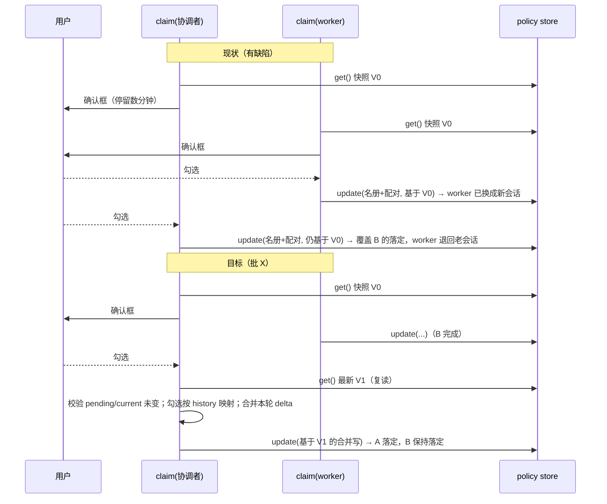

# 设计档：整队换届时 claim 的复读合并（批 X，2026-11-04）

> 状态：**待用户确认** · 前置需求档：`docs/2026-11-04-rotation-claim-fresh-merge-requirements.md`
> 关联：批 W（auto 看门狗移交 · `docs/2026-11-04-rotation-watchdog-status-budget-design.md`）· M4 换届状态机（`docs/team-upgrade-design-2026-09-17.md` §3.6）· 批 S 整队换届 Phase A 规格（`docs/2026-10-18-team-rotation-design.md`）
> 过程登记（评审 🟡#1）：本批**未先做会诊** —— 方案由用户提问直接驱动、规模小（单域、约 60 行），用户 2026-11-04 明确选择「先出设计档，走完整工程模式」。本行即该裁定的登记（METHODOLOGY「会诊前置」的豁免说明）。

## 一、背景

用户问整队换届（1 协调者 + 4 worker）时确认框的配对语义；调查发现：顺序换届会收敛，但 **claim 的读-改-写
窗口覆盖了整个确认框**，并发的两个 claim 会互相覆盖（last-write-wins）。这是「整队换届」才会踩到的真问题。

## 二、问题（现象 + 根因，带 file:line；行号为 as-of 批 W `cc166e7`）

- `lib/rotation.js` 的 `claim()` 在**确认框之前**只读一次状态：`const view = policy.get()`（约 :1732），
  `team` 与 `entry` 都来自这份快照。
- 确认框在 :1813 打开，**可能停留数分钟**（等用户勾选）。
- 框后所有计算仍用这份旧快照：`planRotationMigration(view, …)`（:1799）、
  `applyRotationTrust(view, …)`（:1844）、`settleRotation(team, …)`（:1845）、
  `teams = view.teams.map(…)`（:1846）、`transferAutoWatchdogs(view, …)`（:1849）。
- 第一笔写盘 `policy.update(settlePatch)`（:1857）把**整份 `pairs` 与 `teams`**替换成「旧快照 + 本次改动」；
  第二笔 `policy.update({ teams: clearedTeams })`（:1876）同样来自旧快照。
- ⇒ 若另一角色在这段时间内已落定，本次写盘**把它整笔覆盖回旧状态**：`current` 回退、已迁移配对回退、
  它的 `rotationStatus / provisional` 与 `migratedPairs` 标记也一起丢。

（实测证据：判据 X1 会在旧实现上复现「后完成的 claim 把先完成的落定回滚」。）

## 三、目标 / 非目标

**目标**：见需求档 §二 / US-1–US-4。
**非目标**：不改换届的对外语义（令牌、两阶段、TTL、域限定、provisional 24h）· 不改 replay / sweep 的判定 ·
不引入持久锁 / 版本号字段 · 不处理跨进程并发（本部署是单插件进程，见 §九）。

## 四、决策与理由

| 决策 | 选定 | 为什么 | 被否决 |
|---|---|---|---|
| D1 冲突怎么解 | **确认框之后复读 + 合并本角色 delta** | 根因是「旧快照写全量」；复读后只应用本角色这一份，天然保留别人的落定 | 团队级串行锁跨确认框（框开几分钟，其它 claim 干等）· 版本号/CAS（会让用户白点一次框，重试体验差） |
| D2 勾选怎么映射 | 以**对端会话**为键；若对端已换届，按该角色 history 把旧会话映射到**新的 current** | 用户勾的是「这一条通道」，换届不该让选择失效 | 按 pairKey 严格匹配（对端换届后 key 不存在 ⇒ 静默丢弃，违反 US-2） |
| D3 微秒级竞态 | **单把进程内全局锁**只包「复读 → 计算 → 写盘」这一段（不跨确认框） | 写盘替换的是**全局数组**（pairs/teams/trustedSenders/rememberTargets/watchdogs）⇒ **不同团队**的 claim 也会互相覆盖，锁必须覆盖全局而不能只按团队分（评审 🟡#2）；临界段只有几毫秒且不含确认框，串行代价可忽略 | 团队级锁（跨团队仍会覆盖，过度声称）· 无锁（残留窗口）· 跨框锁（D1 已否决） |
| D4 第二笔（清 pending） | **复读后只清本 rid 的 pending**，写最新 teams | 与 D1 同因；清 pending 不该带走别人的落定 | 沿用旧 `teams`（现状，会二次覆盖） |
| D5 冲突方向 | **fail-closed：零写入 + 可执行错误**（pending 已失效 / 现任已变 / 团队已删） | 拿旧快照硬写正是本批要消灭的 | 继续写（错）· 静默丢弃（用户不知道发生了什么） |
| D6 无人应答分支 | 复读后按**最新候选人**全选（仍 provisional） | 迁移的是通道，不是快照 | 沿用旧候选（会迁移已失效的通道） |
| D7 回执 | 新增读数：映射几条 / 跳过几条（原因）/ 冲突时的处置 | US-4；排查不靠猜 | 静默 |

## 五、方案（FR）

- **FR-X1 复读与校验**：确认框结束后 `const fresh = policy.get()`；重新定位团队与角色；
  校验 `pending.token` 未变、`current` 仍是旧任。任一不满足 ⇒ 按 D5 拒绝（零写入）。
- **FR-X2 候选重算与映射**：用 fresh 的名册重算 `planRotationMigration(fresh, …)`；
  把用户勾选的对端按 D2 映射到 fresh 的候选（旧会话 → 该角色新的 current）；无人应答 ⇒ 全选 fresh 候选。
- **FR-X3 合并写**：`applyRotationTrust(fresh, …)`、`settleRotation(freshTeam, …)`、`teams = fresh.teams.map(…)`、
  `transferAutoWatchdogs(fresh, …)`；写盘前用**单把进程内全局锁**（D3）包住「复读 → 计算 → 写盘」。
- **FR-X4 收尾写**：第二笔再复读一次，只对被本角色、本 rid 的 pending 做 `clearRotation`，写最新 teams。
- **FR-X5 回执**：`lines` 增加**映射 / 跳过（含歧义）/ 清理 / 冲突**读数行（D7）——「清理」复用既有 `facts.dropped`
  的「随退役清理」行，按**复读后的计划**重算（评审 🟡#3）；冲突文案点名「确认框期间发生了什么 + 下一步」。
- **FR-X6 判据**：见 §八。

## 六、机制伪代码

```js
async function claim(request) {
  view0 = policy.get();            // 既有：团队/角色/pending/token/继任者/过期/快照校验，不变
  plan0 = planRotationMigration(view0, {members(view0.team), retiree, successor})
  dialog = await askRotationDialog(plan0.candidates, …)   // 可能停留数分钟
  selected = dialog.answered ? chosen-by-pairKey : ALL

  await withPolicyLock(async () => {
    fresh = policy.get()
    freshTeam = fresh.teams.find(name === teamName)
    if (freshTeam === undefined) return refuse("团队已删")
    freshEntry = roleOf(freshTeam, roleName)
    if (freshEntry?.pending?.token !== token) return refuse("换届已被取消/认领")
    if (freshEntry.current !== retiree0) return refuse("现任已变")
    freshPlan = planRotationMigration(fresh, {members(freshTeam), retiree0, successor})
    mapped = mapSelected(selected, freshPlan, freshTeam)   // 旧会话 → 该角色 current
    trust = applyRotationTrust(fresh, {retiree0, successor, chosen: mapped.candidates, now, provisional})
    settlement = settleRotation(freshTeam, {…, migratedPairs: trust.additions})
    teams = fresh.teams.map(r => r.name === teamName ? settlement.team : r)
    await policy.update({pairs, trustedSenders, rememberTargets, teams, watchdogs: transferAutoWatchdogs(fresh, …)})
  })
  // 第二笔：再复读，只清本 rid
  await withPolicyLock(async () => {
    fresh2 = policy.get(); teams2 = fresh2.teams.map(clearRotation(r, roleName, rid))
    await policy.update({teams: teams2})
  })
}
```

**前置 / 后置**：前置 = 已过既有令牌 / 现任 / 过期 / 快照校验；后置 = 成功则名册指向继任者且信任已迁移/撤销，
失败则**一个字节都不写**；`withPolicyLock` 是**单把进程内全局锁**（不同团队的 claim 也串行），只覆盖「读 → 写」，
确认框不在锁内。

## 七、状态与 schema

- **零 schema 变更**：不新增字段、不新增持久状态；互斥表是**进程内 Map**（重启即空，符合「锁不持久」）。
- **谁写谁读**：仍是 `policy.update` 两笔；写者唯一 = claim；读者 = 状态卡 / watch list / replay。

## 八、防偏离（判据）

| 判据 | 断言 | 红相（旧实现） |
|---|---|---|
| X1 | **两个 claim 交错**：A 的确认框开着时执行 B 的完整 claim，再回答 A ⇒ A、B **两个角色都是新会话**、团队域内配对端点全部新会话、两边 history 都在 | 旧实现：B 的落定被 A 的旧快照覆盖 ⇒ B 的 current 退回老会话 ⇒ 红 |
| X2 | **框开着时 pending 失效**（过期清扫/取消）⇒ claim 拒绝、零写入、错误文案点名原因与下一步 | 旧实现：拿旧快照继续落定 ⇒ 红 |
| X3 | **对端换届映射**：A 的框开着时 B 先换；A 勾选 B 的旧会话 ⇒ 最终配对是 A新 ↔ B新（回执里**同时**有「已映射」行与「随退役清理」行） | 旧实现：写出「新 ↔ 旧」或丢弃 ⇒ 红 |
| X4 | **无人应答分支**：超时/取消 ⇒ 按**最新**候选人全选迁移（provisional） | 旧实现：按旧候选 ⇒ 迁移已失效通道或漏掉新通道 |
| X5 | **既有判据全绿**：1797 条（as-of 批 W `cc166e7`；含 replay / sweep / 单角色换届）一字不改仍全绿 | 任何既有判据红 ⇒ 红 |
| X6 | **写入次数**：成功路径仍是 **2 笔** `policy.update` | 变 3 笔 ⇒ 红 |

**交付后期望总数**：**1803 = 1797 + 6**（X1–X6 各一条 `check()`；as-of 批 W `cc166e7`）。

## 九、边界

- 确认框期间**团队被删** / 角色被删 ⇒ 拒绝、零写入（D5）。
- 确认框期间**该角色被另一路径清了 pending**（过期清扫 / 人工）⇒ 拒绝；文案给「重新 prepare」。
- 确认框期间**对端角色换了届** ⇒ 按 history 映射；映射目标不在候选里（例如对端这次没勾）⇒ 计入「跳过」并说明。
- **继任者自己**出现在候选里（历史遗留脏数据）⇒ 既有 `planRotationMigration` 已按「对端就是继任者」丢弃。
- **锁的范围**：**单把全局锁**（评审 🟡#2：写的是全局数组，跨团队也必须串行）；单进程内有效，多进程同时写同一
  settings 命名空间不在本批承诺内（本部署单实例）。
- **崩溃窗口**：两笔写之间崩溃 ⇒ 与现状同一条 replay 路径（既有判据覆盖，X5 锁住）。
- **失败方向**：写盘失败 = 现有错误文案；冲突 = fail-closed 零写入。

## 十、时序（现状 vs 目标）



## 十一、测试矩阵（红 → 绿）

| 用例 | 形状 | 期望 |
|---|---|---|
| X1 | 交错两个 claim（A 的框内执行 B） | 两角色都落定，配对端点全为新会话 |
| X2 | 框内清掉 pending | 拒绝 + 零写入 |
| X3 | 框内对端换届，勾旧会话 | 映射为新会话，回执说明 |
| X4 | 无人应答 | 按最新候选 provisional 迁移 |
| X5 | 全套 1797（as-of 批 W） | 全绿；交付后总数 1803 = 1797 + 6 |
| X6 | 成功路径写次数 | 2 笔 |

**交付物（评审 🔵#7）**：X1–X4 必须给出「修复前红相 / 修复后全绿」两次实测读数，并落 `docs/verification-log.md` 的「批 X」节；
只写「已修复」不算交付。

## 十二、实施边界（工程模式）

- 改动落在 `lib/rotation.js` 与 `host-half.test.mjs`（判据 X1–X6）；**入口 `lib/index.js` 不动**（262,118 B / 余量 26 B，as-of 批 W `cc166e7`）。
- 实施由 `eng_coder` 执行；设计评审通过后由我把设计 token 交给它。
- 真机生效仍需 DSH 重启（时机由用户定）。
