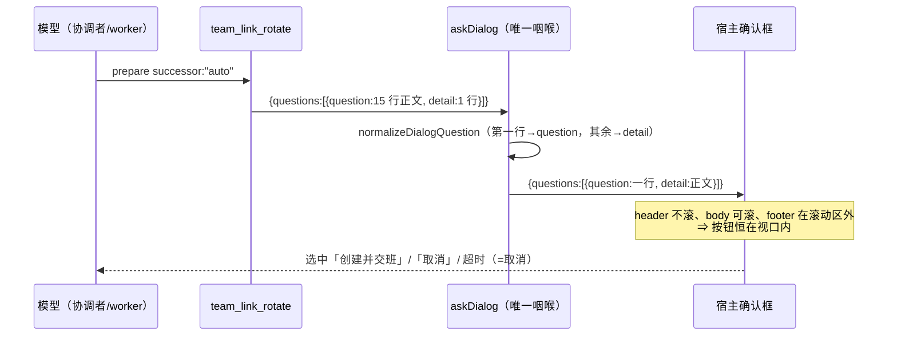

# 批 V（热修）：换届确认框看不见按钮 —— question 布局合同 + 发起前自检

> 状态：**已实施（本地套件绿；2026-11-05 已随 DSH 重启在真机生效，弹窗行为待用户复验）· advisor 事后评审 PASS（2026-11-04，见 §10）** · 日期 2026-11-04 · 触发：用户真机反馈
> 关联：`docs/2026-10-18-team-rotation-design.md` · `docs/collab-enhancements-design-2026-09-19.md` §10.2.8.4（U33 换槽位）· `docs/2026-10-09-team-autonomy-design.md` §5 FR-5/FR-6（轮换标记）

## 一、背景（这件事从哪来）

2026-11-04 14:33（本地），团队 `server-line-1021` 的协调者会话
`team-link-server-line-1021-coordinator-bfc0c9e7` 在收到 worker-1 的一条自述
「上下文接近用尽」的停手报告后，**自行决定换届**，并把
`team_link_rotate action=prepare successor:"auto"` 的整段调用与交接正文投给 worker-1
（协调者日志 `seq=5690`，第一次角色名写错后再投一次 `seq=5721`）。

worker-1 照做后，确认框在 **worker 会话里**弹出（用户看得到、点不到 —— 协调者自己也这么描述：
`seq=5749`）。用户截图里那个框**没有「创建并交班 / 取消」**：正文从顶部一直排到卡片下沿，
动作底栏被裁掉了。

## 二、问题（现象 + 根因，逐条带证据）

### 2.1 现象 A：确认框没有按钮（本批主修）

- **根因（宿主布局，逐条可复核）**：`@deepseek-ai/dsh-client-ui-user-questions/lib/client.js`
  把一条问题渲染成三段 ——
  - `question` → `header > h2.title`：`.header{flex-shrink:0}`、**在滚动容器之外**、**没有高度钳制**；
  - `detail` 与选项行 → `.body{overflow-y:auto}` 之内（可滚）；
  - 动作底栏 `footer` 是 `flex-shrink:0`、也在滚动区外；卡片本身
    `.card{max-height:min(60vh,520px); overflow:hidden}`。

  ⇒ `question` 越长，header 越高；卡片到 60vh/520px 之后**直接裁掉下方内容** —— 人只看得到正文，
  看不到按钮。这与 2026-09-21 `/team_session` 的「8 次够不着」是**同一形态**（U33），
  当时只修了 `/team_session` 一处。

- **本次出事的那个框**：`lib/index.js` 的 `rotationAutoDialogText()` 产出 **15 行**披露
  （继承清单 / 保守成本 / 交班内容 / 信任面 / 取消语义），`askRotationAuto()` 把它整段塞进
  `question`，`detail` 只有一行。批 S 的整队换届框（`lib/rotation.js` 的 `askBatchDialog`）同形。

- **不是孤例**：同一形态另有 8 处（send / receive / retire-cleanup / revive / reappoint / set-mode……），
  它们的 `question` 也是多行正文 —— 只是平时没那么长。

### 2.2 现象 B：把「上下文压力」当成换届理由（本批加规）

- worker-1 在同一步的**插件真读数**是 `压力 …（66.6%）`（`seq=8884`；06:46 为 68.4%），
  但它的自述是「接近用尽 / ~2%」（`seq=8892`，turn 78）。**自述数字与插件读数相差 30+ 个百分点**，
  是模型自己估的。
- 协调者在 2026-11-03 只调过一次 `team_link_status`，那次**宿主 30s 超时**（`seq=37`），
  之后整个 11-04 没有状态卡读数 —— 它手上没有真值，采信了自述。
- 插件自己的判读行其实写着「本系统按压力自动压缩，结构上不存在『预算耗尽』」（第 ⑧ 段末行），
  但协调者没读到；工具面也没有一条规则说「换届要先得到用户同意 / 自述百分比不可采信」。
- 状态卡第 ⑧ 段的轮换候选规则是 **turns > 100 或 tokens > 2 亿**（与压力无关），
  而 worker 当轮的 `累计 ≈397.99M` ⇒ 它是候选；标记行只给现成命令，没写「先问用户」。

### 2.3 现象 C：读数只有数字、没有结论（用户 2026-11-04 追加裁定）

模型把「压力 70%」自行读成「不能干活了」——插件的读数没有告诉它**这不是停工判据**。用户原话：
「模型幻觉本身拦不住——起码你的读数告诉它，即使 70% 上下文了，只要不是 agent-team 模式，各个 worker 都是
session，有自带的上下文压缩机制，上下文不是不干活的接口。」

- 每回合的资源行只有四个数（窗口 / 压力 / 累计 / 轮次），没有一句「占用高不是停工理由」；
- 第 ⑧ 段的段头同样只列字段，没有区分 **sessions 档**（成员各自是独立 session、各有宿主压缩）与
  **agent-team 档**（成员是本会话子代理）；
- 判读行虽然是「否定式结论」，但它只在**状态卡**里，模型不打开状态卡就看不到。

## 三、目标 / 非目标

**目标**：① 任何确认框的 `question` 都只有一行 headline，正文一律进可滚动的 `detail` —— 动作底栏
不可能再被挤出卡片；② 模型可见面明写「换届必须先得到用户明确同意」「自述百分比不可采信」
「换届不是重启手段」；③ 这三条各有一条可失败断言。

**非目标**：不改换届的状态机 / 令牌 / 信任语义；不改宿主（`node_modules` 不可写，也不该改）；
不把「是否换届」变成插件自动决策（判断权仍在人与插件外的模型）；不改 `/team_session` 已完成的那套
（它本来就在 `detail`）。

## 四、决策与理由

| 决策 | 选定 | 理由 | 被否决的备选 |
|---|---|---|---|
| D1 修在哪一层 | **插件侧唯一咽喉**：新增 `askDialog()`，全插件只剩它一处调 `userQuestions.ask` | 逐处「注意一下」已经失败两次；一个咽喉 + 一条源码计数断言才是结构性的 | 逐个对话框改文案（12 处，下一次新对话框照样漏） |
| D2 归一规则 | **第一行做 headline（空白压平、≤160 码点），其余按原序进 detail** | 现有调用点全部是「首句是摘要、后面是明细」的形状 ⇒ 零文案重写也能立即修好；超长尾巴**一个字不丢** | 只截断（丢正文）· 要求每个调用点手写 headline（同样靠自觉） |
| D3 阈值 160 | 与 `/team_session` 的 120 同量级、留出中文摘要余量 | 16px 标题在聊天列宽约 2 行；160 码点不会把 header 撑回事故形状 | 沿用 120（会把 claim 框的首句切在句子中间） |
| D4 规则放哪 | ① `team_link_rotate` description（模型要动手时必读）② 协调者宪章与 worker 义务行（会话期内恒定）③ 状态卡第 ⑧ 段标记行（它给出候选时就在劝人换届） | 三处都是**模型真正会读到**的面；宪章/义务行走段面（缓存友好，逐字节恒定） | 只放 README（模型不读）· 只放报错文案（要等踩了才看到） |
| D5 文案迁到 shared | `ROTATION_SELF_CHECK_TEXT` 常量住在 `lib/shared.js` | `lib/index.js` 已贴商城硬上限（262,144 B）：若把整段文案留在入口，实测会**越限**（262,378 B） | 不迁移（Rr1 红，上架不合规） |
| D6 读数自带结论（用户追加裁定） | 资源行追加「独立会话（宿主自动压缩；占用高不是停工理由）」；第 ⑧ 段段头按形态写清 sessions / agent-team 两种成员语义 | 幻觉拦不住，但**读数可以不给它接口**：结论与数字同处一行，模型不必自行推断；形态区分避免把 agent-team 的子代理说成独立 session | 只加规则行（模型可能不读）· 只在状态卡判读行写（要打开状态卡才看得到） |

## 五、方案（FR 交付单元）

- **FR-1 对话框归一器**（`lib/shared.js`）：`DIALOG_QUESTION_MAX_POINTS=160` ·
  `normalizeDialogQuestion()` · `normalizeDialogQuestions()` · `askDialog()`。
  12 个调用点全部改成 `askDialog(userQuestions, {...})`。
- **FR-2 契约执行**：新增「唯一咽喉」结构判据（源码里 `userQuestions.ask(` 恰 1 处）。
- **FR-3 发起前自检**：`ROTATION_SELF_CHECK_TEXT` 拼进 `team_link_rotate` description；
  宪章第 4/6 条与 worker 义务行各加一句；第 ⑧ 段标记行补「判断权在用户 / 先问用户 / 压力不是理由」。
- **FR-4 判据**：`批 V · V1–V10`（见 §8）。
- **FR-5 读数自带结论**（用户 2026-11-04 追加裁定）：每回合资源行追加
  「独立会话（宿主自动压缩；占用高不是停工理由）」；状态卡第 ⑧ 段段头按形态写清
  sessions 档（成员各自是独立 session、各有宿主压缩）与 agent-team 档（成员是本会话子代理）——
  **占用都不是停工/换届判据**。两句都保持「恰一行 / 行数预算不变」。

### 时序（一次换届确认）



## 六、机制伪代码（含前后置条件）

```js
// 前置：entry 可为任意值；question 可为任意字符串（含多行/超长/带终止符）
// 后置：question 单行且 ≤160 码点；question 的第二行起与超长尾巴按原序并入 detail；
//       detail 归一后为空串时不新增该键；短问句与既有 detail 逐字节不变
normalizeDialogQuestion(entry) {
  lines = entry.question.split(/\r?\n/u)
  head = lines[0]; rest = lines.slice(1)
  [head, overflow] = cut(head, DIALOG_QUESTION_MAX_POINTS)   // 码点界，不切代理对
  carried = [overflow, ...rest].join("\n").trim()
  detail = [carried, entry.detail].filter(nonEmpty).join("\n\n")
  return { ...entry, question: wellFormed(flatten(head)), detail }
}

// 唯一咽喉（结构判据：全插件只剩这一处 userQuestions.ask( ）
askDialog(userQuestions, request) {
  return userQuestions.ask({ ...request, questions: request.questions.map(normalizeDialogQuestion) })
}
```

## 七、状态与 schema

**零状态、零 schema 变更**：不改 policy / settings / roster / pending / 事件类型；归一器是纯函数，
只在**每次弹框时**对内存里的 payload 做一次变换。唯一新增的持久面是**源码常量**
`ROTATION_SELF_CHECK_TEXT`（一条字符串，模型可见文案）。

## 八、防偏离（该设计怎么被机械验证）

判据全部落在 `host-half.test.mjs` 的「批 V」块（放在批 T/批 U 之后、`rmTestRoot()` 之前 ——
这样批 T 的回归锁 `Tr7` 的 `1758` 计数不被扰动）：

| 判据 | 断言 | 红相（修复前） |
|---|---|---|
| V1 | 真机那一具（`prepare successor:"auto"` 捕获的 payload）：question 单行 ≤160、含「即将自动换届」；继承清单/成本/取消语义/`{{model}}` 在 detail | 旧实现 question 15 行 ⇒ 红 |
| V2 | claim 确认框：question 单行 ≤160、含「交接到」 | **修复前绿**（该框恰好只有一行、≤160）—— 如实标为覆盖缺口类 |
| V3 | 整队换届确认框：question 单行 ≤160、明细在 detail | 旧实现 question 多行 ⇒ 红 |
| V4 | 归一器三形状：多行→headline+detail（原序、不丢）、超长→160+尾巴进 detail、短问句逐字节不变 | 没有归一器 ⇒ 红 |
| V5 | 源码里 `userQuestions.ask(` 恰 1 处（shared.js 的 askDialog） | 旧实现 12 处 ⇒ 红 |
| V6 | 注册出来的 `team_link_rotate`.description 含三句规则 | 旧实现无 ⇒ 红 |
| V7 | 宪章含「团队结构变更…先问用户」「自述上下文耗尽不算判据」；worker 义务行含「上下文压力不是停手理由」；宪章行数 ≤ CHARTER_MAX_LINES | 旧实现无 ⇒ 红 |
| V8 | 第 ⑧ 段标记行含「判断权在用户 / 先问用户 / 上下文压力不是换届理由」 | 旧实现无 ⇒ 红 |
| V9 | 资源行仍单行、四项在场，且明写「独立会话（宿主自动压缩；占用高不是停工理由）」 | 旧实现只有数字 ⇒ 红 |
| V10 | 第 ⑧ 段段头仍单行、以「--- 资源/预算（⑧」开头，且写清 sessions / agent-team 两种形态与「占用都不是停工/换届判据」 | 旧实现只列字段 ⇒ 红 |

**两次实测**：红相 `node host-half.test.mjs`（lib 回退到 `fe0573e`）与绿相（修复后）见
`docs/verification-log.md` 的 2026-11-04 条目。

## 九、边界

- **空/畸形输入**：`entry` 非普通对象原样返回；`question` 非字符串按空串处理；空正文 ⇒ detail 不新增。
- **超长 detail**：允许（它在滚动区里，与 `/team_session` 的 600 码点预算不共用；本批不收紧它，
  因为「正文被裁掉」比「正文很长」更危险）。
- **多问题对话框**：整批都归一（`normalizeDialogQuestions`），顺序不变。
- **代理对**：截断按码点，绝不切 UTF-16 码元（沿用 `preview` / `wellFormed` 的规矩）。
- **失败方向**：`askDialog` 只是透传宿主返回/抛错 —— 既有的 fail-closed（无服务 / 超时 / 取消）
  语义一字未改；归一器不抛（任何输入都返回对象）。
- **重启**：`askDialog` 跑在宿主进程里 ⇒ 与所有插件日志一样**需要 DSH 重启才在真机生效**（本机 `link:` 接线）。

## 十、过程偏离登记与评审结论（2026-11-04）

**偏离**：本批是真机热修，**实施先于用户发起的设计评审**（METHODOLOGY 的四步工作流要求「设计评审由用户发起、先评审后实施」）。
用户当面对此提出异议（原话：「谁让你直接修的，你起个 advisor 评审一下」）——这是流程偏离，不是代码缺陷。
处置：

1. 已补 **advisor(type=code) 事后评审**（2026-11-04，dsh 路由 `zai-coding-cn:glm-5.3`，job `advisor-dsh-25e70ae5e6124d49`）：
   结论 **VERDICT: PASS**，无 🔴；2 🟡 为文档层收口与流程登记，2 🔵 为注释级边界说明 —— 逐条处置见
   `docs/verification-log.md` 同日条目的「评审响应表」。
2. **后续门禁恢复**：`lib/**` / `test/**` 的下一次改动回到「设计档 → 用户发起评审 → 实施」的常规路径；
   本档只登记这一笔偏离，不构成「热修豁免」先例。
3. 偏离与评审结论同时写进 `docs/verification-log.md`，使「先核后罚」这条纪律在账本上可复核。
