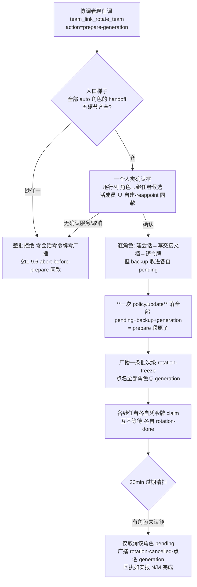
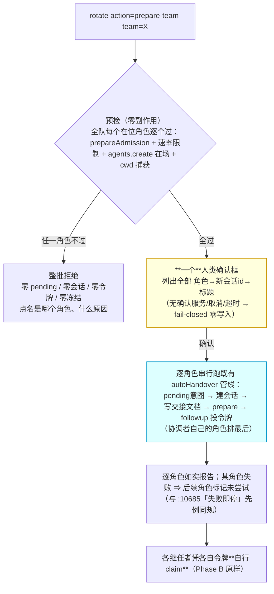
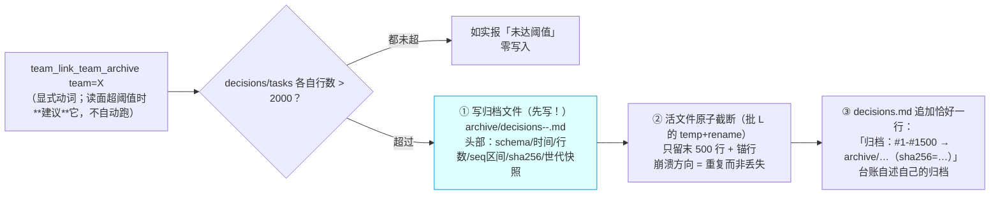

# 会诊纪要 —— consult #66（原始层，机制落盘）

- 日期：2026-10-14
- 会诊 id：66
- 模型：deepseek-official:deepseek-v4-pro, zai-coding-cn:glm-5.3, kimi-api:kimi-k3, opencode-go-plan:mimo-v2.6-pro, codex-cli:gpt-6-astra
- 平台 job：consult-7
- 结果：4/5 交付（其中 4 条有内容 —— **交付数 ≠ 有效数**，R-43）
- requiresReport：true
- 写者：`lib/consult.mjs` 的 `settleAndDeliver`（**只写 §0 汇总与 §1 原始层**；裁定层由主代理写）

## §0 汇总

[consult #66 finished — 4 of 5 replied (1 failed)]

## §1 原始层（机制写——digest 全文，逐字）

```text
[consult #66 finished — 4 of 5 replied (1 failed)]
effective: 4 of 5 (1 failed · 0 without content)
权限面如实（A30-10）：**本部署无法保证只读（平台面无法收窄）**——「只读」仅为**弱证**：`toolFilter.allow` 白名单**下发**（平台不保证模型面可见）；**模型面证据**须读子会话 `request/header` 事件（本部署实测 = [run_code] 单元素 ⇒ 残余绕行口在场，子会话实为 `danger-full-access`）。
models: deepseek-official:deepseek-v4-pro, zai-coding-cn:glm-5.3, kimi-api:kimi-k3, opencode-go-plan:mimo-v2.6-pro, codex-cli:gpt-6-astra
job: consult-7
minutes: docs/consult-minutes/2026-10-14-consult-66-minutes.md
requiresReport: true

--- replies (raw, unjudged — verify with your own tools) ---

[1] codex-cli:gpt-6-astra — failed
(consultation failed: codex-cli PROCESS_ERROR: codex 进程失败（非零退出且无有效输出）（diagnostics: exit=1 | stderr: 2026-10-13T17:10:53.151982Z ERROR codex_models_manager::manager: failed to refresh available models: request timed out 2026-10-13T17:10:53.215763Z ERROR codex_models_manager::manager: failed to refresh available models: request timed out 2026-10-13T17:11:17.267917Z ERROR rmcp::transport::worker: worker quit with fatal: Transport channel closed, when Client(HttpRequest(HttpRequest("http/request failed: error sending request for url (https://chatgpt.com/backend-api/ps/mcp)"))) 2026-10-13T17:11:25.939203Z ERROR rmcp::transport::worker: worker quit with fatal: Transport channel cl…）)

[2] zai-coding-cn:glm-5.3 — ok
三件事我都已在仓内逐处核实（不是凭父侧转述），先把**三句话结论**放前面：

1. **①整队换届**：可行的切法是「**一把 prepare、分布式 claim、世代号串联**」——今天卡死整队的不是 `role` 必填本身，而是 `rotationBackup` 是**每队一个槽位**，第二个角色的 prepare 会抹掉第一个角色的撤销依据；这个不改，任何「批量」都是假的。
2. **②继承**：继任者该继承的是 **preset id + 模型对（provider/model）**，取处就是复活路径已经在读的那份「前任会话自己的 header」——修法本质是**让创建面读复活面已经在读的东西**，零新增状态。
3. **③归档**：口径建议「**行数阈值提示 + 显式动词 + 只搬永不删 + 尾段留存 + max(文件,计数器) 分配**」——因为 seq 与任务号的分配器**今天是从文件全文扫出来的**，天真截断会重置计数器、重发已用任务号，这是可审计性的命门。

---

## ① 整队换届怎么切

### 事实（我逐处核过，比父侧多钉死一条）

| 事实 | 证据 | 对设计的含义 |
| --- | --- | --- |
| `role` 必填 | `lib/index.js:8226` | 入口缺失，确认 |
| **更硬的卡点：`rotationBackup` 每队一个槽** | `TeamConfig.rotationBackup`（`:1180`）；prepare 整队级覆写（`:12777-12784` `{ ...team, rotationBackup: backup, ... }`） | 角色 A prepare 后、claim 前给角色 B prepare ⇒ **A 的撤销依据被覆盖**。不改 schema，并行/批量 prepare 根本不成立 |
| prepare 只能由**该角色现任**发起（`prepareAdmission`） | `:8260`、`:8276` 附近 | 5 人队今天要 **5 个不同调用方会话**各自跑 prepare——协调者根本无权代 worker 发起，这才是「麻烦」的本体 |
| claim 只能由**继任者本人凭令牌**发起 | 工具描述 Phase B（`:8222`） | 任何「一把换完」都**不可能原子地完成 claim 段**——令牌自治是机制红线 |
| 限速按 `(team, role)` 键控 | `:11943-11960`（`rateLimit(team, role, 10min)`） | 每角色恰一次 prepare 的批量**不会**撞限速；批量重试才撞。批量动词必须计作「每角色一次」 |
| 已有人类授权代发起的先例 | `team_link_recover action=reappoint`（`:14160-14161`，候选由插件算、人勾选、随后逐字走 M4） | 「协调者发起整队 + 一个确认框」有 §4.2 (c) 的成例可依，不是新发明 |
| 既有错峰纪律 | prepare 回执原文「先换协调者 → 稳定 → 再换 worker——任何时刻保留一个活记忆」（`:12816`） | 一把全换**与既有纪律相抵触**，设计必须直面而不是装作没有 |

### 建议：切成「一把 prepare ＋ 分布式 claim ＋ 世代号」



四个关键裁定（每条附理由与被否备选）：

1. **schema：把 `rotationBackup` 从队级槽搬进 `roles[].pending` 里（每个 pending 自带自己的 backup）**，旧档迁移 = 把现存队级槽折进「有 pending 的那个角色」。理由：pending 本来就按角色存（`roles[].pending`），backup 是 pending 的撤销依据，两者同生命周期，放队级才是错位。**被否**：保留队级槽但做成按键映射——两处状态、清理路径翻倍，收益为零。
2. **prepare 段原子、claim 段显式放行部分成功**：全部 pending 在**一次** `policy.update` 里落盘（现有 `policy.update` 单写一处，天然满足约束）；claim 各自独立，某继任者死掉/超时只取消该角色，回执按世代报「4/5 已换、worker-2 过期」。**被否**：全有或全无的批次（claim 要等 N 个继任者凑齐，一个死继任者会把全队冻到 24h provisional 窗口尽头的更糟形态）——部分成功是诚实失败面，不是缺陷。
3. **发起权 = 现任协调者 + writer gate + 一个批次级确认框**（框里逐行列出角色→继任者，候选由插件算：本队活成员 ∪ 自建，模型不可指定 id——照 reappoint 的 §4.2 (c) ①）。**被否**：放宽为「任一成员可发起整队」——那是对 writer gate 的静默弱化，明令禁止的同款（`:14161` ⑥）。
4. **auto 批次的排序不变式：发起的协调者自己的角色排最后**（否则驱动批次的那个人先把自己换掉，后半批次成了孤儿驱动）。这只是「先 worker 后协调者」与本仓既有「先协调者」错峰句（`:12816`）方向相反——**如实声明**：错峰句针对的是「一次换一个」的常态；整批 auto 换届里「活记忆」由交接文档承担，回执必须带这句代价声明，不装。

**明确非目标（v1）**：agent-team 档的 Lead 更换不进本动词（那是 `set-mode` 的地盘，`:7195`）；手工显式 successor 混进批次（v1 只收全 auto 或全显式二选一，混合态的失败面不值得首版背）。

### 风险

- **🔴 冻结风暴变形**：N 个角色同时 pending，任何成员此刻发起单角色换届会与批次互踩（限速按 (team,role) 键控，挡不住跨角色）。缓解：批次存在期间（generation 有活 pending），单角色 prepare 拒绝并指路。
- **🔴 schema 迁移窗口**：旧档只有队级槽；升级瞬间若恰有单角色 pending，折叠逻辑必须把槽归给那个角色。红相必须覆盖这条。
- **🟡 交接质量即一切**：整批 auto = 记忆全部落在 handoff 文档上；梯子只把关结构（§11.9.6 现状），把关不了内容。这是如实边界，README/回执都要写。
- **🟡 通知面**：批次级 freeze 一条 vs 每角色一条——建议一条（5 条 freeze 就是通知风暴）；但 rotation-done/cancelled 保持每角色，冻结解除按角色归账。

### 红相判据（机械可验）

- 批量 prepare 落盘恰 **1 次** `policy.update`，且每个 pending 各自带 backup（断言写入次数与 per-role backup 内容）。
- **修复前必红**：角色 A pending 时给 B prepare，旧码 A 的 backup 被覆盖（断言丢失）；新码两份各自可还原。
- 一个 auto 角色 handoff 缺硬节 ⇒ `agents.create` 零调用、广播零次、`policy.update` 零次（三计数全零断言）。
- 无确认服务 ⇒ 整批 fail-closed、零副作用；确认框 3 分钟超时沿用 auto 现语义（fail-closed，不走 provisional——provisional 只属 claim 段）。
- 10 分钟内重发整批 ⇒ 按 (team,role) 逐角色拒绝并列剩余窗口。
- 部分认领：role1 认领、role2 令牌过期 ⇒ 清扫只取消 role2，roster 呈 mixed 态，回执报「1/2 + generation」。
- 顶层 import 计数仍为 8（`lib/index.js:72-79`）。

---

## ② 新会话继承什么、从哪取

### 事实（根因钉得比「meta 只放 cwd」更死）

继承断层的**真正注入点**不在 `buildTeamSessionCreateOptions`——那条路**本来就吃 `plan.preset/provider/model`**（`:10946`、`:10975`）。断层在**两个调用点硬编码了全 undefined 的 plan**：

- `autoHandover`（`:8134`）：`createRootAgent(ctx, rootCtx, { preset: undefined, provider: undefined, model: undefined, team })`
- reappoint 自建支路（`:13981`）：同款逐字 undefined。

而复活路径 `buildTeamSessionResumeOptions` **恰恰在读**「这个会话自己存下来的」`agent.session.header.agentPreset`（`:11100`）。同一个插件、两条路、口径相反——父侧的判断成立，且修法因此变得非常小。

### 建议：继承梯 = 前任自己的持久化 header，零新增状态

| 设置 | 取处（优先级从高到低） | 读不到时 |
| --- | --- | --- |
| **preset id** | 前任 `session.header.agentPreset`（`:11100` 复活面读的同一字段；prepare 时调用方**就是**现任，`exec.agent` 在手） | `resolve(undefined)` 宿主缺省，回执如实写「未继承，原因：前任无存量」 |
| **模型对 provider/model** | 前任会话持久化的上次模型选择（宿主 `selectionFor` 先读 request header——`:11054` 注释自证宿主有此存量；**实施前需一根形状探针核实读法**） | 宿主缺省（现状行为），回执如实写 |
| **审批档** | **随 preset 组成走**：preset 组成里带的审批/沙箱面随 preset id 继承；宿主全局的不属会话级，**不承诺继承** | 文档如实声明，不造「审批继承」的假承诺 |
| cwd/workspace、pairs/信任 | 已继承/已迁移（现状即对） | — |
| 会话历史/上下文、goals | **刻意不继承**（§11.2 既定代价；goals 由继任者自己 `/goal resume`，`:12815`） | — |

配套两条规则：**显式覆盖 > 继承 > 宿主缺省**（未来若给动词加 `preset=` 参数，显式赢）；**继承来的 preset id 解析失败 ⇒ 拒绝创建**（fail-closed，逐字对齐复活面 `:11062-11063` 的「绝不静默降级成另一支组成源」——一个顶着旧名字跑着别的工作面的继任者比一次可读失败更难查）。

**被否备选**：在 `TeamConfig` 里存「每角色的上次 preset/model 镜像」——双事实源必漂移，且违反「状态单写一处」的本意（header 本来就是那份状态，插件只是终于去读它）。

### 风险

- **🔴 形状探针风险**：`exec.agent.options` / header 里模型对的**实际可读形状我未在运行时核实**（preset 字段是核实过的，`:11100` 现网在用）。模型对的读法必须先探针、后写码；读不到就落「宿主缺省 + 如实回执」，不硬凑。
- **🟡 前任 preset 已被删除/改名**：按上面 fail-closed 拒绝后，用户需要手工指定新 preset 重发——回执必须指路（「前任的 preset X 已不可解析；显式给 `preset=` 或先在壳里处理」），不能只抛一句错。
- **🟡 回执膨胀**：继承梯要逐角色打一行（继承自谁/缺省/原因），批量 5 角色多 5 行——值得，这是这条功能的「可核面」。

### 红相判据

- **修复前必红**：前任 header 存非缺省 preset 时，auto 继任者的 `meta.agentPreset` ≠ 前任值（旧码= 缺省解析值）；新码相等。
- 前任无存量 preset ⇒ `meta.agentPreset` === `resolve(undefined).id`，且回执含「未继承+原因」行。
- 前任 preset id 不可解析 ⇒ **零建会话**（断言 `agents.create` 未被调），错误文案点名那个 id 与出路。
- 回执逐角色含继承梯行（断言文案存在）。
- 复活面行为逐字节回归不变（`buildTeamSessionResumeOptions` 既有断言全绿）。

---

## ③ 黑板/台账归档的口径与可审计性

### 事实（命门在「计数器是从文件扫出来的」）

| 事实 | 证据 | 含义 |
| --- | --- | --- |
| decisions/tasks 纯 appendFile、无轮转 | `:5771`、`:7816`、`:7881`、`:13436` | 确认 |
| **seq 分配器扫全文** | `lastSeq`（`:6660-6665`）、`lastDecisionSeq`（`:6672`） | **天真截断 ⇒ seq 从头重计 ⇒ 跨档重号 ⇒ 审计链断** |
| **任务号分配也扫全文** | `registeredTaskIds`，注释明写「The scan covers the WHOLE file — the read window plays no part in allocation」（`:6728-6730`） | **天真截断 ⇒ t-3 重发**（归档里的旧任务被当新号再分配）——比 seq 重号更危险，因为 claim 会指向歧义历史 |
| 读窗 20 / 派生扫描窗 500 | `DECISIONS_WINDOW=20`（`:5478`）、`TASKS_WINDOW=20`（`:5483`）、`TASKS_PROJECTION_SCAN=500`（`:5488`） | 超 500 行后**旧行已不参与派生读数**（读面会标注）——膨胀的伤害是「全文读入 + 窗口截断」两头 |
| 每次读/写都整档读入内存 | `readBlackboardFile` 全文读再 `slice(-20)`（`:7681`） | 行数是真实成本驱动 ⇒ 口径用**行数**，不是时间 |
| `rename`/`rm`/`statfs` 已在 8 条 import 里 | `:76` | 归档 = writeFile 新档 + rename 换档，**零新依赖成立** |
| handoff-\<role\>-\<ts\>.md 每次换届累积一档 | `:12456` | 同目录第三类增长源 |
| 状态已按队入 `TeamConfig`（rotationBackup/mode/leadSessionId 三个先例） | `:1171-1188` | 归档簿记的落点现成：加一个 `ledger` 字段，仍单写一处 |

### 建议：行数阈值提示 ＋ 显式归档动词 ＋ 只搬永不删 ＋ 尾段留存 ＋ max(文件, 计数器) 分配

**口径裁定：按行数，不按时间、不按换届世代。**
- 时间口径错在：闲队永不触发、忙队在事故中段被切。
- 世代口径错在：把归档绑死换届——bac-1009 的 1104 条裁决恰恰说明**不换届的队也会胖**；且首次整队换届落地前根本没有世代号可依。
- 行数是唯一与真实成本（整档读入 + 全文扫描计数）同构的量。默认阈值建议 **500**（与 `TASKS_PROJECTION_SCAN` 同量级：行数一旦越过派生窗，留在主档的边际价值开始为负）——且**阈值只触发提示，不触发自动归档**：`team_link_team_read` 尾部多一行「已 N 行（>500），可运行 team_link_blackboard action=archive」。

**归档机制（崩溃安全的关键设计）：**

1. 新动词 `action=archive`，封闭文件集 `{decisions, tasks}`（`discipline.md` 是可锁定文档不是台账，排除；handoff 文档 v1 不动、只在回执里计数提醒）。
2. 切法：**尾段留存**——主档保留末段（如 200 行），头部行搬入 `archive/decisions-<n>.md`，档头三行（团队 / 代号 n / seq 范围 a..b / 行数 / 搬移块 baseHash / archivedAt / by）。
3. **计数器高水位落 `TeamConfig.ledger`**（`decisionsSeqHighWater` / `tasksSeqHighWater` / `tasksIdHighWater`），分配一律 `max(全文扫描, 高水位) + 1`。
4. **崩溃窗口分析（这是本方案能立住的核）：** 落序 = 先写 policy 高水位
… [reply capped at 8000 chars — the uncapped text is in the minutes' §1.1]

[3] deepseek-official:deepseek-v4-pro — ok
事实已全部核齐（插件本体 + 宿主 app.asar 两面），下面是我的完整会诊意见。

---

# 会诊意见：dsh-team-link「团队长期运维」三件事

## 三句话结论

1. **这是三个真缺口，不是观感**：换届的授权模型（`rotateGate` 要求"本角色现任自己发起"）决定了 5 人队必须跑 5 次；创建面只认 `plan.preset`、复活面才读前任存档，两条路口径确实相反；黑板三个写入点全是裸 `appendFile` + 每次全文件扫描，越攒越沉。
2. **三件都能在"零新依赖、状态单写"红线内做完**：宿主 `CreateAgentOptions` 和会话投影已经把"预设/模型/权限档"三样继承的读写口都开好了；归档只需要 `rename`/`readdir`/`createHash`——全部已在导入面（lib/index.js:72-79 恰 8 条 import）。
3. **最该先拍的三个决策**：批换届的授权给现任协调者（沿 `retireGate` 先例）、权限档继承必须进人类确认框正文、归档"行数触发 + 世代做标签"（纯世代不收敛，bac-1009 的 1104 条全在一个世代里）。

---

## 一、我核过的事实（含宿主能力，全带证据）

| # | 事实 | 证据 |
| --- | --- | --- |
| F1 | `role` 必填，授权 = **该角色现任自己**发起 | lib/index.js:8226（role required）；`rotateGate` :11968-11976「只有该角色的现任会话可以发起」 |
| F2 | 协调者**无权**替别的角色发起换届（这是"跑 5 次"的病根，不只是令牌麻烦） | `rotateGate` 只认 `entry.current === caller`；对照 `retireGate` :6195-6205——**退役却允许现任协调者对任意角色动手**，先例在 |
| F3 | 创建面 meta 只放 `cwd + agentPreset`，preset 来自 `plan.preset` | :10946、:11002-11004 |
| F4 | 换届 auto 路径把 plan 建成 `{preset: undefined, provider: undefined, model: undefined}` ⇒ 新会话**全走宿主缺省** | :8134、:13981 |
| F5 | 复活面**读前任自己存档的 preset** | :11058-11102（`agent.session.header.agentPreset`） |
| F6 | 模型：创建面读不到调用方给的一对就取宿主**当下**缺省，**不看前任用过的模型** | :11138-11171（注释 :11054-11057 自认"宿主自己那条路会读会话上次用的模型，本插件没有"） |
| F7 | 宿主 create 面接受 `meta.agentPreset`、`agentOptions`、`setup`、`seed` | 宿主 app.asar `CreateAgentOptions`（检索 L1018670） |
| F8 | 宿主有会话投影 `agentPreset` / `modelSelection:{lastUsed,next}` / `permissions:{currentValue}` | asar `SessionProjectionMap`（L331388）、`ModelSelectionProjection`（L331123）、`PermissionSelection`（L331151） |
| F9 | 宿主有 `permissionPresets.current(session)` / `set(session, preset)`——**webhook 模板建会话后就是这么设权限档的** | asar L988248、L1074786-1074812 |
| F10 | 插件**已经在用**投影读面 `ctx.get("sessionProjections").stateOf(...)` | lib/index.js:4716-4737（contextPressure/tokenUsage/sessionStats） |
| F11 | 黑板只增不减：decisions/tasks 裸 appendFile；seq 靠**每次全文件扫描**取 max | :5771、:7816、:13436；`lastSeq` :6657-6665 |
| F12 | 读面只给末 20 条 | `DECISIONS_WINDOW`/`TASKS_WINDOW` = 20（:5478/:5483），读面 :7694-7713 |
| F13 | 交接文档每换届每角色一份，`latestHandoffDocument` 靠"上一份还在场" | :12591-12605、:12478 |
| F14 | 归档机制有仓内先例：policy 折叠归档 = `rename` + 时间戳后缀 | AGENTS.md §七（`policy.superseded-<ts>.json`）；`rename` 已在导入面 :76 |

---

## 二、问题一：整队换届怎么切

### 推荐切法（两步，不动 claim，不新增工具注册）

**`team_link_rotate` 新增 `action=prepare-batch`，参数 `items: [{role, successor, handoff?}]`。**

- **授权改为现任协调者 + 一次人类确认框**（沿 `retireGate` 先例 F2；无确认服务 fail-closed 零写入，与 auto 路径同判）。这是本需求的核心切法：不换授权模型，协调者就永远只能换自己，"整队"无从谈起。
- **落盘是一笔 `policy.update`**：N 行 pending 一次写齐（每行加 `batch` 字段），一份 `rotationBackup` 覆盖全部批角色（F14 单槽问题顺带修掉），一次 `rotation-freeze` 广播列全部角色。令牌 N 枚各自掩码；交接文档按角色各写一份（`writeHandoffDocument` 现成）。
- **claim 逐字不动**：每继任者凭自己的 token 在自己的会话里 claim（claim 判据只有 token+successor，无 writer gate，:12901-12909）。两阶段安全模型不塌；最后一笔 claim 落定时附一句"批完成 x/N"汇总。
- **换 Lead**：coordinator ∈ items 即可；新 Lead 凭 token 自 claim，不依赖旧 Lead 在场。
- **sweep**：批内行共用到期时刻；过期逐行取消（现有 sweep 按行做，只需取消文案不把整批说成已取消）。批开放期间**拒绝独立 prepare**（fail-closed 点名）。

### 否决的备选

| 备选 | 否决理由 |
| --- | --- |
| 单 token 一把落定所有角色 | 破坏 §3.6.1 原则 1（继任者本人凭令牌主张）；迁移确认框会在**别人的会话**里弹 |
| 新工具 `team_link_rotate_all` | 工具面膨胀、既有 prepare 的红相判据全部平移；扩 action 最小 |
| 保留"各现任自己发起"只合并 claim 侧 | 不解决痛点——5 次 prepare 才是用户抱怨的量 |
| 批内允许 `successor:"auto"` | 批量自建会话放大半成品面（v1 批只收显式 id；auto 保持单角色路径不变） |

### 风险（如实列出）

- **部分成功是常态**：5 个 claim 不会同时发生，批必须全程如实报进度（状态卡 ② 段按 batch 分组显示 x/N）。
- **30 分钟统一到期**：5 个人轮流 claim 挤一个窗口。**建议批的 TTL 单独放宽**（如 2h 统一倒计时）——这是决策点，红相可测。
- **10 分钟限速**：批内所有角色同刻写 `rotationAt` ⇒ 整队 10 分钟内不能再换（如实报即可，不是缺陷）。
- **授权面扩大**：协调者从"只能换自己"变成"能发起全队换届"——靠一次人类确认框 + "协调者仍不能代 claim"守住。这条必须在需求档里向用户明说。

### 红相判据（可 grep 断言名）

`U-batch-all-or-nothing`（任一角色 admission 失败 ⇒ settings 零变更）· `U-batch-one-write`（N 行 pending 一笔落盘）· `U-batch-claim-unchanged`（既有 claim 断言在批改动后全绿）· `U-batch-exclusive`（批开放时独立 prepare 被拒）· `U-batch-progress`（状态卡显示 x/N 与 batch id）。

---

## 三、问题二：新会话继承什么、从哪取

宿主已经把三个读写口都开好了（F7-F10），所以答案是"三样继承、各有来源、读不到就降级留痕、绝不阻断创建"：

| 继承项 | 从哪取 | 写哪 | 读不到怎么办 |
| --- | --- | --- | --- |
| **预设** | `stateOf(incumbent,"agentPreset")`，回落 `agent.session.header.agentPreset`（与复活面 :11100 同源） | create 的 `meta.agentPreset`（F7 官方位） | 宿主缺省 + 具名 warn（不阻断） |
| **模型** | `stateOf(incumbent,"modelSelection").lastUsed`（`{provider,model}`，F8） | `agentOptions`（:11010 现成） | 走既有宿主缺省兜底（:11159-11170 已在） |
| **权限/审批档** | `stateOf(incumbent,"permissions").currentValue`（F8），或 `permissionPresets.current` | `setup` 里 `permissionPresets.set(新会话, 档名)`（F9，webhook 模板同款时序） | **降级 + 具名 warn**：prepare 返回与 handoff 事实段各列一行"权限档未继承，需人工重设"。绝不因此拒绝创建——创建失败比权限要重设更糟（与"标题降级不阻断" :10874-10880 同判） |

**明确不继承**：pairs/trustedSenders/rememberTargets（走 claim 迁移对话框，已有机制）· 会话历史（"继任者空上下文"是既有声明）· 黑板块（团队级）。

**两个关键安全设计**：
1. **继承清单必须进 prepare 确认框正文**（人类过目）——把 `danger-full-access` 拷给新会话是延续高风险配置，不能静默。继承结果三行（preset/model/权限档各一行，含"未继承 + 原因"）同时写进 handoff 事实段，可审计。
2. **`permissionPresets` 形状断层显式点名**（与 preset 面的 resolve/mount 断层同款纪律，:10970-10997）——绝不让裸 TypeError 当错误文案。

**修复点落位**：F3+F4 的病根是"创建面只看 `plan.preset`"。修法 = 把 `buildTeamSessionCreateOptions` 里 `plan.preset === undefined` 时的回退源从"宿主缺省"改成"前任投影"（旋转路径传入 incumbent id），`/team_session` 建队路径行为不变。

### 红相判据

`U-inherit-all`（夹具钉 P/M/X ⇒ create options 三项齐）· `U-inherit-degrade`（投影缺席 ⇒ 创建仍成功 + 具名 warn）· `U-inherit-dialog`（权限继承出现在确认框正文）· `U19`（导入白名单计数不变）。

---

## 四、问题三：黑板归档口径 + 可审计性

### 口径：切割单位 = 换届世代，触发 = 行数阈值，时间只进文件名

| 备选口径 | 判决 |
| --- | --- |
| 纯行数 | 机械可测，但"切在哪"与团队生命周期脱钩，审计问"哪一代做的"答不上 |
| 纯时间 | 快团队切太晚、慢团队空切 |
| 纯世代 | 语义最美，但**长命世代不收敛**——bac-1009 的 1104 条裁决全在一个世代里 |
| **推荐：行数触发（阈值常量，如 2000 行）+ 世代做标签** | 触发机械可验证；文件名 `decisions.gen-<g>-<YYYYMMDD-HHmmss>.md` 让"哪一代当政时裁的"可读 |

- **世代号** = `TeamConfig` 新增 `generation` 字段，coordinator claim 落定时 +1（批换届只随 coordinator 那一笔递增）。这是本方案**唯一的政策状态新增**，走 `policy.update` 单写（批 K 的原子写机制现成）。
- **触发点**：把三处裸 appendFile（:5771/:7816/:13436）收敛到一个共享 helper（顺带修掉"每次写都全文件扫描"的线性成本，F11）。append 前判 `行数 ≥ 阈值` ⇒ 归档。
- **动作**：`rename` 活档 → `<team>/archive/<名字>.gen-<g>-<ts>.md`（同卷原子 rename，先例 = policy 折叠归档 F14）→ 新活档首行写 tombstone（`归档基线 | ISO | archive | 上个文件名 | 行数 | seq 到 M | sha256=<前16>`——**不匹配 `^\d+\s*\|` 形状 ⇒ `lastSeq` 不受干扰**（:6660 判据），seq 从 M+1 继续）→ 追加本次行。
- **崩溃窗口**：rename 后、新档建立前无活档 ⇒ 读面已把"文件不存在"当空处理（:7696 同款），下一次 append 重建活档并**幂等回填 tombstone**。归档文件**永不改写**（append-only 语义平移）。
- **读面**：`team_link_team_read` 尾部加"归档索引"段（`readdir archive/` → 文件名 + 行数 + 哈希，零内容读取）；可选参数按文件名读某归档的**末 20 条**（有界）。**不加新动词**（动词闭集纪律）。
- **回收（删除）**：v1 **只归档不删**（不可逆；索引如实标缺失即可让断链可见）。删除口径 = 留给用户的决策点。
- **handoff 文档 v1 不归档**：量级小，且 `latestHandoffDocument` 的"上一份"引用依赖文件在场，挪走会打断指针（文档卫生）。

### 可审计性四条

① 活档 tombstone 链（每段归档引用上一段 + 哈希）· ② 归档段 append-only 不改写 · ③ 索引可读（文件在不在、哈希对不对，一目了然）· ④ `baseHash` 展示面照旧（:7696）。

### 红相判据

`U-archive-cut`（阈值 3，append 第 4 条 ⇒ 归档 3 行 + 活档 1 行 + tombstone 首行）· `U-archive-hash`（tombstone 哈希 = 归档内容 sha256）· `U-archive-seq`（seq 跨切割单调）· `U-archive-idempotent`（rename 后崩溃 ⇒ 回填幂等）· `U-archive-appendonly`（后续 append 不改归档字节）· `U-import-gate`（导入面计数不变）。

---

## 五、约束核算（三条红线逐项过）

| 约束 | 核算 |
| --- | --- |
| 零新依赖 | 三件全部用既有导入（:72-79）：批/继承零新导入；归档用 `rename`/`readdir`/`mkdir`/`createHash`，全在（:75-76）。U19 白名单断言照绿 |
| 状态单写一处 | 唯一政策新增 = `generation`（可选）与 pending 行的 `batch` 字段，都走 `policy.update` 原子写；归档书签全在文件系统（archive 目录自描述），policy 零归档状态 |
| 红相判据 | 上文每件各 5-6 条，全部可 grep、夹具可红 |

---

## 六、留给你（主代理/用户）的决策点汇总

| # | 决策 | 前因后果 | 我的建议 |
| --- | --- | --- | --- |
| D1 | 批换届授权 = 现任协调者 + 一次确认框 | 不换授权，"整队"无从做起（F2）；代价 = 协调者权限面扩大，靠"不能代 claim"守住 | **采纳**（retireGate 先例） |
| D2 | 批 token TTL | 30 分钟不够 5 人轮流 claim | **批统一 2h 倒计时** |
| D3 | 批内禁 `auto` | 批量自建会话放大半成品面 | **v1 只收显式 id** |
| D4 | 权限档继承进确认框正文 + 降级不阻断 | 静默延续 danger-full-access 不可接受；但创建失败更糟 | **采纳**（两者都做） |
| D5 | 归档口径 | 纯世代不收敛、纯行数语义薄 | **行数触发 + 世代标签** |
| D6 | 归档删除 | 不可逆 | **v1 只归档不删** |
| D7 | 是否加 `generation` 字段 | 一个政策字段换可读的世代标签；不加则世代从 coordinator history 现算（略贵） | **加** |

**非目标（本设计明确不做）**：不迁移会话历史 · 不改 claim 语义与迁移对话框 · 不建"单 token 整队" · 不把手动归档动词塞进 v1。

[4] opencode-go-plan:mimo-v2.6-pro — ok
核完事实了（三处代码证据 + 宿主 API 面 + 既有约束判据都对过）。先给结论，再给设计。

# 三句话结论

1. **这是三个真缺口**，不是观感：换不动（`role` 必填 ⇒ 5 人队跑 5 遍流程）、接不住（创建路径不读前任、复活路径读 —— 同一插件两种口径）、越攒越沉（decisions.md 只追加、读面只给末 20 条、无归档动词）。
2. **对你的影响**：每换一届人工跑 N 遍 + 手动重设模型/审批；团队跑几个月后黑板千行台账，有用的信息沉底。
3. **建议**：①整队换届 = **编排层新动词 + 机制层逐字复用 M4**（不动「继任者本人凭令牌 claim」这道安全门）；②继承 = **换届时拍设置快照、建会话时应用**（preset/模型有现成取值源，审批档要先核实写入口）；③归档 = **按换届世代搬迁 + 归档账 + 序号跨档单调**。三件都零新依赖（`rename`/`readdir` 已在 8 条顶层 import 里）。**但有一个前置缺陷必须先修**：`rotationBackup` 是团队级单槽（[lib/index.js:1180](lib/index.js:1180)），批量换届会把它放大成撤销事故。

---

## 先摆事实（都可 grep 复核）

| 痛点 | 代码证据 |
|---|---|
| 只能一个一个换 | `role` 参数 `required: true`（[lib/index.js:8226](lib/index.js:8226)）；限速还是按 (team, role) 各算 10 分钟（[:9371](lib/index.js:9371)） |
| 新会话不继承 | 创建面 `meta: { cwd, agentPreset }` 只取 `plan.preset`/宿主缺省（[:11004](lib/index.js:11004)）；复活面显式读 `agent.session.header.agentPreset`（[:11100](lib/index.js:11100)） |
| 撤销快照单槽 | `rotationBackup: z.any().default(null)` 挂在**团队行**上（[:1180](lib/index.js:1180)），每角色 prepare 都整体覆盖（[:12784](lib/index.js:12784)） |
| 黑板只增不减 | decisions.md 走 `appendFile`（[:5771](lib/index.js:5771)）、读面 `DECISIONS_WINDOW = 20`（[:5478](lib/index.js:5478)）、任务号 `kind=plan` 扫全文件取最大号（[:7852](lib/index.js:7852)）—— **两个计数器都依赖「全文件在场」** |
| 删团队也不回收 | 批 H 的 `deleteTeam` 明说「不会删：磁盘上的黑板目录」（[:6360](lib/index.js:6360)） |
| 宿主侧设置面 | `SessionHeader` 只有 `agentPreset` 一个设置字段，`sandboxMode`/`approvalPolicy` 已**退役**（app.asar 对它俩直接 throw）；审批档是会话事件 `approval/policy`，闭集 `'ask' \| 'never'`；preset 有活投影 `sessionProjections.stateOf(session, "agentPreset")`，且**会话开跑后 preset 锁定**（`agent-preset/locked`） |

---

## ① 整队换届怎么切

**一句话**：不动 M4 的两阶段机制，加一个「编排层」把 N 个角色的换届变成一条命令、一次计划确认；claim 仍然每个继任者自己来。


**切法要点**：
- **新动词 `team_link_rotate action=prepare-all`**（或 `scope:"team"`）：参数给「角色 → 继任者」计划（可以全 `"auto"`）。它**逐角色复用现有 prepare**（铸令牌、快照、冻结、交接文档一个都不改），外面套一层编排与**一道**人类确认框。
- **安全门怎么处理（关键取舍）**：M4 的「prepare 只能由现任发起」（`rotateGate` [:11968](lib/index.js:11968)）在批量场景有两种放法 —— 我建议**照抄 reappoint 的先例**（[:14160](lib/index.js:14160)）：批量 prepare 的正当性来自**人类在确认框里逐角色点头**（attended-only、无确认服务即 fail-closed），不来自协调者身份。这样审计语义从「现任发起」换成「人类授权」，有对话框留痕，不弱化。
- **「换 Lead」**：换 Lead 实质 = 换 coordinator +（`mode=agent-team` 时）`leadSessionId` 跟着走。建议在 claim 落定时**同事务**更新 `leadSessionId` 并在回执里点名；另留一个封闭动词 `set-lead` 当手工纠偏入口。
- **不做**：不合并 claim（「继任者本人 + 令牌 + 逐项勾选信任」是 M4 的安全内核）；不做跨会话真原子（5 个会话没法真原子，如实按「逐角色独立成败 + 一张汇总回执」报）。

**风险**：🔴 **前置缺陷**——批量 prepare 会把 `rotationBackup` 单槽连环覆盖，「撤销依据」只剩最后一个角色的（要改成按 rotationId 各存一份）；🟡 部分成功语义（3 成 2 败时冻结解除要按角色粒度，别整队解冻）；🟡 10 分钟限速是按角色的，批量要另加**一个团队级冷却**防风暴。

## ② 新会话该继承哪些设置、从哪取

**一句话**：换届 prepare 时从**旧任身上拍一张「设置快照」**，插件自建继任者（auto / reappoint 自建）时照单应用；人类手建的显式继任者**不套用**（人已经自己设过了）。

| 设置项 | 从哪取（优先→兜底） | 应用点 | 取不到怎么办 |
|---|---|---|---|
| **预设 preset** | 前任活投影 `stateOf(old,"agentPreset")` → 前任 `session.header.agentPreset`（复活面同款）→ 宿主缺省 | 创建时 `resolve()` + `meta.agentPreset` + `mount()`（[lib/index.js:10975](lib/index.js:10975) 一处改） | 走宿主缺省 + 回执点名「未继承」 |
| **模型/路由** | 前任最后一条 `request/header` 里的 selection（宿主自己的 resume 就是这么读「会话上次用的模型」）→ `agentDefaultModel.currentSelection()`（现状） | `agentOptions`（[:10957](lib/index.js:10957)） | 走现状 + 如实报 |
| **审批档**（`'ask'\|'never'`）与 sandbox 档 | 前任会话事件 `approval/policy` / `sandbox/mode` | 新会话 `session.append("approval/policy", { policy })` —— **写入口需真机核实**（宿主 delegation 路径这么写，插件 handle 是否可达未验） | **fail-closed：报「继承失败，需人工设」，绝不假装成功** |
| **插件信任**（pairs 等） | 不新增——已由 claim 逐项勾选迁移 | 不变 | 不变 |

**快照存在哪（守「状态单写一处」）**：进 policy.json 的换届 `pending`（`pending.inherit = { preset, model, approvalPolicy }`），交接文档事实段加一行「继承快照」当审计面 —— 不新增第二处状态。**为什么不放 settings**：快照是一次性迁移物料，生命周期跟着 pending 走（30 分钟/24h 回退），塞进长期设置会变成垃圾。

**边界**：preset 在会话开跑后宿主**锁定**（`agent-preset/locked`）⇒ 继承只能发生在创建那一刻，事后想换只能重建会话 —— 这条要在回执里说清。

**风险**：🔴 审批档写入口未核实（宿主 API 面有 `approval/policy` 事件，但插件能否对自建会话 append 未验）——这是本项唯一可能「做不到」的格子，建议列为实施前置侦察；🟡 模型取值源在 request header，插件读取面要核 `snapshotEvents` 可达性。

## ③ 黑板归档：口径与可审计性

**一句话**：**切口按「换届世代」，触发按「行数阈值 + 显式动词」，动手只搬不删，删要单独授权**。

- **主口径 = 换届世代**：每次 claim 落定 = 世代 +1（写进 team 行，policy.json 单写 ✓）。归档单元 = 老世代的整段 decisions/tasks 行 + 该世代的 handoff-*.md。**为什么不用纯时间**：审计要按「谁在任时干的」切，世代边界天然对齐交接；纯时间会把一届的工作切成两半。**为什么不纯按行数**：行数只是**触发器**（活文件 > 400 行就在 status 提示），切口仍落在世代边界。
- **执行 = 显式动词**（attended 确认框）：`team_link_team_archive`（列清「会搬走哪些 seq 范围、几个 handoff」）。**绝不自动删**——现状 `deleteTeam` 都明说不删黑板，这个保守口径保持。
- **可审计性三件套**（缺一不可）：
  1. **字节搬迁不重写**：`rename` 到 `<黑板>/archive/decisions-<gen>-<ts>.md`，同目录写**归档账**一行（何时 / 谁 / seq 范围 / 前后 hash / 目标文件名）；
  2. **两个计数器跨档单调**：`highestDecisionSeq`（[:6668](lib/index.js:6668)）与 `kind=plan` 的 t-最大号（[:7852](lib/index.js:7852)）现在都「扫全文件」——归档后必须**连归档文件一起扫**（或读归档账顶），否则序号会倒退重号，审计直接烂掉；
  3. **读面给指针**：`team_link_team_read` 的 decisions 段尾加一行归档索引（几代、去哪看），另给 `file=archive` 读索引 + 校验 hash。
- **回收（真删）**：只在归档之后可选、attended、明示不可逆、留 hash 清单；默认永不自动。

**风险**：🟡 归档 `rename` 与 `appendFile` 的并发窗口（有人正在追加时搬迁）→ 归档动词要「重读→rename→事后 hash 校验」，失败方向 fail-open（追加永远可用，归档失败只报不阻塞）；🟡 归档账本身也是文件，要用「可由 live+archive 重算」的口径避免它变成第三处状态。

---

## 红相判据（每项改动的「修复前必红」）

| 项 | 修复前（必红） | 修复后（必绿） |
|---|---|---|
| 整队换届 | `action=prepare-all` 被拒：「action 必须是 prepare 或 claim」 | 一次调用 N 个 pending + **恰一次**确认框 + 回执逐角色（断言 `U-rotate-all-*`） |
| 继承 | auto 建的会话 `meta.agentPreset` 恒为宿主缺省、与前任投影不同 | 等于前任投影读数；preset/模型/审批三条各一断言，继承失败格子必有具名回执 |
| 归档 | 工具面 grep「archive」零归档动词 | `U-archive-no-loss`（活+归档行数恒等）· `U-archive-seq-monotone`（归档后新行 seq = 归档前 max+1）· `U-archive-audit`（归档账 hash 对上） |
| 前置缺陷 | 两角色连续 prepare 后 `rotationBackup` 只剩后一个（`U-rotation-backup-clobber`） | 每次换届独立快照，撤销各归各 |

---

## 要你拍板的四件事（每条都有前因后果 + 我的建议）

| # | 前因后果 | 我建议 | 代价 |
|---|---|---|---|
| D1 整队换届的安全门 | 不放门 = 整队换不了；放成「协调者可代 prepare」= 破坏「现任发起」审计 | **照 reappoint 先例走「人类确认框授权」**，attended-only | 多一道确认框（但整队只一道，比现在 5 遍流程省） |
| D2 继承范围 | 全继承连权限都搬 = 可能放大误配；只继承 preset = 治标不治本 | **preset + 模型先做，审批档侦察后再做**（fail-closed 如实报） | 审批档可能做不到，要接受「报继承失败」的回执 |
| D3 归档口径 | 按时间切会把一届工作切两半；按行数自动删有审计事故风险 | **世代切口 + 行数触发 + 显式动手 + 永不自动删** | 归档要人点一下（换来可审计） |
| D4 先修单槽缺陷 | 不修就上整队换届 = 撤销依据连环覆盖，出事无法还原 | **rotationBackup 改按 rotationId 各存一份，先于本批落地** | 多一个小批次（约几十分钟 + 两条断言） |

**建议的批次顺序**：批 0（修 rotationBackup 单槽）→ 批 1（整队换届编排 + Lead 跟走）→ 批 2（继承快照：preset/模型）→ 批 3（黑板世代归档 + 计数器跨档）→ 批 4（审批档侦察与继承，做不成就把「继承失败」回执做诚实）。你点头哪几条，我就按需求档 → 设计档 → 你确认 → 实施计划的流程往下走。

[thincoder-suite] effort "max" is not supported by model mimo-v2.6-pro (supported: off|high) — falling back to nearest supported effort "high"（D-裁决-2 最近支持档，等距向上取）

[5] kimi-api:kimi-k3 — ok
事实全部钉死（含一个彩蛋级发现：**reappoint 路径 `:14160` 已经存在「人类对话框授权的 prepare + 插件从 roster 事实自动生成交接文档」这个先例**——整队换届的两个关键模式都有现成的、已评审过的先例可复用）。设计评估如下。

---

# 团队长期运维三件事 · 设计评估（讨论稿）

## 三句话结论

1. **这是什么**：① 给换届加一个「整队 prepare」入口（**批量的只是 Phase A 的机械活**，Phase B 的信任迁移仍逐个 claim、人类关卡一个不少）；② 继任者创建时**读前任会话自己存下的 preset 和模型**写进新会话（审批档**刻意不继承**，如实报一行）；③ 黑板加**显式归档动词**：按**行数阈值**触发（不是时间、不是世代），世代只作为归档头里的元数据。
2. **对你的影响**：5 人队换届从「5 个会话各跑一次 prepare、5 个确认框」变成「协调者一次调用、1 个确认框」；新会话落地即带着前任的 preset 和模型，不用再手设；黑板体积有界，老内容搬进只增不改的 `archive/` 子目录，台账自己用一行裁决记录每次归档。
3. **建议**：三件事拆成**三个独立批次**（M 整队换届 → N 设置继承 → O 黑板归档），每批按本仓惯例走「需求档 + 设计档 → 确认 → 实施」；其中 N 批有两个**宿主核实项**要先探（下文 §N.4），探不到就退化为只继承 preset + 如实声明，不阻塞另外两批。

---

## ① 整队换届：切在「Phase A 可批量、Phase B 不批量」这条缝上

### 前因后果

现状（已核实）：`team_link_rotate` 的 `role` 必填（`lib/index.js:8226`），且 **prepare 的权限门是「该角色的现任本人」**（`rotateGate`，`:11965` 注释原话 "prepare permission, verbatim: the incumbent session of that role"）。⇒ 5 人队整队换 = **5 个不同会话**各自跑 prepare/claim，各铸令牌、各播冻结、各过确认框。这就是「只能一个一个换」的机制根因，不只是缺个批量参数。

### 关键洞察：两阶段的性质不同

- **Phase A（prepare）是机械活**：建会话、写交接文档、铸令牌、广播冻结——**零信任语义**，可预检、可批量；
- **Phase B（claim）是信任迁移的人类关卡**：逐项勾选 pairs、provisional + 24h 回退——**必须保持逐个角色、逐个继任者本人发起**，一步都不能省（§3.6.1 的爆炸半径纪律）。

⇒ **批量只批 Phase A**。claim 路径**逐字不动**（幂等、清扫、取消广播全是现成的）。

### 我建议的切法

`team_link_rotate` 加第三个 action（先例：批 H 的 D1——加枚举值优于新建工具）：



**配套三个决策**：

| 决策点 | 我的建议 | 被否决的备选 |
|---|---|---|
| **权限门**：coordinator 能否替别的角色 prepare？ | **能，但双重授权**：调用方是该队现任 coordinator **且** 过一次列出全部角色↔继任者的人类确认框（fail-closed）。**先例已存在**：`reappoint`（`:14160`）就是「人类对话授权的 prepare」，attended-only、候选由插件算 | 保持「每角色现任本人发起」⇒ 整队换届等于没做（现状痛点）；一枚令牌通吃全队 ⇒ 新令牌类型、claim/清扫语义全要重写，爆炸半径太大 |
| **交接文档**：批量时谁来写 5 份五硬节正文？ | **插件从 roster 事实自动生成**（读不到的项如实标未知）——**逐字复用 reappoint 的既有模式**（`:14160`）；不接受按角色的正文参数 | 一次调用塞 5 份模型代写正文 ⇒ 协调者模型替它不担任的角色编交接内容，是编造不是交接 |
| **空缺席位 / 已有 pending 的角色** | 空缺 ⇒ 跳过并如实报一行；有 pending ⇒ **预检阶段整批拒绝**（可预测的拒绝优于半成品批次） | 部分执行 ⇒ 「换了一半」的状态对人是认知负担，且与「失败即停」先例不一致 |

**换 Lead**：coordinator 就是名册里的一个角色，整批里排**最后**跑它自己的（它还要驱动前面的创建）；它 freeze 之后不需要再驱动任何事——各继任者自行 claim。agent-team 档的 `leadSessionId` 是 `set-mode` 的属性，**不在本批范围**（非目标）。

**速率限制**：现有 `rateLimit(team, role, 10min)` 是**按角色**的，整队批内各角色各占各的窗口，无冲突；预检逐角色查，任一在窗口内 ⇒ 整批拒绝并报剩余时间。

### 风险（①）

- **R-①a 权限模型变更**：这是三件事里**唯一改权限语义**的。缓解：attended-only（无确认服务即 fail-closed，与 reappoint 同规）、确认框逐项列全、decisions.md 追加恰好一行「整队换届发起」裁决。
- **R-①b 一批建 N 个会话**：N 个 AgentHandle 由插件持有（§10.2.5 生命周期代价已如实声明过的那一类，插件重载则代理随拆、会话在盘上）；N 个 pending-create 意图先落盘（宁可不建不留孤儿，`:8120-8126` 先例逐角色复用）。
- **R-①c 确认框信息密度**：5 个角色 ×（新 id + 标题 + cwd）塞进一个框——复用批 J 练过的 `detail` 滚动区形制（`:10606` 那一条：正文进 `detail`，框本体一行话）。

---

## ② 继任者继承什么、从哪取

### 前因后果

三条创建/复活路径的口径**今天是分裂的**（已核实）：

| 路径 | preset | 模型 | 出处 |
|---|---|---|---|
| `/team_session` 建队（②） | 调用方 `preset=` 或宿主缺省 | 调用方 `model=` 或宿主缺省（**同一次** `currentSelection()` 补齐） | `:10975` / `:11138` |
| 换届 auto 继任者（③a） | **写死 `undefined` → 宿主缺省** | **写死 `undefined` → 宿主缺省** | `:8134` / `:13981` 两处字面量 |
| 复活（revive） | **读该会话自己存下的 `header.agentPreset`** | 宿主缺省（有意偏差，已声明） | `:11100-11102` |

⇒ 换届出来的继任者**拿到了全队最差的待遇**：复活都知道读盘上那份 preset，换届反而不读。用户那句「换了之后新会话还得重新设置权限和模型，不能自动继承老的」逐字对应这两行 `undefined`。

### 我建议的继承面（按「可读性已证实」排序）

| 设置 | 从哪取 | 写法 | 把握 |
|---|---|---|---|
| **preset** | 前任会话 header 的 `agentPreset`（**读取面已证实**：复活路径 `:11100` 就在读；verification-log :2278 实测 header 帧里有 `"agentPreset":"standard"`） | 把读到的 id 作为 `plan.preset` 传给**同一条** `buildTeamSessionCreateOptions`（`resolve(plan.preset)` → mount，`:10975`），继任者 `meta.agentPreset` 自然落上同一个 id | ✅ 高 |
| **模型（provider/model 一对）** | 前任 agent 的 `options.{provider,model}`——路由基线就是它（`dsh-agent-loop:1167-1178`，见 verification-log :2296） | 读全一对 ⇒ 作为 `plan.provider/model` 传入（解析器对「两侧都给」**完全不问服务**，`:11139` 既有分支）；**读不到 ⇒ 回退宿主缺省 + 报告里如实一行「模型未继承（原因），取缺省 X」** | ⚠️ 读取面**待核实**（核实项 1） |
| **审批档（权限）** | **不继承——这是决策不是遗漏** | 报告里固定一行：「审批档属宿主每会话设置，本次未继承，请在新会话按需设置」 | ✅ 刻意如此 |

**审批档为什么不继承**（前因后果）：① 插件对它**没有任何读取面**（全仓零引用——宿主壳的每会话状态）；② 即使将来有面，**自动把 `danger-full-access` 这类档位静默复制给一个新会话是安全回退**——新会话的信任档应该由人点一下，这与全插件的 fail-closed 立场一致；③ 用户的真实痛点在「模型和 preset 要重设」，审批档**如实报一行**就把「为什么没继承」说清了，不假装。

**继承的优先级**（决策）：前任存下的 > 调用方显式给的 > 宿主缺省。换届场景没有「调用方显式给」这一档（prepare 参数面不加 preset/model——参数膨胀，且模型转录 preset id 正是本仓反复强调要防的事）。

**单角色 auto 路径同修**：`:8134` 与 `:13981`（reappoint 的自建继任者）两处字面量走**同一个**继承读取器，改一处机制、两条路径一起好。单角色 auto 还有个便利：前任就是调用方本人（`exec.agent`），读取最直接。

**审计**：继承结果写进交接文档事实段（「继承：preset=X · model=Y」或「未继承：原因」）——交接文档本来就是每次换届的审计锚，**不在 policy.json 里加任何字段**（继承是创建时的派生读数，不是状态——单写一处约束天然满足）。

### 风险（②）

- **R-②a 宿主读取面不确定（最大风险）**：核实项 1 = 非调用方会话的模型是否可读（`ctx.agents.get(id).options`？sessionQuery 记录/projections？需在真机或宿主 asar 文本上探一次——本仓有成熟的探查惯例）。探不到 ⇒ 退化为「只继承 preset」+ 如实声明，**不阻塞**。
- **R-②b 继承来的 preset 已被删除**：`resolve` 抛错。复活面此时**拒绝复活**（fail-closed，`:11062` 注释有完整理由）；但换届场景照此办理会**把整次换届卡死在一个没人能修的墙上**（前任已冻结）。⇒ **有意偏差**：换届面回退宿主缺省 preset + 交接文档与报告各如实一行（先例：preset 服务缺席时恰一行具名 warn、照常创建，`:11000`）。这个偏差要在设计档里写明理由。
- **R-②c 批量里逐角色可读性不同**：5 个前任里有的活、有的已死——死的那个 header 在盘上仍可读（复活路径证实），模型则大概率读不到 ⇒ 逐角色独立继承、逐角色如实报告，**不允许**「一个角色读不到就整批回退缺省」。

---

## ③ 黑板归档：行数触发、世代记账、台账自述

### 前因后果

已核实的增长源与**隐藏的耦合点**：

- `decisions.md` 只增（4 个写入点：`:5771` 形态史、`:7816` 追加、`:13436` 恢复审计、外加换届/删队等）；
- `tasks.md` 只增，且**任务号分配扫全文件**（`:6727-6739` 注释原话 "The scan covers the WHOLE file"）——**天真截断会让任务号回卷，t-5 在两个世代指两个任务**；
- handoff 文档每次换届每角色一份，只增不删；
- **彩蛋级耦合 1**：形态史幂等检查（`:5796`）要**读 decisions.md 找「这一档已有」的行**——若那一行被归档走，检查会漏判 ⇒ 重复追加形态史行；
- **彩蛋级耦合 2**：`listHandoffDocuments`（`:12465`）按 `handoff-<role>-` 前缀扫目录（§11.5 的取证源）——归档子目录**绝不可**以 `handoff-` 开头（用 `archive/` 即天然安全：`startsWith` 与 `endsWith(".md")` 两关都过不了）。

### 口径之问的直接回答：行数触发，世代只做元数据

| 口径 | 评断 |
|---|---|
| **行数**（建议：**触发器**） | 确定性、可机械验证（夹具种 2001 行 ⇒ 必触发）、**对从不换届的队也有界**（bac-1009 的 1104 条就是这种情况） |
| 时间 | 否决做触发器：安静的队文件再大也不触发（无界）；测试要冻结时钟；但归档头里**记** `archivedAt` ISO |
| 换届世代 | 否决做触发器：世代边界不约束体积（不换届就无界），且按角色换届 ⇒ 世代是二维的，切不干净。**但世代是极好的审计维度** ⇒ 归档头里记「归档时刻的名册世代快照」（各角色届数 + 现任），审计时能回答「这批裁决是哪届班子产的」 |

### 我建议的机制



**保住可审计性的五条**（每条都有红相判据）：

1. **seq 永不重排**：活文件剩下的行保留原 seq，下一行从 `lastSeq+1` 续（`:6668` 的分配器**零改动**就能工作）；归档文件按 seq 区间命名 ⇒ 任意一行裁决**有且仅有一个家**（活文件或恰一个归档文件）。
2. **tasks.md 锚行**：截断后活文件首行写锚（`… | anchor | 已归档，最大任务号 t-41`）；任务号分配改为 `max(锚, 活文件扫描)`——**判据：t-41 整体归档后，下一条 plan 仍分到 t-42**。锚行自然被 `parseTasksRow` 跳过（kind 不在闭集）。
3. **形态史行钉住**：`decisions.md` 的最新一条形态史行**永远留在活文件**（归档截点取「末 500 行」与「最新形态史行」的较保守者）——堵死彩蛋耦合 1；判据：归档跨越形态史行 ⇒ 活文件仍含它 ⇒ set-mode 幂等检查不受影响。
4. **归档文件只写一次、永不追加**：新一次归档 = 新文件；幂等判据：同一 seq 区间已存在 ⇒ 报「已归档」且不重复（崩溃方向恒为重复可检出、不为丢失）。
5. **读面如实**：`team_link_team_read` / 状态卡的「共 N 行」改为「共 N 行（另有 M 行已归档至 archive/，最近归档 <ts>）」——**归档内容不进读面热路径**（保持读便宜），查账的人自己打开文件（审计是人的动作，不是模型的热路径）。

**handoff 文档**：本批**只报数量、不搬动**（它们是 §11.5 的活取证源，且体积随换届次数线性、有界）。**阈值取常量**（2000 触发 / 500 留尾），不写进 settings——与 `DECISIONS_WINDOW` 等全部窗界常量同规（常量 + 断言钉住，非配置）。

**为什么显式动词而不是追加时自动归档**（被否决的备选）：自动归档让**每一次黑板写**都背上「读全文件 + 写归档 + 原子替换」的延迟与失败面；且审计账本的结构性改写该有人发起一次、看清楚报告一次——读面在超阈值时给出**现成命令的建议行**（与状态卡 ⑧ 段建议 `rotate` 的既有形制一致）。

### 风险（③）

- **R-③a 锚行是最大的正确性风险**（任务号回卷 = 审计串号）⇒ 锚行判据必须第一批就红。
-
… [reply capped at 8000 chars — the uncapped text is in the minutes' §1.1]
```

### §1.1 未截断全文（**仅当有回复超 8000 字软顶时出现**；机制写）

#### [2] zai-coding-cn:glm-5.3（10732 字）

```text
三件事我都已在仓内逐处核实（不是凭父侧转述），先把**三句话结论**放前面：

1. **①整队换届**：可行的切法是「**一把 prepare、分布式 claim、世代号串联**」——今天卡死整队的不是 `role` 必填本身，而是 `rotationBackup` 是**每队一个槽位**，第二个角色的 prepare 会抹掉第一个角色的撤销依据；这个不改，任何「批量」都是假的。
2. **②继承**：继任者该继承的是 **preset id + 模型对（provider/model）**，取处就是复活路径已经在读的那份「前任会话自己的 header」——修法本质是**让创建面读复活面已经在读的东西**，零新增状态。
3. **③归档**：口径建议「**行数阈值提示 + 显式动词 + 只搬永不删 + 尾段留存 + max(文件,计数器) 分配**」——因为 seq 与任务号的分配器**今天是从文件全文扫出来的**，天真截断会重置计数器、重发已用任务号，这是可审计性的命门。

---

## ① 整队换届怎么切

### 事实（我逐处核过，比父侧多钉死一条）

| 事实 | 证据 | 对设计的含义 |
| --- | --- | --- |
| `role` 必填 | `lib/index.js:8226` | 入口缺失，确认 |
| **更硬的卡点：`rotationBackup` 每队一个槽** | `TeamConfig.rotationBackup`（`:1180`）；prepare 整队级覆写（`:12777-12784` `{ ...team, rotationBackup: backup, ... }`） | 角色 A prepare 后、claim 前给角色 B prepare ⇒ **A 的撤销依据被覆盖**。不改 schema，并行/批量 prepare 根本不成立 |
| prepare 只能由**该角色现任**发起（`prepareAdmission`） | `:8260`、`:8276` 附近 | 5 人队今天要 **5 个不同调用方会话**各自跑 prepare——协调者根本无权代 worker 发起，这才是「麻烦」的本体 |
| claim 只能由**继任者本人凭令牌**发起 | 工具描述 Phase B（`:8222`） | 任何「一把换完」都**不可能原子地完成 claim 段**——令牌自治是机制红线 |
| 限速按 `(team, role)` 键控 | `:11943-11960`（`rateLimit(team, role, 10min)`） | 每角色恰一次 prepare 的批量**不会**撞限速；批量重试才撞。批量动词必须计作「每角色一次」 |
| 已有人类授权代发起的先例 | `team_link_recover action=reappoint`（`:14160-14161`，候选由插件算、人勾选、随后逐字走 M4） | 「协调者发起整队 + 一个确认框」有 §4.2 (c) 的成例可依，不是新发明 |
| 既有错峰纪律 | prepare 回执原文「先换协调者 → 稳定 → 再换 worker——任何时刻保留一个活记忆」（`:12816`） | 一把全换**与既有纪律相抵触**，设计必须直面而不是装作没有 |

### 建议：切成「一把 prepare ＋ 分布式 claim ＋ 世代号」


四个关键裁定（每条附理由与被否备选）：

1. **schema：把 `rotationBackup` 从队级槽搬进 `roles[].pending` 里（每个 pending 自带自己的 backup）**，旧档迁移 = 把现存队级槽折进「有 pending 的那个角色」。理由：pending 本来就按角色存（`roles[].pending`），backup 是 pending 的撤销依据，两者同生命周期，放队级才是错位。**被否**：保留队级槽但做成按键映射——两处状态、清理路径翻倍，收益为零。
2. **prepare 段原子、claim 段显式放行部分成功**：全部 pending 在**一次** `policy.update` 里落盘（现有 `policy.update` 单写一处，天然满足约束）；claim 各自独立，某继任者死掉/超时只取消该角色，回执按世代报「4/5 已换、worker-2 过期」。**被否**：全有或全无的批次（claim 要等 N 个继任者凑齐，一个死继任者会把全队冻到 24h provisional 窗口尽头的更糟形态）——部分成功是诚实失败面，不是缺陷。
3. **发起权 = 现任协调者 + writer gate + 一个批次级确认框**（框里逐行列出角色→继任者，候选由插件算：本队活成员 ∪ 自建，模型不可指定 id——照 reappoint 的 §4.2 (c) ①）。**被否**：放宽为「任一成员可发起整队」——那是对 writer gate 的静默弱化，明令禁止的同款（`:14161` ⑥）。
4. **auto 批次的排序不变式：发起的协调者自己的角色排最后**（否则驱动批次的那个人先把自己换掉，后半批次成了孤儿驱动）。这只是「先 worker 后协调者」与本仓既有「先协调者」错峰句（`:12816`）方向相反——**如实声明**：错峰句针对的是「一次换一个」的常态；整批 auto 换届里「活记忆」由交接文档承担，回执必须带这句代价声明，不装。

**明确非目标（v1）**：agent-team 档的 Lead 更换不进本动词（那是 `set-mode` 的地盘，`:7195`）；手工显式 successor 混进批次（v1 只收全 auto 或全显式二选一，混合态的失败面不值得首版背）。

### 风险

- **🔴 冻结风暴变形**：N 个角色同时 pending，任何成员此刻发起单角色换届会与批次互踩（限速按 (team,role) 键控，挡不住跨角色）。缓解：批次存在期间（generation 有活 pending），单角色 prepare 拒绝并指路。
- **🔴 schema 迁移窗口**：旧档只有队级槽；升级瞬间若恰有单角色 pending，折叠逻辑必须把槽归给那个角色。红相必须覆盖这条。
- **🟡 交接质量即一切**：整批 auto = 记忆全部落在 handoff 文档上；梯子只把关结构（§11.9.6 现状），把关不了内容。这是如实边界，README/回执都要写。
- **🟡 通知面**：批次级 freeze 一条 vs 每角色一条——建议一条（5 条 freeze 就是通知风暴）；但 rotation-done/cancelled 保持每角色，冻结解除按角色归账。

### 红相判据（机械可验）

- 批量 prepare 落盘恰 **1 次** `policy.update`，且每个 pending 各自带 backup（断言写入次数与 per-role backup 内容）。
- **修复前必红**：角色 A pending 时给 B prepare，旧码 A 的 backup 被覆盖（断言丢失）；新码两份各自可还原。
- 一个 auto 角色 handoff 缺硬节 ⇒ `agents.create` 零调用、广播零次、`policy.update` 零次（三计数全零断言）。
- 无确认服务 ⇒ 整批 fail-closed、零副作用；确认框 3 分钟超时沿用 auto 现语义（fail-closed，不走 provisional——provisional 只属 claim 段）。
- 10 分钟内重发整批 ⇒ 按 (team,role) 逐角色拒绝并列剩余窗口。
- 部分认领：role1 认领、role2 令牌过期 ⇒ 清扫只取消 role2，roster 呈 mixed 态，回执报「1/2 + generation」。
- 顶层 import 计数仍为 8（`lib/index.js:72-79`）。

---

## ② 新会话继承什么、从哪取

### 事实（根因钉得比「meta 只放 cwd」更死）

继承断层的**真正注入点**不在 `buildTeamSessionCreateOptions`——那条路**本来就吃 `plan.preset/provider/model`**（`:10946`、`:10975`）。断层在**两个调用点硬编码了全 undefined 的 plan**：

- `autoHandover`（`:8134`）：`createRootAgent(ctx, rootCtx, { preset: undefined, provider: undefined, model: undefined, team })`
- reappoint 自建支路（`:13981`）：同款逐字 undefined。

而复活路径 `buildTeamSessionResumeOptions` **恰恰在读**「这个会话自己存下来的」`agent.session.header.agentPreset`（`:11100`）。同一个插件、两条路、口径相反——父侧的判断成立，且修法因此变得非常小。

### 建议：继承梯 = 前任自己的持久化 header，零新增状态

| 设置 | 取处（优先级从高到低） | 读不到时 |
| --- | --- | --- |
| **preset id** | 前任 `session.header.agentPreset`（`:11100` 复活面读的同一字段；prepare 时调用方**就是**现任，`exec.agent` 在手） | `resolve(undefined)` 宿主缺省，回执如实写「未继承，原因：前任无存量」 |
| **模型对 provider/model** | 前任会话持久化的上次模型选择（宿主 `selectionFor` 先读 request header——`:11054` 注释自证宿主有此存量；**实施前需一根形状探针核实读法**） | 宿主缺省（现状行为），回执如实写 |
| **审批档** | **随 preset 组成走**：preset 组成里带的审批/沙箱面随 preset id 继承；宿主全局的不属会话级，**不承诺继承** | 文档如实声明，不造「审批继承」的假承诺 |
| cwd/workspace、pairs/信任 | 已继承/已迁移（现状即对） | — |
| 会话历史/上下文、goals | **刻意不继承**（§11.2 既定代价；goals 由继任者自己 `/goal resume`，`:12815`） | — |

配套两条规则：**显式覆盖 > 继承 > 宿主缺省**（未来若给动词加 `preset=` 参数，显式赢）；**继承来的 preset id 解析失败 ⇒ 拒绝创建**（fail-closed，逐字对齐复活面 `:11062-11063` 的「绝不静默降级成另一支组成源」——一个顶着旧名字跑着别的工作面的继任者比一次可读失败更难查）。

**被否备选**：在 `TeamConfig` 里存「每角色的上次 preset/model 镜像」——双事实源必漂移，且违反「状态单写一处」的本意（header 本来就是那份状态，插件只是终于去读它）。

### 风险

- **🔴 形状探针风险**：`exec.agent.options` / header 里模型对的**实际可读形状我未在运行时核实**（preset 字段是核实过的，`:11100` 现网在用）。模型对的读法必须先探针、后写码；读不到就落「宿主缺省 + 如实回执」，不硬凑。
- **🟡 前任 preset 已被删除/改名**：按上面 fail-closed 拒绝后，用户需要手工指定新 preset 重发——回执必须指路（「前任的 preset X 已不可解析；显式给 `preset=` 或先在壳里处理」），不能只抛一句错。
- **🟡 回执膨胀**：继承梯要逐角色打一行（继承自谁/缺省/原因），批量 5 角色多 5 行——值得，这是这条功能的「可核面」。

### 红相判据

- **修复前必红**：前任 header 存非缺省 preset 时，auto 继任者的 `meta.agentPreset` ≠ 前任值（旧码= 缺省解析值）；新码相等。
- 前任无存量 preset ⇒ `meta.agentPreset` === `resolve(undefined).id`，且回执含「未继承+原因」行。
- 前任 preset id 不可解析 ⇒ **零建会话**（断言 `agents.create` 未被调），错误文案点名那个 id 与出路。
- 回执逐角色含继承梯行（断言文案存在）。
- 复活面行为逐字节回归不变（`buildTeamSessionResumeOptions` 既有断言全绿）。

---

## ③ 黑板/台账归档的口径与可审计性

### 事实（命门在「计数器是从文件扫出来的」）

| 事实 | 证据 | 含义 |
| --- | --- | --- |
| decisions/tasks 纯 appendFile、无轮转 | `:5771`、`:7816`、`:7881`、`:13436` | 确认 |
| **seq 分配器扫全文** | `lastSeq`（`:6660-6665`）、`lastDecisionSeq`（`:6672`） | **天真截断 ⇒ seq 从头重计 ⇒ 跨档重号 ⇒ 审计链断** |
| **任务号分配也扫全文** | `registeredTaskIds`，注释明写「The scan covers the WHOLE file — the read window plays no part in allocation」（`:6728-6730`） | **天真截断 ⇒ t-3 重发**（归档里的旧任务被当新号再分配）——比 seq 重号更危险，因为 claim 会指向歧义历史 |
| 读窗 20 / 派生扫描窗 500 | `DECISIONS_WINDOW=20`（`:5478`）、`TASKS_WINDOW=20`（`:5483`）、`TASKS_PROJECTION_SCAN=500`（`:5488`） | 超 500 行后**旧行已不参与派生读数**（读面会标注）——膨胀的伤害是「全文读入 + 窗口截断」两头 |
| 每次读/写都整档读入内存 | `readBlackboardFile` 全文读再 `slice(-20)`（`:7681`） | 行数是真实成本驱动 ⇒ 口径用**行数**，不是时间 |
| `rename`/`rm`/`statfs` 已在 8 条 import 里 | `:76` | 归档 = writeFile 新档 + rename 换档，**零新依赖成立** |
| handoff-\<role\>-\<ts\>.md 每次换届累积一档 | `:12456` | 同目录第三类增长源 |
| 状态已按队入 `TeamConfig`（rotationBackup/mode/leadSessionId 三个先例） | `:1171-1188` | 归档簿记的落点现成：加一个 `ledger` 字段，仍单写一处 |

### 建议：行数阈值提示 ＋ 显式归档动词 ＋ 只搬永不删 ＋ 尾段留存 ＋ max(文件, 计数器) 分配

**口径裁定：按行数，不按时间、不按换届世代。**
- 时间口径错在：闲队永不触发、忙队在事故中段被切。
- 世代口径错在：把归档绑死换届——bac-1009 的 1104 条裁决恰恰说明**不换届的队也会胖**；且首次整队换届落地前根本没有世代号可依。
- 行数是唯一与真实成本（整档读入 + 全文扫描计数）同构的量。默认阈值建议 **500**（与 `TASKS_PROJECTION_SCAN` 同量级：行数一旦越过派生窗，留在主档的边际价值开始为负）——且**阈值只触发提示，不触发自动归档**：`team_link_team_read` 尾部多一行「已 N 行（>500），可运行 team_link_blackboard action=archive」。

**归档机制（崩溃安全的关键设计）：**

1. 新动词 `action=archive`，封闭文件集 `{decisions, tasks}`（`discipline.md` 是可锁定文档不是台账，排除；handoff 文档 v1 不动、只在回执里计数提醒）。
2. 切法：**尾段留存**——主档保留末段（如 200 行），头部行搬入 `archive/decisions-<n>.md`，档头三行（团队 / 代号 n / seq 范围 a..b / 行数 / 搬移块 baseHash / archivedAt / by）。
3. **计数器高水位落 `TeamConfig.ledger`**（`decisionsSeqHighWater` / `tasksSeqHighWater` / `tasksIdHighWater`），分配一律 `max(全文扫描, 高水位) + 1`。
4. **崩溃窗口分析（这是本方案能立住的核）：** 落序 = 先写 policy 高水位，再 rename 换档。
   - 高水位已写、rename 未做 ⇒ 无害（max() 吸收，下次重做）；
   - rename 已做、高水位未写 ⇒ **尾段留存的正是 seq 最大的行**，仅凭文件扫描分配依然单调——高水位只是「主档被切到很小/为空」边缘的保险。两个方向都不重号 ⇒ **无序也安全，天然幂等**。
5. **任务号的「已注册」判定**：归档后旧 id 不在主档，`plan` 引用 `t-<旧id>` 必须仍被认（它的历史在归档里，claim 合法）——判定放宽为「id ≤ `tasksIdHighWater` 视为已注册（历史在归档）」；`t-9999`（> 高水位且不在档）照旧拒绝。归档档头记 task 号范围，审计可对账。
6. **读面与审计面**：`team_read` 尾行报「已归档 k 代：archive/decisions-1..k.md（seq 范围…），本档自 seq X 起」；新增只读 `action=read-archive`（封闭集收 `archive/decisions-<n>` 等具体档名，不接受任意路径——同 `BLACKBOARD_FILES` 的门规，`:5458-5459`）。
7. **「回收」的裁定：没有删除动词，永远只有搬移。** 磁盘便宜、审计昂贵；`rm` 已 import 也不为归档用它。声明为设计红线而非省事。

**被否备选**：
- 只改读侧（tail-only 读）不归档——治标：计数器仍扫全文（分配需要），且 500 行外的派生盲区照旧；
- 自动归档挂在换届/世代上——见口径裁定；且给换届事务再加一个写面，失败面相乘；
- 在归档档头存「已注册任务号全集」——集合无界、与档内容冗余，两个事实源。

### 风险

- **🔴 任务号注册判定的语义放宽是行为变更**：`t-<旧id>` 从「拒绝（不在档）」变「接受（历史在归档）」。这是**有意的修复**（旧行为在归档后反而制造假阴性），但必须有一条断言钉住新语义 + 一条钉「超高水位仍拒」。
- **🟡 并发追加 vs rename**：归档进行时有会话并发 appendFile ⇒ 尾部落丢。缓解：归档动词持协调者 writer gate（本队写权收敛）+ 换档前重读一次对账（baseHash 不符 ⇒ 放弃并如实报，重试）。黑板今天本就「无门」（`:14161` 自述），归档是第一个带门的黑板动词——如实声明这是新增的门，别装它一直存在。
- **🟡 人工编辑归档档**：档头 baseHash 供对账但不设锁（与 decisions「只追加不接受 baseHash 参数」同哲学）；读面遇哈希不符如实标注「归档档疑似被改」。
- **🟢bac-1009 存量**：首跑 archive 即从 1104 条切到 ~200 条主档，红相判据的天然夹具。

### 红相判据

- 归档后：`team_link_team_append`（decisions）写出的 seq = 归档前 max+1（断言跨档单调，不重置）；
- 归档后：`plan` 分配 `t-<tasksIdHighWater+1>`；`claim` 引用归档内旧 id 成功；伪造 `t-<高水位+999>` 被拒（三条各自成断言）；
- 崩溃注入：高水位写后、rename 前中断 ⇒ 重跑幂等成功且无重号；rename 后、（模拟）高水位缺 ⇒ 仅凭主档分配仍单调；
- `team_read` 含归档索引行；`read-archive` 能读回搬移块原文且哈希与档头一致；
- 归档动词对 `discipline.md` 与任意路径拒绝（封闭集断言）；顶层 import 仍 8。

---

## 给用户的决策点（每条：前因后果 → 建议 → 代价）

| # | 决策 | 前因后果 | 建议 | 不选会怎样 |
| --- | --- | --- | --- | --- |
| D1 | 整队换届做「批次世代」还是维持逐角色 | 逐角色要 N 个现任各自发起（prepare 只认现任，`:8260` 区），真机上没人愿意跑 5 遍；批次要动 `rotationBackup` 的 schema（每队一槽 → 每 pending 自带，`:1180`/`:12784`） | **做批次**，schema 迁移把现槽折进有 pending 的角色；claim 段显式放行部分成功 | 不动 schema 就只能做「循环跑 5 次旧动词」的假批量——backup 槽互踩的雷还在，且协调者依旧无权代 worker 发起 |
| D2 | 批次失败面：全有或全无 vs 部分成功 | claim 必须由各继任者亲自发起（令牌自治），一个死继任者会拖住全批 | **部分成功 + 世代回执如实报 N/M** | 追求原子 claim 要等 N 个会话凑齐，最坏把全队冻进 24h provisional 窗 |
| D3 | 继承的来源 = 前任 header（零新状态） | 复活路径已在读它（`:11100`），创建路径两个调用点硬编码 undefined（`:8134`/`:13981`） | **统一两面的取数来源**；模型对可读性先探针后写码 | 在 policy 里存镜像 = 双事实源必漂移，还违反单写一处 |
| D4 | 归档口径 | seq/任务号分配器扫全文（`:6660`/`:6740`），天真截断即断审计链 | **行数阈值（默认 500）提示 + 显式动词 + 只搬永不删 + max(文件,高水位) 分配** | 时间口径闲队永不触发；世代口径管不住不换届的胖队（bac-1009 即反例） |
| D5 | 要不要「删除/回收」动词 | 用户原话提到「回收」 | **明确不做删除，永远只有归档**；写进设计档非目标 | 一旦有删除，baseHash 对账与「只追加」哲学同时失效，审计面再也立不回来 |

**交付切片建议**（依赖序）：FR-A 继承（最小、无 schema 动、先兑现真机最痛的那句「还得重新设置」）→ FR-B 归档（独立、自带夹具 bac-1009）→ FR-C 批次换届（动 schema，最后做，且可顺带引入 `generation` 计数给归档档名用——但两者保持可解耦）。三批共用的闸门判据各带一条：import 计数=8、`policy.update` 单写、修复前必红/修复后全绿双读数（本仓 AGENTS.md 三条验证纪律）。
```

#### [5] kimi-api:kimi-k3（9946 字）

```text
事实全部钉死（含一个彩蛋级发现：**reappoint 路径 `:14160` 已经存在「人类对话框授权的 prepare + 插件从 roster 事实自动生成交接文档」这个先例**——整队换届的两个关键模式都有现成的、已评审过的先例可复用）。设计评估如下。

---

# 团队长期运维三件事 · 设计评估（讨论稿）

## 三句话结论

1. **这是什么**：① 给换届加一个「整队 prepare」入口（**批量的只是 Phase A 的机械活**，Phase B 的信任迁移仍逐个 claim、人类关卡一个不少）；② 继任者创建时**读前任会话自己存下的 preset 和模型**写进新会话（审批档**刻意不继承**，如实报一行）；③ 黑板加**显式归档动词**：按**行数阈值**触发（不是时间、不是世代），世代只作为归档头里的元数据。
2. **对你的影响**：5 人队换届从「5 个会话各跑一次 prepare、5 个确认框」变成「协调者一次调用、1 个确认框」；新会话落地即带着前任的 preset 和模型，不用再手设；黑板体积有界，老内容搬进只增不改的 `archive/` 子目录，台账自己用一行裁决记录每次归档。
3. **建议**：三件事拆成**三个独立批次**（M 整队换届 → N 设置继承 → O 黑板归档），每批按本仓惯例走「需求档 + 设计档 → 确认 → 实施」；其中 N 批有两个**宿主核实项**要先探（下文 §N.4），探不到就退化为只继承 preset + 如实声明，不阻塞另外两批。

---

## ① 整队换届：切在「Phase A 可批量、Phase B 不批量」这条缝上

### 前因后果

现状（已核实）：`team_link_rotate` 的 `role` 必填（`lib/index.js:8226`），且 **prepare 的权限门是「该角色的现任本人」**（`rotateGate`，`:11965` 注释原话 "prepare permission, verbatim: the incumbent session of that role"）。⇒ 5 人队整队换 = **5 个不同会话**各自跑 prepare/claim，各铸令牌、各播冻结、各过确认框。这就是「只能一个一个换」的机制根因，不只是缺个批量参数。

### 关键洞察：两阶段的性质不同

- **Phase A（prepare）是机械活**：建会话、写交接文档、铸令牌、广播冻结——**零信任语义**，可预检、可批量；
- **Phase B（claim）是信任迁移的人类关卡**：逐项勾选 pairs、provisional + 24h 回退——**必须保持逐个角色、逐个继任者本人发起**，一步都不能省（§3.6.1 的爆炸半径纪律）。

⇒ **批量只批 Phase A**。claim 路径**逐字不动**（幂等、清扫、取消广播全是现成的）。

### 我建议的切法

`team_link_rotate` 加第三个 action（先例：批 H 的 D1——加枚举值优于新建工具）：


**配套三个决策**：

| 决策点 | 我的建议 | 被否决的备选 |
|---|---|---|
| **权限门**：coordinator 能否替别的角色 prepare？ | **能，但双重授权**：调用方是该队现任 coordinator **且** 过一次列出全部角色↔继任者的人类确认框（fail-closed）。**先例已存在**：`reappoint`（`:14160`）就是「人类对话授权的 prepare」，attended-only、候选由插件算 | 保持「每角色现任本人发起」⇒ 整队换届等于没做（现状痛点）；一枚令牌通吃全队 ⇒ 新令牌类型、claim/清扫语义全要重写，爆炸半径太大 |
| **交接文档**：批量时谁来写 5 份五硬节正文？ | **插件从 roster 事实自动生成**（读不到的项如实标未知）——**逐字复用 reappoint 的既有模式**（`:14160`）；不接受按角色的正文参数 | 一次调用塞 5 份模型代写正文 ⇒ 协调者模型替它不担任的角色编交接内容，是编造不是交接 |
| **空缺席位 / 已有 pending 的角色** | 空缺 ⇒ 跳过并如实报一行；有 pending ⇒ **预检阶段整批拒绝**（可预测的拒绝优于半成品批次） | 部分执行 ⇒ 「换了一半」的状态对人是认知负担，且与「失败即停」先例不一致 |

**换 Lead**：coordinator 就是名册里的一个角色，整批里排**最后**跑它自己的（它还要驱动前面的创建）；它 freeze 之后不需要再驱动任何事——各继任者自行 claim。agent-team 档的 `leadSessionId` 是 `set-mode` 的属性，**不在本批范围**（非目标）。

**速率限制**：现有 `rateLimit(team, role, 10min)` 是**按角色**的，整队批内各角色各占各的窗口，无冲突；预检逐角色查，任一在窗口内 ⇒ 整批拒绝并报剩余时间。

### 风险（①）

- **R-①a 权限模型变更**：这是三件事里**唯一改权限语义**的。缓解：attended-only（无确认服务即 fail-closed，与 reappoint 同规）、确认框逐项列全、decisions.md 追加恰好一行「整队换届发起」裁决。
- **R-①b 一批建 N 个会话**：N 个 AgentHandle 由插件持有（§10.2.5 生命周期代价已如实声明过的那一类，插件重载则代理随拆、会话在盘上）；N 个 pending-create 意图先落盘（宁可不建不留孤儿，`:8120-8126` 先例逐角色复用）。
- **R-①c 确认框信息密度**：5 个角色 ×（新 id + 标题 + cwd）塞进一个框——复用批 J 练过的 `detail` 滚动区形制（`:10606` 那一条：正文进 `detail`，框本体一行话）。

---

## ② 继任者继承什么、从哪取

### 前因后果

三条创建/复活路径的口径**今天是分裂的**（已核实）：

| 路径 | preset | 模型 | 出处 |
|---|---|---|---|
| `/team_session` 建队（②） | 调用方 `preset=` 或宿主缺省 | 调用方 `model=` 或宿主缺省（**同一次** `currentSelection()` 补齐） | `:10975` / `:11138` |
| 换届 auto 继任者（③a） | **写死 `undefined` → 宿主缺省** | **写死 `undefined` → 宿主缺省** | `:8134` / `:13981` 两处字面量 |
| 复活（revive） | **读该会话自己存下的 `header.agentPreset`** | 宿主缺省（有意偏差，已声明） | `:11100-11102` |

⇒ 换届出来的继任者**拿到了全队最差的待遇**：复活都知道读盘上那份 preset，换届反而不读。用户那句「换了之后新会话还得重新设置权限和模型，不能自动继承老的」逐字对应这两行 `undefined`。

### 我建议的继承面（按「可读性已证实」排序）

| 设置 | 从哪取 | 写法 | 把握 |
|---|---|---|---|
| **preset** | 前任会话 header 的 `agentPreset`（**读取面已证实**：复活路径 `:11100` 就在读；verification-log :2278 实测 header 帧里有 `"agentPreset":"standard"`） | 把读到的 id 作为 `plan.preset` 传给**同一条** `buildTeamSessionCreateOptions`（`resolve(plan.preset)` → mount，`:10975`），继任者 `meta.agentPreset` 自然落上同一个 id | ✅ 高 |
| **模型（provider/model 一对）** | 前任 agent 的 `options.{provider,model}`——路由基线就是它（`dsh-agent-loop:1167-1178`，见 verification-log :2296） | 读全一对 ⇒ 作为 `plan.provider/model` 传入（解析器对「两侧都给」**完全不问服务**，`:11139` 既有分支）；**读不到 ⇒ 回退宿主缺省 + 报告里如实一行「模型未继承（原因），取缺省 X」** | ⚠️ 读取面**待核实**（核实项 1） |
| **审批档（权限）** | **不继承——这是决策不是遗漏** | 报告里固定一行：「审批档属宿主每会话设置，本次未继承，请在新会话按需设置」 | ✅ 刻意如此 |

**审批档为什么不继承**（前因后果）：① 插件对它**没有任何读取面**（全仓零引用——宿主壳的每会话状态）；② 即使将来有面，**自动把 `danger-full-access` 这类档位静默复制给一个新会话是安全回退**——新会话的信任档应该由人点一下，这与全插件的 fail-closed 立场一致；③ 用户的真实痛点在「模型和 preset 要重设」，审批档**如实报一行**就把「为什么没继承」说清了，不假装。

**继承的优先级**（决策）：前任存下的 > 调用方显式给的 > 宿主缺省。换届场景没有「调用方显式给」这一档（prepare 参数面不加 preset/model——参数膨胀，且模型转录 preset id 正是本仓反复强调要防的事）。

**单角色 auto 路径同修**：`:8134` 与 `:13981`（reappoint 的自建继任者）两处字面量走**同一个**继承读取器，改一处机制、两条路径一起好。单角色 auto 还有个便利：前任就是调用方本人（`exec.agent`），读取最直接。

**审计**：继承结果写进交接文档事实段（「继承：preset=X · model=Y」或「未继承：原因」）——交接文档本来就是每次换届的审计锚，**不在 policy.json 里加任何字段**（继承是创建时的派生读数，不是状态——单写一处约束天然满足）。

### 风险（②）

- **R-②a 宿主读取面不确定（最大风险）**：核实项 1 = 非调用方会话的模型是否可读（`ctx.agents.get(id).options`？sessionQuery 记录/projections？需在真机或宿主 asar 文本上探一次——本仓有成熟的探查惯例）。探不到 ⇒ 退化为「只继承 preset」+ 如实声明，**不阻塞**。
- **R-②b 继承来的 preset 已被删除**：`resolve` 抛错。复活面此时**拒绝复活**（fail-closed，`:11062` 注释有完整理由）；但换届场景照此办理会**把整次换届卡死在一个没人能修的墙上**（前任已冻结）。⇒ **有意偏差**：换届面回退宿主缺省 preset + 交接文档与报告各如实一行（先例：preset 服务缺席时恰一行具名 warn、照常创建，`:11000`）。这个偏差要在设计档里写明理由。
- **R-②c 批量里逐角色可读性不同**：5 个前任里有的活、有的已死——死的那个 header 在盘上仍可读（复活路径证实），模型则大概率读不到 ⇒ 逐角色独立继承、逐角色如实报告，**不允许**「一个角色读不到就整批回退缺省」。

---

## ③ 黑板归档：行数触发、世代记账、台账自述

### 前因后果

已核实的增长源与**隐藏的耦合点**：

- `decisions.md` 只增（4 个写入点：`:5771` 形态史、`:7816` 追加、`:13436` 恢复审计、外加换届/删队等）；
- `tasks.md` 只增，且**任务号分配扫全文件**（`:6727-6739` 注释原话 "The scan covers the WHOLE file"）——**天真截断会让任务号回卷，t-5 在两个世代指两个任务**；
- handoff 文档每次换届每角色一份，只增不删；
- **彩蛋级耦合 1**：形态史幂等检查（`:5796`）要**读 decisions.md 找「这一档已有」的行**——若那一行被归档走，检查会漏判 ⇒ 重复追加形态史行；
- **彩蛋级耦合 2**：`listHandoffDocuments`（`:12465`）按 `handoff-<role>-` 前缀扫目录（§11.5 的取证源）——归档子目录**绝不可**以 `handoff-` 开头（用 `archive/` 即天然安全：`startsWith` 与 `endsWith(".md")` 两关都过不了）。

### 口径之问的直接回答：行数触发，世代只做元数据

| 口径 | 评断 |
|---|---|
| **行数**（建议：**触发器**） | 确定性、可机械验证（夹具种 2001 行 ⇒ 必触发）、**对从不换届的队也有界**（bac-1009 的 1104 条就是这种情况） |
| 时间 | 否决做触发器：安静的队文件再大也不触发（无界）；测试要冻结时钟；但归档头里**记** `archivedAt` ISO |
| 换届世代 | 否决做触发器：世代边界不约束体积（不换届就无界），且按角色换届 ⇒ 世代是二维的，切不干净。**但世代是极好的审计维度** ⇒ 归档头里记「归档时刻的名册世代快照」（各角色届数 + 现任），审计时能回答「这批裁决是哪届班子产的」 |

### 我建议的机制


**保住可审计性的五条**（每条都有红相判据）：

1. **seq 永不重排**：活文件剩下的行保留原 seq，下一行从 `lastSeq+1` 续（`:6668` 的分配器**零改动**就能工作）；归档文件按 seq 区间命名 ⇒ 任意一行裁决**有且仅有一个家**（活文件或恰一个归档文件）。
2. **tasks.md 锚行**：截断后活文件首行写锚（`… | anchor | 已归档，最大任务号 t-41`）；任务号分配改为 `max(锚, 活文件扫描)`——**判据：t-41 整体归档后，下一条 plan 仍分到 t-42**。锚行自然被 `parseTasksRow` 跳过（kind 不在闭集）。
3. **形态史行钉住**：`decisions.md` 的最新一条形态史行**永远留在活文件**（归档截点取「末 500 行」与「最新形态史行」的较保守者）——堵死彩蛋耦合 1；判据：归档跨越形态史行 ⇒ 活文件仍含它 ⇒ set-mode 幂等检查不受影响。
4. **归档文件只写一次、永不追加**：新一次归档 = 新文件；幂等判据：同一 seq 区间已存在 ⇒ 报「已归档」且不重复（崩溃方向恒为重复可检出、不为丢失）。
5. **读面如实**：`team_link_team_read` / 状态卡的「共 N 行」改为「共 N 行（另有 M 行已归档至 archive/，最近归档 <ts>）」——**归档内容不进读面热路径**（保持读便宜），查账的人自己打开文件（审计是人的动作，不是模型的热路径）。

**handoff 文档**：本批**只报数量、不搬动**（它们是 §11.5 的活取证源，且体积随换届次数线性、有界）。**阈值取常量**（2000 触发 / 500 留尾），不写进 settings——与 `DECISIONS_WINDOW` 等全部窗界常量同规（常量 + 断言钉住，非配置）。

**为什么显式动词而不是追加时自动归档**（被否决的备选）：自动归档让**每一次黑板写**都背上「读全文件 + 写归档 + 原子替换」的延迟与失败面；且审计账本的结构性改写该有人发起一次、看清楚报告一次——读面在超阈值时给出**现成命令的建议行**（与状态卡 ⑧ 段建议 `rotate` 的既有形制一致）。

### 风险（③）

- **R-③a 锚行是最大的正确性风险**（任务号回卷 = 审计串号）⇒ 锚行判据必须第一批就红。
- **R-③b 形态史幂等耦合**（彩蛋耦合 1）⇒ 钉行规则 + 专项夹具；**不改** `:5796` 的检查逻辑（它继续只读活文件，钉行规则保证它要的行永远在）。
- **R-③c 与批 H 的既有裁定对齐**：批 H 删团队时**刻意不碰黑板**（非目标 1）——归档动词**只在团队活着时可用**，团队被 `delete` 后黑板目录冻结为纯档案（插件连归档也不跑），与批 H 语义一致、零冲突。

---

## 约束合规自检（三条全过）

| 约束 | 落法 |
|---|---|
| 零新依赖（顶层 import 恰 8 条） | 全部机制用既有 import：`node:fs/promises` 的 `appendFile/readFile/writeFile/rename/readdir/rm/mkdir` + `node:crypto` 的 `createHash`（`:75-76` 全在）；**import 计数保持 8**，红相判据 = grep 顶层 import 条数不变 |
| 状态单写一处 | ① 批量的 pending/信任/名册全走**既有** policy 单写路径；② 继承**零新增 policy 字段**（读宿主 header、写宿主 meta）；③ 归档元数据**全在归档文件头 + 台账自述行**，policy.json 一个字节不动 |
| 可机械验证的红相 | 每批先落断言再落码（本仓铁律），关键判据：整批预检零副作用（任一角色不过 ⇒ 零 pending/零会话/零令牌）· 1 个确认框（夹具数对话框调用=1）· 继承断言（`meta.agentPreset` === 前任 header 值；显式对 ⇒ `currentSelection` **未被调用**，镜像既有「两侧都给不问服务」断言形制）· 锚行（t-41 归档后下一条 plan 得 t-42）· seq 连续（`max(归档)+1 === min(活)`） |

---

## 请你拍板的决策点（每条都给了建议）

| # | 决策点 | 前因后果（一句话） | 我的建议 | 代价 |
|---|---|---|---|---|
| D1 | 整队换届的权限门 | 现状是「每角色现任本人才能 prepare」⇒ 不松门整队换届等于没做；松门 = 本批唯一改权限语义的地方 | **协调者发起 + 一个列全角色的人类确认框**（attended-only；reappoint 先例） | 确认框责任变重——它是全队换届的唯一人类关卡，文案必须逐项列清 |
| D2 | 批量时的交接文档 | 5 份五硬节正文一次调用塞不下；模型代写别的角色是编造 | 插件从 roster 事实自动生成（reappoint 模式），如实标未知 | 交接文档比模型亲笔的薄——事实在、嘱托无 |
| D3 | 审批档继承 | 插件无读取面；自动复制权限档是安全回退 | **刻意不继承**，每次换届如实报一行 | 用户痛点三条里这一条只被「解释」不被「解决」——如将来宿主开面，可加确认框勾选项 |
| D4 | 继承来的 preset 已删除 | 复活面 fail-closed 拒绝；照搬到换届会把整次换届卡死 | 换届面**回退缺省 + 两处如实声明**（有意偏差，设计档写理由） | 与复活面口径不一致——需要一段注释钉住为什么 |
| D5 | 归档触发口径 | 时间不约束安静队的体积；世代不约束不换届的队 | **行数阈值触发**（2000/500 常量）；世代只进归档头元数据 | 世代不是一等触发器——「按届查账」要靠归档头里的快照反查 |
| D6 | 归档要不要确认框 | 归档**无损**（行都在盘上、seq 连续、台账自述），可逆 | **不要确认框**，要显式动词 + 阈值建议行 + 全量如实报告 | 任何队员可触发（黑板无写门）——与黑板既有权限模型一致，但意味着「谁都能搬」|
| D7 | 三件事的批次切分 | 三者互相不依赖（①只动换届面、②只动创建面、③只动黑板文件面） | **M → N → O 三批**，各自走完需求档/设计档/确认/实施 | 三轮评审的时间；好处是任何一批翻车不连坐 |

**我建议的下一步**：你拍 D1–D7 之后，我按本仓流程先出 **M 批（整队换届）的需求档 + 设计档**（含宿主核实项清单：N 批的模型读取面探查可以在 M 批实施期间并行做掉）。如果你只想先做一件事止血，**N 批（继承）最小、最贴用户原话**——两处 `undefined` 字面量换成继承读取器，改动面是三者里最窄的。
```

## §2 逐问裁定（**主代理写**）

> 四个有效席逐条处置（**恰一条处置/席**）；`[1] codex-cli` 进程失败，未取到意见。

| 席 | 处置 | 理由（含不采纳部分） |
| --- | --- | --- |
| **[2] zai-coding-cn:glm-5.3** | **采纳主体** | 整队 prepare + 分布式 claim + 世代串联、`rotationBackup` 单槽「不修则任何批量都是假的」、继承取前任 header、归档「行数 + 高水位 + 只搬不删」——全部纳入。★ **不采纳一点**：把 backup **搬进 `roles[].pending`**（schema 迁移）⇒ 改取**按 rotationId 各存一份**（见 §3-①），pending 形状是既有契约，动它牵连 claim/清扫/幂等三处判据。 |
| **[3] deepseek-official:deepseek-v4-pro** | **采纳主体** | 扩 `action` 不建新工具、协调者 + **一次**人类确认框授权（沿 `retireGate`/`reappoint` 先例）、**一笔 `policy.update`** 落全部 pending、claim 逐字不动、继承三样 + **进确认框正文** + 降级留痕、归档「行数触发 + 世代标签」。★ **不采纳一点**：**批内只收显式 id**（其 D3）⇒ 见 §3-②。 |
| **[4] opencode-go-plan:mimo-v2.6-pro** | **采纳主体** | 编排层 + **逐字复用 M4**、人类确认框授权、单槽缺陷先修、归档「世代切口 + 行数触发 + 只搬不删」、审批档写入口**列前置侦察**。★ **不采纳一点**：把「继承快照」落进 `pending.inherit`（新增 policy 状态）⇒ prepare 与 create 在**同一调用链内**，preset/model 当场读、当场传即可，无需落盘中间态（状态单写 + 不留会过期的中间态）。 |
| **[5] kimi-api:kimi-k3** | **采纳主体** | 「**批量只批 Phase A**、Phase B 一个人类关卡都不省」、预检 all-or-nothing、一个确认框、**协调者自己的角色排最后**、归档**锚行**（任务号不回卷）+ **形态史行钉住** + 归档文件只写一次——全部纳入（其「彩蛋级耦合」两条是本轮最有价值的实现细节）。★ **不采纳一点**：审批档**刻意不继承**⇒ 见 §3-④。 |
| **[1] codex-cli:gpt-6-astra** | **待定（未取到意见）** | 该席 `PROCESS_ERROR`（非零退出、无有效输出；日志为网络/模型刷新超时）。**不计入有效票**，也不构成对结论的否证。 |

---

## §3 分歧与父侧裁定（**主代理写**）

| # | 分歧 | 各方立场 | **父侧裁定** | 理由 |
| --- | --- | --- | --- | --- |
| ① | **`rotationBackup` 单槽怎么修** | glm：搬进 `roles[].pending`；mimo：按 rotationId 各存一份；deepseek：批共享一份 | **按 `rotationId` 各存一份**（旧单槽值在读取时折叠进 map，单人流程逐字兼容） | 达成同一目的（各换届互不覆盖）且**改面最小**；不新增嵌套状态、不动 pending 契约（claim/清扫/幂等三处判据零牵连） |
| ② | **批内是否允许 `successor:"auto"`** | deepseek：禁（放大半成品面）；kimi/mimo：允 | **允**（v1 同时接受 auto 与显式 id） | 用户的痛点逐字就是「换届要建新会话」——禁 auto 等于把主场景排除；半成品面由**预检 all-or-nothing + 逐角色如实报告**兜住 |
| ③ | **归档切口** | glm/kimi：纯行数；deepseek/mimo：世代切口 + 行数触发 | **行数触发 + 尾段留存（切口落在行数）+ 世代只做归档头元数据** | **不换届的队也必须收敛**（`bac-1009` 的 1104 条裁决全在一个世代里，且按角色换届 ⇒ 世代是二维的、切不干净）；世代作为**审计维度**（归档头记当时各角色届数快照）价值保留 |
| ④ | **审批/权限档要不要继承** | kimi：刻意不继承（安全）；deepseek：继承 + 披露；mimo：探针后定、fail-closed | **先探针、后定**：宿主可写面存在 ⇒ **继承，并把这一项写进确认框正文**（披露即化解 kimi 的安全顾虑）；探不到 ⇒ 退化为「**如实报一行未继承**」 | 用户原话逐字包含「还得重新设置权限」；能继承就继承（带披露），不能就诚实报 —— 两条路都不假装 |
| ⑤ | **是否新增 `generation` 政策字段** | deepseek/mimo/glm：加；kimi：不加（世代只做元数据） | **不加** | 归档头记「归档时刻的各角色届数快照」，从**既有** `history` 现算即可；状态单写、零新字段（与批 L/K 的「能不新增状态就不新增」同规） |

---

## §4 教训（**主代理写**）

1. **用户抱怨的「麻烦」下面往往压着一个更硬的机制缺陷**：四席**独立**都指出 `rotationBackup` 是**团队级单槽**（`lib/index.js:1180`；prepare 整体覆写 `:12777-12784`）⇒ 任何「批量」都是假的（第二个角色的 prepare 会**抹掉第一个角色的撤销依据**）。⇒ 前置缺陷必须先修（**批 0**），否则整队换届把「不可还原」从一个人放大到全队。
2. **「同一个插件里两条路口径相反」是缺陷的常见签名**：创建面写死 `{preset: undefined, provider: undefined, model: undefined}`（`:8134` / `:13981`），而**复活**面显式读前任自己存下的 `agent.session.header.agentPreset`（`:11100`）⇒ 用户那句「不能自动继承老的」**逐字对应这两行字面量**。修法本质是「让创建面读复活面**已经在读**的东西」——**零新增状态**。
3. **归档类需求的第一命门是「计数器从文件扫出来」**：`lastSeq`（`:6660-6665`）与任务号分配（`:6728-6730` 注释原文明写「扫**整个**文件」）⇒ 天真截断会**重置序号**；其中**任务号回卷比 seq 重号更危险**（claim 会指向歧义历史）。四席全部独立命中这条。
4. **会诊子会话的「只读」是弱证**（平台如实声明本部署无法收窄权限面）：实际核对 —— `git status` 只多出纪要文件、**仓内零改动**。★ 本条只覆盖**我核过的那个时刻**，不构成一般保证。

---

## §5 不可验清单（**主代理写**）

1. **宿主面 · 前任模型对的可读形状**（`provider/model` 在**非调用方**会话上）：`ctx.agents.get(id).options`？会话投影？snapshot events？—— **未验**，两个独立席都把它列为**实施前置探针**（这是「继承模型」这条唯一可能做不到的格子）。
2. **宿主面 · 审批档的可写性**：`permissionPresets.set` / `approval/policy` 事件对**插件自建会话**是否可达 —— **未验**（mimo 明列为本项唯一「可能做不到」的格子）。
3. **平台面 · 截断**：本轮 digest 有 **2 条回复被 8000 字软顶截断**（全文在纪要 §1.1，约 100 KB）⇒ 本裁定基于**可见部分 ＋ 各回复的结论段**，**未逐字读全 §1.1**。
4. **`[1] codex-cli` 失败**：`PROCESS_ERROR`（网络/模型刷新超时）⇒ 该席意见**未取到**，不构成否证也不计入有效票。
5. **行数阈值的具体取值未定**：四席给了 **400 / 500 / 2000** 三个不同值 ⇒ 留作需求档里的**具名常量** + 实测再调（并明确「阈值只触发**建议**，不触发自动归档」）。

---

## §6 历史行

| 日期 | 变更 |
|---|---|
| 2026-10-14 | 机制落盘（§0 汇总 + §1 原始层） |
| 2026-10-14 | 父侧补写裁定层 **§2–§5**：4/5 有效（`codex-cli` 进程失败）；**五条分歧已裁定**（§3）；两条宿主面探针列入实施前置（§5-1/2） |
